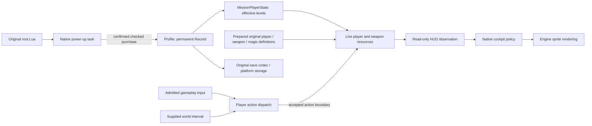
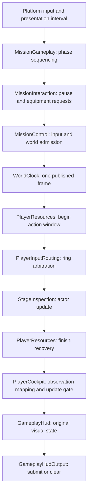

# Live player resources and gameplay presentation

October 25, 2026. The user accepted the HUD/live-resource work and confirmed the
hand repair works. The actual gameplay pause menu is not accepted and is next;
debug views will require explicit build parameters. Casting prerequisites remain.
Post-result power-up design and working-tree verification below are separate,
unaccepted work and are excluded from the accepted HUD implementation commit.
Based on accepted lighting
baseline `3e985bc`. This document extends [player progression](player-progression.md)
and [world timing](world-timing.md). It does not reopen accepted residual
angle-dependent speckling or coarse shadows.

## Responsibilities

The source separates permanent Record progression, mission-applied capabilities,
current player resources, each weapon's ammunition and cadence, native cockpit
presentation, and native pause/power-up tasks. The reconstruction must preserve
those authorities rather than turn the HUD or controller into a second save.

`Profile` remains the sole permanent progression authority. `MissionPlayerState`
retains intentional entry inheritance and mission-local restrictions; the explicit
development completed-game profile never changes the campaign Record or wallet.
Current health/magic and ammunition belong to live mission owners, not profile
bytes, clip clocks, HUD smoothing values or selected resident meshes.

Owners and capabilities are designed before their bodies. Current resources have
stable identity and cannot copy or move while action capabilities borrow them.
HUD presentation receives value snapshots and no mutation capability. Actions
receive only the resource operations required by their recovered admission and
publication boundaries. Resource definitions are immutable prepared values.
Pause and power-up navigation publish typed requests; they cannot alter clocks,
mission masks, render resources or arbitrary profile bytes.

The launch framework constructs services and stable owners, adapts sampled
platform fields and delegates game phases. It does not compute spell
availability, mask player commands, translate resource receipts or decide which
HUD lanes to publish. Neutral shoulder/face observations cross the platform
boundary; their game meaning is assigned after mission input admission.

`MissionGameplay` retains a checked begin/advance handoff; media can advance
between those phases without moving game policy into the host. It borrows the
existing resource, actor and control authorities. `MissionInteraction` delegates
physical replacement to StageInspection and selection to MissionPlayerState.
`PlayerInputRouting` owns the single ring lifecycle and typed missing-owner
result. `PlayerCockpit` owns HUD mapping and skips phase updates on a consumed
pause/resume frame, while drawing the retained HUD when resume replaces the
pause menu. Explicit hidden activation clears the previous sprite submission.
Inspection activation remains separate from script activation. The retained
mission opening now routes `_DispCockpit` through `MissionScriptRuntime` to this owner.
These responsibilities were missed by the first ownership
review; see [the repair evidence](../../research/engine/subsystems/gameplay-integration-boundaries.md).

## Source routes and slice limits

The original cockpit and pause/power-up screens are native tasks. Lua controls
their activation and visibility; it does not draw every menu. The original
`root.game()` runs power-up after campaign success, newspaper and result, then
saves. It does not expose a power-up purchase screen from pause or concept play.
The native power-up consumer and its real transactions can be verified directly
before the missing campaign-result producer is implemented. No mission success
or completion reward will be fabricated to reach it.

The original mission opening reuses these live actor, timing/control, scene and
presentation owners. Lua supplies initial placement; the former placement shim
has been removed. The original three-page instruction modal must be acknowledged
before `start()` finishes. Source-triggered NPC admission and serial mission
callbacks are implemented; completed gameplay remains separate. See
[world startup](world-and-simulation.md).

Player action resource semantics must follow source events. In particular,
reloading couples current ammunition to shared magic and publishes at accepted
weapon-message dispatch, independently of the reload animation's completion.
The final source trace defines capacities, costs, cadence and refill behavior;
animation duration is not a substitute for that trace.

## Acceptance

- Current/max health, magic and ammunition derive from original prepared content
  and effective progression. Weapon replacement retains the correct per-weapon
  resource state. No permanent profile changes arise from development entry.
- Supported fire/reload/action paths use authoritative admission and commit
  boundaries and supplied world timing. Pausing consumes neither world resource
  time nor repeated action events. Unsupported projectile, target, damage and
  spell-effect producers remain explicitly unavailable.
- The native HUD renders original assets and recovered layout, observes live
  resources, and responds to weapon/action changes. It is not a diagnostic text
  overlay or an independently writable model.
- Supported pause operations retain one user-pause authority, consume navigation
  edges and preserve live resources through costume changes/resume. Original
  checkpoint restart requires genuine world restoration and cannot claim success
  from a review-scene reset.
- Power-up selection, affordability, confirmation, debit/level publication and
  persistent save failure/retry use existing Profile transactions. Original
  campaign routing remains distinct from concept development policy.
- In-process tests cover meaningful admission, transaction, ownership and lifecycle
  boundaries. The full formatting/build/test/fatal-lint/content gate passes.
  Existing actual-content and native offscreen routes verify original resource
  interpretation and integrated HUD presentation. A subsequent announced user
  walkthrough checks visible HUD changes and physical controls.

After this slice and the remaining agreed pre-gameplay work, a final
architecture/file-organization slice precedes genuine mission implementation.
The user will discuss the layout at that point: game-directory decomposition,
engine versus game scene ownership, and lighting responsibilities across layers.
The directory structure will express responsibility and dependency boundaries;
this is not a decision to move engine scene into game, and no layout is selected
yet. No reorganization belongs to the current implementation.

Full mission entity creation, enemy damage, projectiles, spell effects, objectives,
checkpoint restoration and campaign result production follow that preparation.
Their absence must not be disguised by successful callbacks or expanded shims.

Future gameplay acceptance covers complete connected behaviors: input and source
action admission, real entity/outcome changes, animation, relevant particles and
visual effects, sound-event playback with spatial placement and lifetime, HUD
response, and applicable pause/timing/cleanup. Gunfire, impacts, reload, movement
foley, spells, enemies and environment sounds accompany their respective gameplay
owners. Reuse the existing audio backend and trace original event producers; do
not schedule guessed cues to decorate a partial action. A silent or invisible
action is not completed gameplay. Genuine missing producers remain explicit
dependencies. This defines the later gameplay slices; it does not expand the
current HUD and animation repair into full audio/effects implementation.

## Implemented source behavior

The player owns distinct current/recoverable/maximum health lanes, initialized
from the original 5000 health setting. Magic current, recoverable ceiling and
minimum ceiling start at WA0's recharge cost, 20; the HUD denominator remains
100. Completion unlocks capabilities but does not grant full magic. Waiting
recovers current magic only to its ceiling; pickups are a separate future world
producer. All four magazines/cooldowns remain resident through equipment and
costume changes. Source recharge consumes magic for the missing magazine fraction
and fills ammunition when its accepted message is delivered, before its animation
finishes. A frame receipt, rather than a guessed ammunition increase, drives the
HUD recharge presentation.

The coordinator publishes one world frame after pause/input admission. Resource
transactions execute during that frame; child recovery/cooldowns update once at
its end. HUD/ring presentation consumes the supplied world interval and skips
updates with world pause; supplying zero alone could still advance immediate
task phases. No HUD clock, resource setter or permanent profile mirror is
introduced. Resource and progression owners cannot copy or move while borrowed.

The native cockpit uses original sprite/font assets and recovered 1280×720
layout, including independent resource lanes/trails, weapon notices, cartridge
ejection, aiming reticle and magic-ring transitions. Lua's `_DispCockpit` controls
visibility in the original game; the actual drawing and controller selection
policies are native. The present inspection host displays the cockpit while
world-start Lua remains blocked; it does not claim that callback completed.
Source magic-ring input consumes B/A/X/Y and RS cancellation while leaving movement,
look and held fire with the player. LB/RB opens or pages the ring. Keyboard uses
brackets for its shoulder equivalents and Y/Q/E/R for up/right/down/left.
Holding one shoulder while pressing the other expires ring input. Input ownership
and visible art have separate lifetimes: timeout/chord expiry lets an opening or
page transition reach the original close path; RS withdraws the magic action's
keepalive. An immediate shoulder press can retain the prior page if the previous
keepalive is still present, rather than resetting opacity or selection.

The separate, unaccepted working-tree `PowerUpFlow` reconstructs native category/row/confirmation transactions through
`UpgradePurchaseControl`; it cannot load/save the profile, mutate mission state
or award points. `_ExecPowerUp`/`_WaitPowerUp` now have a queued native task.
Its dedicated `PowerUpSurface` uses original power-up, system, font and localization
resources. Category/upgrade art samples recovered endpoint tracks; the native
selector's bob and damped row displacement remain separate from bottom control
prompt fades. The original shared confirmation uses horizontal Yes/No; Back
selects No without closing. Entry and dialog admission gates consume frontend
presentation intervals, and a confirmed purchase occurs after dialog retirement.
Both the category and child prompt owners can remain visible during a transition.
Host input-family observations select controller A/B or the actual Mac Return/Esc
bindings using original glyph art; the surface cannot change input policy.
The flow requests global conceal after the source exit lead; FrontEnd retains
ownership of fade completion and native task retirement.
Confirmed purchases dirty the real Record. The original root's subsequent
`_ExecSaveGame` route also involves world/checkpoint tasks that are not implemented;
this slice does not claim complete campaign result-to-save routing. Existing
Profile save failure/retry and exact Record round trips remain the persistence
boundary. No purchase screen is added to pause or concept play.

Research: [resources](../../research/engine/subsystems/player-combat-resources.md),
[cockpit and ring](../../research/engine/subsystems/gameplay-hud.md), and
[ammunition presentation](../../research/engine/subsystems/ammunition-hud.md),
[independent review](../../research/engine/subsystems/gameplay-hud-independent-review.md),
and [integration verification](../../research/engine/subsystems/gameplay-hud-verification.md).

## Casting dependency requiring a scope decision

A selected ring icon is a typed action request, not a successful cast. Original
Ancient Wall validates placement and allocates a real wall owner before debit
and cast animation; Sacrifice requires an ally. Those are the only spells
currently affordable at the source fresh 20 magic ceiling. Other spells require
pickup-driven ceiling growth and their own target/effect owners. Existing animation
review synthesizes those observations for inspection and cannot become gameplay
admission. The current runtime reports this missing owner and does not debit,
play a successful cast, or fabricate completion. The requested live cast-animation
acceptance therefore remains unresolved until its prerequisite is explicitly
included or that boundary is accepted as pending. Particles themselves do not
own gameplay authority and need not be present for future real logical effects.

## Established ownership reference

The concrete Unreal reference remains revision
`f45729c0b6f097038e72b52d366a62baeca3275b`. Inspection of
`Engine/Source/Runtime/Engine/Private/PlayerController.cpp`,
`APlayerController::SetPause` and `IsPaused`, confirms a controller requests
changes from the authoritative game/world owner rather than retaining another
pause flag. `Engine/Source/Runtime/Engine/Classes/GameFramework/SaveGame.h`,
`ULocalPlayerSaveGame`, separates live player identity from saved-data lifecycle
and success/failure. This slice preserves our existing MissionControl and
Profile/storage boundaries following that decomposition. Original Bullet Witch
routines determine resource arithmetic, HUD animation and purchase timing;
no Unreal source, pause networking or serialization format is copied.
