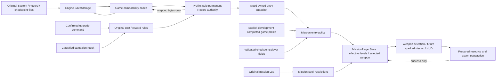

# Player progression and mission state

October 24, 2026. This drill-in decomposes recovered Bullet Witch state owners.
It is not a generic world framework. Read beside [world and simulation](world-and-simulation.md),
[runtime ownership](runtime-model.md) and [file mapping](file-mapping.md).

## Original owners and their reconstructed boundaries

| Recovered responsibility | Implementation owner | Lifetime and authority |
| --- | --- | --- |
| Persistent Record service: stat/weapon/magic levels, spendable points, book flags | `Profile` with typed `Progression` observations | Session lifetime; sole permanent authority is its retained Record payload |
| Power-up task's cost, affordability and level operations | `progression` rules and `Profile::purchase` | A confirmed command changes the permanent owner atomically; UI is a later consumer |
| Result task's ranked point award | `mission_reward_points` and `Profile::award_result` | Original result publication calls once; no invented receipt ledger or combat score producer |
| Mission checkpoint/player fields and progression application | `MissionPlayerState` and `CheckpointPlayer` | Mission lifetime; effective capabilities and selected weapon, separate from permanent progression |
| Mission script/context spell restrictions | `MissionPlayerState` | Mission-local masks; never rewrite learned levels |
| Save task buffers and fixed compatibility layout | `progression_save` plus existing `Profile` file orchestration | Decode a candidate, validate, publish; preserve unrelated bytes |
| File replacement and target directory selection | Existing engine `SaveStorage` and native target | Byte I/O only; no game progression knowledge |

These names express responsibility, not recovered Cavia class names. Original
anchors, tables and instructions are in [progression rules](../../research/engine/subsystems/player-progression-rules.md)
and [concept entry](../../research/engine/subsystems/concept-progression-entry.md).
The [pinned Unreal comparison](../../research/engine/subsystems/progression-reference-design.md)
records the inspected source and the narrow publication/storage design adopted
where original source-level ownership declarations are unavailable.

Arrows below show data publication, not update timing:



`Progression` and `PlayerLevels` are owned value snapshots, not mutable references
into `Profile`. Every permanent mutation validates a candidate before encoding
known fields back into the one Record owner. There is no independently mutable
cached progression object. Mission-local copies are intentional: the original
keeps checkpoint levels and temporary restrictions distinct from the Record.

## Entry policy

Fresh profiles retain the recovered defaults: stat levels `1,1`, weapon levels
`1,0,0,0`, spell levels `0,1,0,0,1,0,0,0,0`, zero spendable points. A new mission
inherits the current profile, not an unconditional fresh-game reset. Creating a
new profile is the operation that establishes fresh defaults.

Campaign checkpoint inspection reads the mission section and merges each level
with the larger permanent Record level. Selection is retained if available and
otherwise repaired in original cyclic order. A completely empty weapon set gets
the original runtime-only first-weapon fallback; permanent Record remains intact.
The three story spells are boolean at runtime even though source byte storage is
retained. Checkpoint health/magic values are decoded but **not restored to live
combat resources** in this slice; those owners are not implemented yet. Full
world checkpoint writing/restoration remains unavailable.

Concept entry inherits current permanent progression and discards campaign
checkpoint state. The original completion gate relies on external achievement
13; Record alone does not establish that history. Original concept routing grants
neither every optional purchase nor maximum upgrades. Completion and maximum
progression are different facts.

The user-authorized early concept access uses an explicit **development completed-game
profile** by default in this development host. It has all weapons and spells at
level one, stat levels one and zero spendable points. This is an authored capability
baseline, not a recovered guarantee about every completed game. It replaces only
the mission-entry snapshot; it never edits the real profile, achievement history,
checkpoint file or wallet. `./run --concept-profile saved` instead uses exactly
the loaded permanent progression. A missing/invalid save does not secretly
select another policy; normal profile-load errors retain their existing handling.

Both sources enter the same mission state and restrictions pipeline. The origin
is retained in `ProgressionOrigin` and logged once at launch. Real completion
proof and achievement service integration remain separate from this intentional
development access policy.

## Purchases and persistence

The source has two stat, four weapon and six purchasable spell rows; the final
three spells are story grants. A purchase resolves the source cost at the current
level, checks the wallet, then deducts and increments together. A first-level
spell purchase sets the original tutorial/book flag. Capped, unpurchasable and
unaffordable commands preserve state. All-purchasable-upgrades completion is a
query; this slice does not fabricate an achievement provider.

Classified campaign results use the original rank/difficulty reward table and
cap the wallet at 99,999. Concept and stage replay results do not earn spendable
points. This interface consumes the original result task's already classified
rank; it does not invent raw combat score calculation. Its caller must publish
once at the original result transition. The incomplete mission loop does not
call it speculatively.

`Profile::save` persists only dirty System/Record files through existing storage.
A failed write retains dirty state for retry. Files remain individually atomic,
not a new multi-file transaction. Unknown bytes and checkpoint files are preserved.
The power-up UI, actual result lifecycle and story-grant producer bindings belong
to subsequent mission/menu work; rules and persistence are callable and tested now.

## Current gameplay consumer

The host constructs one `MissionPlayerState` from the immutable gameplay request
before preparing the player. Initial weapon preparation and normal weapon cycling
consume its selected/acquired state. Paused weapon previews use the same availability.
The resident model and animation action remain prepared views: they do not decide
what the player owns. Only a successful resource/action transaction commits the
new authoritative selection; rejected requests retain it. A boundary check catches
divergence between the selected weapon and resident representation.

Spell capability means learned and not disabled by mission/context masks. It
**does not mean castable**: current magic cost, target validity and action-state
admission remain distinct future consumers. Source mask bits permute Thunder and
Tornado relative to the Record array. `_SetMagicMask` is bound to mission state,
but the unchanged `start()` remains behind genuine world-start prerequisites.
One Shot Kill's mask is not hardcoded or applied early to manufacture startup
completion. Its later Lua publication is the authority.

## Safety and verification boundaries

The original file reader accepts fixed-size bytes with little semantic validation.
This reconstruction rejects out-of-range level/wallet fields, invalid selectors,
nonfinite checkpoint resources and invalid mask bits before publication. These
are explicit safety restrictions, not claims that the original rejects them.
Previously accepted state remains unchanged on load failure.

In-process contracts cover original defaults/costs/rewards, purchase atomicity,
opaque-byte preservation, save/reload and write-failure retry, checkpoint merge,
concept checkpoint exclusion, explicit development origin, weapon repair and
permuted spell masks. These tests alone do not establish HUD, spell casting,
combat resources, full save restoration or completed mission behavior.

The slice passes `python3 scripts/check.py all`: pinned formatting, the complete
host build, all six CTest targets, fatal clang-tidy and repository content policy.
A final separate formatting check also passes. These checks include the seven
focused progression cases inside the existing profile target; no integration
scenario was added.


The existing original-root corpus also passes (exit zero):

```sh
build/host-debug/startup-corpus "$GAME_DIRECTORY"
```

Here `GAME_DIRECTORY` is the purchased Steam installation, as in the corpus
instructions. This run exercises the original Lua/root and asset corpus,
immutable progression handoff, acquired initial weapon preparation, saved versus
development concept policy, and the native profile storage round trip. Rendering
and audio observations use the existing controlled fixtures; this is not a native
GPU, controller, listening or gameplay-parity claim.

The complete run took approximately 36 minutes on the current development Mac
(process start to final log write). Most work was the pre-existing frame-by-frame
traversal, weapon, melee and action-exit acceptance route with the controlled
world-draw fixture. This duration is a verification observation, not an in-game
performance baseline. The full route completed with zero live tracked CPU memory
after teardown. Logs remain under ignored
`research/evidence/reconstruction/progression/`.

The first corpus attempt exposed stale static-environment expectations from
before the accepted AREA publication change. The fixture now expects the
source-backed cave ambient/exposure/gamma values, retaining the original sky
expectation. Production lighting was not changed; the original-source witness
and fixture diagnosis are recorded in the
[brightness audit](../../research/engine/subsystems/character-material-brightness-audit.md).
