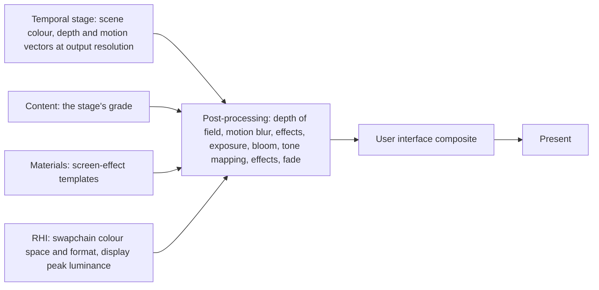
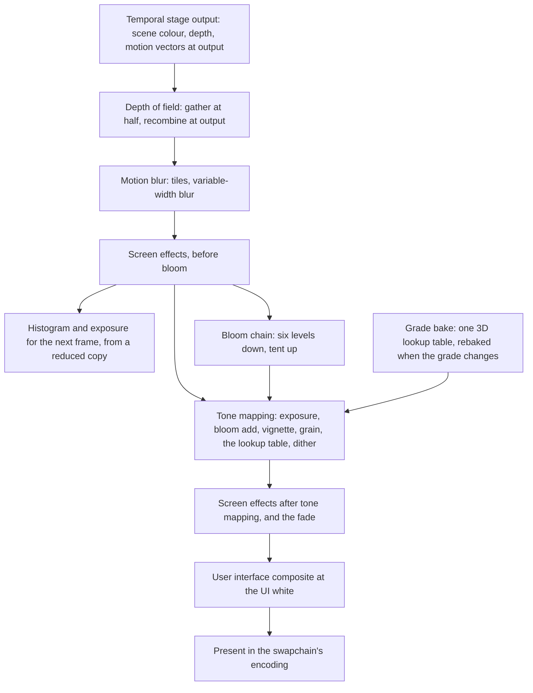
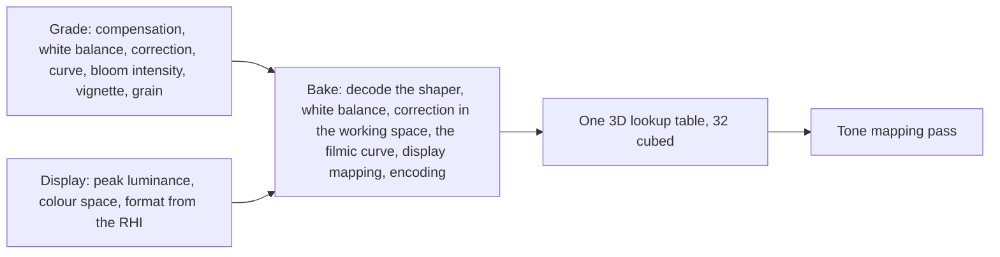

# Post-processing

What happens to the image after the temporal stage: a physical camera's
exposure, depth of field, motion blur, bloom, the grade and the tone curve,
the output transform for the display, and the authored screen effects, all
at output resolution. Scene colour stays linear and photometric through all
of it; the one place it becomes display colour is the tone mapping pass,
and what differs between an SDR and an HDR display is the display side of
that pass's lookup table, its shaper and its last step, the mapping and
encoding, and after the pass the white the interface is composited at.

Exposure is the camera's EV100. The grade is a stage's authored look: a
small set of parameters baked into one lookup table. A screen effect is a
full-screen template the world enables.

## Position

The tail of the [scene renderer](scene-renderer.md)'s frame, from the
temporal stage's output to present. Fed by [content](content.md), which cooks each
stage's grade, by [materials](materials.md), whose screen-effect templates
are the shaders of the two effect slots, and by the [RHI](rhi.md), which
reports the swapchain's colour space, format and the display's peak
luminance. The world sets the camera's focus, f-stop, sensor width and
shutter, the camera cut flag and the active screen effects.
Above the [render graph](render-graph.md).

## Invariants

1. Scene colour is linear light in photometric units, stored pre-multiplied
   by the previous frame's exposure so a 16-bit float holds its range. The
   factor is applied by renderer code in every pass that writes light into
   scene colour or any light target of the frame, never by a template.
   Every reader divides it out, and every buffer that holds light across
   frames is stored with the factor of the frame that wrote it and reused
   by the ratio of the two factors. The factor lives in a GPU texture the
   passes read, and every temporal implementation takes it as that texture,
   so no reader ever holds a CPU copy. Exposure changes the image once, at
   tone mapping; no light is scaled for the display.
2. Exposure is EV100 metered by a histogram of log luminance over the frame
   after the temporal stage at reduced resolution, between the 10th and 90th
   percentiles, driven toward middle grey, adapting faster up than down,
   offset by the grade's exposure compensation. The value measured this
   frame is the factor of the next.
3. Depth of field is a physical camera: circle of confusion from the focus
   distance, the f-stop and the sensor width, with the focal length from the
   field of view. It runs after the temporal stage at output resolution,
   gathering at half of it in a foreground and a background layer, each
   scatter-as-gather over a tile maximum, with a bilateral prefilter and a
   median, and recombines by a circular filter. It runs as nothing until
   the world sets a focus distance. The sensor width is a camera value the
   world sets with the focus and the f-stop.
4. Motion blur reads the motion vectors and depth the temporal stage
   resampled to output resolution: a tile
   maximum, a neighbourhood maximum, and a variable-width blur along the
   tile velocity weighted by depth and spread, with the background mirrored
   under the foreground. The velocity is scaled by a shutter fraction of a
   target frame time and capped at a fraction of the width. It is skipped on
   a camera cut, and a setting leaves it out.
5. Blended pixels write no depth and no motion vector, so depth of field
   and motion blur treat a blended pixel by the opaque surface behind it.
6. Bloom takes the unthresholded scene colour through six levels of a
   downsample chain with a thirteen-fetch filter, averages fireflies on the
   first level, and upsamples progressively with a tent filter. It is added
   at tone mapping, scaled by exposure and the grade's intensity. There is
   no threshold, no dirt mask and no lens flare.
7. The grade is content: per stage, exposure compensation, white balance,
   colour correction, the curve's slope, toe, shoulder, black clip and white
   clip, bloom intensity, vignette and grain. It is baked into one 3D lookup
   table in a wide working space, shaped by a log curve for an SDR display
   and by PQ for an HDR one. A grade that changes in a frame is rebaked that
   frame.
8. The lookup table's last step is the display mapping, and with the
   shaper and the interface white it is what differs between displays: the
   curve's output is mapped to the
   display's peak luminance and encoded as the swapchain reports, sRGB, PQ
   with Rec.2020 primaries, or scRGB linear. The RHI reports and presents
   and converts nothing; the host creates the swapchain with the colour
   space and format the setting asks for, and the RHI reports what it got.
   An SDR display is assumed to show white at 200 nits. A user setting
   overrides the detected transfer function.
9. The tone mapping pass does, in order: exposure, bloom add, vignette,
   grain, the lookup table, and a triangular dither sized to the output's
   quantization. Nothing else is in it.
10. The user interface is drawn offscreen in sRGB and composited after tone
    mapping with premultiplied alpha at a white of 203 nits on an HDR
    display, and as is on an SDR one.
11. A screen effect is a full-screen template at one of two slots: before
    bloom, on scene colour in photometric units, or after tone mapping, on
    display colour. A screen effect is a material of such a template, with
    its parameter values and textures, and the world enables one with a
    duration. A fade is an after-tone-mapping effect that multiplies toward
    black or white.
12. Every step writes at output resolution; the bloom chain and the depth
    of field gather reduce internally by the fractions stated here.
13. The original's per-stage tone, luminance and correction values are
    recorded by name beside the stage and derive nothing. The stage's grade
    is authored content, and the converter writes a default grade with the
    record.

## The chain

Each step writes a fresh frame-only texture that becomes scene colour, or
display colour, for the step after it, as the render graph requires of a
pass that reads and writes the same image.

| Step | Reads | Writes | Resolution |
|---|---|---|---|
| Depth of field | scene colour, the resampled depth, the camera's focus, f-stop, sensor width | scene colour | output, gathering at half of it |
| Motion blur | scene colour, the resampled depth and motion vectors, the shutter fraction, the camera cut flag | scene colour | output |
| Screen effects, before bloom | scene colour, the effect's parameters | scene colour | output |
| Histogram and exposure | a reduced copy of scene colour, last frame's exposure, the grade's compensation | the exposure for the next frame | reduced |
| Bloom chain | scene colour | six levels, summed on the way up | half to a sixty-fourth |
| Grade bake | the grade, the swapchain's encoding, the display's peak luminance | the lookup table | 32 cubed |
| Tone mapping | scene colour, bloom, exposure, the lookup table, vignette and grain parameters | display colour | output |
| Screen effects after tone mapping, fade | display colour, the effect's parameters | display colour | output |
| User interface composite | display colour, the interface's offscreen image | display colour | output |

## Exposure

| Part | Rule |
|---|---|
| Unit | EV100: aperture, shutter and sensitivity folded into one value, since lights are photometric |
| Meter | a 64-bucket histogram of log luminance of a reduced copy of scene colour after the temporal stage |
| Window | the 10th to 90th percentiles, the rest discarded |
| Target | the windowed average brought to middle grey, then the grade's compensation |
| Adaptation | exponential toward the target, faster brightening than darkening, with a switch to linear for large steps |
| Lag | the value computed this frame pre-multiplies the next frame's light |
| Readers | tone mapping, the histogram, the temporal stage, the reflections trace of the previous frame's scene colour, the fog history, each by the ratio of its frame's factor to the writer's |

## The grade and the lookup table

| Part | Rule |
|---|---|
| Shaper | log for an SDR display, PQ for an HDR one, so the table's samples sit where the eye needs them |
| Working space | a wide space that holds every colour the curve can produce without clipping hue |
| Curve | the filmic: slope, toe, shoulder, black clip, white clip, from the grade |
| Display mapping | the curve's output scaled to the display's peak luminance, the last step |
| Encoding | sRGB, PQ with Rec.2020 primaries, or scRGB linear, as the swapchain reports |
| Rebake | when any grade parameter or the display changes, one compute dispatch |

## Content the chain reads

| Data | Form | Written by |
|---|---|---|
| Grade | per stage, the parameters of invariant 7 | the converter, a default per stage, and authored grades in the published layer |
| Original stage record | the stage's tone, luminance and correction values by name | the converter, beside the grade |
| Screen-effect template | a full-screen template with its slot and parameter block | material templates |
| Camera | focus distance, f-stop, sensor width, shutter fraction, the camera cut flag | the world, each frame |

## Components and ownership

| Component | Lives in | Consumed by |
|---|---|---|
| Exposure: histogram, adaptation, the factor and its ratio rule | `src/engine/rendering/postprocess` | every pass that writes or reuses light |
| Depth of field, motion blur, bloom chain | `src/engine/rendering/postprocess` | render graph |
| Grade bake and the lookup table | `src/engine/rendering/postprocess` | tone mapping |
| Tone mapping, dither, output encoding | `src/engine/rendering/postprocess` | user interface composite |
| Screen-effect slots | `src/engine/rendering/postprocess` | the world |
| Grade payload reader | `src/engine/rendering/postprocess` | content loading |
| Swapchain colour space, format and display peak report | `src/engine/rendering/rhi` | the grade bake |

## Boundaries

Above: the world, which sets the camera's focus, f-stop, sensor width and shutter and enables
screen effects; the user interface, which draws itself offscreen and is
composited here. Beside: the temporal stage, which hands over scene colour
at output resolution and has its own document; the lighting system and the passes
before it, which write light pre-exposed by this document's rule; content,
which delivers grades. Below: the render graph and the RHI, which reports
the display and presents. How the interface is drawn, how video is decoded,
and how a stage's grade is authored are outside this document.
