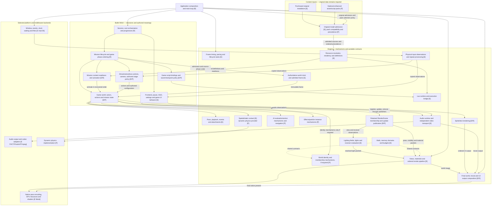
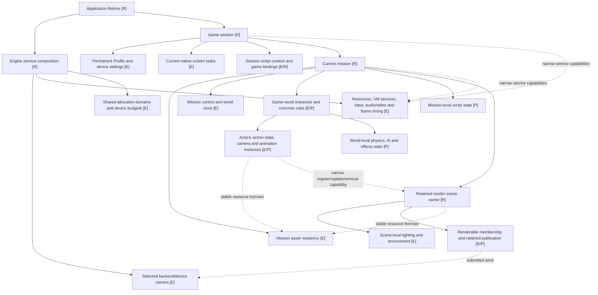
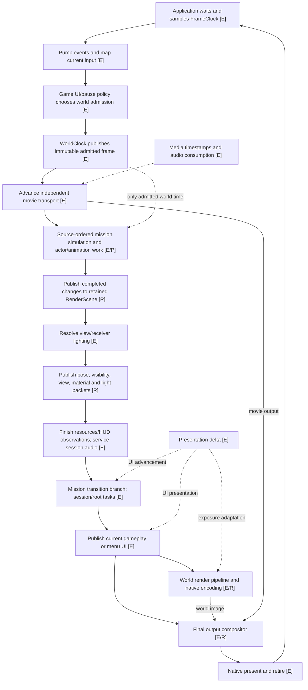

# Proposed architecture boundaries

**Accepted target boundaries · October 26, 2026. Execution underway.**
The [reorganization plan](reorganization-plan.md) fixes destination groups and four
implementation slices. Slice 1 is accepted (`fd773fb`), and slice 2 is accepted after native review.
These target diagrams do not claim every proposed repair already exists.
This is the complete proposed system view, complementing the
[current implementation](current-ownership.md). The proposal retains recovered
Bullet Witch behavior and existing portable contracts/native implementations.
Boxes name responsibilities, not required new classes, libraries or threads.

Legend throughout: **E** = existing mechanism retained; **R** = proposed
reorganization/extraction of existing responsibilities; **P** = planned runtime
capability. An E box does not claim complete game coverage.

## Proposed system boundaries

Arrows mean dependency or publication as labelled. Shared engine mechanisms know
contracts/observations; game policy supplies concrete rules. Lighting is named
explicitly, even if its files remain under the engine scene family.

The diagram groups implementation scope without requiring all planned systems
before reorganizing existing code. In particular, frame timing and current
collision/animation/lighting work survive independently of the future entity
registry. AI and navigation remain planned mechanisms; enemy/boss decisions are
game code. A lifecycle task scheduler does not imply a job pool. No ECS, new
fixed-step simulation or render/worker thread is proposed here. The application
composes the renderer and game session; rendering consumes engine contracts and
packets and must not depend on concrete game classes.

## Proposed lifetime and authority

Solid arrows mean **owns lifetime**; dashed arrows mean **borrows/uses**. The
engine owns shared services, while a mission owns their world-local instances.
These are different objects, not double ownership of one service. Engine VM
services provide execution mechanisms; mutable script contexts and game bindings
belong to their session or mission, not to a shared global script world.

Session owns permanent progression; mission state does not overwrite it through
render or developer interfaces. Game settings keep narrow System/Record save
capabilities. Presentation/actor borrowers retire before mission assets; backend
completion gates native resource reuse. Current synchronous GPU completion is
retained until a separate asynchronous retirement design is approved.

## Proposed frame and data flow

This diagram shows explicit retained-scene publication while preserving current
source ordering constraints. The clarified render-scene publication phase is **R**, not an existing aggregate.
It is a phase boundary, not a promise of a full-world snapshot copy. The grouped
simulation box follows the recovered schedule; AI, physics and animation phase
dependencies must be recovered as those systems land, not inferred from this
diagram. Render-scene preparation consumes completed current-frame observations. Actors or
components may publish changes through narrow capabilities; no central copy is
required.

Paused worlds continue UI/device/media work without simulation advancement.
Loading/reentry branches preserve their existing presentation-only pump and
rebasing. Movie/audio consumption is not the simulation clock. The current
100 ms presentation cap, target 60 Hz pacing and actor-local subdivisions remain
unchanged; target rate is not a fixed physics timestep.

## Current owners to proposed boundaries

| Current owner | Proposed responsibility | Review recommendation |
| --- | --- | --- |
| `StartupApplication` | Application composition/main loop, selecting owners and calling phases | Keep one composition boundary; name it for the complete application, not only startup. Engine timing owns its algorithm; game owners choose phase behavior. |
| `StartupSession` / root driver | Game session and native-task orchestration | Retain original Lua ordering and shared frontend state. Do not turn it into an engine service locator. |
| `StageInspection` | Mission actor/camera simulation, scene presentation, diagnostics split apart | Separate game simulation from retained render-scene lifetime now; keep entity-registry growth a separate planned capability. |
| `PlayerActor` / controller publication | Game motion/action state plus completed pose observations | Retain actor/component publishers through narrow scene capabilities; make registration, phase admission and retirement explicit. Preserve source transforms and borrowing. |
| `SceneLighting` / stage environment adapter | Engine lighting versus game-authored channel interpretation | Keep one named lighting subsystem with scene-local state; do not move sampling into actors or replace its recovered equations. |
| `WorldRenderer` / `WorldPostprocess` | Render-pipeline contracts and native GPU implementation | Expose pass/data boundaries; retain native encoding and shaders. No generic frame graph required. |
| `StartupHost` | Native window/input/output composition and presentation | Keep device mechanics here; do not migrate game scene/action/menu policy into the host. |
| `GameAudio`, Profile, shared Options | Game admission/cue/persistence policy using engine capabilities | Preserve accepted lifetime and save authority; directory cleanup must not create duplicate runtimes or settings owners. |

## Settled design and remaining implementation contracts

The [reorganization plan](reorganization-plan.md) settles peer engine source
families, grouped game folders, retained RenderScene publication capabilities,
identifiable scene lighting, sibling world/movie/UI output composition, and
resource residency versus game-owned activation. The required original install
and optional future selected packs share an ordered resolution path; packs cannot
bypass installation admission. This pass does not implement that future pack path.

Exact C++ publication handles, borrow durations and removal/retirement checks are
header-first implementation contracts within these boundaries, not another layout
choice. Preserve synchronous completion; no ECS, fixed-step loop or asynchronous
renderer is implied. Concrete gameplay and AI rules remain game-side unless a
shared mechanism is supported by actual source contracts or reuse.

The [comparison and pinned primary references](reorganization-plan.md#reference-hierarchy-and-comparison-decisions)
use Bullet Witch for behavior, Doom 3 for the integrated game/engine structure,
Unreal for concrete scene/lifetime examples, and Lyra for readiness. They do not
prescribe copying those engines' frameworks.
