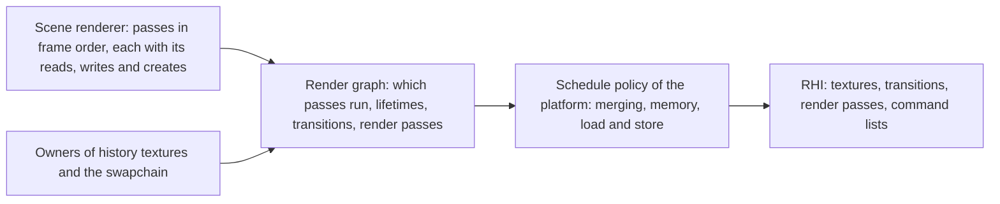
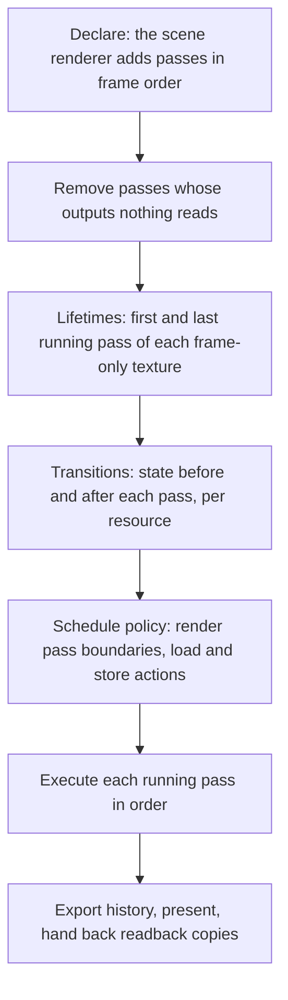
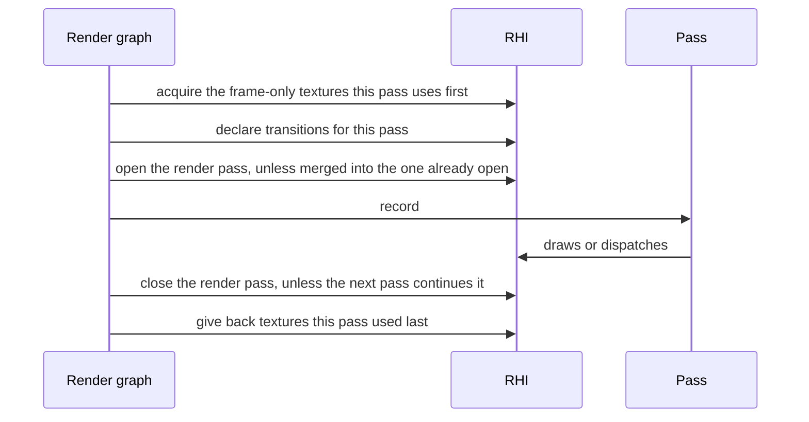

# Render graph

How a frame's passes become GPU work. The [scene renderer](scene-renderer.md)
says which passes a frame has; each pass says what it reads, writes and
creates. From that the graph works out which passes run, when each
frame-only texture exists, what state every resource is in before each pass,
where API render passes begin and end, and what is cleared, loaded, stored
or discarded at those boundaries.

A frame-only resource is a texture or a buffer no later frame reads: a
render target, a draw record buffer, a delta buffer, a strip buffer, a tile
list. What this document says of frame-only textures holds for frame-only
buffers. A platform is one of the graphics APIs the [RHI](rhi.md) has a
backend for.

## Position

Below the scene renderer, which declares passes and never names a resource
state or a load action. Above the RHI, which requires both. The graph is the
caller that declares state transitions to the RHI for every resource a pass
uses.

## Scope by game need

| In the graph | Out |
|---|---|
| passes declared every frame and run in declared order | reordering passes |
| removal of passes whose outputs nothing reads | compute on a second queue |
| lifetimes and reuse of frame-only textures | recording passes on several threads |
| state transitions derived from declared access | |
| render pass boundaries, load and store actions | |
| imported and exported resources: history, swapchain, readback | |

## Invariants

1. A pass declares every resource it touches and how: sampled, written as an
   attachment, depth tested without writing, written from compute, read as
   draw or dispatch arguments, copied from or to. A pass cannot touch what
   it did not declare, and no pass reads a texture it writes in the same
   pass: a step that needs both writes a frame-only copy and a second pass
   merges it.
2. The graph is declared again every frame. Passes run in the order they
   were declared. The graph never reorders them.
3. An output leaves the frame in one of three ways: it is presented, it is
   exported as history for a later frame, or it is read back to the CPU. Each
   is marked where the output is declared.
4. A pass runs only if one of its outputs is read by a pass that runs or
   leaves the frame. A pass that fails that test does not run, and neither
   does a pass that only fed it. Which passes ran is reported.
5. A frame-only texture exists from the first pass that runs and uses it to
   the last. The graph asks the RHI for it at first use and gives it back
   after last use. Its contents at first use are undefined, and no pass may
   rely on them.
6. Two frame-only textures whose lifetimes do not overlap may share storage.
   How they share it is the RHI backend's choice; the graph supplies the
   lifetimes.
7. An imported resource is never reused for anything else. It enters the
   frame in the state its owner states and leaves in the state its owner
   asks for.
8. State transitions come from declared access and nothing else. Passes that
   read a resource one after another share one state and one transition.
   Transitions are issued together at the start of the pass that needs them.
9. No pass writes a load or store action. A pass states a clear value or
   that it overwrites the whole texture; the graph derives the rest from
   first use and last use.
10. The schedule policy belongs to the platform. It decides which adjacent
    passes become one API render pass, which textures take no memory because
    they never leave their pass, and how load and store actions are spent. It
    never adds, removes or reorders a pass, and it never changes the image.
11. Reading a frame-only texture that no running pass wrote is a named error
    when the graph is compiled.

## A frame through the graph

## Load and store actions

| Situation of a texture at a pass | Action |
|---|---|
| First use, the pass states a clear value | clear |
| First use, the pass overwrites every pixel | discard on load |
| The pass adds to contents written earlier | load |
| A later running pass reads it, or it leaves the frame | store |
| Nothing later reads it | discard on store |
| Written and read inside one API render pass and never stored | no memory, where the platform's policy and the RHI allow it |

A depth texture used only to test within the passes that share it follows
the last two rows like any other texture.

## Imported and exported resources

| Resource | Owner | Enters | Leaves |
|---|---|---|---|
| Swapchain texture | RHI swapchain | acquired for the frame | presented |
| History texture | the system that reads it next frame | last frame's export | exported again, or dropped |
| Readback copy | the caller that asked for it | created by the pass that fills it | handed to the RHI's readback path |
| Persistent texture or buffer | its system | in the state the owner states | in the state the owner asks for |

## Schedule policy

One declaration, one schedule per platform. The policy reads the compiled
frame and the capabilities the RHI backend reports, and answers three
questions the APIs answer differently.

| Question | What varies by platform |
|---|---|
| Which adjacent passes share one API render pass | whether an attachment written earlier in the pass can be read later in it, and what work between draws ends a pass |
| Which textures take no memory | whether the API has attachments that live only inside a pass |
| How load and store actions are spent | what a load, a store and a clear each cost on that GPU family |

## Components and ownership

| Component | Lives in | Consumed by |
|---|---|---|
| Pass and resource declarations, access kinds, the marks for outputs that leave the frame | `src/engine/rendering/graph/public/bw/rendering/graph` | scene renderer, every pass |
| Compile: pass removal, lifetimes, transitions, the load and store table | `src/engine/rendering/graph` | execute |
| Execute: acquire, transition, begin, record, end, give back | `src/engine/rendering/graph` | RHI |
| Schedule policy, one per RHI backend | `src/engine/rendering/graph` | compile |
| Storage for frame-only textures | RHI backends | graph execute |

## Boundaries

Above: the scene renderer, which decides what passes a frame has and what
each computes. Below: the RHI, which owns textures, their memory, command
recording and the validation of every declared transition. Beside: the
owners of history textures and the swapchain, which hand resources in and
take them back. What a pass draws, and whether a pass exists at all on a
given platform, are outside the graph.
