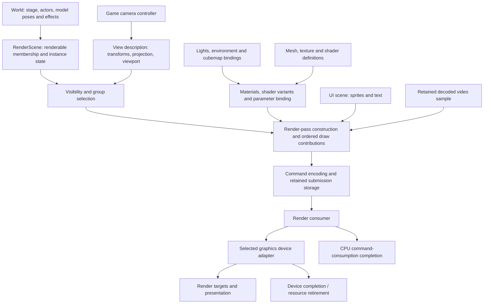

# Rendering and presentation architecture

**Target architecture · working baseline · October 22, 2026.**
[Engine architecture](logical-overview.md) · [World model](world-and-simulation.md).

The renderer transforms scene observations and presentation requests into ordered
device work. It owns view/visibility processing, material and shader binding,
render-pass construction, command storage and device-facing lifetime. Game code
owns camera behavior and screen choices; a graphics adapter owns native API calls.
The distinction permits a platform port without replacing gameplay or losing
original draw semantics in an overly small device abstraction.

## Rendering structure

Arrows are data dependencies. Passes determine actual ordering; the drawing does
not claim UI/video always run last or that a particular lighting/postprocess
sequence has been recovered. CPU consumption and device retirement are separate
completion outputs. Exact camera, full visibility, lighting and pass behavior
remain unresolved within the assigned units below.

## Units and contracts

| Unit | Owns | Input → output | Boundary |
|---|---|---|---|
| RenderScene | Renderable registrations and renderer-facing instance state | Stage/model/effect updates → visible-candidate membership and stable draw inputs | Does not own gameplay actors or advance their AI/animation |
| View processing | View/projection/viewport representation and derived camera data | Camera request → view consumed by culling and shader binding | Game camera controller owns follow/aim/cutscene policy |
| Visibility | View-specific selection, masks/groups and required ordering information | Bounds/volumes/groups + view → eligible contributions | Does not change simulation eligibility; exact original rules must be recovered |
| Materials/shaders | Definition/instance distinction, variant selection and parameter interpretation | Material/texture/environment/pose inputs → complete required shader/state bindings | Native shader objects stay in the device implementation |
| Pass construction | Render-target usage, pass dependencies and contribution order | Eligible contributions + environment/output requirements → ordered pass work | No guessed forward/deferred/PBR pipeline or automatic draw reordering |
| Command encoding | Typed command families, storage and input retention | Pass work → submit-ready command packet | Includes model, constants, particles, sprites/text and video families |
| Render consumer | Consumption order and execution of submitted packet | Commands → device operations and CPU completion | Does not read a changing world or resolve arbitrary game names |
| Device adapter | Native resources, pipeline objects, uploads, synchronization and presentation | Device contract → API work/results | Implements required semantics; cannot invent game/material meaning |

These units need not each be a library or virtual interface. For example,
visibility helpers can be internal to scene preparation. The boundary matters
because changes to camera policy, shader equations, scene membership and API
resource lifetime have different callers and correctness criteria.

## Scene extraction and cameras

World/system producers publish renderable instance changes at designated phases.
A renderable includes stable identity, mesh/group selection, world transform,
required pose/deformation data, material overrides, bounds and its resource uses.
Stage geometry can be represented without an actor dispatcher. Effects can submit
model or sprite/triangle contributions through the same lifetime boundary.

RenderScene is a projection of authoritative state. Synchronous preparation can
borrow a stable pose; asynchronous consumption requires a copy or retained version
that will not be mutated. This is a per-submission contract, not a requirement to
copy the whole world every frame. Deregistration prevents new extraction, while
old packets retain what they already use.

A view description records camera transforms, projection, viewport and the
coordinate/depth conventions consumed downstream. The game camera controller
produces it from gameplay state. Camera equations, clipping conventions and the
complete interaction with stage visibility remain open. Their ownership is
explicit so these questions cannot disappear into either game update or an API
adapter. No modern camera smoothing or interpolation is assumed.

## Mesh, material, lighting and pass semantics

The recovered model path constructs commands with model/mesh references and
copied state. Execution checks group/readiness/deformation gates, then interprets
nested CNKH/DGRP/DVOL/declaration/stream/index/draw and related state records.
This provides a concrete translation boundary: preserve record meaning in typed
render operations, including inherited state, masks and alternate draw paths.
Container parsing does not issue device calls.

Materials retain shader-variant identity, texture roles, constant inputs and
instance overrides. The native registry maps 766 names to 490 cached shader
bytecodes; that closes registry selection, not the complete meaning of constants,
lighting, skinning or environment inputs. Texture roles, matrix/palette layout,
precision and blend/depth/cull state require faithful contracts before translation.
Do not collapse those definitions into a generic PBR material and call it a port.

Lighting/environment state has a renderer-owned representation with world/game
producers. Known stage cubemap requests belong here as bindings. Their presence
does not establish a probe-selection algorithm, deferred lighting, shadow method,
light list format or complete postprocess graph. The architecture assigns those
questions to material/pass preparation and keeps them visible in review.

Pass construction explicitly names attachments, required inputs/outputs, resource
uses and ordering. A future implementation may represent those dependencies with
simple pass records; the design does not mandate a general render-graph framework.
Original state inheritance and transparent/effect/UI ordering constrain batching.
Optimizations must demonstrate equivalent results before reordering contributions.

## Submission and device resources

The producer seals a packet with command storage and all referenced immutable or
versioned inputs. The consumer executes its ordered commands, reports CPU
consumption and handles device submission. Completion sufficient for CPU arena
reuse is not necessarily sufficient for destroying textures/buffers used by an
asynchronous backend. The device contract supplies the latter retirement evidence.

The recovered PC path already has a render-list arena, a producer completion wait,
a separate command worker and PresentEx. Preserve its observable task/presentation
relationship when selecting a backend. Ring sizing, buffering count and pacing
are not fixed by a generic “double buffering” assumption. Explicit device resource
uses also govern video samples and particle geometry, not just model buffers.

Resource handlers may request device object creation through the renderer's
resource interface. They retain the originating record and release association;
the generic resource service does not know a D3D/Metal object. CPU definition
availability, upload submission, renderability and release completion remain
separate states where the selected path requires them.

Device loss/reset, unsupported shader translation and failed uploads return
explicit results. They do not publish a usable placeholder for a required object.
The game's visible recovery policy and required retained CPU data must be specified
when those paths are reconstructed.

## UI, audio and video

UI has an engine presentation layer for sprite/font/layout primitives and retained
screen draw state. Concrete title/menu/dialog navigation, transitions and modal
gates belong to session screen tasks. Text/sprite geometry enters render commands;
a successful draw does not complete a screen's script-facing operation.

The audio service owns banks, cues, voice/device operations and playback status.
World audio bindings provide spatial observations; session/screens can play audio
without a world. Cue acceptance, completion, failure and ownership are distinct.
Backend selection must preserve required bank/codec/cue semantics rather than
substituting an unrelated sound effect on missing data.

A movie player owns its playback state and decoded samples through a video
backend. A screen consumes status and chooses how to present the sample; the
renderer retains that sample or its uploaded texture through consumption/device
completion. Decode completion, end-of-stream, screen transition and frame
presentation are different events. AV timing and failure policy remain explicit
media contracts, not inferred from a single “finished” flag.

## Evidence boundary

| Established input | What remains open |
|---|---|
| [Model records and draw path](../../research/engine/subsystems/rendering.md) | Full visibility/pass structure, all command semantics, coordinate conventions |
| [Model data](../../research/engine/subsystems/model-data.md) and [animation](../../research/engine/subsystems/animation-data.md) | Complete skinning/morph/material and numerical interpretation |
| [Stage requests](../../research/engine/subsystems/mission-and-stage-loading.md) | Area/visibility topology, cameras and complete environment/lighting behavior |
| [Particle GPU path](../../research/engine/subsystems/particle-runtime-contracts.md) | Remaining numeric/state branches and unusual allocation/reuse paths |
| [UI](../../research/engine/subsystems/ui-and-screen-tasks.md), [audio/video](../../research/engine/subsystems/audio-and-movies.md) | All screen/media failure, timing, layout and reuse branches |

This is the renderer's structural design and ownership assignment. It is not a
claim that all render passes are recovered, shaders are translated, a graphics
backend is chosen or visual fidelity is demonstrated.
