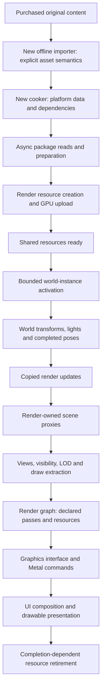

# Rendering and assets

This is the architecture seed for a fresh implementation, not a report of working features. Unreal supplies the process and ownership reference. All previous Bullet Witch code is excluded: importers, math, shaders, material algorithms, animation helpers, asset caches, rendering adapters and the Metal backend. None is called, linked, copied or wrapped. Purchased original content is input data; derived content must be produced by the new tools.

## End-to-end process

Unreal's texture importer assigns source interpretation separately from platform build data: [`UTextureFactory::FactoryCreateBinary`](https://github.com/EpicGames/UnrealEngine/blob/f45729c0b6f097038e72b52d366a62baeca3275b/Engine/Source/Editor/UnrealEd/Private/Factories/EditorFactories.cpp#L3718), then [`UTexture::CachePlatformData` and cooked serialization](https://github.com/EpicGames/UnrealEngine/blob/f45729c0b6f097038e72b52d366a62baeca3275b/Engine/Source/Runtime/Engine/Private/TextureDerivedData.cpp#L3655). These are different responsibilities from loading a resident runtime asset.

## Asset and rendering contracts

| Contract | Required representation |
|---|---|
| Coordinates | One documented engine basis, handedness, unit and matrix convention. Import converts mesh positions, normals, tangents, skeletons, animation, sockets and collision consistently. No corrective half-turn inside rendering. |
| Color | Explicit color versus linear-data textures; linear scene lighting; declared HDR/exposure/output encoding. Normal and mask textures do not receive color decoding. |
| Textures | Pixel/block format, dimensions, complete mip chain, original mip indices, resident range, UV set, addressing, filtering and anisotropy policy. Uploaded mip zero must match its declared asset mip. |
| Materials | Named texture/channel assignments, shading model, parameters, alpha mode, cutoff, sidedness and shadow behavior. Unknown semantics fail explicitly; diffuse is not silently assumed to be PBR base color. |
| Meshes | Indexed sections, material references, UVs, tangent basis and handedness, bounds, LODs, skin weights and section bone maps. |
| Skinning | Explicit local/component/world spaces and inverse-bind convention; completed current and previous pose revisions. GPU deformation consumes those matrices, not controller state. |

Unreal performs coordinate/unit conversion during [`FFbxImporter::ConvertScene`](https://github.com/EpicGames/UnrealEngine/blob/f45729c0b6f097038e72b52d366a62baeca3275b/Engine/Source/Editor/UnrealEd/Private/Fbx/FbxMainImport.cpp#L1499). Its [texture resource creation](https://github.com/EpicGames/UnrealEngine/blob/f45729c0b6f097038e72b52d366a62baeca3275b/Engine/Source/Runtime/Engine/Private/Rendering/Texture2DResource.cpp#L84) preserves sampler settings and maps requested source mips to resident GPU mips. Its [material normal transformation](https://github.com/EpicGames/UnrealEngine/blob/f45729c0b6f097038e72b52d366a62baeca3275b/Engine/Shaders/Private/MaterialTemplate.ush#L4242) normalizes the resulting shading normal.

## Loading, sharing and activation

Immutable mesh, texture, clip and material resources are shared by asset identity. A character instance owns pose, playback, transform and gameplay state; spawning another instance does not repeat import, shader preparation or allocation of identical immutable assets.

Dependency jobs prepare data asynchronously. Render uploads publish readiness only when consumers can safely use the resources. World activation waits for required dependencies and performs bounded instance setup. Retirement preserves resources until their final users and GPU work complete. Streaming budgets distinguish resident bytes, pending reads/uploads and requested detail.

Unreal separates asynchronous package work from game-thread finalization in [`AsyncLoading2`](https://github.com/EpicGames/UnrealEngine/blob/f45729c0b6f097038e72b52d366a62baeca3275b/Engine/Source/Runtime/CoreUObject/Private/Serialization/AsyncLoading2.cpp#L5507). Its [`FRenderAssetStreamingManager`](https://github.com/EpicGames/UnrealEngine/blob/f45729c0b6f097038e72b52d366a62baeca3275b/Engine/Source/Runtime/Engine/Private/Streaming/StreamingManagerTexture.cpp#L786) calculates requests from views and memory budgets. Shader/pipeline preparation belongs to loading and bounded background work, not an enemy's first attack.

## Scene ownership and CPU/GPU boundary

The world owns gameplay objects. The renderer owns persistent scene proxies and GPU resources. Publication carries IDs/generations, handles, transforms, bounds, visibility, light state and completed skeletal data. Rendering never reads a mutable controller. Actor visibility does not destroy animation state.

This follows [`FScene::AddPrimitive`](https://github.com/EpicGames/UnrealEngine/blob/f45729c0b6f097038e72b52d366a62baeca3275b/Engine/Source/Runtime/Renderer/Private/RendererScene.cpp#L1341) and [`FSkeletalMeshObjectGPUSkin::Update`](https://github.com/EpicGames/UnrealEngine/blob/f45729c0b6f097038e72b52d366a62baeca3275b/Engine/Source/Runtime/Engine/Private/SkeletalRenderGPUSkin.cpp#L781). [`BeginRenderingViewFamilies`](https://github.com/EpicGames/UnrealEngine/blob/f45729c0b6f097038e72b52d366a62baeca3275b/Engine/Source/Runtime/Renderer/Private/SceneRendering.cpp#L5359) sends end-of-frame component updates before scheduling rendering.

CPU work includes loading preparation, world/animation evaluation, scene updates, view selection and draw preparation. GPU work includes skin deformation, rasterization, material shading, lighting and postprocessing. Initial skinning uses a vertex shader; a compute skin cache is a later alternative. CPU bounds tests are ordinary visibility work, not per-pixel lighting.

The new graph must track pass reads/writes, load/store operations, dependencies, transitions, transient lifetime and external imports/exports. It must not merely rename a draw-call list. Unreal's [`FRDGBuilder::Compile` and `Execute`](https://github.com/EpicGames/UnrealEngine/blob/f45729c0b6f097038e72b52d366a62baeca3275b/Engine/Source/Runtime/RenderCore/Private/RenderGraphBuilder.cpp#L1327) establish these responsibilities. Render-command completion and GPU completion are distinct lifetime boundaries.

## Proposed first rendering configuration

Use conventional deferred rasterization: depth and shadow maps; opaque/masked material buffers; direct lighting and environment contribution; sky/fog and ordered translucency; selected antialiasing and exposure/tone/output transformation; then screen UI. Lights and environment belong to scene state, not character controllers. Fixed exposure establishes the initial calibration baseline.

This follows the phases in [`FDeferredShadingSceneRenderer::Render`](https://github.com/EpicGames/UnrealEngine/blob/f45729c0b6f097038e72b52d366a62baeca3275b/Engine/Source/Runtime/Renderer/Private/DeferredShadingRenderer.cpp#L1823) and the conditional sequence in [`AddPostProcessingPasses`](https://github.com/EpicGames/UnrealEngine/blob/f45729c0b6f097038e72b52d366a62baeca3275b/Engine/Source/Runtime/Renderer/Private/PostProcess/PostProcessing.cpp#L412). It does **not** claim original-port visual parity. Legacy material and environment meanings require deliberate conversion.

Nanite, Lumen, virtual shadow maps, ray tracing, TSR, motion blur and virtual textures are optional techniques, not prerequisites. A denoiser is appropriate for an enabled effect that generates noisy estimates; it cannot repair incorrect material data.

UI emits layout/material draw data with explicit viewport, clipping, alpha and color rules. [`FSlateRHIRenderer`](https://github.com/EpicGames/UnrealEngine/blob/f45729c0b6f097038e72b52d366a62baeca3275b/Engine/Source/Runtime/SlateRHIRenderer/Private/SlateRHIRenderer.cpp#L1286) composes and presents through RHI; [`MetalViewport`](https://github.com/EpicGames/UnrealEngine/blob/f45729c0b6f097038e72b52d366a62baeca3275b/Engine/Source/Runtime/Apple/MetalRHI/Private/MetalViewport.cpp#L1311) owns native presentation and drawable release. Capture uses the same rendering path.

## Implementation order

1. Coordinate/color contracts, fresh graphics backend, resource lifetime and pacing.
2. Fresh importer/cooker, typed schemas, dependency loading and shared resources.
3. Render scene publication, visibility and dependency graph.
4. Unlit texture/material inspection, bind pose and skeletal GPU deformation.
5. World lighting, shadows, environment, transparency and explicit output conversion.
6. UI/postprocessing, streaming budgets and population-scale integration.

At step 4, compare identical assets and poses with neutral diagnostic views before lighting obscures data errors. At integration, inspect frame-time spikes during activation, movement and retirement. A scene that merely appears on screen does not establish these contracts.
