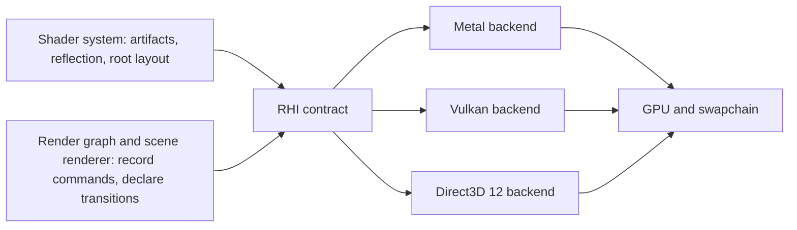
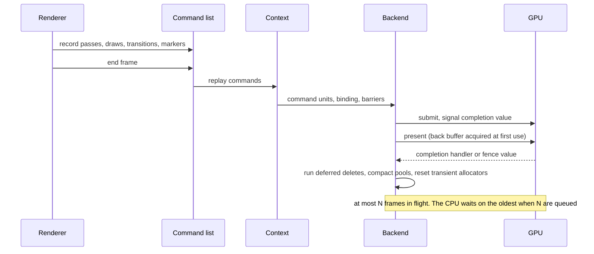
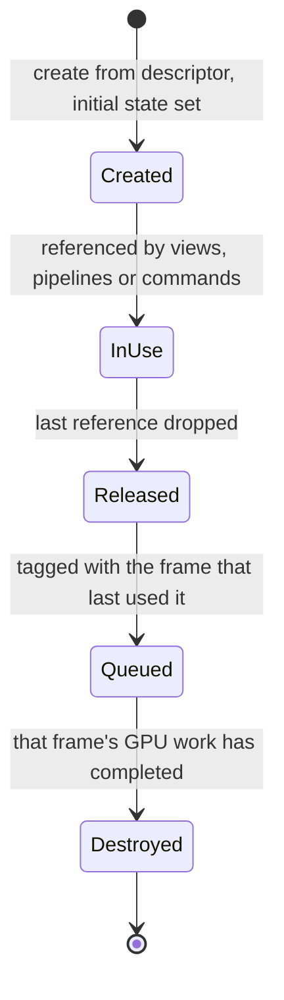
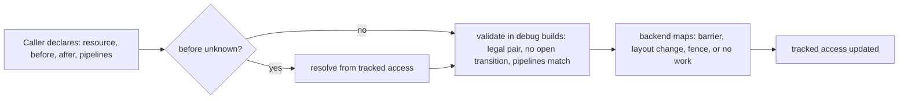
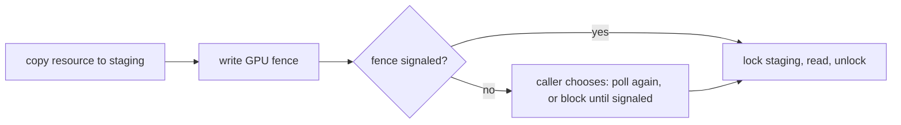

# RHI

The rendering hardware interface: one contract over Metal, Vulkan and
Direct3D 12 that the renderer records against and never sees past. It is our
own, sized to what the game needs.

## Position

Below the render graph and the scene renderer, above the [shader
system](shaders.md). It receives shader artifacts, their backend-neutral
reflection and the fixed root layout, and owns everything from there to GPU
completion: devices and queues, resources and their memory, command recording
and submission, pipeline states and their caches, synchronization, presentation,
readback, and the debug surface. Nothing above it names an API type. One
backend is selected at startup and lives for the process.

## Scope by game need

| In the contract | Reported as a capability, off until a backend proves it | Out |
|---|---|---|
| one device, one graphics queue, copy and compute work on it | async compute on a second queue | multiple GPUs |
| buffers, textures, views, two descriptor arrays and a sampler array | mesh and amplification shaders | Direct3D 11 |
| graphics and compute pipeline states, render passes | ray tracing | work graphs |
| explicit resource state transitions | timestamp queries with calibrated clocks | runtime shader compilation |
| GPU fences, frame pacing, readback to the CPU | | |
| swapchain and present, offscreen targets | | |
| debug names, markers, a validation layer | | |

## Invariants

1. Recording never touches a graphics API. Command lists record; contexts
   execute them on a backend; a context is driven by one thread at a time; and
   submission is one serialized path. That is true with or without a
   dedicated submission thread, so threading is not part of the contract.
2. Every resource is created from an explicit descriptor that names its usage,
   its initial state and its debug name. No field defaults silently; a
   descriptor the backend cannot honor is a named error at creation.
3. State transitions are declared by the caller with the access before and
   the access after. A before state of unknown resolves from the tracked
   state of the resource. Every declared transition is validated in debug
   builds. A backend whose API tracks hazards itself may execute a transition
   as no work, but the declaration is still required.
4. Lifetime is reference counting plus a deferred delete queue. Nothing is
   destroyed until the GPU has completed the last frame that referenced it.
   A view holds its resource alive. A release never blocks.
5. The API binding structure, root signature, pipeline layout or argument
   buffer layout, is built once per device from the fixed root layout. No
   pipeline gets its own.
6. A pipeline state is created from shader artifacts plus a complete state
   description. Creation failure is a named error, never a fallback pipeline.
7. GPU memory comes from backend-owned pools and sub-allocators. There is no
   API allocation per draw. Per-frame transient allocators reset at the frame
   boundary.
8. There is one frame boundary, at the end of the frame. Deferred deletes,
   pool compaction and transient resets hang off it, gated by GPU completion.
   The number of frames in flight is bounded and fixed.
9. Readback never busy-waits. A copy to a staging resource is paired with a
   GPU fence; a lock blocks only while that fence is unsignaled, and says so.
10. Debug names and markers exist on every backend and compile out of
    shipping builds. Capabilities are reported by the backend at startup, and
    a required capability that is missing fails startup by name.

## Frame flow

There is no begin-frame call. The back buffer is acquired when a pass first
targets it, and present is enqueued with the frame's commands. The end of
frame is the single boundary where everything per-frame happens.

## Resource lifetime

Resources hold tracked access state. Transient resources that alias memory
follow the same path with acquire and discard declared through transitions.

## Transitions

Declared transitions are the only source of barriers. The render graph will
derive them from pass declarations; until then the renderer declares them by
hand. The validation layer is a backend wrapper present in debug and
development builds and absent from shipping.

## Pipeline states and caches

Two caches with different keys and owners.

| Cache | Owner | Key | Filled by | Invalidated by |
|---|---|---|---|---|
| Pipeline description cache | the RHI | content hash of shader artifact hashes plus the full state description | the permutation enumeration from the shader system, precompiled at launch; misses at draw time are an error in shipping | a change in shader or state content |
| Driver pipeline cache | the API: Metal binary archive, Vulkan pipeline cache, Direct3D 12 pipeline library | driver and GPU | first creation of each pipeline on this machine | a driver or GPU change |

Sampler, rasterizer, depth-stencil and blend states are immutable objects
created once per distinct description and shared. A graphics pipeline state
names its shaders, those state objects, the vertex layout, the render target
formats and sample count, and the primitive type; a compute pipeline state
names its shader.

## Readback

## Backends

| Concern | Metal | Vulkan | Direct3D 12 |
|---|---|---|---|
| Language binding | metal-cpp, manual retain and release, autorelease pools scoped per call site | C API through the loader | COM |
| Command unit | command buffer with one encoder open at a time; encoder switch ends the previous one | command buffer per submission | command list per submission |
| Submission and completion | payloads committed in order, completion value signaled by an event, completion handler per command buffer | queue submit with a timeline semaphore | queue execute with a fence value |
| CPU-visible fence | shared event waited by value | timeline semaphore host wait | fence event |
| Resource memory | placement heaps with tracked hazards, sub-allocated; pooled buffers; per-encoder ring for transient bytes | device memory blocks, sub-allocated | heaps, sub-allocated |
| Transitions | tracked hazards do the synchronization; declared transitions become compute memory barriers for unordered access only | image layout changes and pipeline barriers | resource barriers |
| Descriptor arrays and samplers | argument buffer tables in the converter's explicit layout, resident sets declared per encoder; a sampler table | descriptor set 1 runtime arrays per type, set 0 samplers | descriptor heap tables of unbounded typed arrays, a sampler heap |
| Root layout | one top-level argument buffer bound at the converter's fixed point | one pipeline layout | one static root signature |
| Present | drawable from the layer, present scheduled on the command buffer, a semaphore bounds frames in flight | swapchain acquire and present | swapchain present |

The Direct3D 12 backend serves Windows and the Xbox Dev Mode container; the
latter is probed at startup for shader model 6.4 and resource binding tier 2
and fails by name below them.

## Components and ownership

| Component | Lives in | Consumed by |
|---|---|---|
| Contract: device, resources, views, command list, context, pipeline states, transitions, fences, queries, viewport | `src/engine/rendering/rhi/public/bw/rendering/rhi` | render graph, scene renderer, tools |
| Backend-neutral units: reference counting and the deferred delete queue, descriptor index allocator, memory suballocator, transition validation, binding structure, pipeline description cache and precompilation | headers in `src/engine/rendering/rhi/public/bw/rendering/rhi`, sources in `src/engine/rendering/rhi` | the device and the backends; tests assert each unit through its header |
| Validation layer | `src/engine/rendering/rhi/validation` | debug and development builds, wrapping any backend |
| Metal backend | `src/engine/rendering/rhi/backends/metal` | the contract |
| Vulkan backend | `src/engine/rendering/rhi/backends/vulkan` | the contract |
| Direct3D 12 backend | `src/engine/rendering/rhi/backends/d3d12` | the contract |
| Window and layer | `src/platform/os/<os>` | the backend's viewport |

The pure units have public headers because a test reaches a unit only
through a public header, never a private include directory. All of the above
except the window compiles into one library, `bw_rhi`: the validation layer
is compiled in when the debug surface is on and absent otherwise, and the
host's backend is compiled in behind the contract's factory. One library, so
the device's call into the validation wrapper and the factory's call into the
backend form no cycle between static libraries. Its one configuration switch
is the debug surface, on for debug and development builds and off for
shipping.

## Dependencies

| Dependency | Role | In the repository |
|---|---|---|
| metal-cpp, the release matching the macOS SDK in use | Metal API from C++ | vendored, Apache 2.0, with its license |
| Metal Shader Converter runtime shim | binding converter-built pipelines | vendored, Apache 2.0, as the shader system states |
| Vulkan headers and loader | Vulkan API | pinned when the Vulkan backend is built |
| Direct3D 12 headers | Direct3D 12 API | pinned when the Direct3D 12 backend is built |

## Boundaries

Above: the render graph derives transitions and resource lifetimes from pass
declarations and the scene renderer decides what is drawn; neither touches an
API. Below: the three APIs and their drivers. Beside: the shader system
owns artifacts, reflection and the root layout; the RHI only consumes them.
Headless rendering is this same RHI with an offscreen target and readback,
and no window.
