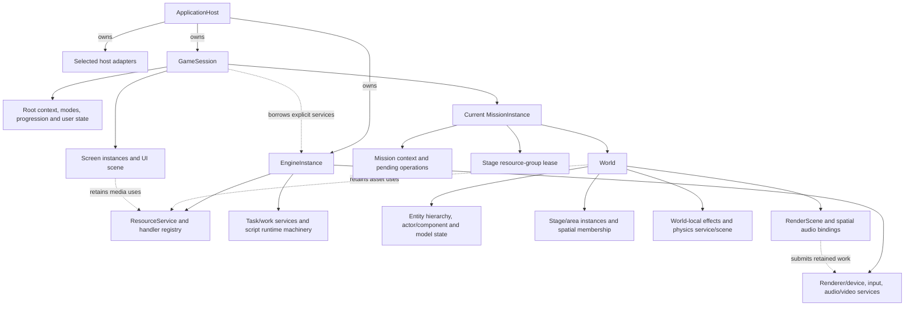
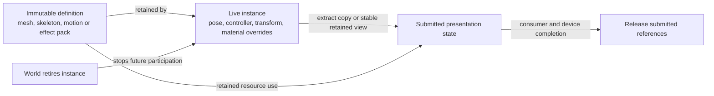

# Runtime objects and ownership

**Target architecture · working baseline · October 22, 2026.**
[Engine architecture](logical-overview.md) · [Execution contracts](execution-contracts.md).

Names below describe reconstruction responsibilities, not recovered Cavia class
names or finalized C++ declarations. Ownership means responsibility for destruction
and outstanding work. It does not prescribe `shared_ptr` for every relationship.

## Lifetime tree

Solid arrows mean logical ownership; dashed arrows are explicitly labelled uses.
Submitted work can outlive the owner's decision to remove an object. This tree
therefore requires the retention/quiescence rules below; child destruction alone
is insufficient. The design targets one active Bullet Witch mission/world. It
makes no claim of simultaneous worlds, multiplayer sessions or an editor runtime.

## Responsibilities of the main owners

**ApplicationHost** constructs adapters, validates required capabilities, creates
the engine, registers the game's typed handlers/bindings, then creates the session.
It owns the outer event loop and coordinates shutdown. It does not implement the
mission update. Construction uses explicit acquired-state bookkeeping so partial
startup can release only what exists.

**EngineInstance** owns the service lifetimes shared across menus and missions.
It supplies script-context creation, task/work scheduling, resources, input,
graphics and media services through explicit references. It does not own a hidden
current-player pointer or decide which stage should load. Registering game adapters
is composition: the engine holds narrow handler/binding contracts, not concrete
Bullet Witch class dependencies.

**GameSession** owns root execution, mode transitions, persistent player/profile
state, progression, screens and the current mission owner. It selects a schedule
for the active mode. Session state is distinct from a live player actor, which
belongs to the world and can be recreated on restart. Save/profile access is a
session operation, while world capture/restore crosses the mission boundary.

**MissionInstance** binds a mission script, its outcome, world and retained content
group. It distinguishes mission name from stage name. Loading/entering/exiting are
owner states that coordinate resource and world operations; they do not replace
the recovered mission driver's intermediate states or same-call transitions.
A mission outcome does not mean its objects have already been destroyed.

**World** integrates live objects and subsystem instances. Its entity registry,
hierarchy and phase context form the reference point for actors, transforms,
queries and derived scene state. It creates a world-local physics service through
a selected provider; the recovered world-owned SDK/scene pair remains an allowed
implementation. A process-global physics SDK is not assumed merely because the
renderer has a process-lived device.

Within the world there is one destruction authority per instance. An actor's
owned model component owns its animation/controller/pose state; an effect with
an animated model owns that model's corresponding state. Animation services
operate on these instances and retain shared definitions but do not separately
own the same instance. Entity and subsystem registries index participants; index
membership is not a second ownership claim. World-local physics and effect
systems own their own scene objects/instances, with explicit actor associations
and removal operations. Render/audio projections likewise retain bindings or
submitted uses without owning the actor.

**ScreenInstance** owns a particular task state machine, UI state and playback/
resource operations. The session's UI scene presents those screen contributions.
Menus can exist without a world, and a modal screen can overlay a world without
implicitly stopping every world or service phase. Mode policy determines the gates.

## Object identities and cross-system references

| Identity | Meaning | Validity / lookup rule |
|---|---|---|
| Content/catalog identity | Exact mounted catalog and selected resource entry | Retained while requests/publications depend on that selection |
| Resource identity | A publication owned by a particular archive record | Availability and owning-record match checked separately from logical name |
| Entity identity | A world-local live object with generation-checked registration | Context includes owning world; never resolve a handle against a different world |
| Model/effect/physics instance identity | A subsystem instance bound to an entity or stage object | Binding explicitly removed during retirement; asset identity is insufficient |
| Script operation identity | One pending continuation and its retained arguments | Driver/context and operation state remain alive until completion or safe cancellation |
| Render submission identity | One submitted command-storage lifetime and retained inputs | Released only after the consumer and relevant device uses complete |
| Save operation identity | Captured state, serialization buffer and storage result | Completion, success and UI acknowledgement are separate |

The original entity handle has a specific slot/generation encoding and 4000-slot
allocator. Preserve externally observed compatibility where required. An internal
world association can prevent cross-world resolution without silently rewriting
that legacy field. Generation wrap, exhaustion and retirement-time visibility
remain specified behaviors, not proof that handles can never alias.

Objects are directly borrowed only while their owner and mutation phase are
stable. Crossing a work boundary requires copied values or a retained ownership
record. A raw pointer into a Lua stack, mutable pose, loaded archive or transient
command arena is not an asynchronous lifetime contract.

## Definition, instance and submitted state

Arrows describe data/lifetime relationships. Retirement and packet completion
are independent; the diagram is not a destruction order. The same separation
applies to bank/cue, script package/context and collision definition/scene object.
Mutable material or motion state belongs to an instance even when its definitions
are shared. A subsystem must not mutate a shared definition to store per-actor state.

## Lifetime transitions

| Event | Remains alive | Released or changed |
|---|---|---|
| Title → mission load | Engine services, root/session state, relevant screens | Mission owner acquires stage group and constructs world as required |
| Spawn | World and required definitions | Factory creates actor/components and registers subsystem bindings only as acquired |
| Actor retirement | Prior submissions and pending work that hold valid uses | New participation stops at recovered gates; hierarchy removal and destruction follow maintenance rules |
| Mission restart | Session/services; content whose recovered restart path retains it | Restore/recreate affected world and script state according to that path |
| Return to root | Session, root context and process services | Quiesce mission work, remove world bindings, release mission uses and group |
| Process shutdown | Services needed by remaining callbacks/consumer work | Stop admission, drain/cancel safely, join workers, destroy dependent owners, then adapters |

Do not invalidate entity handles earlier than the recovered contract simply to
make a new API convenient: mapped invalidation occurs in destruction. Removal
flags and operation-specific admission gates govern the intervening period.
Likewise, a group-release request cannot force-free an archive still borrowed by
a continuation or command. An implementation must reconcile original release
ordering with retained storage before claiming that path complete.

## Architectural invariants

1. Only one owner is authoritative for each mutable state value. Render/audio
   projections and physics observations identify the phase from which they came.
2. The engine does not call back into game implementations through hidden globals.
   Composition supplies typed adapters and their required lifetimes explicitly.
3. Identity resolution and physical storage lifetime are separate. Retained data
   need not remain a live participant in the world.
4. Context, mission and resource status values remain distinct from completion of
   queued or submitted work.
5. Owner teardown cannot race a consumer still using its storage. CPU completion
   is insufficient for resources still referenced by the graphics device.

Grounding: [bootstrap](../../research/engine/subsystems/bootstrap-and-tasks.md),
[mission lifecycle](../../research/engine/subsystems/mission-lifecycle.md),
[actor ownership](../../research/engine/subsystems/actor-lifecycle.md),
[physics ownership](../../research/engine/subsystems/physics-and-collision.md),
[resource publication](../../research/engine/subsystems/resource-dispatch.md).
The aggregate names and service partition above are proposed; the referenced
local ordering, state and ownership facts constrain their implementation.
