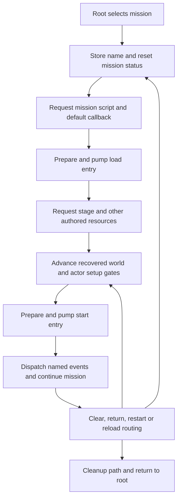

# Runtime scenarios

**Design · working baseline · October 22, 2026.**
[Engine structure](logical-overview.md) · [Runtime ownership](runtime-model.md) ·
[Execution contracts](execution-contracts.md).

These scenarios trace operations through the proposed engine architecture. They
are supporting sequence views, not the top-level architecture or a development
sequence. The [runtime model](runtime-model.md) defines the owners; the
[world model](world-and-simulation.md) and [renderer](rendering-and-presentation.md)
define the collaborating systems. Original call-order facts retain their stated
scope; proposed names are not claims about Cavia's source classes.

## 1. Establish the run

Inputs are a selected local content installation, user settings, a supported
platform configuration and the recovered game behavior. Outputs are admitted
services, mounted content namespaces and a startup task capable of advancing.

1. Identify the content set used for the run. Research evidence binds the current
   format contracts to the acquired PC files and hashes. Another build needs
   explicit compatibility checks; it is not admitted merely because a file opens.
2. Establish separate read-only content access and writable user-data access.
   Catalog names and virtual content locations resolve through these access
   boundaries. Save paths do not point back into the installation.
3. Construct selected host services and engine service owners. Validate required
   capabilities before starting dependent work. Construction and teardown must
   handle partial initialization without publishing an apparently ready engine.
4. Install resource handlers and native script bindings, then mount the catalogs
   appropriate to startup. Retain the known lower-key priority behavior and the
   distinction between common, shader, mission and costume content lifetimes.
5. Register startup/service tasks and advance the recovered startup sequence.
   The startup task eventually selects the root script and its driver.

**Recovered:** the PC entry includes Steam initialization, a temporary PhysX
availability check, configuration, window/device setup, engine services, concrete
game hooks and the startup task. The world later owns a separate physics scene.
See [bootstrap](../../research/engine/subsystems/bootstrap-and-tasks.md).

**Proposed:** platform composition owns how those capabilities are supplied on
the selected host. It must document any changed platform-service behavior. Steam,
legacy middleware, graphics API selection and final packaging are not silently
assumed portable. A headless test can exercise a supported subset, but cannot
report complete game startup when required services are absent.

## 2. Turn a named request into a usable resource

A logical name is a request for a published resource, not necessarily a filename
or a CPR record's local name. This pipeline serves scripts, scenes, models,
effects, UI and audio alike.

```mermaid
flowchart LR
    Name["Logical name + request ownership"] --> Lookup["Catalog lookup and precedence"]
    Lookup --> Dependencies["Mark request; resolve ordered dependency names"]
    Dependencies --> Files["Identify and read containing archives"]
    Files --> Decode["Check container structure and record references"]
    Decode --> Construct["Invoke supported record handlers"]
    Construct --> Phases["Run deferred CALL phases"]
    Phases --> Publication["Publish resource identity and readiness"]
    Publication --> Consumer["Borrow or retain through an explicit lifetime"]
```

Arrows express data dependencies. Publication may occur during an earlier handler
phase; the graph does not say every resource becomes ready only after phase 2.

The catalog determines archive membership and direct dependencies. Indexed
catalog dependencies become full names and reenter global lookup, so higher
priority catalogs can supply them. Marking precedes recursive expansion to
avoid repeatedly traversing an already requested resource. The runtime must
preserve that behavior while diagnosing unresolved names and dependency cycles.

The reader produces immutable bytes and checked metadata. Payload interpretation
then establishes the meaning of those bytes for a resource family. Construction
may require dependencies or a platform device. Publication associates the logical
resource with a particular owning archive record; opening the file alone does
not establish readiness.

On release, remove only publications still belonging to the releasing record,
invoke the appropriate handler teardown, and free backing bytes after their last
consumer. Tag-based unload is retained. Exact cancellation and partial-failure
script outcomes remain unresolved; see [execution contracts](execution-contracts.md#resource-lifecycle).

[Native resource evidence](../../research/engine/subsystems/resource-dispatch.md).

## 3. Execute root and screen behavior

Inputs are a ready script package, a compatible Lua execution environment, its
native API table, input/service observations and the persistent driver state.
Outputs are screen requests, resource/mission operations and driver transitions.

1. Obtain the named DPK payload, find the requested chunk, and validate its bounds
   and supported encoding before passing it to the script runtime. Neither CPR
   decoding nor a filename suffix proves the chunk is executable.
2. Establish the root context with the recovered Lua 5.0.2 semantics and native
   registration contracts. Preserve exact arguments, results and aliases.
3. Prepare and pump `init`; the recovered root driver subsequently prepares and
   pumps `main` repeatedly according to its state machine.
4. Immediate native calls marshal results synchronously. Yielding calls retain
   their argument/state block and callback until the pump observes completion.
   An immediate call can still submit work that outlives the call.
5. Screen Exec/Wait bindings communicate with native tasks. Screen updates own
   resource, input, fade and movie gates; their outcomes return to the script.
   UI drawing consumes the screen state but does not determine script readiness.

Root, mission and AI contexts share execution mechanisms, but have different
API sets, state and lifetimes. AI evaluation is not a replacement for the native
behavior controller. Recovered scripts remain local content inputs, not source
files copied into Git or translated into a second hand-written mission script.

**Recovered:** a pending native callback returns nonzero; zero allows Lua to
resume, potentially within the same pump invocation. `_WaitTitle` has an explicit
initial phase before its later status check. Preserve those distinctions.
[Script runtime](../../research/engine/subsystems/execution-and-scripts.md) ·
[screen tasks](../../research/engine/subsystems/ui-and-screen-tasks.md).

## 4. Select, load and enter a mission

Inputs are the selected mission name and root/native state. Outputs are a prepared
world, live mission context and actors, followed by execution of mission behavior.

This is a grouped recovered dependency flow, not a complete state enum or a claim
that each arrow takes one frame. The load/start entry names are mutable in the
native context. Preserve intermediate gates and same-invocation fallthroughs
when reconstructing the driver.

Stage loading submits work to a shared queue. Its pending count includes running
callbacks and is not stage-local. Queue emptiness says execution finished, not
that every requested resource became available. Actor/world setup must use its
own required readiness contracts as well as the recovered script-facing gates.

Mission status retains its value: 0 running/reset, 1 clear, 2 return-to-root/menu,
3 internal restart in the mapped paths. `_WaitMission` observes nonzero status;
it does not prove all teardown is finished. Outcome interpretation, cleanup,
checkpoint restoration and root resumption remain separate responsibilities.
[Mission lifecycle](../../research/engine/subsystems/mission-lifecycle.md) ·
[stage loading](../../research/engine/subsystems/mission-and-stage-loading.md).

## 5. Advance tasks and the selected game mode

Inputs include elapsed time, platform events, sampled input, available resource
results and current game state. Outputs include updated tasks/world state,
service requests, presentation commands and deferred retirements.

**Recovered outer order:** lifecycle transitions precede active task updates;
a later task pass runs while application state is zero. Input polling and render
list publication are concrete active tasks. The later pass draws the mapped
screens, but is not universally synonymous with rendering. The PC loop services
messages before timing/task work when a message is available.

**Proposed:** preserve an explicit mode-specific schedule and its gates. Do not
replace it with a generic fixed-step loop or reorder systems for convenience.
Timestep acquisition/pacing is a host responsibility; the values and ordering
consumed by gameplay remain behavior contracts. No global 60 Hz assumption is
established by constants found in particle code.

Within mapped game method `0x45f070`, the known order includes state requests,
pre-update entity messages, additional passes, parent-before-child hierarchy
updates, retirement maintenance, service work/signals, actor-derived data and
pair overlap, then effects. Some intermediate roles and worker completion
relationships remain unresolved. Within `0x4617e0`, selected game phases and
script driving precede the later physics step. These are local witnesses, not a
proof of one global ordering across all modes.

World behavior comprises cooperating mechanisms:

| Responsibility | Consumes | Produces / preserves |
|---|---|---|
| Entity hierarchy and state dispatch | Pending states, ordered messages, parent transform, timestep | Current state, component updates, child-visible transforms and retirement requests |
| Native AI control | Authored trees, Lua scores, actor observations, cadence gates | Selected actions, controller transitions and actor commands; earlier candidate wins equal scores |
| Animation and attachments | Tracks, controller state, time, skeleton and parent relationships | Pose, motion events and attachment transforms in the mapped order |
| Collision and dynamics | Queued scene mutations, movement/query requests and timestep | Contacts, query results and scene updates; engine actor separation remains a separate path |
| Effects | Pack bindings, emission state, RNG, transforms, collision and time | Particles/children, updated lifetime and sprite/model presentation inputs |
| Game rules | Mission events, actor/service outcomes and authored parameters | Spawn/combat/progression decisions through those mechanisms |

This is a responsibility view, not permission to run the rows in table order
or in parallel. Native actions and component handlers remain game behavior even
when Lua selects them. Physics middleware does not absorb all collision handling.
Effects reuse animation, collision and model rendering; they are not a separate
mini-engine.

[Actor lifecycle](../../research/engine/subsystems/actor-lifecycle.md) ·
[AI](../../research/engine/subsystems/ai-runtime.md) ·
[animation](../../research/engine/subsystems/animation-data.md) ·
[physics](../../research/engine/subsystems/physics-and-collision.md) ·
[particles](../../research/engine/subsystems/particle-runtime-contracts.md).

## 6. Produce and consume presentation work

Inputs are world/model state, UI state, completed video samples, audio requests
and ready resources. Outputs are ordered graphics commands, audio service work
and presented output when a selected backend completes it.

Game and engine producers construct commands containing the required transforms,
material state and resource references. Command submission transfers or retains
the storage needed until execution completes. Model particles reuse model
commands; sprite particles and UI use their own compatible command families.
Video samples remain alive while queued texture consumers use them.

A render consumer interprets the commands and invokes a graphics backend.
Preserve required state inheritance, blending, shader constants and draw order;
backend-independent commands must not discard original behavior to fit a simpler
API. The PC command worker's completion event gates arena reuse. CPU command
completion and a new GPU backend's resource-release fence are distinct concerns.

Audio has recurring cue/spatial updates and bank ownership. Movie state includes
opening, decoded-frame readiness, completion events and stop/release. Screen and
mission behavior consume those statuses independently of whether a frame has
been presented or a cue has finished playing.

**Unresolved:** backend choice, complete shader/postprocess semantics, device
failure/reset, legacy audio/video compatibility and some command/ring reuse
paths. Interfaces record these requirements; no backend is selected or renderer
implemented by this scenario description.
[Rendering](../../research/engine/subsystems/rendering.md) ·
[audio/video](../../research/engine/subsystems/audio-and-movies.md).

## 7. Capture progress and persist it

Checkpoint capture consumes a supported world/mission state and produces an
owned snapshot. Serialization gives that snapshot the original file schema;
storage writes it to the user-data location. The asynchronous save/UI task
reports operation completion separately from success and retry/dialog state.

The original game distinguishes system, record and game save payloads. The
fixed game buffer size differs from its used-length header. Neither a memory
copy nor an apparently successful dialog proves compatible serialization.
Unknown nested fields remain unresolved, and a replacement writer must not
modify original saves before its schema and round-trip behavior are established.
Unlock/costume policy belongs to game progression, not catalog discovery.
[Save evidence](../../research/engine/subsystems/saves-and-progression.md).

## 8. Leave a mission or end the run

Stop admitting work for the departing owner, advance the recovered stop/cleanup
path, quiesce consumers, retire actors/effects and release owned resource groups.
A restart may retain different services/content from a return to root. Preserve
those distinctions rather than treating every outcome as complete shutdown.

The proposed safety invariant is that no queued callback, script continuation,
render command or device operation outlives the storage it can access. Retired
entities are not freed during hierarchy traversal. The mapped ordinary path
uses delayed maintenance buckets; command completion can impose additional
retention requirements. Marking a resource unavailable does not itself destroy
storage still borrowed by a consumer.

Application shutdown joins workers before destroying the services and buffers
they use, then releases host services. The recovered render stop/join sequence
supports this boundary; exceptional exits and some secondary worker/destructor
orders still need closure. [Execution contracts](execution-contracts.md#ownership-and-release)
define the proposed owners and unresolved shutdown obligations.
