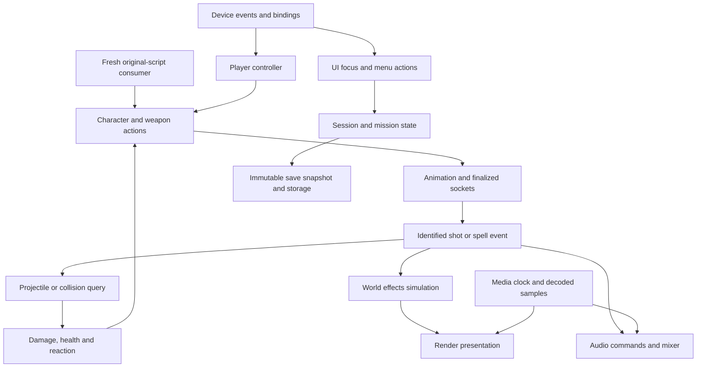

# Gameplay and runtime services

Design seed, not implemented behavior. These services are new implementations, connected to [characters and AI](characters-ai.md). No previous Bullet Witch weapon, audio, media, input, UI, save, effects or supporting implementation may be called, wrapped, linked or copied. Original data and scripts are inputs only. Unreal supplies reference mechanisms, not a requirement to retain the old engine design.

## Connected process

## Combat and effects

**Verified Unreal:** [ProjectileMovementComponent::TickComponent][projectiles] advances movement with collision handling; [GameplayStatics::ApplyPointDamage][damage] packages a hit and sends it to actor damage handling. These do not define game-specific weapons or enemy tactics. [NiagaraSystemSimulation][niagara] describes game-thread submission, concurrent simulation, batched instance work and finalize/completion tasks for both spawn and tick. [NiagaraWorldManager][fx-world] owns world-specific simulations and teardown.

**Proposed ownership:** Weapon state owns ammo, cadence, spread, reload and shot sequence. Character actions own animation and interruption. Player and AI use the same action implementation. A shot or spell event has an action identity, originating simulation time and finalized muzzle/socket transform. Collision produces hit data; health/reaction applies game rules once. Audio and visual effects consume events; they cannot manufacture extra damage or shots.

Effects definitions are prepared assets; world owns instance lifetime and batched updates. CPU/GPU execution follows effect capabilities, with explicit collision/query results crossing boundaries. Decorative particle simulation cannot become an uncontrolled gameplay clock. Spell forces, damage and destruction belong to gameplay/physics even when a visual emitter illustrates them. Teardown cancels pending work before releasing world resources. This is a new implementation inspired by Niagara's scheduling, not a commitment to reproduce Niagara in full or a claim that Bullet Witch effects already map to it.

## Audio and media clocks

**Verified Unreal:** [FAudioDevice::Update][audio] transfers commands from game thread to audio thread and updates device timing. [FMixerDevice::OnProcessAudioStream][mixer] pumps render commands, advances clocks by output frames, computes samples and processes submix output. [FMediaClock][clock] separates input/fetch/output/render phases and timecode. [FMediaPlayerFacade::TickInput][media] processes player events and selects samples by playback time range; it does not equate one game tick with one video frame.

**Proposed ownership:** World emits timestamped sound commands; audio owns voices, decoding, mixing and device sample progress. A frame stall must not restart a voice or redefine its playback cursor. Media owns playback state, timestamped sample queues, seek/pause/end semantics and synchronization policy. Cinematic video is presented against the selected playback clock, with audio/device timing explicitly accounted for. World simulation, media timeline and audio sample clock are distinct owners with defined synchronization, not interchangeable counters.

Fresh platform backends consume prepared buffers; the realtime audio callback performs no world traversal, asset loading or blocking game-thread work. Menus, music and combat sound use one audio service with explicit pause policies. Movie completion requires the playback timeline and queued output to complete, not exhaustion of decoder input alone.

## Input, UI and session state

**Verified Unreal:** [GameViewportClient::InputKey][viewport] routes device events and controller identity; PlayerController processes input bindings. Viewport drawing and input are separate operations. [GameInstance::Init][instance] initializes session-level subsystems independently of a particular character. [AsyncSaveGameToSlot][save] creates serialized bytes before asynchronous storage and completes through a game-thread callback.

**Proposed ownership:** Platform input supplies device events; binding/context resolution produces actions. UI focus determines consumption, and the HUD reads current binding/device information for prompts. Menu scripts run through a fresh UI consumer; widget layout, clipping, scrolling, hit selection and highlights share the same geometry/state. The HUD observes authoritative world state and submits actions; it does not independently spend magic, fire guns or advance progression.

Session owns profile, options and persistent progression. Mission state owns transient health, ammo, entities, objectives and checkpoint state. New-game defaults and concept-mission completion presets are explicit game policies. Restart creates a mission from a declared snapshot rather than accidentally reconstructing profile defaults. Save captures an immutable consistent snapshot, serializes a versioned schema and performs storage away from active simulation; errors do not alter the accepted live state. Original save compatibility, if required, is a separately specified new decoder, never the previous implementation reused.

## Delivery order and observable requirements

1. Device routing, bindings, fresh menu/HUD state and focus; verify selection, scroll, glyph changes and pause input.
2. Audio/media services; verify complete boot playback, pause/resume and continuous output through frame variability.
3. Session/mission/save boundaries; verify costume, progression and restart persistence deliberately.
4. Shared weapon/actions, hits, reactions and sound; verify the visible muzzle, impact, damage and audio agree for player and enemies.
5. Effects and spell interaction; verify spawn/update/teardown, physical interaction and world-transition cleanup under native play.

Checks must include sustained gameplay and transitions, visible action timing and frame/audio deadline evidence. No subsystem is accepted solely because an isolated event counter or screenshot looks plausible.

All references below are pinned to Epic commit `f45729c0b6f097038e72b52d366a62baeca3275b` and require repository access.

[projectiles]: https://github.com/EpicGames/UnrealEngine/blob/f45729c0b6f097038e72b52d366a62baeca3275b/Engine/Source/Runtime/Engine/Private/Components/ProjectileMovementComponent.cpp#L141
[damage]: https://github.com/EpicGames/UnrealEngine/blob/f45729c0b6f097038e72b52d366a62baeca3275b/Engine/Source/Runtime/Engine/Private/GameplayStatics.cpp#L788
[niagara]: https://github.com/EpicGames/UnrealEngine/blob/f45729c0b6f097038e72b52d366a62baeca3275b/Engine/Plugins/FX/Niagara/Source/Niagara/Private/NiagaraSystemSimulation.cpp#L24
[fx-world]: https://github.com/EpicGames/UnrealEngine/blob/f45729c0b6f097038e72b52d366a62baeca3275b/Engine/Plugins/FX/Niagara/Source/Niagara/Private/NiagaraWorldManager.cpp#L719
[audio]: https://github.com/EpicGames/UnrealEngine/blob/f45729c0b6f097038e72b52d366a62baeca3275b/Engine/Source/Runtime/Engine/Private/AudioDevice.cpp#L4725
[mixer]: https://github.com/EpicGames/UnrealEngine/blob/f45729c0b6f097038e72b52d366a62baeca3275b/Engine/Source/Runtime/AudioMixer/Private/AudioMixerDevice.cpp#L1666
[clock]: https://github.com/EpicGames/UnrealEngine/blob/f45729c0b6f097038e72b52d366a62baeca3275b/Engine/Source/Runtime/Media/Private/MediaClock.cpp
[media]: https://github.com/EpicGames/UnrealEngine/blob/f45729c0b6f097038e72b52d366a62baeca3275b/Engine/Source/Runtime/MediaUtils/Private/MediaPlayerFacade.cpp#L2238
[viewport]: https://github.com/EpicGames/UnrealEngine/blob/f45729c0b6f097038e72b52d366a62baeca3275b/Engine/Source/Runtime/Engine/Private/GameViewportClient.cpp#L725
[instance]: https://github.com/EpicGames/UnrealEngine/blob/f45729c0b6f097038e72b52d366a62baeca3275b/Engine/Source/Runtime/Engine/Private/GameInstance.cpp#L97
[save]: https://github.com/EpicGames/UnrealEngine/blob/f45729c0b6f097038e72b52d366a62baeca3275b/Engine/Source/Runtime/Engine/Private/GameplayStatics.cpp#L2403
