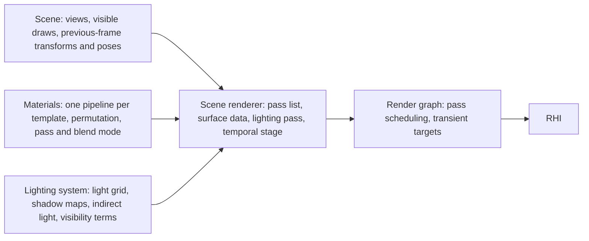
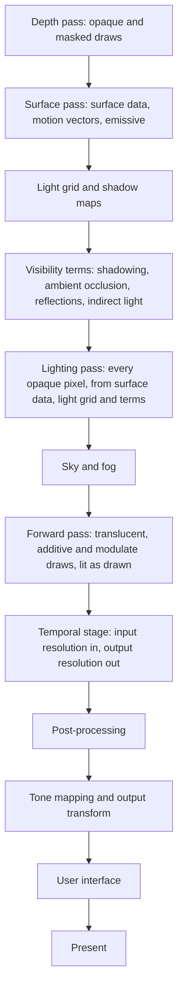
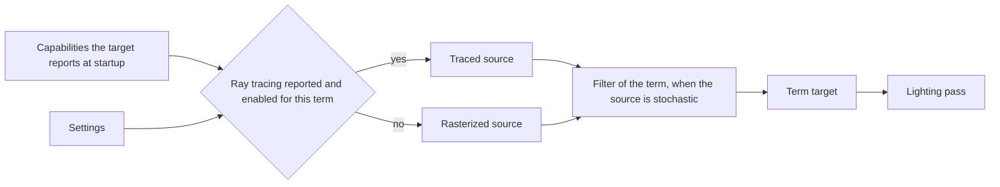

# Scene renderer

How one frame is made from a view of the scene: the fixed list of passes, the
data each pass writes for the ones after it, where light is evaluated, and
where the image changes resolution. Solid surfaces are lit deferred: they
write what the surface is, and one later pass lights every pixel from that.
Blended surfaces are lit as they are drawn. Both use one lighting function
and one light grid.

## Position

Above the render graph, which schedules the passes and owns their transient
targets, and the [RHI](rhi.md). Beside [materials](materials.md), whose
templates supply a shader for each pass, and the lighting system, which
supplies lights, shadows and indirect light as data and as visibility terms.
Fed by the scene, which supplies views and the draws visible in them.

## Invariants

1. An opaque or masked surface is never lit in its own pixel shader. It
   writes surface data, and the lighting pass evaluates light once per pixel
   from that data.
2. A translucent, additive or modulate surface is lit as it is drawn. It
   calls the same lighting function and reads the same light grid as the
   lighting pass. There is one lighting function.
3. Surface data is one set of per-pixel targets with a fixed meaning. A pass
   that needs to know the surface at a pixel reads those targets; no pass
   draws geometry again to find out.
4. The shading model of a pixel is an id in the surface data. The lighting
   pass branches on it; the set of ids is the shading models the material
   system declares.
5. The light grid is built once per view. It is the only way a pass finds
   the lights that reach a point, for the lighting pass, the forward pass
   and fog alike.
6. Every opaque and masked draw writes a motion vector, including skinned,
   morphed and vertex-offset geometry. A motion vector points from a pixel
   to where that surface point was in the previous frame, with the jitter
   removed.
7. The scene is drawn at input resolution with a sub-pixel jitter on the
   projection. One temporal stage turns that into an anti-aliased image at
   output resolution. Every pass before it runs at input resolution and
   every pass after it at output resolution. There is no multisample
   anti-aliasing and no other anti-aliasing pass.
8. Shadowing, ambient occlusion, reflections and indirect light are
   visibility terms. Each has a rasterized source that runs on every target.
   A target that reports the ray tracing capability may run a traced source
   for a term in its place. Both sources write the same target with the same
   meaning, and the lighting pass cannot tell which ran. A target that
   reports no ray tracing capability runs the rasterized source of every
   term.
9. The source of each term is chosen at startup from the capabilities the
   target reports and the settings, and the choice is reported. A source
   that is chosen and cannot be created fails by name. A source never
   changes silently.
10. A stochastic source is filtered before the lighting pass reads it. The
    filter belongs to its term and reads surface data and motion vectors.
11. Light is accumulated in linear scene values. Tone mapping and the output
    transform run once, after post-processing. The user interface is drawn
    after them.
12. The pass list is fixed and declared in one place. A setting or a
    capability selects a term's source or leaves a pass out; nothing
    reorders passes.

## The frame

| Pass | Reads | Writes | Resolution |
|---|---|---|---|
| Depth | visible opaque and masked draws | depth | input |
| Surface | the same draws, depth | surface data, motion vectors, emissive into scene color | input |
| Light grid and shadow maps | lights, shadow-casting draws | light grid, shadow maps | their own |
| Visibility terms | surface data, depth, motion vectors, shadow maps or the ray tracing scene | one target per term | input |
| Lighting | surface data, light grid, term targets | scene color | input |
| Sky and fog | depth, light grid | scene color | input |
| Forward | visible blended draws, depth, light grid | scene color, reactive coverage | input |
| Temporal stage | scene color, depth, motion vectors, reactive coverage, jitter, exposure | scene color | input to output |
| Post-processing | scene color | scene color | output |
| Tone mapping and output transform | scene color, exposure | display color | output |
| User interface | display color | display color | output |

## Surface data

What the surface pass leaves for every later pass. It holds one surface per
pixel, which is why blended draws do not write it.

| Datum | Read by |
|---|---|
| Depth | every later pass |
| Base color | lighting, filters of traced terms |
| Normal | lighting, visibility terms, their filters |
| Roughness | lighting, reflections, their filters |
| Metallic and specular | lighting, reflections |
| Material ambient occlusion | lighting |
| Shading model id | lighting |
| Shading model data: subsurface color or tangent | lighting, by shading model |
| Motion vector | temporal stage, filters of stochastic terms, post-processing |

Emissive is not surface data: the surface pass adds it to scene color. An
unlit surface writes emissive and its shading model id and nothing else.

## Passes a template provides

The passes below are the pass dimensions the renderer declares to the
material system. A template has a shader for each pass its blend modes
reach.

| Pass | Blend modes drawn | The template's shader writes |
|---|---|---|
| Depth | opaque, masked | depth, with the masked discard |
| Surface | opaque, masked | the attributes of its shading model as surface data, a motion vector, emissive |
| Shadow | opaque, masked | depth from a light's view, with the masked discard |
| Forward | translucent, additive, modulate | lit color blended into scene color, and reactive coverage |

A forward draw writes no surface data and no motion vector. Its reactive
coverage tells the temporal stage where history cannot be trusted.

## Visibility terms

The scene renderer owns the selection and the meaning of each term's
target. What each source computes belongs to the lighting system. Traced
sources need the positions of skinned and morphed geometry in buffers, so
the scene supplies deformed positions as buffers on targets that trace.
Shaders of traced sources are their own set, built only for targets that
can report the capability and loaded only when it is reported.

## Temporal stage

The frame hands the stage the same inputs on every target. How the stage is
implemented is each target's own code with its own tuning; nothing is shared
between implementations but this hand-off.

| Input | Meaning |
|---|---|
| Scene color | linear, before tone mapping, at input resolution, drawn with the frame's jitter |
| Depth | the frame's depth, with its direction stated |
| Motion vectors | from a pixel to its previous position, jitter removed |
| Jitter | the frame's sub-pixel offset, from a low-discrepancy sequence whose length grows with the ratio of output to input area |
| Exposure | the value the tone mapper uses |
| Reactive coverage | where blended draws covered the pixel |

Texture sampling in the passes before the stage uses a mip bias set from
the ratio of input to output resolution. At a ratio of one the stage is
anti-aliasing alone. One implementation is written in the project's own
shaders and runs on every target; it is the reference for image comparison.

## Components and ownership

| Component | Lives in | Consumed by |
|---|---|---|
| Pass list, surface data layout, term targets, source selection | `src/engine/rendering/passes` | render graph, materials, lighting system |
| Views, jitter, previous-frame view data, the lighting function | `src/engine/rendering/scene` | every pass, material templates |
| Light grid | `src/engine/rendering/lighting` | lighting pass, forward pass, fog |
| Temporal stage, post-processing, tone mapping and output transform | `src/engine/rendering/postprocess` | hosts |
| Depth, surface, shadow and forward shaders of each template | `src/engine/rendering/materials/templates` | pass list |

## Boundaries

Above: the hosts, which present the result, and the world, which publishes
what the scene holds. Below: the render graph and the RHI. Beside: the
material system, which gives each draw its pipeline for a pass and never
sees a light; the lighting system, which decides what lights exist and how
shadows, indirect light, sky and fog are computed; the scene, which decides
what is visible. The effects inside post-processing, the order of blended
draws, and how passes are scheduled are outside this document.

Full-screen video is not a scene. The media system decodes it, and its
frames enter at the user interface step as display color; while one covers
the screen, no pass before that step runs.
