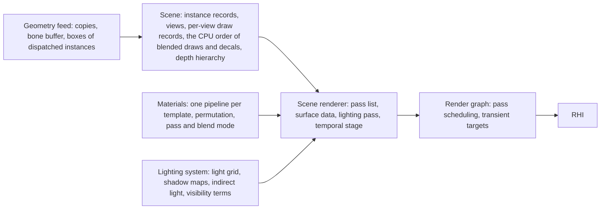
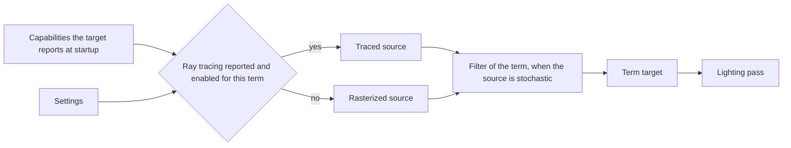

# Scene renderer

How one frame is made from a view of the scene: the fixed list of passes, the
data each pass writes for the ones after it, where light is evaluated, and
where the image changes resolution. Solid surfaces are lit deferred: they
write what the surface is, and one later pass lights every pixel from that.
Blended surfaces are lit as they are drawn. Both use one lighting function
and one light grid.

## Position

Above the render graph, which schedules the passes and owns their transient
targets, and the [RHI](rhi.md). Beside [materials](materials.md), whose
templates supply a shader for each pass, and the [lighting
system](lighting.md), which supplies lights, shadows and indirect light as
data and as visibility terms.
Fed by the [scene](scene.md), which supplies the views and, for each view,
the draw records of what is visible in it, and by the [geometry
feed](geometry.md), which supplies each dispatched instance's vertices for
the frame.

## Invariants

1. An opaque or masked surface is never lit in its own pixel shader. It
   writes surface data, and the lighting pass evaluates light once per pixel
   from that data.
2. A translucent, additive or modulate surface is lit as it is drawn. A
   surface-form template calls the same lighting function and reads the
   same light grid as the lighting pass; a particle-form template takes its
   light from the fog volume and evaluates none, as [transparency](transparency.md)
   states. There is one lighting function.
3. Surface data is one set of per-pixel targets with a fixed meaning. A pass
   that needs to know the surface at a pixel reads those targets; no pass
   draws geometry again to find out.
4. The shading model of a pixel is an id in the surface data. The lighting
   pass branches on it; the set of ids is the shading models the material
   system declares.
5. The light grid is built once per view. It is the only way a pass finds
   the local lights that reach a point, for the lighting pass, the forward
   pass and fog alike. The sun is evaluated everywhere and is not in it.
6. Every opaque and masked draw writes a motion vector, including skinned,
   morphed and vertex-offset geometry. A motion vector points from a pixel
   to where that surface point was in the previous frame, with the jitter
   removed.
7. The scene is drawn at input resolution with a sub-pixel jitter on the
   projection. One temporal stage turns that into an anti-aliased image at
   output resolution. Every pass before it writes at input resolution and
   every pass after it writes at output resolution; any pass may reduce
   internally. There is no multisample anti-aliasing and no other
   anti-aliasing pass.
8. Shadowing, ambient occlusion, reflections and indirect light are
   visibility terms. Each has a rasterized source that runs on every target.
   A target that reports the ray tracing capability may run a traced source
   for a term in its place. Both sources write the same target with the same
   meaning, and the lighting pass cannot tell which ran. A target that
   reports no ray tracing capability runs the rasterized source of every
   term. Hair pixels are the one exception, for the shadowing and indirect
   terms: a hair pixel reads the shadow maps directly on every target, as
   blended surfaces do, keeps the probe light the surface pass wrote for
   it, and the traced sources of those two terms skip it by shading model
   id; the shadowing term's rasterized source skips it too. Ambient
   occlusion has no hair rule, and hair takes no reflection, as [character
   shading](character-shading.md) states.
9. The source of each term is chosen at startup from the capabilities the
   target reports and the settings, and the choice is reported. A source
   that is chosen and cannot be created fails by name. A source never
   changes silently.
10. A stochastic source is filtered before the lighting pass reads it. The
    filter belongs to its term and reads surface data and motion vectors.
11. Light is accumulated in linear scene values, stored pre-multiplied by
    the previous frame's exposure; renderer code applies that factor in
    every pass that writes light, and every reader divides it out, as
    [post-processing](post-processing.md) states. Tone mapping and the
    output transform run once, after post-processing. The user interface is
    drawn after them.
12. The pass list is fixed and declared in one place. A setting or a
    capability selects a term's source or leaves a pass out, and a pass
    whose inputs say it has nothing to do this frame (no focus distance, a
    camera cut) runs as nothing; nothing reorders passes.
13. The world publishes a camera cut flag with the frame. Every pass that
    keeps history reads it and drops that history: phase one of culling,
    the temporal stage, motion blur, the fog volume, the filtered terms and
    the reflections trace.

## The frame

```mermaid
flowchart TD
    DF["Deformation: shapes, skinning and bounds of every dispatched instance, once"] --> CU["Culling: every opaque and masked instance and cluster against every view, draw records per view per pipeline, blended instances and decals frustum-tested and sorted on the CPU"]
    CU --> DP["Depth pass: two draws of the main view's records, the depth hierarchy built after each"]
    DP --> SP["Surface pass: surface data with its flags, motion vectors, emissive"]
    SP --> DC["Decal pass: visible decal boxes blended into surface data"]
    DC --> LG["Light grid and shadow maps"]
    LG --> VT["Visibility terms: shadowing, ambient occlusion, reflections, indirect light"]
    VT --> LP["Lighting pass: every opaque pixel, from surface data, light grid and terms"]
    LP --> SS["Scattering pass: skin and eye tiles"]
    SS --> SF["Sky and fog: sky pixels get far depth and camera motion vectors"]
    SF --> FP["Forward pass: blended draws in CPU order, lit as drawn"]
    FP --> DA["Distortion apply, then scene color exported as next frame's history"]
    DA --> TS["Temporal stage: input resolution in, output resolution out, sharpened above ratio one"]
    TS --> PP["Post-processing: depth of field, motion blur, screen effects, exposure, bloom"]
    PP --> TM["Tone mapping: exposure, bloom, grade, display mapping and encoding"]
    TM --> E2["Screen effects after tone mapping, fade"]
    E2 --> UI["User interface composite"]
    UI --> PR["Present"]
```

| Pass | Reads | Writes | Resolution |
|---|---|---|---|
| Deformation | changed poses and shape weights, stream 0 of each dispatched mesh, bone maps | the bone buffer, the current copy of each dispatched instance, its cluster and instance boxes | its own |
| Culling | instance records, the frame's views (the main view, and the cascades and atlas slots the lighting system fits and assigns at frame start), the previous frame's depth hierarchy, the camera cut flag | draw records and counts per view per pipeline for opaque and masked instances; the CPU order of the main view's blended instances, emitters and decals | its own |
| Depth | the main view's opaque and masked draw records, in two draws: phase one, then phase two after the depth hierarchy is built | depth, the depth hierarchy twice | input |
| Surface | the same records, depth, probe grids, each dispatched instance's previous copy and the bone buffer's previous slot | surface data with its flags, motion vectors, emissive into scene color, baked indirect light into the indirect light target | input |
| Decal | the main view's decals in CPU order, depth, the surface flags | diffuse albedo, normal and roughness of surface data, the normal by fixed-function alpha blend | input |
| Light grid and shadow maps | lights, each shadow view's draw records | light grid, shadow maps | their own |
| Visibility terms | surface data, depth, the depth hierarchy, motion vectors, the previous frame's scene color (pre-exposed, reused by the exposure ratio), shadow maps or the ray tracing scene | one target per term; hair pixels skipped by the shadowing and indirect sources | input, ambient occlusion reducing to half with a bilateral upsample |
| Lighting | surface data, light grid, term targets, shadow maps directly for subsurface and hair thickness and for hair's shadow | scene color, the skin specular target for subsurface and eye pixels, both with the frame's exposure factor | input |
| Scattering | scene color, depth, surface data, the skin specular target, on tiles with a subsurface or eye pixel | scene color | input |
| Sky and fog | depth, light grid, shadow maps, probe grids, fog history reused by the exposure ratio | scene color, far depth and camera motion vectors for sky pixels, fog volume, fog history for the next frame | input |
| Forward | the main view's blended instances and emitters in CPU order, emitter particle data, depth, light grid, shadow maps, probe grids, environment map, fog volume | scene color, reactive coverage, distortion target and stencil bit | input |
| Distortion apply | scene color, distortion target, stencil | a frame-only distorted color merged back into scene color; then scene color is exported as history for the next frame | input |
| Temporal stage | scene color, depth, motion vectors, reactive coverage, jitter, this frame's and the previous frame's exposure factor, the camera cut flag | scene color at output, depth and motion vectors resampled to output for the passes after it, sharpened above ratio one | input to output |
| Post-processing | scene color, the resampled depth and motion vectors, the camera's focus, f-stop, sensor width and shutter, the active screen effects, the camera cut flag | scene color, the bloom levels, the next frame's exposure | output, reducing internally for bloom and the depth of field gather |
| Tone mapping | scene color, bloom, exposure, the grade's lookup table, vignette and grain | display color | output |
| Screen effects after tone mapping, fade | display color, the active effects | display color | output |
| User interface composite | display color, the interface's offscreen image | display color | output |

## Surface data

What the surface pass leaves for every later pass. It holds one surface per
pixel, which is why blended draws do not write it.

| Datum | Read by |
|---|---|
| Depth | every later pass |
| Diffuse albedo | lighting, filters of traced terms; blended into by the decal pass |
| Normal | lighting, visibility terms, their filters; blended into by the decal pass |
| Roughness | lighting, reflections, their filters; blended into by the decal pass |
| F0 and F90 | lighting, reflections; the eye model stores the iris height in the F0 slot |
| Material ambient occlusion | lighting |
| Shading model id | lighting, the reflections term, the scattering pass's tiles, the shadowing and indirect sources |
| Shading model data: profile id and scatter scale, or fibre direction, or profile id with iris normal and iris mask | lighting, by shading model, as [character shading](character-shading.md) packs it |
| Motion vector | temporal stage, filters of stochastic terms, post-processing |
| Surface flags: receives no decal, refuses decal normal, refuses decal roughness | decal pass |

The surface flags are a field of the surface data, not stencil, because a
counted multi-draw cannot change the stencil reference per record and the
Xbox container exports none from a pixel shader; the surface pass writes
them per pixel from the draw record and the template. The refracting-pixel
stencil bit is the forward pass's, whose draws the CPU issues, set by
refracting draws and cleared by the distortion merge. Emissive is not
surface data: the surface pass adds it to scene color. An unlit surface
writes emissive, its shading model id, its motion vector and its surface
flags and nothing else.
Every target that holds light within a frame carries the frame's exposure
factor; every one kept across frames is reused by the ratio of the two
frames' factors.

## Passes a template provides

The passes below are the pass dimensions the renderer declares to the
material system. A template has a shader for each pass its blend modes
reach.

| Pass | Blend modes drawn | The template's shader writes |
|---|---|---|
| Depth | opaque, masked | depth, with the masked discard |
| Surface | opaque, masked | the attributes of its shading model as surface data, a motion vector, emissive |
| Shadow | opaque, masked | depth from a light's view, with the masked discard |
| Forward | translucent, additive, modulate | lit color blended into scene color, reactive coverage, and a refraction offset if the template writes one |
| Decal | the decal domain | diffuse albedo, normal, roughness and an opacity for each, into surface data |
| Write-out | opaque, masked, on traced targets, as compute | positions through the template's vertex offset into the instance's write-out buffer |

A blended template's forward shader has one permutation per draw kind
(mesh, sprite, ribbon, mesh particle), a vertex-source dimension the
renderer declares with the pass.

Renderer code in the surface pass, not the template, writes the pixel's
baked indirect light. Renderer code in the depth and surface passes, not the
template, applies the dither of a detail level transition, so one surface
still reaches each pixel. Renderer code, not the template, multiplies
every light a pass writes into scene color by the frame's pre-exposure
factor. No template shader skins or morphs: a dispatched
instance's draws fetch the copy the geometry feed wrote, and a rigid-to-bone
cluster's draw applies its bone's transform from the bone buffer. A template's vertex
offset is evaluated by one function in the depth, surface and shadow vertex
shaders alike, and once more in the surface pass with the previous transform
and previous frame values for the motion vector. A forward draw writes no surface data and no motion
vector. Its reactive coverage tells the temporal stage where history
cannot be trusted. Every pass has one pipeline per template and
permutation; the forward and decal passes change pipeline between draws as
their depth order requires, as [transparency](transparency.md) and
[decals](decals.md) state.

## Visibility terms

The scene renderer owns the selection and the meaning of each term's
target. What each source computes belongs to the lighting system. The
rasterized source of indirect light is part of the surface pass, which
writes baked light as it draws on every target; a traced source, where
selected, writes the whole target afterwards. Traced sources need the
positions of deformed geometry in buffers, which the [geometry
feed](geometry.md) hands the ray tracing capability directly, with the
refit-or-rebuild signal, and a rigid-to-bone draw is its own acceleration
structure instance under its bone's transform. A traced gather that leaves
the scene takes the sky's radiance from the sky textures. Shaders of traced
sources are their own set, built only for targets that can report the
capability and loaded only when it is reported.

## Temporal stage

The frame hands the stage the same inputs on every target. How the stage is
implemented is each target's own code with its own tuning; the
implementations share this hand-off and nothing else, and one of them, the
portable loop, runs on every target as the reference.

| Input | Meaning |
|---|---|
| Scene color | linear, before tone mapping, at input resolution, drawn with the frame's jitter |
| Depth | the frame's depth, with its direction stated |
| Motion vectors | from a pixel to its previous position, jitter removed |
| Jitter | the frame's sub-pixel offset, from a low-discrepancy sequence whose length grows with the ratio of output to input area |
| Exposure | this frame's and the previous frame's pre-exposure factor as a texture, so the history is rescaled by their ratio; every implementation takes it as a texture |
| Reactive coverage | one minus the product over the pixel's blended draws of one minus each draw's coverage, clamped to 0.9; a translucent draw's coverage is its alpha, an additive draw's the largest channel of its premultiplied colour, a modulate draw's one minus the smallest channel of its colour |
| Camera cut | the world's flag; the stage drops its history |

The stage's own wrapper, renderer code around whichever implementation
ran, writes scene color at output resolution, resamples depth and motion
vectors to output by nearest depth for the passes after it, since a library
implementation produces color alone, and sharpens above a ratio of one;
[anti-aliasing](anti-aliasing.md) states the implementations.

Texture sampling in the passes before the stage uses a mip bias set from
the ratio of input to output resolution. At a ratio of one the stage is
anti-aliasing alone. One implementation is written in the project's own
shaders and runs on every target; it is the reference for image comparison.

## Components and ownership

| Component | Lives in | Consumed by |
|---|---|---|
| Pass list, surface data layout, term targets, source selection | `src/engine/rendering/passes` | render graph, materials, lighting system |
| Instances, views, culling, draw records, the depth hierarchy | `src/engine/rendering/scene`, described in [scene](scene.md) | every pass |
| Deformed copies, bone buffer, boxes of dispatched instances | `src/engine/rendering/geometry`, described in [geometry feed](geometry.md) | culling, every pass |
| Forward pass: CPU order, sprites, ribbons, mesh particles, distortion | `src/engine/rendering/passes`, described in [transparency](transparency.md) | render graph |
| Decal pass | `src/engine/rendering/passes`, described in [decals](decals.md) | render graph |
| The lighting function | `src/engine/rendering/passes` | lighting pass, forward pass, material templates |
| Light grid | `src/engine/rendering/lighting` | lighting pass, forward pass, fog |
| Temporal stage | `src/engine/rendering/postprocess`, described in [anti-aliasing](anti-aliasing.md) | post-processing |
| Post-processing, tone mapping, output transform, screen effects | `src/engine/rendering/postprocess`, described in [post-processing](post-processing.md) | hosts |
| Depth, surface, shadow, forward, decal and write-out shaders of each template | `src/engine/rendering/materials/templates` | pass list |

## Boundaries

Above: the hosts, which present the result, and the world, which publishes
what the scene holds. Below: the render graph and the RHI. Beside: the
material system, which gives each draw its pipeline for a pass and never
sees a light; the lighting system, which decides what lights exist and how
shadows, indirect light, sky and fog are computed; the scene, which decides
what is visible, writes each view's draw records and orders the blended
draws and decals; the geometry feed,
which computes a dispatched instance's vertices once and hands every pass
the same copy; the effects system, which writes each emitter's particle
data. How passes are scheduled is outside this document; what post-processing
does is [post-processing](post-processing.md).

Full-screen video is not a scene. The media system decodes it, and its
frames enter at the user interface step as display color; while one covers
the screen, no pass before that step runs.
