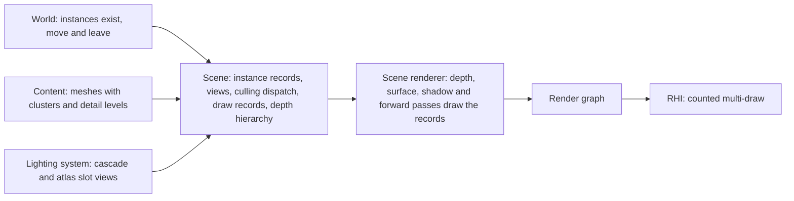
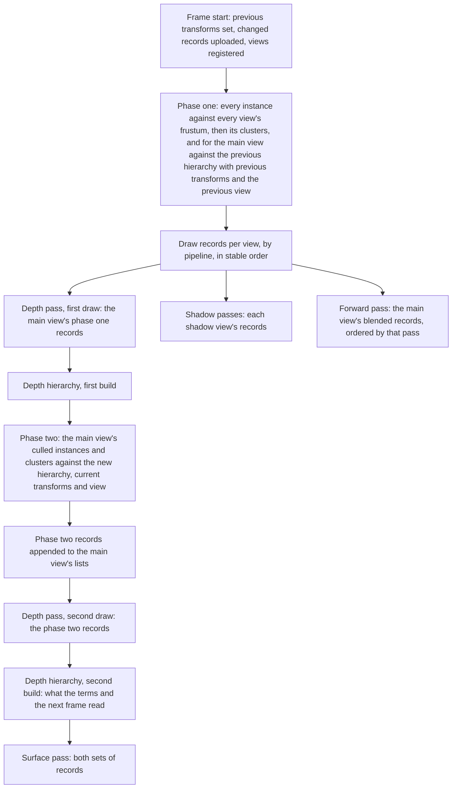

# Scene

What the renderer draws from and how it decides, each frame, what each view
draws. The scene is a flat set of instances with records on the GPU. One
dispatch per frame tests every instance against every view, then every
cluster of the survivors, and writes each view's draw records; the CPU
issues one counted multi-draw per pipeline per view and does no per-instance
work. The main view's occlusion runs in two phases against the frame's own
depth hierarchy.

An instance is one placed mesh with one material instance, one transform,
one set of bounds and its flags. A cluster is a contiguous index range of a
mesh with its own box and, when its draw is rigid to one bone, that bone's
index. A view is a frustum with a purpose: the main view,
one of the sun's cascades, or one atlas slot of a local light.

## Position

Between the world, which publishes what exists and where, and the [scene
renderer](scene-renderer.md), which owns the passes that consume the draw
records. Fed by [content](content.md), which supplies meshes with their
clusters and detail levels, and by the [lighting system](lighting.md), which
supplies the shadow views. Above the [render graph](render-graph.md) and the
[RHI](rhi.md).

## Invariants

1. The scene is a set of instances. An instance enters and leaves at any
   frame and keeps one id for as long as it exists. Nothing in the renderer
   assumes the set is rebuilt whole.
2. The world publishes an instance's existence, transform and flags; the
   scene owns every record built from them. Only records that changed are
   uploaded in a frame.
3. Every instance has a record on the GPU holding its transform, its
   previous transform, its world bounds, its mesh, its material block offset
   and its flags. A pass's shader reaches an instance's data by its index and
   in no other way; no per-draw constant carries a transform.
4. At the start of a frame every instance's previous transform is the
   transform it had the frame before. An instance that enters this frame has
   previous equal to current, so its motion vector is zero.
5. Visibility is computed on the GPU, once per frame, for every view of the
   frame together. No per-instance work runs on the CPU in a frame.
6. Culling runs in two stages: an instance against a view, then each cluster
   of a surviving instance against that view. The unit drawn is a cluster.
7. A view's output is draw records grouped by pipeline, written by
   compaction in instance and cluster order. The same instances and the same
   view give the same records in the same order. Nothing is appended by
   atomic.
8. For each pipeline and each view the CPU issues one counted multi-draw,
   whatever is visible. The count is written by the dispatch and read by
   the GPU; the CPU never reads it back.
9. The main view's occlusion is two-phase. Phase one tests against the
   previous frame's hierarchy and draws its survivors into depth; the
   hierarchy is built; phase two retests only what phase one culled and
   draws its survivors into depth; the hierarchy is built again. The surface
   pass draws the union. Nothing drawn is late by a frame.
10. When no usable previous hierarchy exists, phase one tests the frustum
    alone. Phase two makes the frame correct either way.
11. Shadow views are frustum-culled and never occlusion-culled.
12. The depth hierarchy is one texture of the frame. Phase two reads the
    build after phase one; the visibility terms and the next frame's phase
    one read the build after phase two.
13. A detail level is chosen per instance in the culling dispatch from the
    instance's projected size, with a dithered transition between two
    levels. A mesh with one level is chosen without a test.
14. The draw record buffers of a frame hold every cluster of every instance
    for every view, so a dispatch cannot run out of room and nothing is
    dropped.
15. Blended instances, emitters and decals pass through the same dispatch
    and come out in the same stable order. The forward pass and the decal
    pass sort their records by depth afterwards, as [transparency](transparency.md)
    and [decals](decals.md) state.
16. An emitter is an instance whose bounds the effect fixes or the effects
    system writes each frame, and whose draw record's instance count is
    written on the GPU from its particle count. A decal is an instance whose
    mesh is the unit box. Neither has a transform the CPU reads back.

## The instance

| Field | Written by | Read by |
|---|---|---|
| Id | the scene, on entry | the world, to move or remove the instance |
| Transform | the world, when it changes | culling, every pass's vertex shader |
| Previous transform | the scene, at frame start | phase one, motion vectors |
| World bounds | the scene, from the mesh bounds and the transform, when either changes, padded by the template's declared maximum displacement when the template writes a vertex offset | culling |
| Mesh: cluster table, detail levels | content, through the scene on entry | culling, vertex fetch |
| Deformed stream: current and previous copy indices, or none | the geometry feed, each frame it dispatches the instance or applies its no-dispatch rule | vertex fetch, motion vectors |
| Bone range: the instance's range in the bone buffer, or none | the geometry feed, on entry of a skinned instance | rigid-to-bone clusters' vertex fetch and culling |
| Material block offset | the material system, on entry and on change | every pass's shaders |
| Template id | the material system, on entry and on change | the forward and decal pipelines' branch |
| Sort priority | the world, on entry, from the template's declared priority, and raised when it places a decal over others | the forward and decal passes' sort |
| Flags: carries baked light or is a mover, casts a shadow, blend mode, kind (mesh, emitter, decal) | the world, on entry | the surface pass, shadow views, the forward pass, the decal pass |

A dispatched instance's bounds for the frame, its cluster boxes and its
deformed positions come from the [geometry feed](geometry.md), which owns
skinning and shapes; the scene records what it is given and tests those
boxes in place of the mesh's cooked ones that frame. A cluster cooked rigid
to one bone carries the bone's index; culling transforms its cooked box by
that bone's current transform, and every pass's vertex shader applies the
same transform after the instance transform.

## Views

| View | Frustum from | Occlusion | Previous view kept |
|---|---|---|---|
| Main | the camera, with the frame's jitter | two-phase | yes, for phase one |
| Sun cascade | the lighting system, one per cascade | none | no |
| Atlas slot | the lighting system, one per caster with a slot | none | no |

Every view of a frame is registered before the dispatch runs and tested in
the same dispatch. A view's records are its own; a cluster visible in three
views has three records.

## Visibility

| Stage | Tested | Against | Fails when |
|---|---|---|---|
| Instance, every view | the world bounds box | the view's frustum planes | the box is outside any plane |
| Instance, main view, phase one | the box at the previous transform | the previous frame's hierarchy through the previous view | the box's nearest depth is behind the farthest depth under its screen rectangle |
| Cluster, every view | the cluster's box at the transform | the view's frustum planes | as above |
| Cluster, main view, phase one | the cluster's box at the previous transform | the previous hierarchy | as above |
| Instance and cluster, main view, phase two | the box at the current transform | the hierarchy built after phase one | as above |

A box that crosses the near plane is never tested against the hierarchy and
counts as visible. The screen rectangle of a box is the rectangle of its
eight projected corners; the hierarchy level read is the one whose texel
covers that rectangle in a fixed footprint.

## Draw records and submission

| Record field | Meaning |
|---|---|
| Index count, first index, base vertex | the cluster's range in the mesh's index buffer |
| Instance index | the record the vertex shader fetches |
| Bone index, or none | the bone a rigid-to-bone cluster is transformed by, in the instance's bone range |
| Instance count | one, or an emitter's particle count written on the GPU |

For a ribbon emitter the index count is also written on the GPU, by the
strip build.
| Detail level and transition weight | which level's clusters, and the dither between two |

Records are written into one buffer per view per pipeline, each with a
count. The depth pass and the surface pass read the same records; the
shadow passes read each shadow view's; the forward pass reads the main
view's blended records. The RHI exposes one operation, the counted
multi-draw, that draws a record buffer up to its count; each backend
performs it in its own form, stated in [rhi](rhi.md).

## Depth hierarchy

| Property | Value |
|---|---|
| Content | the farthest depth under each texel |
| Size | half the view's size rounded up to a power of two, with a full mip chain |
| Format | one 16-bit channel |
| Reduction | the minimum of two by two texels of the level below, in reversed depth |
| Builds per frame | two: after the first depth draw, after the second |
| Readers | phase two (first build); reflections' screen trace, ambient occlusion and the next frame's phase one (second build) |

The hierarchy is a frame-only texture of the render graph, which drops
either build that nothing reads.

## Detail levels

A mesh carries one or more levels, each a cluster range and a screen size.
The dispatch projects the instance's bounding sphere, picks the level whose
screen size the projection reaches, and picks a second level from a
slightly lagged view so that a change between frames becomes a dither
between two levels rather than a switch. A level's clusters are the ones
tested and drawn.

## Content the scene reads

| Data | Form | Read by |
|---|---|---|
| Mesh | vertex streams, index buffer, clusters as index ranges with boxes, detail levels as cluster ranges with screen sizes, mesh bounds | culling, vertex fetch |
| Material instance | its block offset | every pass's shaders, through the instance record |

## Components and ownership

| Component | Lives in | Consumed by |
|---|---|---|
| Instance set, ids, records and their upload | `src/engine/rendering/scene` | every pass, the world's publication |
| Views, frustums, jitter, previous-frame view data | `src/engine/rendering/scene` | culling, every pass, material templates |
| Culling dispatch: both stages, both phases, detail level choice | `src/engine/rendering/scene` | scene renderer |
| Draw record buffers and counts, per view per pipeline | `src/engine/rendering/scene` | depth, surface, shadow and forward passes |
| Depth hierarchy build | `src/engine/rendering/scene` | culling, visibility terms |
| Counted multi-draw | `src/engine/rendering/rhi` | the passes, through the render graph |
| Clusters and detail levels in the cooked mesh | the content converter and the mesh payload reader | the scene on instance entry |

## Boundaries

Above: the world, which decides what exists, where it is and what it is for,
and publishes that. Below: the render graph and the RHI. Beside: the scene
renderer, which owns the passes and the lighting function and draws the
records the scene writes; the lighting system, which decides the shadow
views and never sees an instance; the material system, which gives an
instance its block offset; the geometry feed, which owns skinning, shapes
and a dispatched instance's copies and boxes; content, which delivers meshes
with clusters and levels and decides nothing about how they are drawn. How
a stage's instances arrive and leave, in what order blended records are
drawn, and how each backend performs the counted multi-draw are outside this
document.
