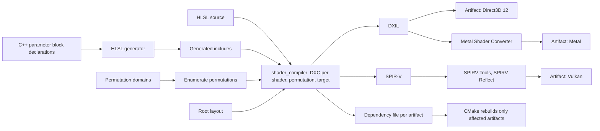
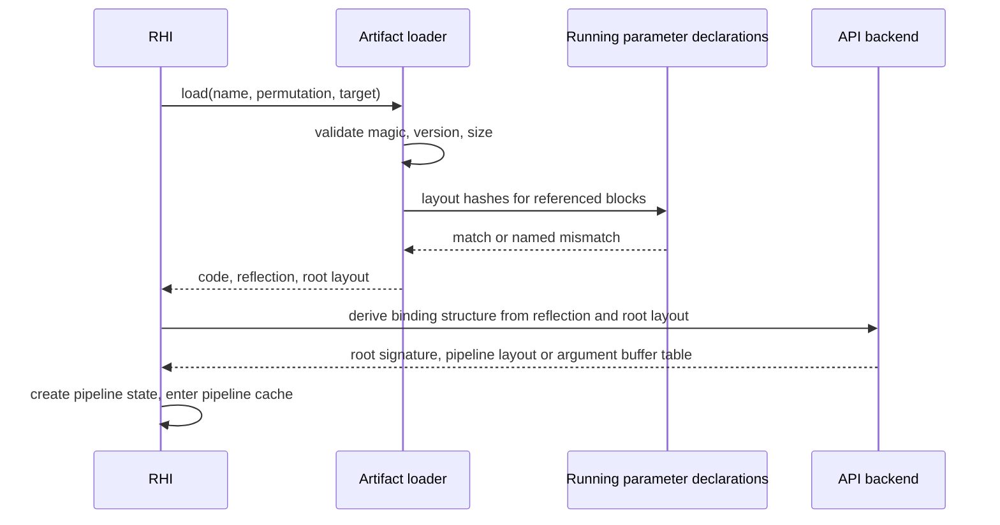
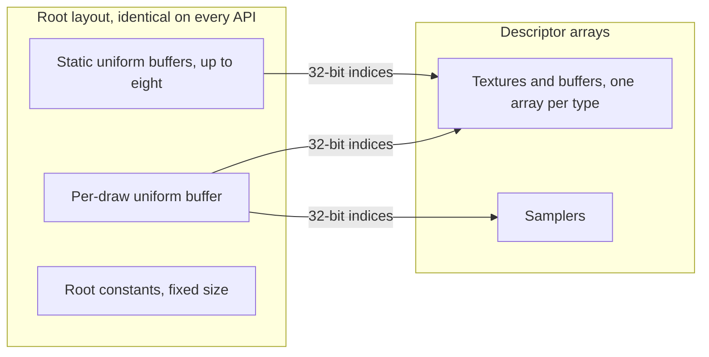
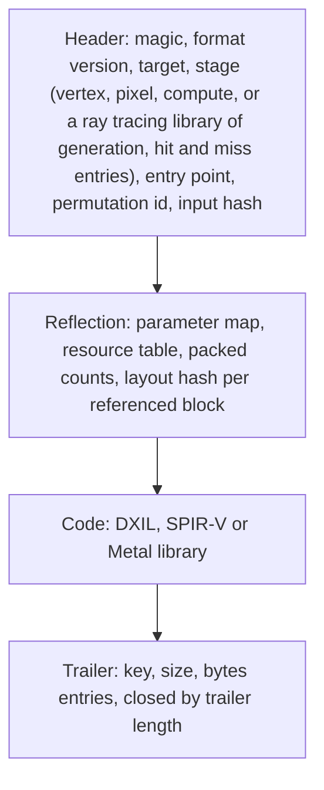

# Shaders

The shader system takes HLSL and C++ parameter declarations in, and gives
the [RHI](rhi.md) loadable artifacts, a backend-neutral description of each
shader and a fixed binding layout out, for Metal, Vulkan and Direct3D 12.

## Invariants

1. One HLSL source per shader. There is no per-target shader source; target
   differences are confined to one include that places the descriptor arrays
   in each API's register spaces or sets.
2. Compilation is offline. The game ships bytecode and never ships source or
   a compiler.
3. The same source revision, defines and compiler arguments produce
   byte-identical artifacts on every build host. A difference fails the
   build.
4. C++ parameter block declarations are the single source of layout truth.
   The HLSL declarations are generated from them, and offsets are equal by
   construction and proven by test.
5. Resources are reached by index into typed descriptor arrays: unbounded,
   one per resource type, for sampled access; bounded to sixty-four in all,
   the most resource binding tier 2 allows, for unordered access, which
   every compute pass of the frame fits. Every pipeline on every API binds
   against one fixed root layout,
   which is fixed before any shader is compiled. There is one binding model,
   and it is the one every target can run. Inside a counted multi-draw the
   per-draw uniform buffer is not rebound per record; the shader takes the
   draw's index, which each API supplies in its own way behind one
   intrinsic of the shader library, and reads the record from the view's
   record buffer.
6. The set of permutations is finite, enumerated at build time and fully
   built. The game never discovers a shader variant at runtime.
7. An artifact is self-describing and validated on its own header. Shaders
   are identified by name and content hash, never by position in a table.
8. Reflection is backend-neutral. Each backend derives its API binding
   structure from it at load; nothing API-specific is stored in the artifact
   beyond the code block.
9. Failure is explicit and named: wrong version, truncated artifact, layout
   hash mismatch, or a target without the required capability. There is no
   fallback binding model and no silent degradation.
10. Nothing from Apple's converter package enters the repository except its
    Apache-licensed runtime shim. The converter is a build prerequisite.

## Build-time flow

The root layout enters compilation because two targets consume it there:
the converter takes it as the root signature, and DXC fixes the Direct3D 12
binding spaces. Debug symbols leave the tool as a separate file named by the
source hash and never enter an artifact.

## Load-time flow

The RHI builds each API's binding structure from the root layout once per
device and binds every pipeline against it. It owns pipeline state creation,
precompilation at first launch or after a driver change, and the API pipeline
caches. The permutation enumeration from this system is what makes the
precompiled set complete.

## Draw-time binding

| Root layout element | Direct3D 12 | Vulkan | Metal |
|---|---|---|---|
| Static uniform buffers | root constant buffer views in a reserved space | push constants holding bindless indices | constant buffer view table in the argument buffer |
| Per-draw uniform buffer | root constant buffer view | push constant index | argument buffer entry |
| Root constants | root constants | push constants | argument buffer bytes |
| Texture and buffer arrays | descriptor tables of unbounded typed arrays | descriptor set 1, runtime arrays per type | argument buffer tables in the converter's explicit layout |
| Sampler array | sampler descriptor table | descriptor set 0 | sampler table in the argument buffer |

Bindless access is typed unbounded descriptor arrays indexed with
non-uniform indices, shader model 5.1 and later, not the shader model 6.6
descriptor heap. That is what keeps the same shaders and the same layout
running on every target, including the Xbox Dev Mode container, which stops
at shader model 6.4.

## Artifact

One artifact per shader, permutation and target, uncompressed, in
`<build>/shaders/<target>/`. The reflection block is identical across the
three targets for the same shader and permutation, and that equality is a
test.

## Permutations

A shader declares dimensions of three kinds: boolean, integer range,
enumeration. The domain's size is the product of the dimension sizes. A dense
permutation id maps to dimension values and back, each dimension sets one
preprocessor define, and a shader excludes permutations through a pure
predicate. The build compiles every permutation that remains.

## Targets

| Target | Bytecode | Back half | Floor |
|---|---|---|---|
| Direct3D 12 | DXIL; a ray tracing library as a library target, built only where the capability can be reported | DXC, signed on a host with the validator | shader model 6.4 or later, resource binding tier 2 |
| Metal | Metal library; ray tracing entries as the converter's compute kernels | the same DXIL through the Metal Shader Converter, in process | macOS 15, Apple silicon, Metal 3 |
| Vulkan | SPIR-V; ray tracing entries through the ray tracing extension | DXC SPIR-V backend, SPIRV-Tools, SPIRV-Reflect | Vulkan 1.3 with descriptor indexing |
| Xbox Series X, Dev Mode | DXIL | the Direct3D 12 backend | shader model 6.4, feature level 11.0; probed at startup, explicit failure below shader model 6.4 or resource binding tier 2; typed unordered-access loads and native 16-bit operations not assumed, reported by the probe |

## Components and ownership

| Component | Lives in | Consumed by |
|---|---|---|
| Parameter block declaration and HLSL generator | `src/engine/rendering/shaders/public` | shader_compiler, RHI, every renderer module |
| Permutation domain | `src/engine/rendering/shaders/public` | shader_compiler, RHI precompilation |
| Root layout | `src/engine/rendering/shaders/public` | shader_compiler, RHI backends |
| Artifact format, writer and loader | `src/engine/rendering/shaders/public` | shader_compiler, RHI |
| HLSL source and the bindless-access include | `src/engine/rendering/shaders` | shader_compiler |
| shader_compiler | `tools/shader_compiler` | CMake, developers by hand |

## Dependencies

| Dependency | Role | In the repository |
|---|---|---|
| DirectXShaderCompiler, one pinned release tag | HLSL to DXIL and SPIR-V | built from source on every host |
| SPIRV-Tools, SPIRV-Reflect | SPIR-V optimization and reflection | pinned |
| BLAKE3 | artifact input hashing | pinned |
| Metal Shader Converter | DXIL to Metal library | no; prerequisite under `/usr/local` |
| Metal Shader Converter runtime shim | Metal RHI support for converter-built pipelines | yes, Apache 2.0, with its license |

## Boundaries

Above: the RHI, which receives artifacts, reflection and the root layout and
owns everything from pipeline creation onward. Below: the compilers, which
are build-time tools. Outside: material shaders and the lighting model, which
belong to the scene renderer; a shipped compiler for user shaders, which the
standalone tool and the self-describing artifact leave possible.
