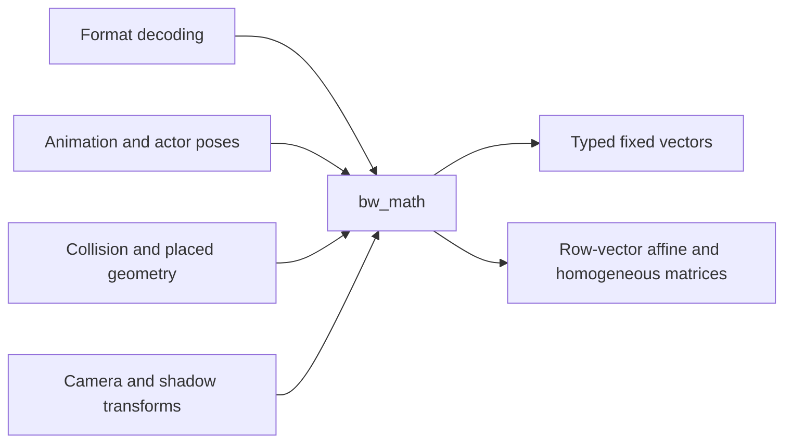

# Shared math

`bw_math` is the engine's common CPU numerical library. Its current implementation
is header-only under `include/bw/math`; consumers retain ordinary fixed-array
storage. A float vector and a double vector use the same operation definitions
with different scalar types. There is no virtual dispatch, heap allocation or
platform object in an individual operation.

`vector.hpp` owns component arithmetic, dot/cross products, length and finite
checks. `matrix.hpp` owns composition, affine inversion and transform construction.
Matrices store rows and use row vectors; affine translation is in row 3. Point
transformation includes translation. Scalar and accumulator precision are
explicit: placed geometry retains double accumulation with float output, while
ordinary float vector arithmetic stays float. Source quaternion magnitude is
retained rather than silently normalized.

Subsystems own the meaning of those numbers: units, coordinate bases, collision
thresholds, normalization fallback directions, source interpolation branches and
format-specific errors. Animation's source-record adapter delegates matrix
construction to math; it does not own another matrix algorithm. Shader built-ins
remain part of the native graphics implementation and are not CPU math calls.

The current scalar implementation preserves expression and accumulation order.
Target-specific CPU SIMD can replace implementations behind these interfaces
when justified by representative measurements and numerical verification. A
change that reassociates a reduction, substitutes reciprocal approximations or
changes accumulator precision is a numerical-contract change, not an invisible
optimization. No target-specific performance claim is made by this consolidation.

See [source comparison and numerical contracts](../../research/engine/subsystems/shared-math.md).

`half.hpp` centralizes the recovered finite half conversion used by skeletal
channels and shape deltas (including the source finite exponent31 behavior).
`scalar.hpp` owns linear interpolation arithmetic; callers choose endpoint and
clamping policy. Neither decoder owns a second conversion or interpolation formula.
