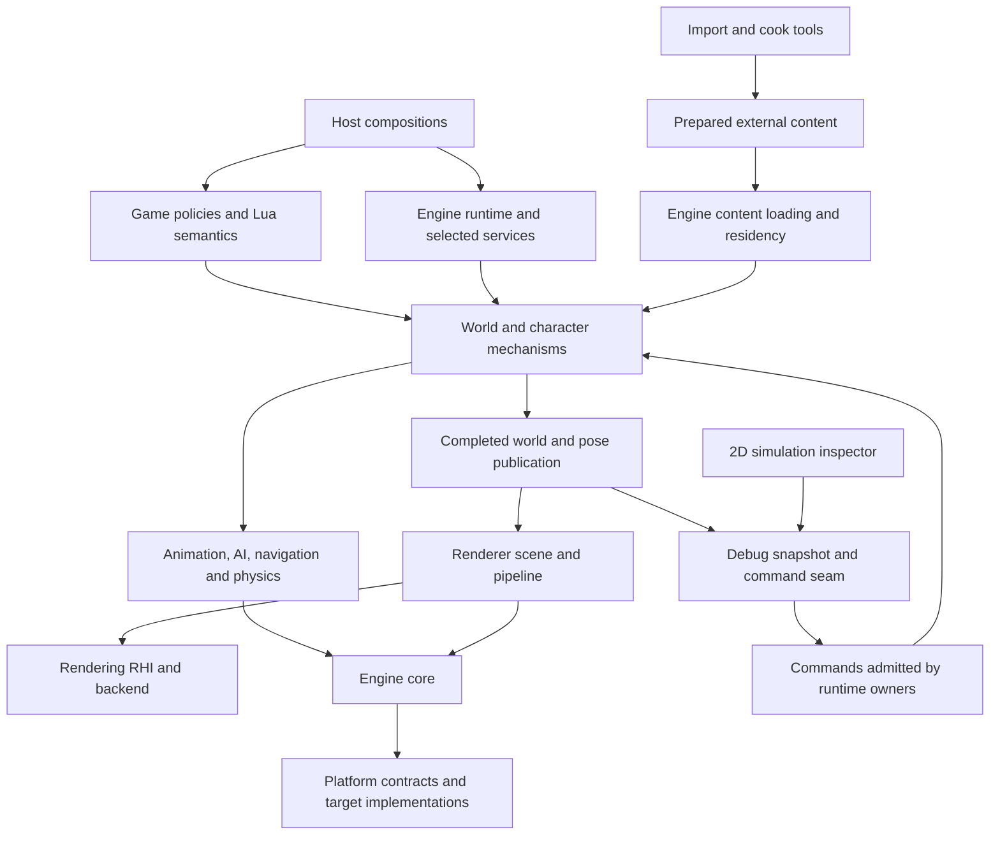

# Source layout and runtime tools

Status: **agreed direction; migration and tools not implemented**. This document
records the project-wide ownership layout, including the tooling the runtime must
support. Existing accepted foundations remain at their current paths. The next
organization slice moves existing files and updates build boundaries; this
revision creates no empty modules or runtime behavior.

The architecture follows the runtime ownership already described in
[the overview](README.md), [world lifecycle](world-lifecycle.md),
[characters and AI](characters-ai.md), [rendering and assets](rendering-assets.md)
and [runtime services](runtime-services.md). The directory choices below are our
project organization, not a claim that Unreal uses these exact paths.

## Destination tree

This is a destination map, not a list of directories to create immediately.
Create a directory when its actual responsibilities and source arrive. Keep
closely related files together; do not make one directory per class.

```text
src/
  engine/
    core/
      math/                 # value math and shared SIMD contracts/algorithms
        vector/
        simd/
      memory/               # facade, allocation lifecycle and failure policy
        binned/             # selected allocator and its private structures
      concurrency/
      tasks/
      diagnostics/          # foundational reporting, including release needs
    runtime/                # EngineLoop, engine lifecycle and frame pacing
    world/                  # clocks/ticks, actors/components, admission/retirement
    content/                # schemas, handles, packages, loading and residency
    input/                  # device-independent binding/context/action routing
    characters/             # possession, movement and reusable action mechanisms
    animation/              # skeleton/pose, blends, root motion, skeletal controls
    ai/                     # perception, agent memory, decisions and retained tasks
    navigation/             # navigation data, queries, routes and path following
    physics/                # simulation/query contracts and backend adapters
      backends/
    rendering/
      scene/                # render-owned proxies, views and visibility
      materials/
      lighting/
      graph/
      passes/
      postprocess/
      rhi/
        backends/           # e.g. Metal; owned by rendering, not general OS code
    audio/
    media/
    ui/                     # widgets/layout/focus/render data; no mission rules
    scripting/              # runtime execution mechanisms; no Bullet Witch policy
    development/
      inspection/           # optional debug adapters and inspection/control seam
  game/
    session/
    missions/
    characters/
      alicia/
      enemies/
      civilians/
    combat/
    progression/
    frontend/
    hud/
    scripting/              # Bullet Witch Lua meanings and game bindings
  platform/
    math/ memory/ time/ tasks/ diagnostics/  # contracts and target selectors by owner
    os/
      macos/                # OS-native services, grouped by subsystem as needed
    cpu/
      arm64/                # NEON and other inspected silicon implementations
    generic/                # source-selected shared platform fallbacks
  hosts/                    # target entry points and runtime composition

tools/
  import/                   # original-format readers and semantic conversion
  cook/                     # target preparation and dependency packaging
  character_viewer/
  ai_scenarios/
  capture/
  simulation_inspector/     # 2D runtime state inspection and scenario authoring
  scenarios/                # tool-authored scenario definitions, not game assets

tests/                      # mirror owners: engine/, game/, platform/, tools/
docs/                       # architecture/process; drill-ins grouped by owners as needed
cmake/                      # common build/quality policies; modules declare own targets
```

The importer can have a Bullet Witch-specific format layer. The engine content
loader consumes prepared schemas and handles; it must not absorb game-specific
parsing and upgrade policy. Import and cook tools can share explicit libraries
with each other and the runtime where appropriate; executable tool entry points
are never runtime dependencies.

## Ownership and dependency map



Arrows identify dependency or publication paths, not permission for arbitrary
synchronous call cycles. Tick phases, completion fences and ownership still
control execution. Platform and core do not depend on game rules or tool clients.
A target-specific graphics or physics backend depends on its subsystem contract
and any required platform services; it does not turn the general platform tree
into a collection of every implementation for that target.

Controllers own intent, possession and requests. Animation owns pose, joints,
blending and skeletal controls. Skeleton/rig mappings belong to prepared asset
and animation configuration. An Alicia controller must not contain a special
joint solver merely because she is the first character brought up.

World owns authoritative transforms, lifecycle and light-component state.
Rendering owns published scene proxies, material interpretation, lighting passes,
shadows and output. Those responsibilities provide a lighting subsystem without
moving rendering calculations into characters or world controllers.

The engine provides reusable mechanisms; game modules specify Bullet Witch
rules and content meanings. Player and NPC actions use the same character
mechanisms with different intent providers. A civilian is not a separate copy of
the movement/animation pipeline. Game-specific behavior may compose or specialize
engine contracts; it may not bypass pose/physics publication ownership.

## Several compositions, one runtime

Hosts select the services and content needed for a task. Tools are clients of the
same production modules used by the game, not alternate simulation algorithms.
These are required compositions, not implemented executables:

| Composition | Required purpose and boundaries |
|---|---|
| Full game | Complete session, world, game policies, input, renderer, audio and UI |
| Headless simulation | Selected production world, AI, navigation, movement, animation and physics; no window or 3D renderer unless explicitly needed |
| Character viewer | Prepared character assets, production animation/pose and renderer; optional movement/physics appropriate to the scenario |
| AI scenario runner | A bounded authored world exercising production AI/tasks/navigation/movement/physics and observing action outcomes |
| Offscreen capture | Production render scene, materials, lighting and render passes, rendering to an offscreen target; no separate imitation renderer |
| 2D simulation inspector | Client of a headless or full-game runtime; draws published state and submits admitted commands |

A headless run needs enough real world data to make its selected mechanisms
meaningful: collision, navigation, relevant actors, prepared behavior and
animation data, and the world clock/lifecycle. It does not require a complete
mission, menus, unrelated scenery or every audiovisual resource. Host composition
selects dependencies; it does not replace physics with a fake height lookup or
stub AI to avoid loading the full mission.

## Inspection and control boundary

`engine/development/inspection` owns optional debug adapters and the inspection
publication/control seam. Each subsystem owns its domain snapshot/read contract
and commands; the development adapter aggregates them for tools without moving
world/AI dependencies into core diagnostics. Foundational
`engine/core/diagnostics` remains responsible for ordinary reporting and failures;
the development module is a different, optional consumer of runtime state.
Tools depend on the development contract. Production owners do not depend on a
particular inspector application or its GUI. The actual world, AI, navigation,
movement and physics mechanisms are production runtime modules, not debug-only
implementations; a headless host selects those same modules.

The agreed debug-only policy remains: in-game overlays can be toggled off, and
development entry points compile out to no-ops or are omitted from production
builds. The previously discussed separate inspection window and headless control
use this same boundary. No active debug transport, overlay update or inspector
allocation is required in production. Specific protocol types, snapshot cadence,
transport, command routing and capture integration remain to be designed under
the normal architecture/header/test workflow; no such behavior exists yet.

Published snapshots must have an explicit lifetime and coherent observation
point. Clients cannot retain writable pointers into actors, controllers, joints
or physics bodies. State changes arrive as commands and are validated/applied by
the owning runtime subsystem at its declared update boundary. Pause/step requests
use runtime/world clock ownership; tools do not advance hidden local clocks.
The exact mechanics and fidelity of stepping remain a future design task.

### 2D simulation inspector

The new `tools/simulation_inspector` client must support:

- Attach to either a headless runtime or the full game through the same seam.
- Display actors, facing, velocity, goals, paths, perception/line-of-sight and
  active task state, with enough identity and timing information to inspect them.
- Author and run scenarios with unusual actor/NPC placements, pause, step and
  resume through runtime commands, and inspect resulting behavior.
- Produce images plus corresponding state traces for human and agent inspection;
  a picture alone must not be the only record of a failed task or blocked route.

Its map and heightmap are display layers. Authoritative collision and navigation
remain three-dimensional. Elevation/layer controls must distinguish bridges,
tunnels and overlapping walkable surfaces; a single height at each XY location
cannot replace that world representation.

The inspector's own 2D drawing does not require the production 3D renderer.
Its data is produced by real runtime systems, and its scenario edits are commands
or authored inputs. Offscreen game-image capture is separate and must exercise
the actual production renderer. The protocol and UI are proposed, not a delivered
debug tool or a source-verified implementation.

## Assets, scenarios and outputs

Purchased originals and derived/cooked game assets remain external, ignored input
and output data. The existing `data/`, `assets/original/`, `assets/generated/`,
`local/` and `research/evidence/` exclusions are not changed by this layout.
Original Lua is purchased game data even when its runtime consumer lives in
`game/scripting`; do not commit it beside that C++ code.

Tool-authored scenarios belong under `tools/scenarios`, distinct from mission
assets. Original project-owned fixtures and scenario descriptions can be tracked
when they contain no proprietary data; references to external assets do not make
those assets repository content. Recordings, captured images and generated state
traces belong in ignored organized outputs, not among scenario source files.

## Migration of existing foundations

This mapping plans a follow-on organization change. None of these moves happens
in this documentation update. Keep existing algorithms and accepted tests intact.

| Current files | Destination responsibility |
|---|---|
| `src/core/math/vector3.*` | `src/engine/core/math/vector/` |
| `src/core/math/register.hpp` | `src/engine/core/math/simd/` |
| `src/core/memory/binned_*` | `src/engine/core/memory/binned/` |
| Other `src/core/memory/*` | `src/engine/core/memory/`, keeping facade/lifecycle/failure contracts distinguishable from allocator internals |
| `src/core/concurrency/*`, `tasks/*`, `diagnostics/*` | Corresponding `src/engine/core/` owner |
| `src/engine/runtime/*` | Retains its runtime owner |
| Shared `src/platform` math/register contracts/selectors | `src/platform/math/` |
| Shared platform memory/allocator/sync/failure contracts | `src/platform/memory/` |
| Shared platform time/task/diagnostic contracts | `src/platform/time/`, `tasks/`, `diagnostics/` |
| `src/platform/macos/*` | `src/platform/os/macos/`, grouped by actual service |
| `src/platform/arm64/*` | `src/platform/cpu/arm64/`, with SIMD implementation grouped together |
| `src/platform/generic/math.inl` | Generic platform math owner, retained as source-selected fallback |
| `src/hosts/macos/engine_host.cpp` | Host composition/target entry point; not an engine service |
| Flat `tests/*` | Corresponding `tests/engine/core`, `engine/runtime` or platform/integration owner |
| `tools/engine_loop_probe.cpp` | Runtime probe tool owner; no algorithm duplication |

Build targets must enforce ownership, not merely reflect folder labels. Each
module declares its public headers/dependencies and internal implementation
sources. Header checks distinguish public contracts from internal completeness
checks. Engine consumers should not receive a universal include path granting
access to all private modules. The exact include/export arrangement and CMake
split belong to the organization slice, with no change to numeric behavior.

Tests and architecture drill-ins follow the same owners as they grow. Keep
project-wide overview/process documents at their entry points. Migrate existing
files, includes, targets, IDE configuration and documentation links together;
verify Debug/Release builds, fatal lint, header checks and all accepted tests.
Do not create the rest of the destination tree until real slices need it.
