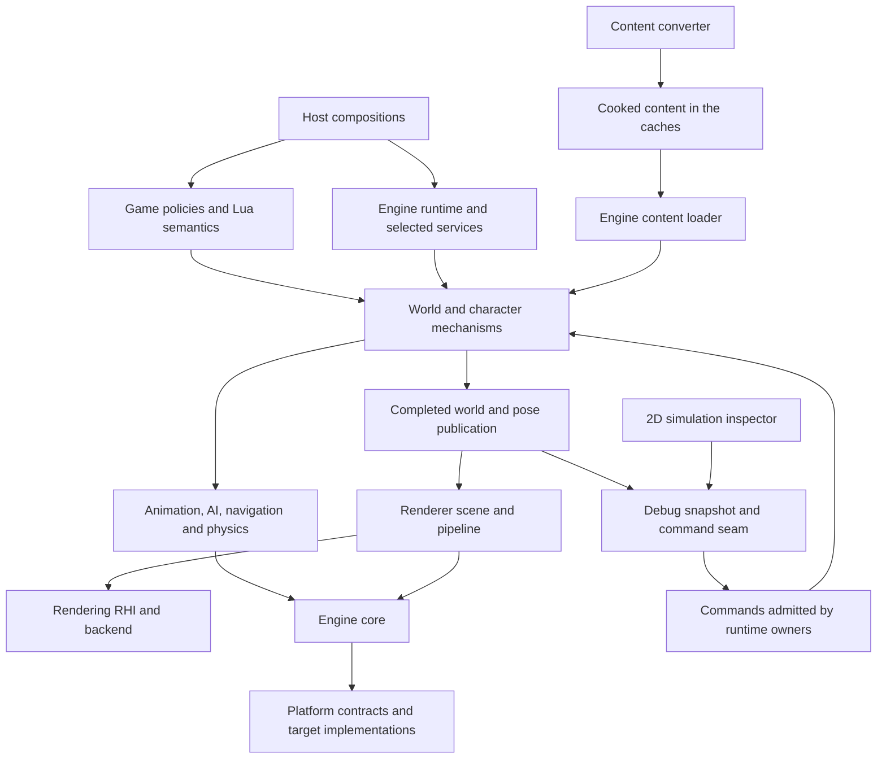

# Source layout and runtime tools

The project-wide ownership map and tooling direction. See
[what we are building](overview.md) for the goal and the two rules.

## Destination tree

This is a destination map, not a list of directories to create immediately.
Create a directory when its actual responsibilities and source arrive. Keep
closely related files together; do not make one directory per class.

```text
src/
  engine/
    core/
      math/                 # value math and shared SIMD contracts/algorithms
        public/bw/math/
          vector/           # public vector contracts and inline definitions
          simd/             # public register contracts
        vector/             # out-of-line vector definitions
      memory/               # facade, allocation lifecycle and failure policy
        public/bw/memory/   # facade/lifecycle/failure contracts
        binned/             # selected allocator and its private structures
      concurrency/
      tasks/
      diagnostics/          # foundational reporting, including release needs
    runtime/                # EngineLoop, engine lifecycle and frame pacing
    world/                  # clocks/ticks, actors/components, admission/retirement
    content/                # cooked format, asset ids, layers, loader, install search, download client
    input/                  # device-independent binding/context/action routing
    characters/             # possession, movement and reusable action mechanisms
    animation/              # skeleton/pose, blends, root motion, skeletal controls
    ai/                     # perception, agent memory, decisions and retained tasks
    navigation/             # navigation data, queries, routes and path following
    physics/                # simulation/query contracts and backend adapters
      backends/
    rendering/
      scene/                # render-owned proxies, views and visibility
      materials/            # material and instance types, attribute table; see materials.md
        templates/          # authored material HLSL and parameter block declarations
      lighting/
      graph/
      passes/
      postprocess/
      rhi/
        backends/           # e.g. Metal; owned by rendering, not general OS code
      shaders/              # HLSL source, one root; generated includes land in the build dir
        public/bw/rendering/shaders/  # parameter block, permutation and artifact contracts
    audio/
    media/
    ui/                     # widgets/layout/focus/render data; no mission rules
    scripting/              # runtime execution mechanisms; no Bullet Witch policy
    development/
      inspection/           # optional debug adapters and inspection/control seam
  game/
    session/
    missions/
    characters/
      alicia/
      enemies/
      civilians/
    combat/
    progression/
    frontend/
    hud/
    scripting/              # Bullet Witch Lua meanings and game bindings
  platform/
    math/ memory/ time/ tasks/ diagnostics/  # contracts and target selectors by owner
    os/
      macos/                # OS-native services, grouped by subsystem as needed
    cpu/
      arm64/                # NEON and other inspected silicon implementations
    generic/                # source-selected shared platform fallbacks
  hosts/                    # target entry points and runtime composition

tools/
  shader_compiler/          # drives DXC and the Metal Shader Converter; the only shader build path
  content_converter/        # original-format readers and per-kind writers of the cooked format; the only reader of original formats
  character_viewer/
  ai_scenarios/
  capture/
  simulation_inspector/     # 2D runtime state inspection and scenario authoring
  scenarios/                # tool-authored scenario definitions, not game assets

tests/                      # mirror owners: engine/, game/, platform/, tools/
docs/                       # architecture/process; drill-ins grouped by owners as needed
cmake/                      # common build/quality policies; modules declare own targets
```

Compiled shader artifacts are build outputs under `<build>/shaders/<target>/`
and are never committed; see [shaders](shaders.md).

The content converter holds the Bullet Witch-specific format readers. The
engine content loader reads the cooked format only and never absorbs original
parsing or upgrade policy; see [content](content.md). The converter shares the
format and id code with the runtime and nothing else; executable tool entry
points are never runtime dependencies.

## Ownership and dependency map



Arrows identify dependency or publication paths, not permission for arbitrary
synchronous call cycles. Tick phases, completion fences and ownership still
control execution. Platform and core do not depend on game rules or tool clients.
A target-specific graphics or physics backend depends on its subsystem contract
and any required platform services; it does not turn the general platform tree
into a collection of every implementation for that target.

Controllers own intent, possession and requests. Animation owns pose, joints,
blending and skeletal controls. Skeleton/rig mappings belong to prepared asset
and animation configuration. An Alicia controller must not contain a special
joint solver merely because she is the first character brought up.

World owns authoritative transforms, lifecycle and light-component state.
Rendering owns published scene proxies, material interpretation, lighting passes,
shadows and output. Those responsibilities provide a lighting subsystem without
moving rendering calculations into characters or world controllers.

The engine provides reusable mechanisms; game modules specify Bullet Witch
rules and content meanings. Player and NPC actions use the same character
mechanisms with different intent providers. A civilian is not a separate copy of
the movement/animation pipeline. Game-specific behavior may compose or specialize
engine contracts; it may not bypass pose/physics publication ownership.

## Several compositions, one runtime

Hosts select the services and content needed for a task. Tools are clients of the
same production modules used by the game, not alternate simulation algorithms.
These are required compositions, not implemented executables:

| Composition | Required purpose and boundaries |
|---|---|
| Full game | Complete session, world, game policies, input, renderer, audio and UI |
| Headless simulation | Selected production world, AI, navigation, movement, animation and physics; no window or 3D renderer unless explicitly needed |
| Character viewer | Prepared character assets, production animation/pose and renderer; optional movement/physics appropriate to the scenario |
| AI scenario runner | A bounded authored world exercising production AI/tasks/navigation/movement/physics and observing action outcomes |
| Offscreen capture | Production render scene, materials, lighting and render passes, rendering to an offscreen target; no separate imitation renderer |
| 2D simulation inspector | Client of a headless or full-game runtime; draws published state and submits admitted commands |

A headless run needs enough real world data to make its selected mechanisms
meaningful: collision, navigation, relevant actors, prepared behavior and
animation data, and the world clock/lifecycle. It does not require a complete
mission, menus, unrelated scenery or every audiovisual resource. Host composition
selects dependencies; it does not replace physics with a fake height lookup or
stub AI to avoid loading the full mission.

## Inspection and control boundary

`engine/development/inspection` owns optional debug adapters and the inspection
publication/control seam. Each subsystem owns its domain snapshot/read contract
and commands; the development adapter aggregates them for tools without moving
world/AI dependencies into core diagnostics. Foundational
`engine/core/diagnostics` remains responsible for ordinary reporting and failures;
the development module is a different, optional consumer of runtime state.
Tools depend on the development contract. Production owners do not depend on a
particular inspector application or its GUI. The actual world, AI, navigation,
movement and physics mechanisms are production runtime modules, not debug-only
implementations; a headless host selects those same modules.

The agreed debug-only policy remains: in-game overlays can be toggled off, and
development entry points compile out to no-ops or are omitted from production
builds. The previously discussed separate inspection window and headless control
use this same boundary. No active debug transport, overlay update or inspector
allocation is required in production. Specific protocol types, snapshot cadence,
transport, command routing and capture integration remain to be designed under
the normal architecture/header/test workflow; no such behavior exists yet.

Published snapshots must have an explicit lifetime and coherent observation
point. Clients cannot retain writable pointers into actors, controllers, joints
or physics bodies. State changes arrive as commands and are validated/applied by
the owning runtime subsystem at its declared update boundary. Pause/step requests
use runtime/world clock ownership; tools do not advance hidden local clocks.
The exact mechanics and fidelity of stepping remain a future design task.

### 2D simulation inspector

The new `tools/simulation_inspector` client must support:

- Attach to either a headless runtime or the full game through the same seam.
- Display actors, facing, velocity, goals, paths, perception/line-of-sight and
  active task state, with enough identity and timing information to inspect them.
- Author and run scenarios with unusual actor/NPC placements, pause, step and
  resume through runtime commands, and inspect resulting behavior.
- Produce images plus corresponding state traces for human and agent inspection;
  a picture alone must not be the only record of a failed task or blocked route.

Its map and heightmap are display layers. Authoritative collision and navigation
remain three-dimensional. Elevation/layer controls must distinguish bridges,
tunnels and overlapping walkable surfaces; a single height at each XY location
cannot replace that world representation.

The inspector's own 2D drawing does not require the production 3D renderer.
Its data is produced by real runtime systems, and its scenario edits are commands
or authored inputs. Offscreen game-image capture is separate and must exercise
the actual production renderer. The protocol and UI are proposed, not a delivered
debug tool or a source-verified implementation.

## Assets, scenarios and outputs

Purchased originals and derived/cooked game assets remain external, ignored input
and output data. The existing `data/`, `assets/original/`, `assets/generated/`,
`local/` and `research/evidence/` exclusions are not changed by this layout.
Original Lua is purchased game data even when its runtime consumer lives in
`game/scripting`; do not commit it beside that C++ code.

Tool-authored scenarios belong under `tools/scenarios`, distinct from mission
assets. Original project-owned fixtures and scenario descriptions can be tracked
when they contain no proprietary data; references to external assets do not make
those assets repository content. Recordings, captured images and generated state
traces belong in ignored organized outputs, not among scenario source files.

## Existing foundation modules

| Owner | Physical organization |
|---|---|
| Math | `src/engine/core/math/public/bw/math/{vector,simd}/`; out-of-line definitions in `math/vector/` |
| Memory facade | `src/engine/core/memory/public/bw/memory/` |
| Allocator internals | `src/engine/core/memory/binned/`, plus private checks/crash machinery at the memory owner |
| Concurrency, tasks, diagnostics | `src/engine/core/<owner>/public/bw/<owner>/` and owner-local implementation files |
| Runtime | `src/engine/runtime/public/bw/runtime/` and owner-local engine/loop definitions |
| Shared platform contracts | `src/platform/<owner>/public/bw/platform/<owner>/` for math, memory, time, tasks and diagnostics |
| Mac services | `src/platform/os/macos/{math,memory,time,tasks,diagnostics}/`; required native declarations have scoped public roots |
| ARM64 SIMD | `src/platform/cpu/arm64/math/simd/` |
| Selected generic math | `src/platform/generic/math/` |
| Host and probe | `src/hosts/macos/engine_host.cpp`, `tools/runtime/engine_loop_probe.cpp` |
| Tests | `tests/unit/<owner>/`, `tests/integration/<owner>/` |

### Public and internal boundaries

A module exports its real `public/` directory. A consumer includes, for example,
`bw/memory/allocator.hpp` or `bw/math/simd/register.hpp`. There are no generated
header copies, export symlinks or universal `src/` include directory. The build
policy target supplies warning flags only. Source ownership defines modules;
there is no target or directory per class.

Public API and compiler-required detail are different. Named-thread dispatch
requires its queue layout in `bw/tasks/detail/task_queue.hpp`. Native register
layout and inline kernels must remain visible through platform selectors; those
selectors use explicit relative includes into OS/CPU implementation directories.
These details are not hidden with new heap indirection, runtime wrappers or class
layout changes. Native Mac time/memory types are available through their scoped
platform contracts. They do not export unrelated core allocator internals.

Genuinely private headers remain outside exported roots: Binned internals, crash
allocator/check helpers and task storage. Their owning implementation and specific
internal tests receive private include access. A runtime or math consumer does
not receive it transitively. Tests that inspect allocator structure state that
access explicitly rather than making those internals public to the whole engine.

### Build

Module CMake files own real targets and dependencies. The root composes existing
modules; it does not list all source files. `cmake/HeaderChecks.cmake` compiles
each public header standalone. `cmake/IncludeBoundaries.cmake` obtains include
directories, definitions and options from actual target usage requirements:
positive probes compile the public headers, negative probes require the
requested private or unlinked header itself to be missing, not just an arbitrary
compiler failure. These checks are part of the default build and add no runtime
behavior or test double. Executables build at the build root, and VS Code
consumes `build-game-loop/compile_commands.json`.
