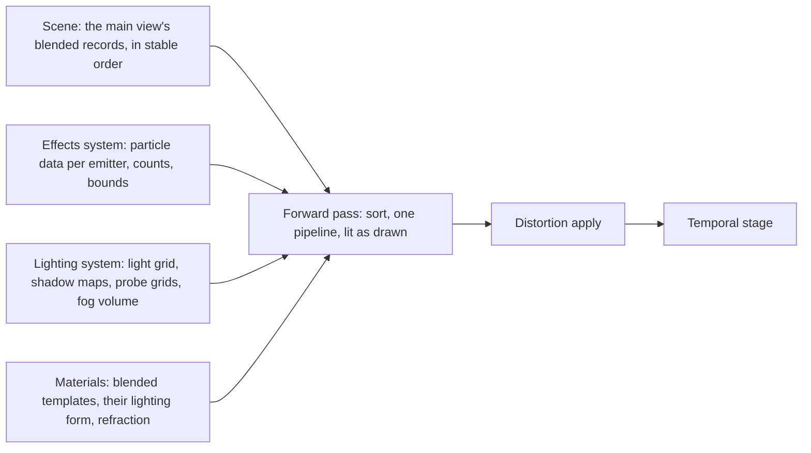
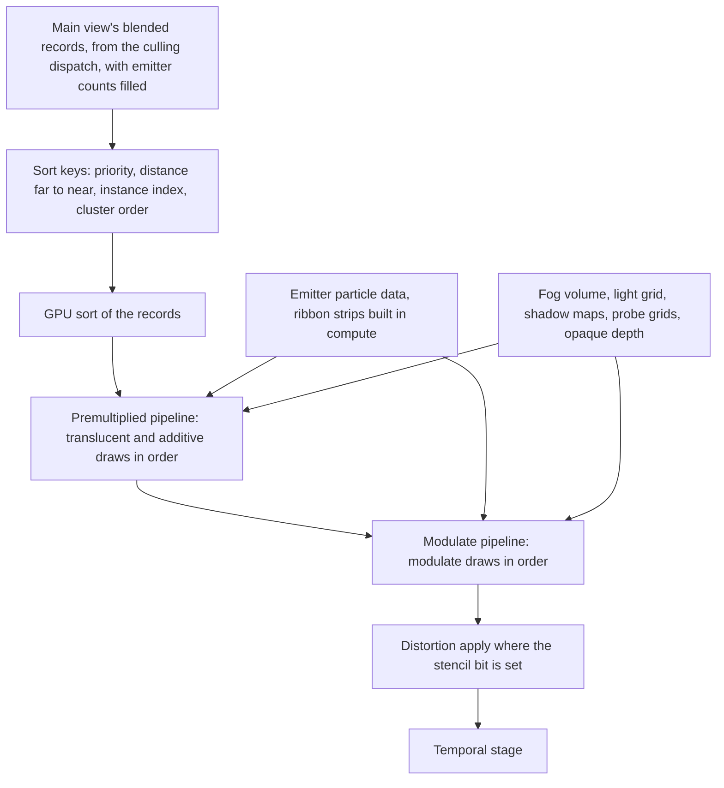

# Transparency

How blended draws are made and composed: translucent, additive and modulate
surfaces, and particles as sprites, ribbons and mesh particles. One forward
pass draws them all at input resolution, back to front by draw, lit as they
are drawn, after the opaque image is complete and before the temporal stage.
Refraction is one offset accumulation during that pass and one apply after
it.

A blended draw is a draw of a template whose blend mode is translucent,
additive or modulate. An emitter is a source of particles with one template;
the effects system simulates it and this document draws it. A particle is one
row of an emitter's data.

## Position

Inside the [scene renderer](scene-renderer.md)'s frame, as its forward pass
and the distortion apply after it. Fed by the [scene](scene.md), whose
culling dispatch writes the main view's blended records, by the
[lighting system](lighting.md), whose light grid, shadow maps, probe grids
and fog volume light the pixels, by [materials](materials.md), whose
templates are the shaders, and by the effects system, which writes each
emitter's particle data. Above the [render graph](render-graph.md) and the
[RHI](rhi.md).

## Invariants

1. Every blended draw of the main view is drawn by the forward pass at input
   resolution, after the sky and fog pass and before the temporal stage. No
   blended draw is drawn at a lower resolution and composited.
2. The forward pass draws its records in one total order: the instance's
   sort priority, which the world sets on entry from the template's
   declared priority and may raise, then the instance's bounds-centre
   distance to the camera from far to near, then the instance index, then
   cluster order.
   The sort runs on the GPU over the main view's blended records each
   frame; the same records give the same order.
3. The forward pass is one pipeline for the translucent and additive blend
   modes, under one premultiplied-alpha blend state in which additive is
   alpha zero, and one pipeline for modulate, drawn after it. The vertex
   stage branches on the record's kind: mesh cluster, sprite, ribbon, mesh
   particle. The pixel stage branches on the template id read from the
   instance record. The forward pass and the decal pass are the two places
   a pipeline spans templates; every other pass has one pipeline per
   template and permutation.
4. A blended pixel is lit by one of two forms the template declares. A
   surface form evaluates the lighting function per pixel from the light
   grid, the shadow maps and the probe grids. A particle form takes its
   light from the fog volume at the pixel and evaluates no light itself.
5. A blended draw writes no depth, no surface data and no motion vector. It
   tests against the opaque depth, fades by its distance to that depth
   where the template asks, reads the fog volume, and writes reactive
   coverage.
6. Particle data is a structure-of-arrays buffer per emitter in a layout the
   emitter declares: position, velocity, size, rotation, colour, age,
   sub-image index, ribbon id, link order, each at a declared offset, and a
   count. The forward pass reads that buffer and nothing of how it was
   written.
7. A sprite is an instanced quad: one corner stream, one index buffer, the
   instance id is the particle. A sub-image has a cutout of four or eight
   vertices the converter fits to the texture's alpha, and the quad is that
   cutout. Facing is one of camera, camera plane, velocity, custom axis.
8. A ribbon's strip is built in compute each frame from its particles'
   ribbon id and link order. A mesh particle emitter is one instanced draw
   of its mesh with the transform read per particle. Mesh particles are
   blended only; an opaque effect model is a world instance.
9. An emitter is an instance of the scene. Its record holds the bounds the
   effect fixes or the union the simulation writes. Its draw record's
   instance count is written on the GPU from the emitter's particle count,
   and for a ribbon emitter the index count is written on the GPU by the
   strip build. Every other draw record has instance count one and the
   cluster's index count.
10. Within a translucent emitter the particles are sorted by view depth on
    the GPU, in that emitter alone. Additive and modulate emitters are not
    sorted.
11. A template that writes refraction has its draws also write a signed
    screen offset into the distortion target during the forward pass. After
    the forward pass one apply reads scene colour at the offset, once, where
    the stencil bit marks a refracting pixel, and merges back. There is no
    blur and no second apply.
12. A record buffer, a sort buffer or a particle buffer that cannot be
    allocated fails by name; no draw is dropped to fit.

## The pass

| Step | Reads | Writes |
|---|---|---|
| Ribbon build | each ribbon emitter's particle data | strip vertices and indices per emitter |
| Emitter sort | each translucent emitter's particle depths | sorted particle indices per emitter |
| Record sort | the main view's blended records, instance records | records in total order, counts per pipeline |
| Premultiplied pipeline | records, particle data, light grid, shadow maps, probe grids, fog volume, opaque depth | scene colour, reactive coverage, distortion target, stencil bit |
| Modulate pipeline | the same | scene colour |
| Distortion apply | scene colour, distortion target, stencil | scene colour |

## Draw kinds

| Kind | Vertices from | Transform | Record count |
|---|---|---|---|
| Mesh cluster | the mesh's streams, or a dispatched instance's copy | the instance record | one |
| Sprite | the corner stream and the sub-image cutout, placed from the particle's position, size, rotation and facing | the emitter's record and the particle | the particle count |
| Ribbon | the strip built in compute, whose index count the build writes | the emitter's record | one |
| Mesh particle | the mesh's streams | the emitter's record times the particle's transform | the particle count |

## Lighting forms

| Form | Light from | Shadow | Fog | For |
|---|---|---|---|---|
| Surface | the lighting function per pixel: sun, light grid, probe grids | shadow maps read directly | the fog volume at the pixel | glass, water, translucent props |
| Particle | the fog volume at the pixel: sun, probes and local lights already scattered into it | in the volume | in the volume | sprites, ribbons, mesh particles |

## Refraction

| Part | Rule |
|---|---|
| Distortion target | two signed screen offsets per pixel, accumulated additively over refracting draws |
| Stencil bit | set by a refracting draw, cleared by the merge |
| Apply | one bilinear read of scene colour at the pixel plus its offset, clamped to the view |
| Order | after both forward pipelines, before the temporal stage |

## Content the pass reads

| Data | Form | Written by |
|---|---|---|
| Effect | emitters with their templates, element kinds, curves over life, sub-image sheets with cutouts, bounds or a flag to compute them | the converter |
| Particle data | the per-emitter buffer of invariant 6 | the effects system, each frame |
| Blended template | shaders for the forward pass, a priority, a lighting form, refraction if written | material templates |

## Components and ownership

| Component | Lives in | Consumed by |
|---|---|---|
| Record sort and the forward pipelines | `src/engine/rendering/passes` | render graph |
| Sprite expansion, cutouts, facing, sub-image blend | `src/engine/rendering/passes`, shaders under `src/engine/rendering/shaders` | the forward pipelines |
| Ribbon build and per-emitter particle sort | `src/engine/rendering/passes` | the forward pipelines |
| Distortion target and apply | `src/engine/rendering/passes` | render graph |
| Emitter instance records and GPU-written counts | `src/engine/rendering/scene` | culling, the forward pass |
| Effect payload reader | `src/engine/rendering/passes` | content loading |

## Boundaries

Above: the effects system, which decides which emitters exist, simulates
them and writes their particle data, and the world, which places blended
instances. Beside: the scene, which culls and orders nothing beyond its
stable record order and hands the forward pass the main view's blended
records; the lighting system, which owns the light grid, the shadow maps,
the probe grids and the fog volume; the material system, which owns the
templates, their priority and their lighting form; the temporal stage,
which reads reactive coverage. Below: the render graph and the RHI. How an
emitter is simulated, how an effect is authored, and how the user interface
and video are composed are outside this document.
