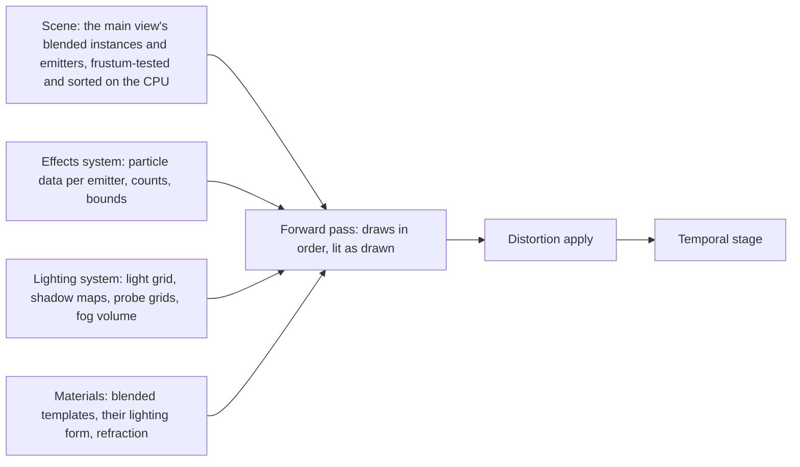
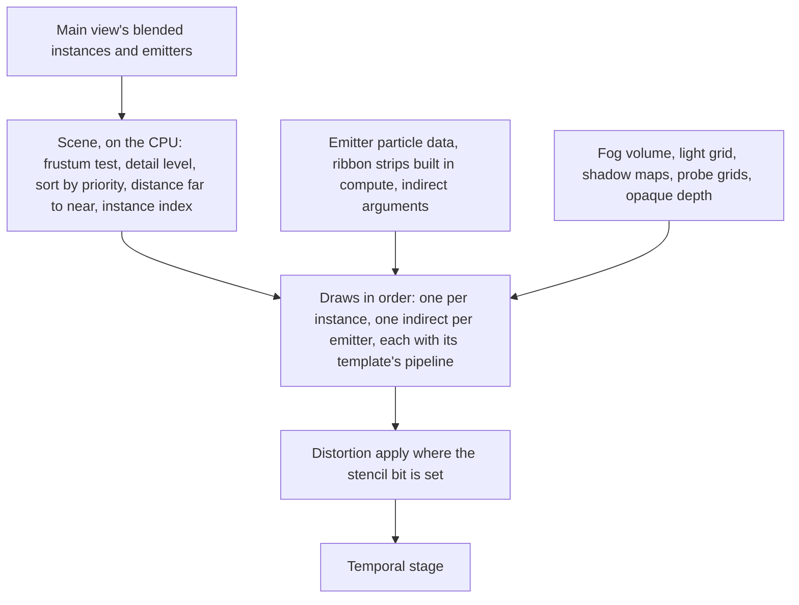

# Transparency

How blended draws are made and composed: translucent, additive and modulate
surfaces, and particles as sprites, ribbons and mesh particles. One forward
pass draws them all at input resolution, back to front by draw, lit as they
are drawn, after the opaque image is complete and before the temporal stage.
Refraction is one offset accumulation during that pass and one apply after
it.

A blended draw is a draw of a material whose blend mode is translucent,
additive or modulate; the blend mode is the material's, and its template
declares which blend modes it supports. An emitter is a source of particles with one template;
the effects system simulates it and this document draws it. A particle is one
row of an emitter's data.

## Position

Inside the [scene renderer](scene-renderer.md)'s frame, as its forward pass
and the distortion apply after it. Fed by the [scene](scene.md), whose
instances and emitters the CPU tests and orders for the main view, by the
[lighting system](lighting.md), whose light grid, shadow maps, probe grids
and fog volume light the pixels, by [materials](materials.md), whose
templates are the shaders, and by the effects system, which writes each
emitter's particle data. Above the [render graph](render-graph.md) and the
[RHI](rhi.md).

## Invariants

1. Every blended draw of the main view is drawn by the forward pass at input
   resolution, after the sky and fog pass and before the temporal stage. No
   blended draw is drawn at a lower resolution and composited. Depth of
   field runs after the temporal stage on the whole image, so a blended
   pixel defocuses by the opaque depth behind it; that is the stated cost of
   one temporal stage with no separate blended composite.
2. The forward pass draws in one total order: the instance's sort
   priority, which the world sets on entry from the template's declared
   priority and may raise, then the instance's bounds-centre distance to the
   camera from far to near, then the instance index. The CPU frustum-tests
   the main view's blended instances and emitters, sorts them by that key,
   and issues one draw per instance and one indirect draw per emitter in
   that order; the same instances and view give the same order.
3. Each draw uses its own template's pipeline, one per template and
   permutation as in every pass, and the pipeline changes between draws as
   the order requires. The blend state is the material's blend mode.
4. A blended pixel is lit by one of two forms the template declares. A
   surface form evaluates the lighting function per pixel from the light
   grid, the shadow maps, the probe grids and the environment map. A
   particle form takes its light from the fog volume at the pixel, which the
   pass samples and hands the template, and evaluates no light itself.
5. A blended draw writes no depth, no surface data and no motion vector. It
   tests against the opaque depth, fades by its distance to that depth
   where the template asks, reads the fog volume, and writes reactive
   coverage: the pixel's coverage becomes one minus (one minus the old
   coverage) times (one minus the draw's coverage), clamped to 0.9, where
   a translucent draw's coverage is its alpha, an additive draw's the
   largest channel of its premultiplied colour, and a modulate draw's one
   minus the smallest channel of its colour. Every light a forward draw
   writes carries the frame's exposure factor, applied by renderer code.
6. Particle data is a structure-of-arrays buffer per emitter in a layout the
   emitter declares: position, velocity, size, rotation, colour, age,
   sub-image index, ribbon id, link order and the particle values its
   template declares, each at a declared offset, and a count. The layout
   states which of the template's particle values it carries, and a draw
   reads the material's value for one it does not carry, as
   [materials](materials.md) states. The forward pass reads that buffer
   and nothing of how it was written.
7. A sprite is an instanced quad: one corner stream, one index buffer, the
   instance id is the particle. A sub-image has a cutout of four or eight
   vertices the converter fits to the texture's alpha, and the quad is that
   cutout. Facing is one of camera, camera plane, velocity, custom axis.
8. A ribbon's strip is built in compute each frame from its particles'
   ribbon id and link order. A mesh particle emitter is one instanced draw
   of its mesh with the transform read per particle. Mesh particles are
   blended only; an opaque effect model is a world instance.
9. An emitter is an instance of the scene. Its record holds the bounds the
   effect fixes or a CPU simulation computes. Its draw is indirect: the
   effects system writes the instance count from the particle count, and
   the strip build, which the forward pass owns, writes a ribbon's index
   count, so the CPU issues the draw without reading either back.
10. Within a translucent emitter the particles are sorted by view depth on
    the GPU, in that emitter alone. Additive and modulate emitters are not
    sorted.
11. A template that writes refraction has its draws also write a signed
    screen offset into the distortion target during the forward pass. After
    the forward pass one apply reads scene colour at the offset, once, where
    the stencil bit marks a refracting pixel, into a frame-only texture,
    and a merge writes it back and clears the bit. There is no blur and no
    second apply. Scene colour is exported as the next frame's history
    after the merge.
12. A particle buffer or a strip buffer that cannot be allocated fails by
    name; no draw is dropped to fit.

## The pass

| Step | Reads | Writes |
|---|---|---|
| Ribbon build | each ribbon emitter's particle data | strip vertices and indices per emitter |
| Emitter sort | each translucent emitter's particle depths | sorted particle indices per emitter |
| CPU order, by the scene | the blended instances' and emitters' bounds and sort priority, the main view | the draw order |
| Draws | instance records, particle data, light grid, shadow maps, probe grids, fog volume, opaque depth | scene colour, reactive coverage, distortion target, stencil bit |
| Distortion apply | scene colour, distortion target, stencil | scene colour |

## Draw kinds

| Kind | Vertices from | Transform | Draw |
|---|---|---|---|
| Mesh | the mesh's streams, or a dispatched instance's copy | the instance record | one draw of the mesh's index range |
| Sprite | the corner stream and the sub-image cutout, placed from the particle's position, size, rotation and facing | the emitter's record and the particle | one indirect instanced draw, instance count from the particle count |
| Ribbon | the strip built in compute | the emitter's record | one indirect draw, index count from the strip build |
| Mesh particle | the mesh's streams | the emitter's record times the particle's transform | one indirect instanced draw, instance count from the particle count |

## Lighting forms

| Form | Light from | Shadow | Fog | For |
|---|---|---|---|---|
| Surface | the lighting function per pixel: sun, light grid, probe grids, the environment map for its reflection | shadow maps read directly | the fog volume at the pixel | glass, water, translucent props |
| Particle | the fog volume at the pixel: sun, probes and local lights already scattered into it | in the volume | in the volume | sprites, ribbons, mesh particles |

## Refraction

| Part | Rule |
|---|---|
| Distortion target | two signed screen offsets per pixel, accumulated additively over refracting draws |
| Stencil bit | set by a refracting draw, cleared by the merge |
| Apply | one bilinear read of scene colour at the pixel plus its offset, clamped to the view |
| Order | after the forward pass's draws, before the history export and the temporal stage |

## Content the pass reads

| Data | Form | Written by |
|---|---|---|
| Effect | emitters, each with its material, element kind, curves over life and sub-image sheet with cutouts; the effect's authored bounds, or a flag that a CPU simulation computes them | the converter |
| Particle data | the per-emitter buffer of invariant 6 | the effects system, each frame |
| Blended template | shaders for the forward pass, a priority, a lighting form, refraction if written | material templates |

## Components and ownership

| Component | Lives in | Consumed by |
|---|---|---|
| The forward pass's draws, in the order the scene gives | `src/engine/rendering/passes` | render graph |
| Sprite expansion, cutouts, facing, sub-image blend | `src/engine/rendering/passes`, shaders under `src/engine/rendering/shaders` | the forward pass |
| Ribbon build and per-emitter particle sort | `src/engine/rendering/passes` | the forward pass |
| Distortion target and apply | `src/engine/rendering/passes` | render graph |
| Emitter instances and their indirect argument buffers | `src/engine/rendering/scene`; the instance count written by the effects system, a ribbon's index count by the strip build | the forward pass |
| Effect payload reader | the effects system's loader | content loading |

## Boundaries

Above: the effects system, which decides which emitters exist, simulates
them and writes their particle data, and the world, which places blended
instances. Beside: the scene, which holds the blended instances and
emitters the CPU tests and orders; the lighting system, which owns the light grid, the shadow maps,
the probe grids and the fog volume; the material system, which owns the
templates, their priority and their lighting form; the temporal stage,
which reads reactive coverage. Below: the render graph and the RHI. How an
emitter is simulated, how an effect is authored, and how the user interface
and video are composed are outside this document.
