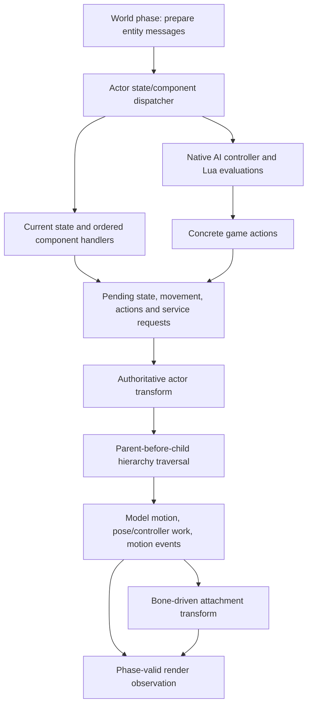

# World, scene and simulation

**Target architecture · working baseline · October 22, 2026.**
[Engine architecture](logical-overview.md) · [Runtime ownership](runtime-model.md).

A world is the authoritative collection of live scene and gameplay instances for
a mission. It integrates entity identity, hierarchy, stage instances, subsystem
bindings and the phase context through which state changes. A scene is a view or
organization of that world for a specific consumer; it is not a second gameplay
world. Rendering, collision and actor selection can require different memberships.

## Object model

| Object / store | Authoritative state | Relationships |
|---|---|---|
| Entity registry | Identity, generation and registration | Resolves references for actor queries, messages and subsystem bindings |
| Object hierarchy | Parent/child membership, local/world transforms, removal state | Owns traversal order; model and attachment children consume parent state |
| Actor instance | Actor-specific state and owned state/component dispatcher | Concrete factories supply player/enemy/vehicle/boss behavior |
| State/component dispatcher | Current/pending state, ordered components and messages | Routes component × state × message combinations under recovered order |
| Model instance | Motion/controller state, pose storage, attachment inputs and instance material state | Owned by its model component or effect; retains shared definitions and supplies render/attachment observations |
| Stage instance | Authored model/area placements, world geometry and environment resource bindings | Contributes render, collision, query and effect membership without requiring every item to be an actor |
| Physics/collision bindings | Association between an engine instance and its collision representation | World-local scene owns native physics objects; movement policy remains in actor/game code |
| Effect instance | Pack bindings, active parts/particles, child state and RNG progression | Uses shared animation, queries and renderer contracts |
| Spatial membership | Registered bounds, groups and consumer-specific associations | Provides candidate sets; exact query/filter semantics belong to the consuming system |

The hierarchy is an ownership/update relationship. Spatial containment, material
batching, collision filtering and AI target lists are different relationships.
Do not infer a single octree/BVH or universal spatial database from the existence
of object bounds. Existing actor-pair traversal and visibility branches retain
their own behavior until a replacement representation is proven equivalent.

## Entity and component execution

Arrows describe interactions and the selected recovered actor/model local order,
not a global order among all systems. AI participates through registered component
handlers; it is not a free-standing script loop that supersedes actor state.
The separate second hierarchy traversal remains separate from the simulation walk.

A state transition sends the mapped old-state transition message, destroys the
old state, installs the pending state, then sends the new-state transition message.
Component/message sorting and registration order are part of the dispatch contract.
Original RTTI includes Runner, Shooter, Grappler, Dodger and AiBehavior; these
concrete behaviors belong to Bullet Witch game code. The shared dispatcher owns
mechanics, not movement or damage policy.

## State authority and phase interfaces

| Boundary | Input | Result | Ownership / timing |
|---|---|---|---|
| Input → game behavior | Sampled device identity, held/pressed/repeat/action state | Commands interpreted by the selected screen/mode/actor policy | Engine input service owns observations; no arbitrary resampling midway through a consumer phase |
| Script → game services | Validated native arguments and context | Immediate values or retained pending operation | Root/mission/AI API sets stay distinct; completion uses each binding's recovered semantics |
| AI → concrete action | Actor observations, tree/controller state, Lua scores | Action selection, transition and game behavior requests | AI component owns controller state; concrete action lifetime follows its controller contract |
| Actor → animation | Selected motion/controller changes and timestep | Pose, motion-event outputs and attachment data | Model instance owns mutable pose; definitions stay immutable |
| Actor → collision/physics | Movement/query request or scene mutation | Query/contact/scene result delivered to its specified consumer | Physics does not unconditionally overwrite actor transforms; synchronization rules are operation-specific |
| World → effects | Authored effect request, transforms, time and required observations | Emitter/particle/child state and presentation contribution | Effect instance owns RNG and lifetime; update order remains observable |
| World → renderer | Phase-valid instances, bounds, transforms, poses and material overrides | Render scene updates and view inputs | Renderer cannot mutate authoritative actor state |
| World → audio | Listener/emitter observations and cue operations | Spatialized playback state and status | World owns spatial associations; audio service owns device/cue execution |
| World → persistence | Supported consistent world/mission state | Owned snapshot for serialization | Capture must name its phase; asynchronous storage never reads changing world memory |

These are semantic contracts, not finalized C++ signatures or a generic command
bus. Immediate calls remain immediate where required. Deferred messages carry
receiver identity, payload ownership and a specified delivery phase. A global
end-of-frame queue would change behavior if it delays a recovered same-call effect.

## AI and game behavior

The engine AI mechanism owns authored-tree traversal, score comparison, branch/
controller transitions and action-interface lifetime. The actor's AiBehavior
component supplies its environment and cadence gates. Root/mission Lua schedules
game flow; AI Lua evaluates the parts selected by the native controller.
Concrete native actions implement locomotion, combat and other game behavior.

The mapped evaluator keeps the earlier candidate on equal scores. Pending actor
state transitions and per-component timers can gate AI work. Therefore neither
uniform AI ticks nor arbitrary parallel evaluation is an architectural default.
Adding an enemy action changes its concrete behavior and registration; it does
not change the Lua pump or require a separate actor store.

## Animation and model state

Shared definitions describe skeletons, tracks and meshes. Model instances own
motion positions, controllers, pose results and any mutable material/morph state.
The selected recovered model path advances motion, prepares controllers,
evaluates/cleans tracks and processes motion-event channels; attachment children
then read the required bone transform. Other consumers, including model particles,
use the same evaluator with their own instance state.

Pose consumers must identify a valid evaluation result and its lifetime. Do not
assume one pose calculation per displayed frame or discard a second pass as
redundant without closing that contract. Exact interpolation, SIMD approximation,
sentinel/rounding and coordinate conventions belong to animation/math contracts.
A math helper is shared only when the numerical operation is actually the same.

## Collision, physics and movement

The world owns a physics service/scene plus engine collision behavior. Scene
mutations use the recovered queue and phase boundaries. A selected backend
implements the required shape, query, simulation and release contract; it cannot
silently choose gameplay behavior based on its SDK defaults.

Actor-pair separation is a distinct engine path: eligible pairs are gated by
bounds, horizontal radii produce separation vectors, and generation-checked
messages deliver the response. Moving-parent correction and movement component
handlers are further paths. They must not be replaced by a single physics step.

For the mapped physics service, timing configuration receives
`min(dt, 0.06666667f)` while simulation receives the original `dt`, followed by
blocking fetch. Queued mutations precede that scene step in the mapped game path.
The contract does not establish where every actor family writes back results or
how unrelated hide/trace workers join. Those edges remain explicit evidence gaps.

## Effects as world participants

Effect packs are shared definitions; runtime instances own binding choices,
part/particle state, children and random-number progression. Spawn/stop/destruction
are distinct operations. Emission consumes transforms and time, simulation may
query collision or animation, and presentation produces sprite/model contributions.
A model particle shares the model/pose/render mechanisms rather than implementing
another model engine.

Resource load order and duplicate IDs affect binding. RNG call order, including
branches with multiple draws, affects behavior. Caps, graceful stop, child lifetime
and deferred storage return are part of the instance contract. Rendering may
consume a retained output after simulation stops producing new particles.

## Scene, cameras and spatial queries

The world supplies transform/bounds membership and authored stage data. A game
camera controller supplies a view request; the renderer owns the derived view
and visibility result. Physics queries, actor-neighbor queries, spawn eligibility
and rendering visibility remain separate APIs even when they can share data.
A visibility result is not evidence that an actor should stop simulating.

Stage loading is known to request model collision/render resources, area data,
effect data and sixteen cubemap resources. That establishes distinct inputs,
not a fully decoded area partition or lighting algorithm. Exact area topology,
camera controller equations, coordinate conventions and visibility algorithms
are assigned to the relevant world/view contracts. No broad-phase data structure
or camera behavior is invented to fill those gaps.

## Creation, retirement and world release

Construction first acquires required definitions, then creates the instance and
registers each hierarchy/system binding as acquired. Partial failure unwinds those
registrations; no half-created actor becomes queryable as ready. The exact
script-visible failure remains the corresponding binding's contract.

Deferred spawn records and live actor instances are distinct. The mapped route
can store an actor record/transform/life, retire the live instance, and later
recreate one under population/distance/visibility gates. Its limits are local to
that path, not a universal engine entity budget.

Retirement marks the object and children, then maintenance detaches hierarchy
nodes and advances delayed reclamation. The ordinary path destroys an object on
the third later maintenance call after bucket-2 admission—not the third displayed
frame. Subsystem bindings and handle invalidation follow the recovered teardown
points. Submitted work also needs independently retained data; delayed buckets
alone do not prove GPU safety. World release quiesces these uses before freeing
world-local services or mission resources.

## Evidence and open contracts

| Area | Grounding | Still needed for faithful bodies |
|---|---|---|
| Identity/hierarchy/components | [Actor lifecycle](../../research/engine/subsystems/actor-lifecycle.md) | Actor variants, wrap/exhaustion and exceptional paths |
| Factories and model ownership | [Actors and animation](../../research/engine/subsystems/actors-and-animation.md) | Variant-specific construction and release |
| AI mechanism/actions | [AI runtime](../../research/engine/subsystems/ai-runtime.md) | Full action equations, controller limits and callback semantics |
| Animation | [Animation data](../../research/engine/subsystems/animation-data.md) | Exact numerical branches and secondary consumers |
| Collision/dynamics | [Physics](../../research/engine/subsystems/physics-and-collision.md) | Shape/filter schemas, movement/writeback and middleware fidelity |
| Effects | [Particle contracts](../../research/engine/subsystems/particle-runtime-contracts.md) | Specialized math, scalar terminal behavior and allocation failures |
| Stage/spatial/view inputs | [Stage loading](../../research/engine/subsystems/mission-and-stage-loading.md), [renderer](../../research/engine/subsystems/rendering.md) | Area topology, camera and full visibility/lighting behavior |

The architectural owners and exchange boundaries are proposed. The evidence
constrains their operations; missing behavior is not delegated to an unspecified
“world update” implementation.
