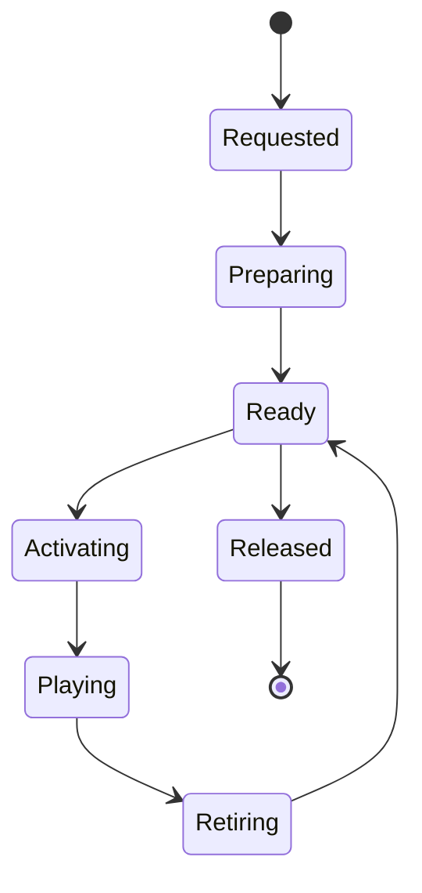

# World and resource lifecycle

Status: proposed contracts; no runtime implementation or migrated services.

## Loading is not activation

[LevelStreaming.cpp](https://github.com/EpicGames/UnrealEngine/blob/f45729c0b6f097038e72b52d366a62baeca3275b/Engine/Source/Runtime/Engine/Private/LevelStreaming.cpp#L1023)
`ULevelStreaming::UpdateStreamingState`, `RequestLevel` and
`AsyncLevelLoadComplete` separate requested residency, package loading and
visibility. Load completion enters `LoadedNotVisible`, not active gameplay.

These are proposed new resource/instance states. The resource can remain ready
while an actor instance retires; changing visibility does not recreate identity.

[AsyncLoading2.cpp](https://github.com/EpicGames/UnrealEngine/blob/f45729c0b6f097038e72b52d366a62baeca3275b/Engine/Source/Runtime/CoreUObject/Private/Serialization/AsyncLoading2.cpp#L11105)
`FAsyncLoadingThread2::TickAsyncLoadingFromGameThread` and package event stages
separate worker preparation from game-thread finalization.
[World.cpp](https://github.com/EpicGames/UnrealEngine/blob/f45729c0b6f097038e72b52d366a62baeca3275b/Engine/Source/Runtime/Engine/Private/World.cpp#L3666)
`UWorld::AddToWorld` incrementally registers components and initializes actors
under time limits; `RemoveFromWorld` can incrementally retire them. Unreal also
has explicit blocking loads. It does not promise all loading work is background.

The new IO/decode pipeline prepares immutable resources. Shared meshes, textures,
skeletons and executable script/program resources are deduplicated, with
per-instance mutable state separate. A new streaming manager requests work;
a budgeted activation queue registers complete bundles. Initial mandatory work
belongs in a loading state. Navigation cooking, shader compilation, decoding and
script preparation must not hide inside an ordinary actor tick or admission.

## Actor ownership

[LevelActor.cpp](https://github.com/EpicGames/UnrealEngine/blob/f45729c0b6f097038e72b52d366a62baeca3275b/Engine/Source/Runtime/Engine/Private/LevelActor.cpp#L456)
`UWorld::SpawnActor` and `DestroyActor` own world admission/removal.
[Actor.cpp](https://github.com/EpicGames/UnrealEngine/blob/f45729c0b6f097038e72b52d366a62baeca3275b/Engine/Source/Runtime/Engine/Private/Actor.cpp#L4276)
`PostSpawnInitialize`, `FinishSpawning`, `PostActorConstruction`,
`DispatchBeginPlay`, `BeginPlay` and `RouteEndPlay` provide the lifecycle model.
[ActorComponent.cpp](https://github.com/EpicGames/UnrealEngine/blob/f45729c0b6f097038e72b52d366a62baeca3275b/Engine/Source/Runtime/Engine/Private/Components/ActorComponent.cpp#L1967)
`RegisterComponentWithWorld`, `CreateRenderState_Concurrent`,
`CreatePhysicsState` and `UnregisterComponent` establish subsystem participation.

Proposed fresh contracts:

- World owns actor identities, lifecycle queues and authoritative lifetime.
- Actor owns components and instance state; a controller possesses an actor
  without owning the actor's physical memory or renderer state.
- Registration creates physics/render/audio/script participation. Initialization
  resolves required components; begin-play happens once readiness is satisfied.
- End-play cancels tasks and unregisters participation. Final reclamation waits
  for jobs and render/physics/audio consumers to release their references.
- Handles carry identity/generation across asynchronous results. No job or event
  can resolve an old identity to a newly spawned actor.
- Loaded resources are shared immutable data. Instance activation and render
  visibility do not implicitly unload them or restart animation.

The implementation needs explicit failure/cancellation paths at each stage.
Late resource completion cannot activate a canceled mission; retirement cannot
leave a controller tick, timer or emitter alive against a destroyed instance.
