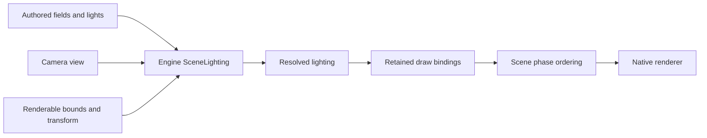
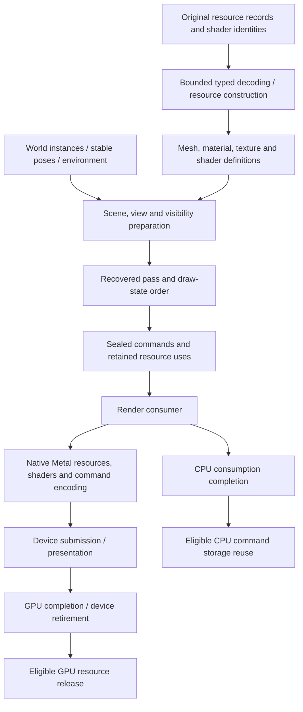
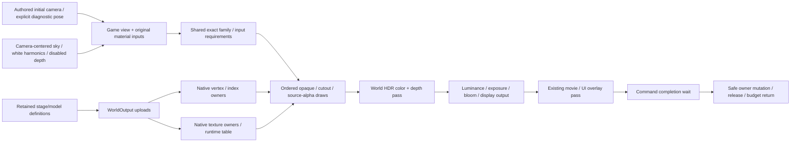
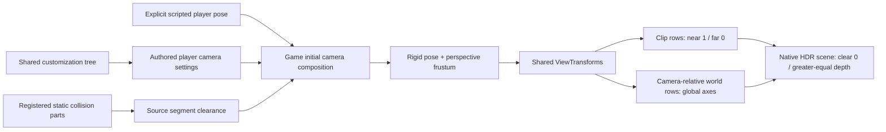
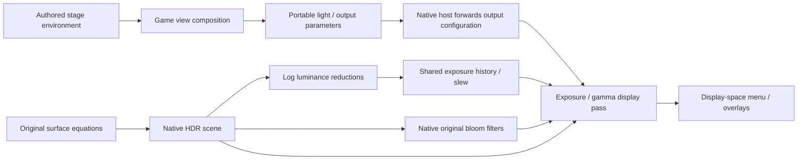
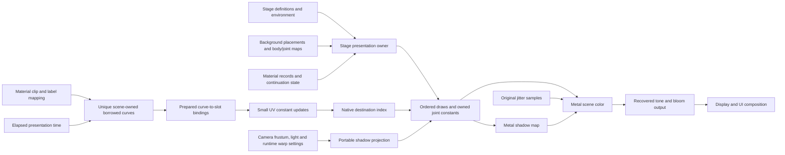

# World renderer reconstruction

**Faithful reconstruction baseline · October 23, 2026 · initial stage presentation implemented; reconstruction limits explicit.**
[Rendering and presentation](rendering-and-presentation.md) defines the engine
owners. This drill-in defines how their implementation follows the original
renderer, beginning with One Shot Kill (`cm01_00`, stage `st04_c`). The
[implementation plan](../../IMPLEMENTATION.md#src-03-one-shot-kill-delivery-breakdown)
owns delivery order. This file owns the renderer's fidelity boundaries and must
be refined as the code establishes them.

Reconstruct the original renderer's data interpretation, shader behavior, state
transitions, draw ordering and lifetime first. Translate those semantics into
native Metal on the Mac. Later performance and graphics improvements are explicit
changes against that baseline. A scene that appears on screen is an integration
milestone; it does not by itself establish the original renderer's behavior.

The immediate source of evidence is the mapped Steam D3D9Ex renderer. That is not
a claim that its implementation or output is identical to the Xbox 360 renderer.
Neither its API objects nor its 32-bit pointer layout become portable engine
contracts. Preserve consequential behavior while representing it in maintainable
source with descriptive names.

## Baseline work placement and later performance design

The current split follows the recovered Steam path: CPU clip sampling, local
pose composition, hierarchy and secondary-bone constraints produce palettes;
the native GPU path consumes those palettes for skinning and performs the
implemented material/shading passes. This is a reconstruction baseline, not a
recommendation for how a new engine should divide work on modern hardware.
[Skeletal animation](../../research/engine/subsystems/skeletal-animation-baseline.md),
[secondary motion](../../research/engine/subsystems/costume-secondary-motion.md)
and [animation layers](../../research/engine/subsystems/alicia-animation-layers.md)
state the evidence and current consumer limits. Unreconstructed morph, effect,
visibility and action paths do not inherit a claimed CPU/GPU policy by analogy.

A working direct port is the reference for the later improvement pass. Moving
animation/deformation work between CPU and GPU, batching it differently or
introducing target-specific SIMD/compute paths belongs to that explicit design
pass, with native measurements and equivalent observable behavior. A measured
performance blocker or demonstrated reconstruction defect can justify a focused
exception before then; document its evidence, preserved contract and validation.
Do not treat source fidelity as a reason to ignore a known bottleneck, or present
an architectural repartition as established original behavior.

The [Steam performance baseline](../../research/engine/subsystems/steam-performance-baseline.md)
records the official 60 fps aim and configurable caps, explicit 720p30 minimum,
and the limits of contemporary reviewer observations. Stable 60 fps is now the adopted
faithful-port acceptance target; the document distinguishes it from measured
Mac acceptance, which has not yet been established.

## Scene lighting ownership

The [lighting drill-in](lighting.md) defines the subsystem contract.
`scene::SceneLighting` owns decoded irradiance fields, authored emitter values,
directional lighting, scene parameters and prepared view-light admission. Fields
have generic scene-local identities; game composition maps the original names
to those identities. Receiver snapshots supply explicit policy, local model bounds
and final transforms. Spatial receivers query the selected field and model-light
list; static receivers use stage ambient and the global view packet; sky retains
its white policy. Unknown policy rejects. Controllers own none of these algorithms.

Stage composes `LightingPublication` and registers authored receiver bounds,
field policy and destinations. Its sealed `ReceiverPublication` values own the
cache/packet distribution and publish through RenderScene's restricted lighting
capability; the native draw registry remains authoritative. Body and weapon observe separately because original callbacks use
each model's bounds. Camera changes refresh scene light admission once. Runtime
publication performs no field decoding, geometry upload or draw-list replacement.

Color draws carry an explicit scene phase, separate from material blend state.
The backend prepares stable phase order when draws change: background, opaque,
masked and the two later source lists. Opaque/masked establish depth; later lists
test without writes. Original chunk identifiers stay in the game format adapter.

See the [source contract](../../research/engine/subsystems/scene-lighting-pass-contract.md)
and [lighting owner reference](../../research/engine/subsystems/lighting-reference-boundaries.md).
These ownership/pass corrections are distinct from the open whole-frame
character brightness comparison.

## Recovered baseline and remaining questions

The facts below are static or corpus-derived at the scope stated by the linked
research. They have not been validated by rendering the original world in this
reconstruction. Proposed engine owners are our architecture, not recovered class
names.

| Area | Recovered evidence | Implementation consequence / open boundary |
|---|---|---|
| Resource construction | [Resource handlers](../../research/engine/subsystems/resource-dispatch.md#native-gpu-resource-consumers) create textures, vertex/index buffers and named shader objects; `vfx2.mesh.create` assembles their references | Preserve typed decoding, phase/publication identity and release associations. CPU decode, upload and usable device state are separate readiness conditions. |
| Model commands | [Builder `0x421e90` and executor `0x427220`](../../research/engine/subsystems/rendering.md#resource-to-draw-path) retain mesh/model references and copied state, check readiness/groups and optional deformation, then traverse render records | Reconstruct ordered typed operations with retained inputs. Full group/visibility/deformation semantics remain open; do not assume every group is always visible. |
| Record execution | `0x4303f0` traverses nested records, declarations, streams, indices and indexed draws; the direct draw forwards six fields in D3D order | Preserve primitive type, base vertex, minimum vertex, vertex count, start index and primitive count. The alternate `0x430810` route is a distinct unresolved case, not permission to use the direct path everywhere. |
| Vertex layouts | [PC model evidence](../../research/engine/subsystems/model-data.md#pc-vertex-declarations) establishes eight-byte D3D9 declaration elements, packed/normalized attributes and half-width texture coordinates in PW0 | Decode the actual stage declarations. PW0's strides/attribute roles are evidence for that model, not a universal mesh layout or a confirmed `st04_c` layout. |
| Shader selection | [Registry `0x954420`](../../research/engine/subsystems/rendering.md#all-named-shader-variants-resolved) maps 766 names through S/T pairs to 490 cached shader-model-3 programs | Preserve variant identity and stage selection. Registry resolution does not establish constant meanings, equations, texture roles or visual equivalence. The 49 other unique broad-scan hashes are outside this registry. |
| Submission | [Publication `0x40f920`, traversal `0x408f50`, worker `0x40fbe0`](../../research/engine/subsystems/rendering.md#render-queue-and-presentation-thread) establish a command arena, producer wait, separate render consumer and paced presentation | Preserve submission order and safe reuse. Recover the relevant scheduling contract before implementing world concurrency; the observed arena positions do not justify a generic buffering count or arbitrary frame cadence. |
| Effects | [Particle GPU contracts](../../research/engine/subsystems/particle-runtime-contracts.md#geometry-to-gpu) map triangle batches, shader pairs, blend/depth state and shared model rendering | Integrate required effects through the same renderer. Some state is inherited: particle blend mode 4 leaves a constant unchanged while writing depth. Generic blend presets are not an equivalent replacement. |
| Views, lighting and passes | [Current evidence boundary](rendering-and-presentation.md#evidence-boundary) identifies these owners but does not close their full behavior | Recover coordinate/projection conventions, visibility, constants, render-target dependencies and pass ordering as the stage needs them. Do not label the complete renderer forward, deferred or PBR from this evidence. |

Stage cubemap requests and material names suggest inputs to investigate; they do
not establish a lighting equation or environment-selection algorithm. No inferred
meaning is promoted to a recovered contract without a native consumer or other
independent evidence. Keep raw compatibility identifiers beside the descriptive
interpretation in research and decoder contracts.

## Data flow and native boundary

Arrows show data and lifetime dependencies, not a recovered full pass graph or
an implemented worker schedule. An input referenced directly by the GPU cannot
be recycled merely because the render consumer has finished encoding commands.

| Responsibility | Portable contract / reusable implementation | Native target implementation |
|---|---|---|
| Asset meaning | Bounded layouts, draw ranges, resource identity, shader variants and constant semantics | Supported GPU formats and any explicit conversion preserving decoded meaning |
| Scene and view | World observations, view conventions, visibility/group rules and immutable draw inputs | Target-specialized work may replace measured hot paths behind the same observable contract |
| Materials and passes | Required shader inputs, inherited state, attachment dependencies and draw order | Metal shader functions, pipeline objects, argument/buffer layouts and attachment actions |
| Submission | Ordered commands, ownership, CPU completion and device retirement contracts | Device queues, uploads, synchronization, resource visibility and presentation |
| Memory | Existing domains, budgets, owner lifetimes, admission/failure and accounting | Native CPU backing, GPU placement/storage mode and actual device allocation accounting |

Use the existing source map: portable `include/bw/render/` contracts, reusable
`src/render/` behavior, and selected `src/platform/<target>/` implementations.
Game camera policy and stage assembly remain in game code. Standard device types
do not escape into shared headers. This does not require a virtual interface or
new library for every table row.

D3D-to-Metal translation must document the required declaration formats,
normalization, matrix multiplication/storage convention, coordinate/depth range,
winding/culling, rasterization conventions, texture addressing/filtering/mips,
color/channel interpretation, alpha test, blend/depth/stencil behavior and constant
layout for each supported path. These are contracts to establish, not claims that
all differences have been resolved. Unsupported required semantics fail with the
asset/variant/record identified; they do not silently select a plausible shader.

Shader implementations remain standalone native source assets, compiled by the
build. Record which original variant, inputs and equations each implements and
how portable constants map into its native bindings. Material compatibility does
not require the same native binding layout on every target. Avoid embedding shader
text in the host, silently substituting PBR materials, or introducing an unproven
shader translator as a prerequisite for the whole registry.

## Implemented static geometry and surface boundary

The singular portable [WorldOutput](../../include/bw/render/world.hpp) owns model
and texture identities, immutable uploads, explicit runtime texture tables and
ordered surface draws. [WorldRenderer](../../src/platform/macos/world_renderer.hpp)
is the selected Mac backend. Its standalone depth shader reconstructs projected
bias behavior; its surface shader reconstructs the traced static families with
geometric/normal-map surfaces, layered bases, vertex illumination/color,
directional diffuse/specular, reflection, cube environment and fog inputs.
The shared `world_material_requirements` helper classifies exact supported
original selectors and required inputs independently of the target. [Source and verification mapping](../../research/engine/subsystems/world-renderer-foundation.md)
records the original program identities and register meanings without exposing
those names as engine architecture.

This is implemented ownership and presentation order, distinct from the recovered
original engine's full pass graph. CPU metadata uses injected domains; buffers,
textures and depth storage hold device charges until actual GPU completion.
Native pipeline and command metadata remain external API allocations. Failed
upload or selection replacement retains the prior complete owner. Absent texture
table entries are explicit: partial inspection can draw only materials whose own
required textures reside, while whole-model readiness remains false.

The implemented family set covers all 4,100 ordinary draws across the ten stage
objects, 674 authored prop draws and the sky material. The three untextured
below-stage quads now consume their source constant/light/SH/fog equations.
Required material families preserve their directional contribution and sample
the retained shadow pass; local-light lists remain a separate consumer.
Alpha-cutout coverage and source-alpha blending are implemented. This census
establishes required stage material support, not the engine's entire shader set.

Inspection composes a source-derived static initial camera and applies initial
source group masks and authored body/joint placement. It consumes camera,
stage directional light, spherical-harmonic irradiance, fog and display settings.
The view uses recovered reverse depth and surface sampling. Runtime destruction,
area-driven visibility/environment changes, effects and full renderer readiness
remain separate. The cutout depth program retains raw-UV alpha coverage.
[State evidence](../../research/engine/subsystems/world-renderer-state.md)
distinguishes defaults from authored state. [Material consumption](../../research/engine/subsystems/stage-presentation-materials.md)
and the slice-4 ownership section below record current consumers and remaining
boundaries.

The existing native memory scenario exercises indexed depth and actual surface
pixels with synthetic data, including layered texture/material modulation, HDR
sky, environment cubes, source-alpha blending, raw-UV cutout coverage, fog, unusual
normal-map inputs, resource failure and retirement. Stage-corpus execution and
matched original-game captures are different evidence levels. The implementation
has not established full numerical or image parity from those synthetic checks.

## Initial camera, view and native state

The earlier camera height, direction and field of view were inspection guesses.
They did not establish the original initial view and are replaced by a bounded
source-derived initialization. [Camera reconstruction](../../research/engine/subsystems/player-camera-initialization.md)
records the scripted pose, authored ordinary preset, collision registration and
ordered clearance algorithm. This is a static snapshot: the actual player actor
and mission `start` callback have not executed in the inspection path.

The shared customization tree belongs to the resource/format layer. Its player
camera settings are inputs to game camera policy; stage assembly does not turn
the tree into a player-camera owner. The game camera composes an explicit
scripted player position/yaw, the authored preset and registered static collision.
It applies vertical, lateral and rear clearance in source order. Moving actor
collision, following, input, interpolation and vibration remain outside this
initial snapshot.

[ViewTransforms](../../include/bw/render/view.hpp) validates a rigid camera basis
and symmetric perspective frustum, then constructs portable dot-product rows.
View rows rotate into camera coordinates; material rows only subtract the eye
and retain global axes for normals and light vectors. Mixing those spaces would
change material equations even when the projected geometry appears correct.
The recovered positive-forward-Z projection maps the near plane to one and the
far plane to zero. Native world presentation clears depth to zero and requires
compatible greater-depth submissions; the sky can use nonwriting always-pass
depth. Isolated caller-owned render passes keep an explicit independent policy.

The sky is an independently submitted scene object. Its original transform keeps
its authored yaw and height while following the camera eye; the shared view
composes that transform without scaling the dome or changing the perspective.
Its original pass disables depth testing and writing, represented as an
always-pass, nonwriting draw before world geometry. Its original constant white
spherical-harmonic input is carried as seven packed coefficient vectors,
independently of material ambient and illumination.
The initial inspection omitted the enabled runtime harmonic feature and selected
a different cached program, producing a black sky. The corrected selector and
coefficient path preserve the original polynomial instead of injecting ambient
brightness. The [installed-sky comparison and source trace](../../research/engine/subsystems/sky-presentation.md)
record that correction and its exact key encoding.

An optional explicit rigid pose supports diagnostic exterior and upward views
through the same stage view and renderer. It retains the authored perspective,
resident assets and output history. This override changes neither the normal
starting camera nor Lua/checkpoint execution; it is not player movement.

The original main stage pass overrides surface minification to anisotropic
filtering with a maximum of four, retaining linear magnification and mip
filtering. The portable surface state represents this requirement; Metal maps
it to a linear filter plus maximum anisotropy. Environment sampling retains its
separate clamp/linear state and anisotropy one. Texture construction now follows the verified default and installed mip-disabled
setting; linear mip filtering is represented independently of texture level
count. The optional original generated-chain algorithm remains separate. See
[texture sampling](../../research/engine/subsystems/texture-sampling.md). [State and sampling audit](../../research/engine/subsystems/world-output-fidelity-audit.md)
records the exact clear/compare and sampler witnesses, API sample-center
translation and numerical device checks.

Repeated offscreen inspection also samples the original mission's checkpoint10
and checkpoint20 positions through the same initial-camera constructor, plus an
explicit upward pose. These are diagnostic viewpoints; neither checkpoint is
executed or saved. Each capture first advances 90 starting-view frames, then 180
exterior-view frames on the same production renderer and exposure history.
The earlier captures showed textured exterior geometry but clipped ground and a
black sky. Source tracing identified a missing runtime irradiance selector bit:
it selected shader programs that never consumed the objects' original harmonic
coefficients. The implementation now evaluates those coefficients at the surface
normal, using authored scene RGB for ordinary objects and the original white
field for sky. This contribution adds to baked vertex illumination independently
of material ambient. Corrected offscreen captures now show the starting cave,
textured exterior ground, industrial buildings, mountains and cloudy sky without
the previous white-ground clipping. The renderer does not substitute ambient
values or normalize the images.
Generated PNGs, raw HDR readback and pose logs remain under the ignored stage
reconstruction evidence directory.

During slice 3, the actual `StartupHost` path was launched at the diagnostic
checkpoint 10 pose and captured after 60 presented frames. Its 4,097 ordinary
world draws plus sky show the same coherent scene as offscreen rendering;
`slice3-host-checkpoint10.png` and its log retain that window verification.
This closes the earlier black-sky/clipped-ground failure for the first static
view. It does not claim full original-game image parity, the complete shadow
pass graph or gameplay camera execution.

Slice-3 verification included the existing six CTest entries, original-root
corpus and fatal clang-tidy across its 96 compilation entries. Native readback checks
exercise constant irradiance, quadratic normal dependence, transformed normals,
and additive combination with baked vertex illumination. These supplement the
real scene/window verification rather than replacing it.

## Scene color and display output

The material pass produces scene HDR color. Writing it directly to an eight-bit
window target bypassed the original exposure and gamma processing and produced
a rejected, nearly black cave view. Display conversion is an engine owner with
a native backend, independent of game menu composition.

The portable `WorldOutputParameters` carries stage-authored tone, bloom and
adaptation settings. `ExposureController` owns the recovered bounded luminance
history and slew algorithm without a device or implicit clock. The Mac
`WorldPostprocess` owns retained HDR/depth/intermediate textures, GPU reduction,
bloom and final display encoding. Its standalone shader preserves the recovered
output equations; it does not substitute a modern tone curve. See
[display reconstruction](../../research/engine/subsystems/world-display-output.md)
and [adaptation](../../research/engine/subsystems/world-output-adaptation.md).

The host adapter must forward authored output settings to the same native
renderer that presents the frame. This operation is required by the common
interface; a silent default previously caused the live host to omit tone mapping
while direct-backend probes displayed it. Native-host acceptance therefore
exercises this adapter as well as the backend shader chain.

The host completes GPU work before reusing the retained targets or reading the
previous luminance scalar. The first frame consumes its current GPU measurement;
there is no invented initial exposure. Target storage is charged to the device
budget and retired with the view. This preserves the existing conservative
submission contract; asynchronous rendering remains separate work.

`StageEnvironment` reads the original customization hierarchy. The game adapter
converts the source light vector to the recovered shader direction and publishes
the base light plus tone settings once. Ordinary objects publish authored stage RGB through the original constant
spherical-harmonic constructor; the sky publishes white through that same
coefficient path. This is separate from material ambient/emission. Slice 4
adds the required directional/shadow terms and authored fog; shadow visibility
attenuates direct diffuse/specular without darkening this irradiance or baked
lighting. Local-light lists, runtime visibility and area-driven environment
changes remain open. Native image acceptance is tracked separately from
implementation and scalar tests.

## First workload: One Shot Kill

The **World renderer foundation** milestone builds reusable world rendering. Its
first acceptance criterion is **first visible level**, using actual `st04_c`
geometry and a source-derived static initial camera at the scripted spawn.
The inspection supplies that pose explicitly; actual actor creation and camera
execution during gameplay remain separate acceptance work.

Before implementing the material subset, enumerate the stage's actual mesh,
texture, shader, group and draw-record dependencies from its loading path and
placements. The [mission map](../../research/engine/subsystems/mission-and-stage-loading.md)
and [DLC comparison](../../research/engine/subsystems/dlc-first-level-selection.md)
provide entry points, not the completed resource closure. Neither the broad
15-terrain-mesh inventory nor PW0 proves which layouts this stage uses.

For each required path, connect the source record/native consumer to the typed
contract, shader/state mapping, resource owner and acceptance evidence. Keep the
census and source findings under organized `research/engine/`; generated manifests
and copied inputs stay in ignored `research/evidence/`. This document records the
resulting architectural decisions and links to that evidence.

The foundation covers the confirmed static subset: mesh/index data, transforms,
view/projection, depth and original textured-material behavior needed to see the
level. Record all omitted contributions visibly in the acceptance report. Sky is included where its original static material is now reconstructed.
The base authored light and HDR-to-display chain are required by this first view.
Animated area overrides, backgrounds, effects and additional passes enter the
following stage presentation slice as their actual consumers are reconstructed. A simplified
inspection output, if needed, must be identified as diagnostic and cannot satisfy
acceptance for a missing original material or pass.

Alicia, animated enemies and model particles extend these same model/material/
submission contracts. Do not create a stage-only renderer that bypasses them.
Resource loading can advance independently of unresolved camera or shader work;
required unresolved rendering behavior remains explicit rather than being filled
in from assumptions.

## Ownership, failure and verification

Definitions, world instances and submitted work have separate owners. The mission
can stop creating contributions and release its resource interests while an
already submitted packet still retains the uses needed to finish. Mutation or
recycling of pose/constant data must respect both CPU consumption and actual GPU
use. Borrowed views require a stable lifetime through their last consumer.

Extend the [memory and residency](memory-and-residency.md) and
[device-memory ownership](../../research/engine/subsystems/device-memory-ownership.md)
contracts for mesh, index, texture, staging, constants and command storage.
Account for payloads and backing, including simultaneous old/new allocations
during replacement. Admission failure and partial upload must unwind owned
resources; no failed construction may publish a renderable object. Allocation
budgets come from representative measurements or explicit application policy,
not invented historical limits.

The current Mac startup path uses conservative GPU completion waits. Any move to
asynchronous world submission needs explicit retirement evidence and bounded
in-flight ownership before those waits change. Preserve startup UI/movie behavior
when sharing the presentation device. Device errors and cancellation are distinct
from successful frame completion or mission teardown.

Acceptance advances through distinct evidence:

1. **Data and command contracts:** compare decoded layouts, selected variants,
   ranges and ordered state/draw operations with mapped native consumers and the
   actual stage corpus. Exercise malformed/unsupported input and partial failure.
2. **Native execution:** observe the real stage with checked placement, scale,
   depth and required materials. Record device validation, allocation/residency
   behavior, repeated load/unload and completion-safe retirement.
3. **Fidelity:** compare matched camera/material/pass output with original-game
   captures when available, plus numerical/command evidence where appropriate.
   Declare tolerances and exclusions; a synthetic draw or screenshot alone cannot
   prove shader, timing or original-game equivalence.

Use the existing verification inventory rather than multiplying integration
scenarios without approval. Required C++ corpus consultation, reference-source
inspection, header-first contracts, implementation signposts, linting and tests
remain part of the [workflow](../process/workflow.md). Mature engine references
inform reliable mechanisms; they do not replace recovered Bullet Witch semantics.

## Optimization and upgrades after the baseline

Keep fidelity reconstruction and deliberate improvement distinguishable in the
source history and architecture. Necessary API translation is part of the port;
changing lighting, draw order, shader equations, visibility or output quality is
an explicit behavioral decision. Baseline work does not require deliberately
reproducing incidental inefficiency, but an asserted equivalent transformation
needs evidence rather than an attractive result.

For a later optimization, retain a reproducible baseline workload and record the
changed mechanism, target/hardware, CPU/GPU timings, memory/bandwidth or submission
costs, and numerical/image/behavior comparison. Examples include draw batching,
shader specialization, upload strategy and queue overlap. Check ordering and
resource lifetime as well as pixels. A visual upgrade may intentionally change
output; name that change and keep the faithful behavior available for comparison.
Do not claim speedup from lower instruction counts alone.

Update this file as implementations resolve the unknowns above: link the chosen
contracts and evidence, distinguish completed stage coverage from remaining
renderer paths, and document later optimizations as departures from the retained
baseline. No full world renderer, complete pass graph or visual parity is claimed
by this design document.

## Slice 4 presentation ownership

The stage keeps resource definitions separate from instance presentation. Typed
background placements and body-to-joint mappings establish initial world poses;
material continuation packets inherit the previous material state before
applying their palette bindings. The common draw boundary owns the resulting
constants and copies its bounded palette into the native submission. No model
or placement name selects a substitute shader.

The original stage-node activation initializes perspective-warp controls after
resource decoding; extracted customization zeros are not the effective runtime
values. The recovered camera/light warp replaces the provisional bounds fit.
The same homogeneous transform serves caster rasterization and receiver depth
comparison. No stabilization or cascade optimization is introduced.

The original depth sampler passes an undocumented D3D9 address value directly to
the device. A deliberate portable boundary therefore uses the pinned Unreal
cleared-border mechanism: reserve the complete point-filter footprint, inset the
projection consistently and prevent casters from writing that guard region.
Map size, reversed depth, eight point comparisons and separation of directional
from baked/SH illumination follow recovered consumers. The native map and
jitter storage are accounted device owners and retire after the existing host
completion boundary. [Shadow evidence and inference](../../research/engine/subsystems/stage-shadow-presentation.md)
records the source and validation boundary: six original matrix witnesses,
native edge coverage and actual camera-pose/movement observations. Projection
and edge sampling are implemented inside slice 4.

Surface mip filtering is independent from mip storage. The original default and
installed setting request one resident level. The renderer preserves that
behavior; optional generated mip chains remain a separate setting-dependent
path rather than an aesthetic aliasing fix. [Texture sampling](../../research/engine/subsystems/texture-sampling.md)
and [material consumption](../../research/engine/subsystems/stage-presentation-materials.md)
record the exact implemented paths and verification.

Material animation binds clip labels to the model's named vector channels, then
maps each draw's texture-animation record to those channels. Validated borrowed
curves live with the stage presentation owner and their load-owned clip bytes.
Elapsed presentation time samples each unique authored curve once, then prepared
slot bindings distribute its value to matching draws. A native publication-time
index locates retained destinations without full-scene scans. `WorldTextureOffsetUpdate`
changes only retained constants. The native boundary validates the whole update
batch before writing any draw and retains geometry, palettes and sampler state.
This mutable path does not re-create the static scene submission each frame.

### Character spatial irradiance

Admitted player body and attached weapon sample the original character SH field
at their model-group center in world space. The prepared field owns decoded
ordered zones, grids and exclusions; each model samples once per publication.
Seven packed shader vectors update retained draws without geometry uploads or
scene replacement. Costume/weapon transactions prepare their own initial sample.
The character field is required for player admission; stage ambient remains the
separate static-object policy. See [source and numerical/native evidence](../../research/engine/subsystems/character-light-sampling.md).
Dynamic local-light augmentation remains a separately audited source consumer;
spatial sampling alone does not establish that runtime effect path.

The character lighting owner now combines spatial SH sampling with the original
bounded direct-light selection. PHIT-enabled placed emitters retain source joint
positions, diffuse/specular RGB and attenuation; each body/weapon model selects
lights at its own group bounds. A single retained packet updates both SH and up
to four direct lights, including clearing when none affect the model. Material
programs retain their original local diffuse/specular loop and threshold, without
normalizing authored intensities or adding shadow factors. See
[character light sampling](../../research/engine/subsystems/character-light-sampling.md)
and [placed local lights](../../research/engine/subsystems/placed-local-lights.md)
for source equations, lifetime, numerical/native witnesses and the separate
future full-shot muzzle-emitter capability.
