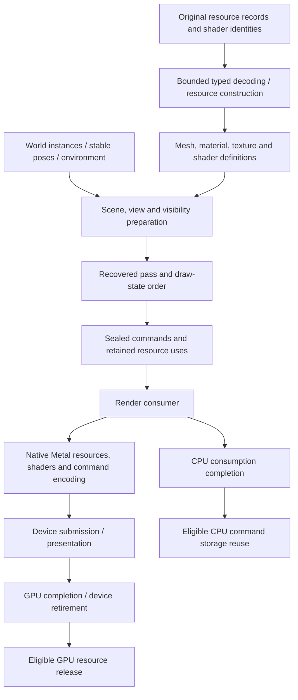

# World renderer reconstruction

**Faithful reconstruction baseline · October 23, 2026 · world implementation pending.**
[Rendering and presentation](rendering-and-presentation.md) defines the engine
owners. This drill-in defines how their implementation follows the original
renderer, beginning with One Shot Kill (`cm01_00`, stage `st04_c`). The
[implementation plan](../../IMPLEMENTATION.md#src-03-one-shot-kill-delivery-breakdown)
owns delivery order. This file owns the renderer's fidelity boundaries and must
be refined as the code establishes them.

Reconstruct the original renderer's data interpretation, shader behavior, state
transitions, draw ordering and lifetime first. Translate those semantics into
native Metal on the Mac. Later performance and graphics improvements are explicit
changes against that baseline. A scene that appears on screen is an integration
milestone; it does not by itself establish the original renderer's behavior.

The immediate source of evidence is the mapped Steam D3D9Ex renderer. That is not
a claim that its implementation or output is identical to the Xbox 360 renderer.
Neither its API objects nor its 32-bit pointer layout become portable engine
contracts. Preserve consequential behavior while representing it in maintainable
source with descriptive names.

## Recovered baseline and remaining questions

The facts below are static or corpus-derived at the scope stated by the linked
research. They have not been validated by rendering the original world in this
reconstruction. Proposed engine owners are our architecture, not recovered class
names.

| Area | Recovered evidence | Implementation consequence / open boundary |
|---|---|---|
| Resource construction | [Resource handlers](../../research/engine/subsystems/resource-dispatch.md#native-gpu-resource-consumers) create textures, vertex/index buffers and named shader objects; `vfx2.mesh.create` assembles their references | Preserve typed decoding, phase/publication identity and release associations. CPU decode, upload and usable device state are separate readiness conditions. |
| Model commands | [Builder `0x421e90` and executor `0x427220`](../../research/engine/subsystems/rendering.md#resource-to-draw-path) retain mesh/model references and copied state, check readiness/groups and optional deformation, then traverse render records | Reconstruct ordered typed operations with retained inputs. Full group/visibility/deformation semantics remain open; do not assume every group is always visible. |
| Record execution | `0x4303f0` traverses nested records, declarations, streams, indices and indexed draws; the direct draw forwards six fields in D3D order | Preserve primitive type, base vertex, minimum vertex, vertex count, start index and primitive count. The alternate `0x430810` route is a distinct unresolved case, not permission to use the direct path everywhere. |
| Vertex layouts | [PC model evidence](../../research/engine/subsystems/model-data.md#pc-vertex-declarations) establishes eight-byte D3D9 declaration elements, packed/normalized attributes and half-width texture coordinates in PW0 | Decode the actual stage declarations. PW0's strides/attribute roles are evidence for that model, not a universal mesh layout or a confirmed `st04_c` layout. |
| Shader selection | [Registry `0x954420`](../../research/engine/subsystems/rendering.md#all-named-shader-variants-resolved) maps 766 names through S/T pairs to 490 cached shader-model-3 programs | Preserve variant identity and stage selection. Registry resolution does not establish constant meanings, equations, texture roles or visual equivalence. The 49 other unique broad-scan hashes are outside this registry. |
| Submission | [Publication `0x40f920`, traversal `0x408f50`, worker `0x40fbe0`](../../research/engine/subsystems/rendering.md#render-queue-and-presentation-thread) establish a command arena, producer wait, separate render consumer and paced presentation | Preserve submission order and safe reuse. Recover the relevant scheduling contract before implementing world concurrency; the observed arena positions do not justify a generic buffering count or arbitrary frame cadence. |
| Effects | [Particle GPU contracts](../../research/engine/subsystems/particle-runtime-contracts.md#geometry-to-gpu) map triangle batches, shader pairs, blend/depth state and shared model rendering | Integrate required effects through the same renderer. Some state is inherited: particle blend mode 4 leaves a constant unchanged while writing depth. Generic blend presets are not an equivalent replacement. |
| Views, lighting and passes | [Current evidence boundary](rendering-and-presentation.md#evidence-boundary) identifies these owners but does not close their full behavior | Recover coordinate/projection conventions, visibility, constants, render-target dependencies and pass ordering as the stage needs them. Do not label the complete renderer forward, deferred or PBR from this evidence. |

Stage cubemap requests and material names suggest inputs to investigate; they do
not establish a lighting equation or environment-selection algorithm. No inferred
meaning is promoted to a recovered contract without a native consumer or other
independent evidence. Keep raw compatibility identifiers beside the descriptive
interpretation in research and decoder contracts.

## Data flow and native boundary

Arrows show data and lifetime dependencies, not a recovered full pass graph or
an implemented worker schedule. An input referenced directly by the GPU cannot
be recycled merely because the render consumer has finished encoding commands.

| Responsibility | Portable contract / reusable implementation | Native target implementation |
|---|---|---|
| Asset meaning | Bounded layouts, draw ranges, resource identity, shader variants and constant semantics | Supported GPU formats and any explicit conversion preserving decoded meaning |
| Scene and view | World observations, view conventions, visibility/group rules and immutable draw inputs | Target-specialized work may replace measured hot paths behind the same observable contract |
| Materials and passes | Required shader inputs, inherited state, attachment dependencies and draw order | Metal shader functions, pipeline objects, argument/buffer layouts and attachment actions |
| Submission | Ordered commands, ownership, CPU completion and device retirement contracts | Device queues, uploads, synchronization, resource visibility and presentation |
| Memory | Existing domains, budgets, owner lifetimes, admission/failure and accounting | Native CPU backing, GPU placement/storage mode and actual device allocation accounting |

Use the existing source map: portable `include/bw/render/` contracts, reusable
`src/render/` behavior, and selected `src/platform/<target>/` implementations.
Game camera policy and stage assembly remain in game code. Standard device types
do not escape into shared headers. This does not require a virtual interface or
new library for every table row.

D3D-to-Metal translation must document the required declaration formats,
normalization, matrix multiplication/storage convention, coordinate/depth range,
winding/culling, rasterization conventions, texture addressing/filtering/mips,
color/channel interpretation, alpha test, blend/depth/stencil behavior and constant
layout for each supported path. These are contracts to establish, not claims that
all differences have been resolved. Unsupported required semantics fail with the
asset/variant/record identified; they do not silently select a plausible shader.

Shader implementations remain standalone native source assets, compiled by the
build. Record which original variant, inputs and equations each implements and
how portable constants map into its native bindings. Material compatibility does
not require the same native binding layout on every target. Avoid embedding shader
text in the host, silently substituting PBR materials, or introducing an unproven
shader translator as a prerequisite for the whole registry.

## First workload: One Shot Kill

The **World renderer foundation** milestone builds reusable world rendering. Its
first acceptance criterion is **first visible level**, using actual `st04_c`
geometry and an explicitly identified inspection camera near the authored spawn.
The camera is a development view, not reconstructed gameplay-camera acceptance.

Before implementing the material subset, enumerate the stage's actual mesh,
texture, shader, group and draw-record dependencies from its loading path and
placements. The [mission map](../../research/engine/subsystems/mission-and-stage-loading.md)
and [DLC comparison](../../research/engine/subsystems/dlc-first-level-selection.md)
provide entry points, not the completed resource closure. Neither the broad
15-terrain-mesh inventory nor PW0 proves which layouts this stage uses.

For each required path, connect the source record/native consumer to the typed
contract, shader/state mapping, resource owner and acceptance evidence. Keep the
census and source findings under organized `research/engine/`; generated manifests
and copied inputs stay in ignored `research/evidence/`. This document records the
resulting architectural decisions and links to that evidence.

The foundation covers the confirmed static subset: mesh/index data, transforms,
view/projection, depth and original textured-material behavior needed to see the
level. Record all omitted contributions visibly in the acceptance report. Sky,
lighting, backgrounds, effects and additional passes enter the following stage
presentation slice as their actual consumers are reconstructed. A simplified
inspection output, if needed, must be identified as diagnostic and cannot satisfy
acceptance for a missing original material or pass.

Alicia, animated enemies and model particles extend these same model/material/
submission contracts. Do not create a stage-only renderer that bypasses them.
Resource loading can advance independently of unresolved camera or shader work;
required unresolved rendering behavior remains explicit rather than being filled
in from assumptions.

## Ownership, failure and verification

Definitions, world instances and submitted work have separate owners. The mission
can stop creating contributions and release its resource interests while an
already submitted packet still retains the uses needed to finish. Mutation or
recycling of pose/constant data must respect both CPU consumption and actual GPU
use. Borrowed views require a stable lifetime through their last consumer.

Extend the [memory and residency](memory-and-residency.md) and
[device-memory ownership](../../research/engine/subsystems/device-memory-ownership.md)
contracts for mesh, index, texture, staging, constants and command storage.
Account for payloads and backing, including simultaneous old/new allocations
during replacement. Admission failure and partial upload must unwind owned
resources; no failed construction may publish a renderable object. Allocation
budgets come from representative measurements or explicit application policy,
not invented historical limits.

The current Mac startup path uses conservative GPU completion waits. Any move to
asynchronous world submission needs explicit retirement evidence and bounded
in-flight ownership before those waits change. Preserve startup UI/movie behavior
when sharing the presentation device. Device errors and cancellation are distinct
from successful frame completion or mission teardown.

Acceptance advances through distinct evidence:

1. **Data and command contracts:** compare decoded layouts, selected variants,
   ranges and ordered state/draw operations with mapped native consumers and the
   actual stage corpus. Exercise malformed/unsupported input and partial failure.
2. **Native execution:** observe the real stage with checked placement, scale,
   depth and required materials. Record device validation, allocation/residency
   behavior, repeated load/unload and completion-safe retirement.
3. **Fidelity:** compare matched camera/material/pass output with original-game
   captures when available, plus numerical/command evidence where appropriate.
   Declare tolerances and exclusions; a synthetic draw or screenshot alone cannot
   prove shader, timing or original-game equivalence.

Use the existing verification inventory rather than multiplying integration
scenarios without approval. Required C++ corpus consultation, reference-source
inspection, header-first contracts, implementation signposts, linting and tests
remain part of the [workflow](../process/workflow.md). Mature engine references
inform reliable mechanisms; they do not replace recovered Bullet Witch semantics.

## Optimization and upgrades after the baseline

Keep fidelity reconstruction and deliberate improvement distinguishable in the
source history and architecture. Necessary API translation is part of the port;
changing lighting, draw order, shader equations, visibility or output quality is
an explicit behavioral decision. Baseline work does not require deliberately
reproducing incidental inefficiency, but an asserted equivalent transformation
needs evidence rather than an attractive result.

For a later optimization, retain a reproducible baseline workload and record the
changed mechanism, target/hardware, CPU/GPU timings, memory/bandwidth or submission
costs, and numerical/image/behavior comparison. Examples include draw batching,
shader specialization, upload strategy and queue overlap. Check ordering and
resource lifetime as well as pixels. A visual upgrade may intentionally change
output; name that change and keep the faithful behavior available for comparison.
Do not claim speedup from lower instruction counts alone.

Update this file as implementations resolve the unknowns above: link the chosen
contracts and evidence, distinguish completed stage coverage from remaining
renderer paths, and document later optimizations as departures from the retained
baseline. No full world renderer, complete pass graph or visual parity is claimed
by this design document.
