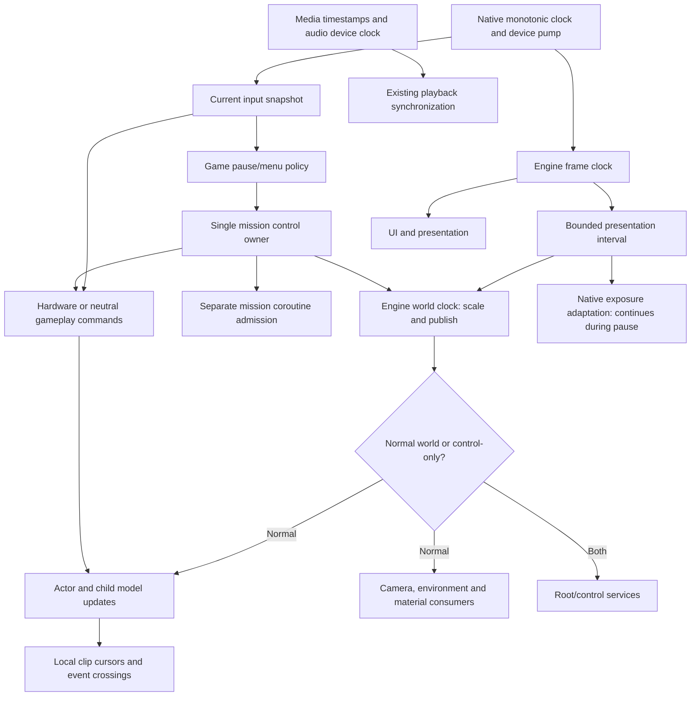

# World timing and tick admission

**Step 2 timing and ownership corrections accepted after the user's interactive
walkthrough.**
[World and simulation](world-and-simulation.md) ·
[Execution contracts](execution-contracts.md) ·
[Source timing](../../research/engine/subsystems/world-timing-source.md) ·
[Pinned reference](../../research/engine/subsystems/world-timing-reference.md) ·
[Verification scope](../../research/engine/subsystems/world-timing-verification.md).

The original engine publishes one scaled world interval, then selects normal
world work or the paused/control route. A target presentation rate does not
create a fixed simulation step. The reconstructed engine owns time publication;
Bullet Witch game policy owns the recovered pause and input decisions.

| Responsibility | Original owner | Reconstructed boundary |
| --- | --- | --- |
| Monotonic elapsed and presentation pacing | Raw timer and render publication/worker | Engine frame clock; native host waits and pumps devices |
| Capped presentation delta | Render publication | Engine frame timing snapshot, shared by UI and world producer |
| Scaled world delta and admitted simulation time | Base game producer and hierarchy context | Engine world clock and immutable frame observation |
| User/script/pad pause and request admission | Base game fields and shared script pause stack | One game mission control owner |
| Pause navigation | Native pause task | PauseFlow borrows mission control; menu state does not duplicate world pause |
| Hardware versus neutral commands | Base game input admission before actor traversal | Game input routing consumes the current sampled frame once |
| Actor/model clocks and retained motion interval | Parent hierarchy, model children | Existing actor/model update consumes the supplied world interval |
| Material elapsed | World-driven model/material updates | Stage samples admitted world time; no Stage-local master clock |

The frame clock measures after pacing, caps presentation elapsed at the recovered
100 ms, and rebases a missed deadline instead of issuing synthetic catch-up
frames. World publication multiplies that float interval by game speed (default
one) without a second clamp. The world clock retains its frame identity and
admitted simulation total. Control-only frames still expose the published scaled
delta; they do not advance normal world time. No subsystem reads an animation
cursor to determine the world's current time.

User pause and scripted game pause select the control route. Pad restriction
neutralizes hardware commands while normal world updates can continue. Script
pause snapshots exclude user pause, preserve the three recovered flags, and are
bounded to eight entries. The additional original input restriction remains a
separate admission input; its unrelated producers are not invented here.

UI consumes the whole input frame that opens or closes the menu. Device sampling
continues, pressed edges are not replayed on resume, and held evade requires
release before rearming as in the accepted pause policy. Held movement may resume.
Root/control work continues on presentation time; mission coroutine admission is
separately gated by user pause. Missing world entities and transition-specific
exception producers remain explicit scope limits.

Stage is a consumer of an engine-issued frame. Its local material master
time and duplicate pause flag are removed. Current actor-local balanced substeps,
retained root producer durations and complete model/event ordering are preserved.
Camera and material work are not silently moved into those actor subdivisions.
Audio pause publication follows the same control owner; device playback time is
not promoted into a world clock.

## Implemented files and lifetime

`bw_timing` contains `timing::FrameClock` and `world::WorldClock`. The host owns
one presentation clock; each mission owns one nonmovable world clock and one
`game::MissionControl`. The mission driver, pause menu and scene borrow those
owners and retire first. World frames are immutable values tied to their clock
and sequence. Stage rejects foreign or repeated frames before updating; a frame
is not a worker synchronization token or a replacement for render completion.

### Mutation authority

The original native pause task changes user pause; it does not own frame
publication, script nesting or hardware-input routing. `PauseFlow` therefore
receives a concrete `UserPauseControl` handle exposing only user-pause observation
and request. Copying the handle aliases the same state; it cannot reveal the
owner or call its other mutators. `StageInspection` and `MissionDriver` borrow
`const MissionControl&`. Stage only observes pause and publishes derived audio
commands; it cannot request a world-pause transition. Tests request transitions
through their real control owner, rather than widening a production interface.

FrameClock, WorldClock and MissionControl cannot be copied or moved. Current
framework declaration and destruction order retires menu, Stage and mission
borrowers before these owners. Presentation/loading callback state is declared
before the mission services retaining those callbacks, so teardown does not
depend on their destructors refraining from observing an expired clock. WorldFrame identity is borrowed from its issuer:
frames must be consumed/retired within that issuer's lifetime, including before
mission destruction/reconstruction. Current synchronous dispatch needs no global
identity registry. Retaining frames across future asynchronous mission lifetimes
would require a different explicit identity/lifetime contract.

Core I.4/Con.2 and performance COPY.5 are applied through restricted signatures,
deleted special members and compile-time assertions, with a runtime check that
menu handles share the real pause state and respect script admission. Corpus
consultation supplies design guidance; it does not analyze or validate our APIs.
The restricted handle is a reconstruction interface choice preserving recovered
native ownership, not a claim to reproduce an original C++ class.

`FrameClock::sample` is the only wall-to-presentation conversion. Initial
presentation may happen immediately; missed deadlines rebase without a catch-up
loop. `WorldClock::publish` is the only scale/accumulation operation. It retains
the original float interval and a double accumulated observation. Engine time
advances when normal world work is admitted even if one actor waits for a missing
external action dependency. Such local consumption cannot rewrite world time.

Shared engine `input::ActionRepeat` preserves one original 32-bit float timer
bank. Device sampling supplies held/pressed masks; the repeat owner consumes the
same presentation delta, including the first held sample. It resets released
bits and emits at most one repeat per bit at the original threshold/subtraction.
Loading presentation pulses sample the same FrameClock without advancing world
simulation. They do not introduce a second wall-to-game converter.

`MissionControl::route` receives one current device snapshot after pause-menu
navigation. It validates and neutralizes input, then the immutable frame carries
phase/input admission to Stage. User pause and UI transition frames consume
hardware edges. The host runs normal scene work before root/mission control;
root services keep receiving presentation time during pause. The mission driver
separately withholds its coroutine on user pause and on the UI transition frame.
Loading and paused resource transactions explicitly rebase presentation sampling;
ordinary weapon switching retains elapsed time.

The recovered shared script-pause stack is implemented and tested as policy.
The Lua `_GamePause`/`_PadPause` callbacks also own audio and player-component side
effects; their genuine startup paths remain unreachable and those complete
callbacks are **not** claimed implemented. Current user pause updates the actual
cue service through the shared owner. A derived last-published audio flag only
avoids duplicate device commands; it is not a second pause authority. The full
source paused hierarchy, transition exceptions and physics phases arrive with
their real owners in later mission work. The unrestricted control defaults match
the original packed constructor flags. AREA also has a root-phase producer that
ordinary user pause gates but script pause alone does not; genuine script-pause
integration must preserve that publication separately from normal actor work.
Current Stage suppression is not a full script-pause environment-parity claim. Its later root/mission-admission check
can initially set scripted pause; genuine world-start activation must carry that
condition when those startup owners are reconstructed. Current blocked startup
does not fabricate that transition or claim full constructor activation parity.

Finite/nonnegative validation, monotonic/overflow checks and rejecting a ninth
script-pause push are intentional reconstruction safety contracts. The native
ninth push mutates flags without saving. No original failure policy is invented.

Exposure is another presentation-time consumer: the original adaptation reads
renderer delta, not scaled or paused world time. The host forwards its engine
frame snapshot through the native renderer to postprocess. The target no longer
samples a separate wall clock. Exposure equations, previous-completed measurement,
history, image passes and first-measurement policy are unchanged. This corrects
time ownership without adjusting the accepted lighting values.

## Remaining clock uses

| Clock or cursor | Domain and reason |
| --- | --- |
| Native monotonic samples in framework | Supplies FrameClock, process time limit, loading presentation and diagnostic durations; never sampled by actor/animation code |
| Native window transition deadline | Bounds a macOS operation before normal frame dispatch; not game simulation |
| Media player timestamps/device position | Existing audio/video synchronization and diagnostic timing; does not publish world time |
| Local clip/ring/facial/secondary cursors | Consume the supplied actor interval, retain phase and event crossings; may wait for actor-specific dependencies |
| Input repeat bank | Shared engine consumer of presentation delta, including first-held time and paused frames; native device adapter supplies masks |
| Exposure history cadence | Consumes explicit presentation seconds, including paused frames; no independent native wall sample |

Full source ownership does not require every cursor to equal the world total.
Local elapsed state represents an operation's phase. It becomes a competing
clock only if it independently determines the interval supplied to other world
consumers or reads wall time to advance simulation.

## Acceptance

Header contracts preceded bodies. Nine in-process cases cover presentation clamp
before world scaling, no catch-up accumulation, immutable frame observations,
normal/control admission, nested pause restoration and checked overflow,
neutral input and consumed resume edges. Existing original-root acceptance
exercises the real consumers with actual assets, retaining prior traversal and
animation checks. Native Stage/Metal and HDR timing witnesses pass, as does the
windowed four-movie startup route. After the ownership correction, the full C++
gate, rebuilt native witness and complete original-root corpus pass. The corpus
took 36 minutes 33 seconds and retired all tracked CPU memory. Compile-time
checks enforce restricted mutation and stable owner identity. See the verification
report for exact scope and the separate fullscreen activation failure. No new
integration scenario, HUD, combat-resource owner, entity framework or lighting
adjustment is part of this slice.
