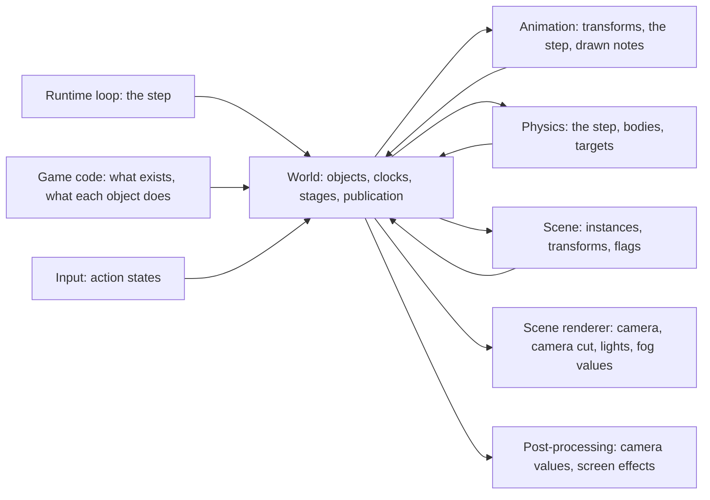
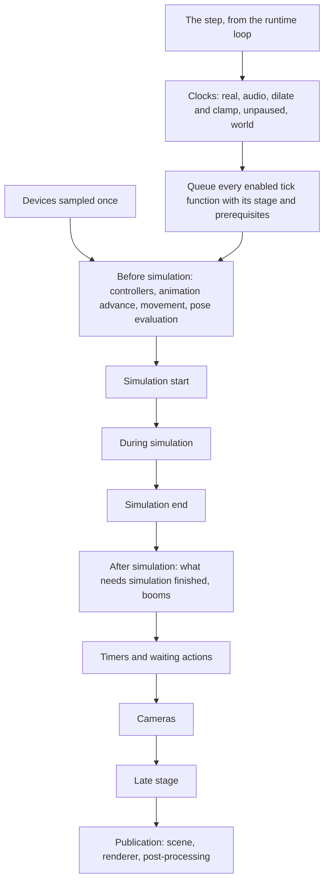

# World

What exists in the game at one moment, and the order in which one tick
changes it. The world owns every object's transform and lifetime, advances
its clocks by the step it is handed, runs each object's work in stages, and
at the end of the tick publishes what the renderer and the other consumers
read. It holds no game rule: which objects exist and what each does belong
to the game's code.

| Term | Means |
|---|---|
| Object | one thing in the world with a transform, a lifetime and parts |
| Part | a piece of an object that does work: a movement part, a skeleton, a camera boom |
| Tick | one advance of the world by one step |
| Step | the time one tick covers, handed to the world by the runtime loop |
| Tick function | work an object or a part registers to run each tick, in a stage |
| Stage | one of the ordered groups a tick runs its functions in |
| Prerequisite | a tick function that must finish before another starts |
| Dilation | a scale on the step: one for the world, one per object |
| Pause | a tick in which only the functions that ask to run do |

## Position

Below the game's code, which decides what exists and what it does. Above
[animation](animation.md), [input](input.md), the characters' movement,
[physics](physics.md) and the camera, whose work it orders. Beside the
[scene](scene.md) and the
[scene renderer](scene-renderer.md), which read what it publishes and
report what was drawn.

## Invariants

1. The world owns the transform and the lifetime of every object. Nothing
   else writes a transform, and a consumer reads transforms only from the
   world's publication. When simulation ends, [physics](physics.md) hands
   the world the bodies it moved, and the world writes their transforms.
2. The step comes from outside. The runtime loop makes it, measured from
   its clock or fixed when a fixed step is set, and hands it to the tick.
   The world reads no clock. The same steps with the same inputs in the
   same order give the same world.
3. The world keeps four clocks. World time advances by the dilated step
   and stops while paused. Unpaused time advances by the dilated step
   always. Real time advances by the undilated step always. Audio time
   advances by the undilated step and stops while paused.
4. Dilation scales the step for the whole world, within a lower and an
   upper bound, and each object has a scale of its own on top of it. The
   dilated step is held between a shortest and a longest frame time, each
   scaled by the dilation.
5. A tick runs in stages, in one order: before simulation, simulation
   start, during simulation, simulation end, after simulation, late.
   Every enabled tick function is queued when the tick starts, before any
   stage runs. A stage finishes before the next starts, except that work
   in the during-simulation stage need not finish before after-simulation
   work begins.
6. A tick function names its stage and its prerequisites. It runs in its
   own stage or a later one, never an earlier one, and never before a
   prerequisite has finished. A prerequisite that is disabled is ignored.
   One that would close a cycle is not used, and the world reports both
   functions by name.
7. Within the before-simulation stage a character's work runs in this
   order, by prerequisites: its controller, then its movement, then its
   skeleton. When a clip's root motion moves the character, animation
   advances the character and takes the root difference before movement
   reads it; the pose is evaluated after movement.
8. A part attached to another ticks after it. A part attached to a bone
   takes its transform from the pose published in the same tick, never
   from the tick before.
9. Devices are sampled once, before the tick. Their state is turned into
   action states and read by controllers inside the tick, once.
10. Cameras update after every stage through after-simulation has run,
    and before the late stage, so a camera sees where its target is this
    tick.
11. An object made during a tick first runs its tick functions in the
    next stage, never the one in progress. An object destroyed during a
    tick runs no function that has not started. The set a stage iterates
    does not change while it runs.
12. A tick function may have an interval. It then runs when that much
    world time has passed and receives the time since it last ran.
13. While paused, no stage runs. Only tick functions that ask to run when
    paused do, in no promised order, and a player's controller is one of
    them. Timers, effects and audio time do not advance.
14. At the end of the tick the world publishes: to the scene, instances
    entered, moved and removed, with their flags and sort priority; to
    the renderer, the camera, its cut flag and the lights, sun and fog
    values; to post-processing, the camera's focus, f-stop, sensor width
    and shutter and the screen effects it enables. The cut flag is set by
    whoever cuts the camera and cleared after the frame is drawn.
15. The scene's report of which instances were drawn describes a frame
    some frames back. The world holds it for one second of world time and
    passes it to animation as a note per character.
16. A run with no renderer runs the same tick. Nothing is drawn, so no
    character is noted as drawn.

## A tick

| Step of the tick | Reads | Writes | Runs when paused |
|---|---|---|---|
| Clocks | the step, the dilation, the frame-time bounds | the four clocks, the dilated step | real and unpaused time only |
| Queue | registered tick functions, prerequisites, intervals | the order of this tick | no |
| Before simulation | action states, last tick's world | intent, root difference, transforms, poses | only functions that ask |
| Simulation | transforms and bodies, changes pushed at its start | the change list at its end: transforms of bodies that moved, wake and sleep, broken constraints, contacts | no |
| After simulation | simulated state | parts that follow it | no |
| Timers and waiting actions | the dilated step | their callbacks | no |
| Cameras | each camera's target, the controller's rotation | each camera's view and cut flag | only a camera that asks |
| Late stage | the finished tick | late work | no |
| Publication | every transform, flag and camera | what the scene, the renderer and post-processing read | yes |

## What the world answers for

| Duty | Read by |
|---|---|
| The tick's step and the world's time | [animation](animation.md), [materials](materials.md) |
| Each character's transform, and the drawn note | [animation](animation.md) |
| The dilated step, the simulation stages, and the writing of transforms simulation hands back | [physics](physics.md) |
| Instances, their transforms, flags and sort priority | the [scene](scene.md), [transparency](transparency.md), [decals](decals.md) |
| Things placed on bones | [animation](animation.md), the [geometry feed](geometry.md) |
| Lights, the sun and the fog values | [lighting](lighting.md) |
| The camera, the camera cut, and the camera's focus, f-stop, sensor width and shutter | the [scene renderer](scene-renderer.md), [anti-aliasing](anti-aliasing.md), [post-processing](post-processing.md) |
| Screen effects enabled | [post-processing](post-processing.md) |

## Components and ownership

| Component | Lives in | Consumed by |
|---|---|---|
| Objects, parts, attachment, lifetime | `src/engine/world` | game code, every system with a part |
| Clocks, dilation, pause | `src/engine/world` | every tick function |
| Tick functions, stages, prerequisites, intervals | `src/engine/world` | movement, animation, physics, cameras, game code |
| Publication to the scene and the renderer | `src/engine/world` | the scene, the scene renderer, post-processing |
| The step | `src/engine/runtime` | the world |

## Boundaries

Above: the game's code, which makes and destroys objects and gives them
their parts, and the runtime loop, which makes the step. Below: the
systems whose parts tick here. Beside: [input](input.md), which turns
device state into action states before controllers read them; the
[scene](scene.md), which takes the publication and reports what was drawn;
the [scene renderer](scene-renderer.md), which takes the camera and the
lights; [physics](physics.md), which fills the simulation stages and
hands back what moved. What an object is for, which objects a stage
holds, and what a controller decides are outside this document.
