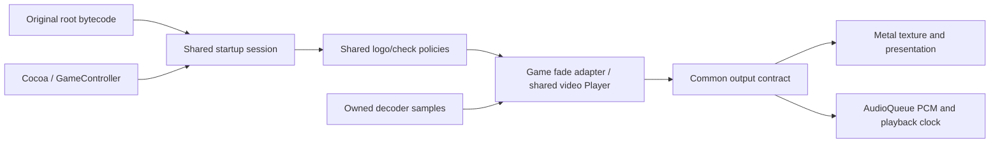
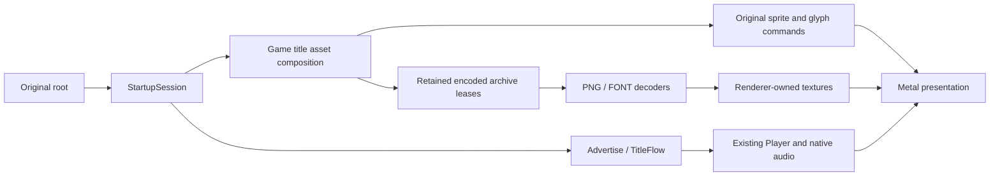

# Native startup host

The native host runs the original root script through the reconstructed
company-logo, startup-check, opening-cinematic and title tasks. Shared C++ owns task sequencing and fades; the reusable
[video player](video-player.md) owns media scheduling and completion. The Mac backend owns its window, Metal
presentation, audio device and input sampling. Title presents the original
movie, animated prompt, copyright and font text. Title confirmation now runs
profile loading and the interactive menu with original menu/costume sprite assets.
A supported confirmed choice reaches an owned gameplay request. One Shot Kill
continues into its original mission script, resource loading and a bounded
traversal scene with Alicia, costume replacement, lighting, shadows, animation
and custom character movement. The original mission load completes and waits at
`awaiting_world_setup`; full mission startup, combat and outcomes remain
unimplemented. The accepted traversal scene uses the explicitly isolated initial
placement shim until genuine world startup replaces it.

Build and run with the local purchased installation:

```sh
./run
```

The root launcher incrementally builds the host before opening it. The game path
comes from `--game PATH`, then `BULLET_WITCH_GAME_DIR`, then
`~/Games/BulletWitch-Steam`. `./run --windowed` forwards the window option;
`./run --build-only` builds without launching or requiring game data. Full
lint/test checks remain `python3 scripts/check.py all`.

The host targets 60 updates per second using `steady_clock` deadlines. This is
an explicit development cadence, not a recovered fixed simulation timestep.
Game tasks and fades receive measured elapsed time capped at 0.1 seconds,
matching the recovered render-completion publication at `0x40f920`. Movie time
remains separate and unclamped. Missed deadlines skip ahead without issuing a
burst of artificial fixed-step updates. The Mac event pump does not set the game
clock. The original render worker also has configurable pacing and an additional
sleep, so its nominal setting alone does not establish its effective frame rate.

The game launches in native macOS fullscreen and waits for the fullscreen
transition before starting playback. `--windowed` selects a resizable window;
`--window-width N --window-height N` request its size in content points (default
1280×720, clamped to the available display). Both modes aspect-fit the original
1280×720 canvas. Control-Command-F and the green window control toggle fullscreen.

The original root now advances through advertise and title. A natural title
timeout returns to the original attract loop; confirmation enters profile loading
and the menu. New Game, valid Continue and campaign-stage selection can reach a
validated gameplay request, which the executable reports before exiting. One
Shot Kill instead retains the request, original mission/load owners and the
traversal scene. Ordinary interactive runs have no time limit;
`--max-seconds N` explicitly bounds a development run.
`--verify-startup` retains a default 300-second bound, ignores skipping and exits
after all four movies complete naturally and title publishes outcome 2. It checks
complete PCM consumption, device drain, no unexpected audio underruns and
terminal-frame presentation, and prints per-movie counters. These conditions
do not establish original-game audiovisual parity.
Verification ignores skip actions so typing in another task cannot shorten a
movie; closing the window still aborts. It fails for early close, timeout or
decode/device errors. Ordinary playback retains the documented skip bindings.
This mode belongs to the existing provisioned original-root integration scenario.

## Recording a demonstration

From the repository root, the recording command is:

```sh
./run --capture
```

Use the same purchased installation and profile as an ordinary run. Capture mode
keeps native fullscreen, audio output and the existing 60 Hz host pacing target.
Developer views are off in the normal build; capture does not choose feature
availability. Build/runtime diagnostics go to the ignored
`research/evidence/capture/latest.log`, replaced on each capture launch. Successful
runs leave the terminal quiet; failures return a nonzero status and a short
message pointing to that log.
It does not change loading work, animation, input, rendering, movie timing or
scene content. It is a presentation option, not a recorder or a sustained-frame-rate
guarantee. The normal pause and costume controls remain available.

`--capture` rejects `--windowed`, `--verify-startup` and `--inspect-camera`.
An explicit positive `--max-seconds N` remains available for a bounded run;
omitting it leaves capture and ordinary interactive runs untimed.

Build once before recording with `./run --build-only`. The recording command still
performs its ordinary incremental build check; retain the actual command-to-window
interval in an uninterrupted launch shot. A clean checkout first needs the
[documented tools and SDK](../scripts/README.md), dependency downloads and a
purchased installation. No IDE, developer shell initialization or separate
executable command is required after that setup.

Movie and title audio use the existing playback path. Menu background music,
confirmation cues and persisted volume-to-output wiring remain incomplete.
Capture mode does not add substitute music or cues. Keep any logo acceleration
in the video edit, visibly labeled, rather than changing runtime playback.

Record the app output without other windows containing extracted data, research
tools or local paths. Keep captures outside Git. The
[public demonstration plan](../research/reports/2026-10-24-public-demo.md) records
the approved shots, external hosting and capture metadata needed before publication.

## Shared contracts and native implementation

| Responsibility | Source | Implemented boundary |
|---|---|---|
| Root/screen lifecycle | `src/game/startup_services.*` | Original root bytecode, reconstructed task policies and owned gameplay request |
| Profile/menu composition | `src/game/frontend.*`, `profile_load_flow.*`, `menu_flow.*` | Resource/fade gates, profile/error choices, persistence and selections |
| Menu presentation | `src/game/startup_menu_surface.*` | Original menu, font and authored costume textures through portable sprite commands |
| Save storage/location | `src/platform/files/save_storage.cpp`, `src/platform/macos/save_directory.mm` | Shared bounded POSIX storage at the target-selected user location |
| Movie transport | `include/bw/video/player.hpp`, `src/video/player.cpp` | Independent session, consumed-media clocks and terminal presentation |
| Game media adapter | `src/game/startup_playback.*` | Game-relative path resolution and recovered fade arithmetic |
| Decoded samples | `include/bw/video/decoder.hpp` | Owned BGRA frames and stereo 48 kHz float PCM; see [decoder](video-decoder.md) |
| Native media output | `include/bw/video/output.hpp` | Presentation plus independently serviced AudioOutput |
| Host window and input | `include/bw/platform/startup_host.hpp` | Main-thread event sampling and output implementation, with no Apple types |
| macOS presentation/input | `src/platform/macos/startup_host.mm` | Cocoa, Metal and GameController |
| macOS media audio | `src/platform/macos/media_audio.mm` | Joined AudioQueue service, callback PCM feed, mapped device clock and drain |
| Movie shader | `src/platform/macos/shaders/movie.metal` | Build-compiled movie texture sampling and black fade composition |
| World output | `include/bw/render/world.hpp`, `src/platform/macos/world_renderer.*` | Retained geometry/textures and explicitly selected original surface/depth draws |
| World shaders | `src/platform/macos/shaders/world_color.metal`, `world_depth.metal` | Static transforms, original geometric/normal/layered/sky surface families, cube reflection, alpha coverage/blending and projected depth |
| Mac process entry | `src/platform/macos/main.cpp` | Parse launch options, own native services and select the FFmpeg factory |
| Shared application composition | `src/framework/startup_application.*` | Resource/session ownership and input → media → game → presentation loop |
| Software decoder backend | `src/video/ffmpeg/decoder.*` | Explicit factory and private FFmpeg implementation |

The public headers are shared contracts. A future target supplies its native
backend behind those contracts. There is no Windows/Xbox backend in this slice;
Apple API behavior is not prescribed for those implementations. Target entry
points live beside their native implementations and reuse framework orchestration.
The common host header hides the selected implementation through Pimpl. The
framework borrows host/file/save services for the duration of the call; its
session, front end, profile, presentation, playback and resources retire before
the target entry destroys those services.

Build targets preserve these boundaries: `bw_startup_framework` composes game
and engine contracts; `bw_video` provides shared transport; `bw_video_ffmpeg`
provides the selected codec; `bw_media_audio_macos` and `bw_startup_host_macos`
provide native audio and window/presentation. The executable selects them.



## Sample time, ownership and completion

The [shared player](video-player.md) documents independent queue ownership,
clock segments, buffering and EOF. The host composes `MediaAudio`; it does not
implement its own audio buffering. That reusable service owns three 1,024-frame
stereo blocks and a fixed device/media mapping store. Audio feeding and mapping
retirement continue on their native owner while the game/render thread sleeps.
Its callbacks read the decoder's prepared PCM ring, never Lua or game objects.
Buffer availability, played-media time and final drain are separate observations.

The original `marvelousLogo` movie has decoded audio; `xeedLogo` contains silent
audio samples. Both streams use the same transport and output implementation.

Metal retains one BGRA texture; only a newly selected frame uploads its pixels.
Presentation letterboxes to preserve aspect ratio. The first backend waits for
each command buffer to finish before allowing the texture to change. `draw` reports whether a drawable
actually accepted the frame; the shared player retains an unpresented final frame. This is a
conservative ownership choice for startup, not the future engine renderer's
execution policy or a performance claim. Audio stop/dispose is synchronous before
the callback owner or buffers are destroyed. [Metal command completion](https://developer.apple.com/documentation/metal/mtlcommandbuffer/waituntilcompleted()),
[AudioQueue stop](https://developer.apple.com/documentation/audiotoolbox/audioqueuestop(_:_:)).

The shader is compiled to `movie.metallib` during the build, beside `bw-startup`.
The backend locates it relative to the running executable, independent of the
working directory. Shader code is not embedded in Objective-C++ strings and no
source compiler runs during startup.

Fade begin preserves current black-overlay alpha; it uses capped game delta,
while media scheduling uses its audio clock or uncapped wall time. Each update subtracts delta
from remaining duration, adds signed `delta / duration` to alpha, clamps it and
snaps to the requested endpoint when duration expires. This follows recovered
helper `0x485a20`; movie opacity is `1 - overlay alpha`. Initial black is an
explicit host policy while the original startup-wide initialization remains to
be traced. [Recovered startup contracts](../research/engine/subsystems/startup-next-contracts.md).

## Input and current limits

The development host maps Return/Space and connected controller A/Menu to the
observed `0x1010` action group, and Escape/controller B to `0x2020`. These are
explicit host bindings for the observed skip consumers, not a claim that the
original game's physical controller mapping has been reconstructed. Native
keyboard repeat does not emit repeated press edges. Devices are sampled before
game tasks, and focus loss clears held state. General input remapping and rumble
remain outside this startup slice. Arrow keys and controller
D-pad/left-stick directions now supply navigation. Repeated directions are
derived from held state with the recovered 0.5-second delay and 0.125-second
interval; options volume changes consume pressed left/right edges. Focus loss
resets repeat timers.

Bounded traversal samples left-stick movement, right-stick look, held LT above
0.1 for the original evasive leap, and Menu for pause. Keyboard aliases are
W/A/S/D, I/J/K/L, Space and Escape respectively. Left-stick click or C toggles the original crouched stance once per press. A/B remain menu confirmation/cancellation, independently of captured gameplay
intent. RT/F reports held fire intent; X/R, A/E, B/Q and RS-click/T report
reload, attack, next-weapon and aim-mode press edges. Desktop letters are
explicit review aliases. Capture does not accept shots, consume ammunition or
implement weapon-specific aim modes; those belong to the game adapter. See
[the source mapping](../research/engine/subsystems/alicia-action-policy.md#interactive-input-capture-and-admission-boundary).
The game owner applies the
recovered radial movement preprocessing and directional action policy.
Pause presents the original gameplay root and native Help/Options children;
menu input continues while mission, animation, camera and material clocks stop.
`./run --developer-views` explicitly configures `BW_DEVELOPER_VIEWS=ON` and
retains separate diagnostic build configuration. Its interface and activation
controls are pending user design; no F1 entry is admitted. Normal builds
configure it OFF.
See [the pause operation inventory](../research/engine/subsystems/native-pause-menu.md)
for working and blocked routes. In-session Costume is an approved improvement
over the original pause menu. Replacement preserves the current action and camera,
and resets the new outfit simulation from the frozen pose. See
[the appearance transaction](../research/engine/subsystems/pause-and-costume-switching.md).

Window-close permission is applied before Cocoa processes close events; the
window delegate vetoes closure while the shared session inhibits it. The native
backend never hides a window and then pretends the close was ignored.

Startup-check lifecycle and result are implemented, but its unresolved sprite
presentation is not replaced with invented artwork. It therefore runs against
the black presentation surface. Profile load/save failures now offer Retry or
Continue without saving, but complete original localized storage dialogs remain
unimplemented. Menu options expose volumes and costumes only; volumes persist
without output-gain wiring. Title confirmation/menu sound cues, menu background
music, other option screens, the complete world renderer and original-game parity
remain outstanding.

Verification distinguishes the in-process playback tests (frame-tail timing,
audio clock/drain, buffering, terminal exposure and interrupted fades), strict compilation/lint, and
provisioned native device execution. Passing the first two alone is not a claim
of visible playback or audible output.

## Earlier logo-only native verification

The October 22, 2026 Mac run used the original root script, the purchased movie
files and `--verify-startup`. Both movies ended naturally, completed their final
presentation intervals, and advanced through the startup check to the explicit
unsupported advertise boundary. The full route took 6.944 seconds.

| Movie | Decoded / uploaded video frames | PCM source / submitted / played frames | Underruns | Media end | Playback wall time |
|---|---|---|---|---|---|
| `marvelousLogo.ssu` | 56 / 55 | 112,046 / 112,046 / 112,046 | 0 | 2.41963 s | 2.56680 s |
| `xeedLogo.ssu` | 60 / 59 | 95,966 / 95,966 / 95,966 | 0 | 1.99929 s | 2.14392 s |

One late video frame was dropped in each movie; neither terminal frame was
skipped. There was no inserted initial silence or buffering silence. Media end
includes preserved source timestamp anchors, so it need not equal PCM duration.
The final XSEED logo was independently visible in a native-window screenshot.
The audio device acknowledged full drain; this is not a claim of a perceptual
listening comparison or original-game color/timing parity.

Full strict build, formatting, fatal clang-tidy, the three registered CTest
entries, repository content checks, UBSan and original-root integration passed
on this implementation. Independent FFmpeg conversion matches all four movie
assets' PCM byte for byte. Separate muted native probes preserve complete audio
through forward/backward media anchors and an induced source stall while the
main thread sleeps. ASan and other target platforms remain unverified.

Generated logs and probes remain ignored under
`research/evidence/reconstruction/native-startup/`: the successful run is
`native-redesign-accepted.log`; its checks use `redesign-accepted-*`. Earlier
failed runs remain alongside them. No game files or reference-engine sources
are included in the tracked result.

## Opening cinematic and title implementation

`src/game/advertise_flow` and `title_flows` preserve recovered state, timing,
fades, input outcomes and cleanup. `startup_title_surface` owns title/font and
selected-loading resource interests, image construction and original draw data.
`bw_images` supplies bounded PNG/FONT decoding; `render::SpriteOutput` supplies
portable texture ownership and ordered quads. Native Metal implements those
commands, including channel-packed font coverage. Encoded resource readiness
and texture readiness are separate.



The opening-cinematic run completed in 130.551 seconds including both logos and
startup check. Advertise consumed all 5,899,200 PCM frames with zero underruns
and presented its terminal frame. The first full title run completed all four
movies in 152.153 seconds, with all PCM consumed and zero underruns; title
published outcome 2. That run exposed an incorrect red/blue FONT channel mapping
in the version text. It is retained as failed visual evidence, despite passing
transport checks. See the corrected acceptance record in
`research/engine/subsystems/startup-title-integration.md`.

The corrected fullscreen run completed in 151.036 seconds with title outcome 2,
all four movies fully consumed and zero audio underruns. Native visual inspection
confirmed readable `Version 1.0.5`, the START prompt and copyright overlay. The
title movie dropped eight late video frames while retaining its terminal frame;
no frame-perfect pacing or original-game parity claim is made. Strict checks,
UBSan and the extended original-root integration pass. Generated evidence lives
under `research/evidence/reconstruction/startup-title/`; the accepted run is
`title-corrected-native.log`, checks are `accepted-checks.log`.


## Profile and interactive-menu acceptance

The Mac default profile directory is
`~/Library/Application Support/Plainsight Systems/Bullet Witch`. `--profile PATH`
selects a different writable directory. The entry rejects a profile directory
inside the game installation; resources and purchased assets remain read-only.
System (72 bytes) and Record (992 bytes) are written through the shared POSIX
storage capability. The adapter replaces complete individual files; it does not
promise an atomic transaction across the pair or synthesize a gameplay checkpoint.

The recorded native manual run entered the menu, viewed the original authored
costume 1 image, selected it and confirmed New Game at Normal difficulty. It
published `st01_00`, stage 1, difficulty 1, costume 1 and zero checkpoint bytes;
System/Record files were persisted at their original sizes. The program exited
at the validated handoff boundary. Costume previews are authored 2D images;
this run did not instantiate or render an actor/world.

The same provisioned original-root integration separately selected costume 5 and
verified an actual profile save/reload while using synthetic rendering and
controlled media observations. Final strict checks, five CTest entries, UBSan
and the original-root corpus passed. Native interaction and corpus assertions
are distinct evidence, not additional unit-test counts. See
[front-end integration](../research/engine/subsystems/frontend-integration.md).

The current framework has no Steam achievement provider. Fresh achievement flags
leave campaign Stage Select and Chaos/Hell entries gated; installed archives
do not unlock them. Concept Mission access is enabled independently under the
[user-approved reconstruction policy](../research/engine/subsystems/front-end-menu-policy.md#reconstruction-policy-concept-access-without-game-completion).
That menu-policy change has in-process coverage, not a new native acceptance
run. The recovered Steam refresh makes all five extra costumes available and
supplies the 18 extra-mission availability entries. Native accessor0x49a560
resolves internal extra result5 to Lua6. The host now consumes One Shot Kill into
owned mission/load state; actual original-script evidence and remaining device/
loading-presentation boundaries are recorded in
[mission launch](../research/engine/subsystems/mission-launch.md). The implemented
static inspection borrows the real load owner's stage/sky residency. The
unchanged mission load now returns naturally and stops at `awaiting_world_setup`.
The view includes all ten ordinary stage models (4,097 selected draws, three
untextured-material omissions), plus one sky draw, with declared camera/material policies. Authored environment,
visibility, background placement and unrelated passes remain later work.
Inspection presentation uses full opacity without altering the original
script-controlled fade or advancing world/actor setup. Original-root CPU and
synthetic-device acceptance are recorded in the mission research; current native
observations are recorded in [stage view completion](../research/engine/subsystems/stage-view-completion.md).
Earlier manual front-end acceptance alone does not establish world rendering or
gameplay execution.


## First static-world observation

On October 23, the user navigated the normal Concept Mission menu to One Shot
Kill. The native log confirmed original concept selection ID 1 and the mission's
real stage-load wait. The separate inspection displayed textured buildings
against black, with 104 supported opaque draws and 1,124 omitted main-world
draws. Ground, sky, authored environment and gameplay are not established by
that observation. Evidence remains ignored under
`research/evidence/reconstruction/stage/native-scene.log` and `native-world.png`.
The implementation checks passed strict build, all six CTest entries, fatal
clang-tidy and the content guard. This is the first limited native static view,
not completed mission loading or original-renderer parity.


## Static-stage camera inspection

`./run --inspect-camera X Y Z YAW PITCH` follows the normal menus and original
mission load, then places the static inspection camera at explicit world
coordinates. Yaw zero looks along positive Z, yaw 90 along positive X; positive
pitch looks upward. Pitch is limited to -90 through 90 degrees. The view retains
the authored vertical field of view, aspect and near/far planes. Invalid values
fail before a native window opens. This override does not reposition Alicia,
execute mission start or provide player controls. Without it, the original
initial behind-camera preset and static collision clearance determine the view.

The sky uses its authored yaw/height relative to the selected camera, so an
exterior view can inspect the horizon without dragging the sky away from the
viewer. Camera diagnostics use the same native renderer and authored exposure
settings as the normal starting view. The development command is also passed
through the top-level `run` launcher; no private diagnostic executable is needed
to choose a view for review.

The exterior checkpoint10 camera can be inspected with:

```sh
./run --inspect-camera -7.98534 1.35 54.8025 -0.28 0
```

Select Concept Mission → One Shot Kill normally. These camera coordinates come
from the script's checkpoint10 pose and original camera constructor; the command
does not load or save a checkpoint. Add a pitch of `45` in place of the final
`0` to look upward. Run plain `./run` for the authored fresh-start camera.

The final slice-3 native capture shows textured ground, buildings, mountains and
clouded sky through `StartupHost`, including its output-parameter forwarding.
The initial cave and upward sky are also verified with the production renderer.
The missing runtime SH selector and authored ambient inputs are corrected;
the previous black sky and clipped-ground captures remain historical failures.
Full shadows, visibility, generated texture mip chains and animated/placed
objects remain later presentation work. See the
[completion record](../research/engine/subsystems/stage-view-completion.md).


## Concept mission progression

The current early-access concept route defaults to an explicit, nonpersistent
**development completed-game profile**: all weapons/spells acquired at level one,
stat levels one and no upgrade points. This preserves the accepted traversal
capabilities without changing the real save or fabricating achievements. It is
an authored development baseline, not the original game's universal completion
state. To inherit the actual loaded profile instead, run:

```sh
./run --concept-profile saved
```

`--concept-profile development-completed` explicitly selects the default.
Both routes initialize the same mission player owner. Campaign progression is
unchanged; mission restrictions remain owned by original Lua, and full mission
startup is still incomplete. See [progression architecture](architecture/player-progression.md).
