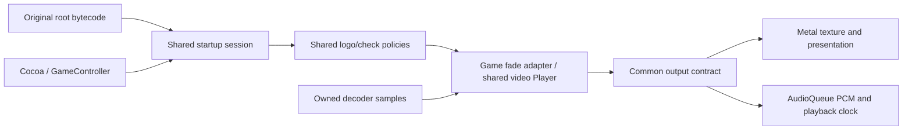
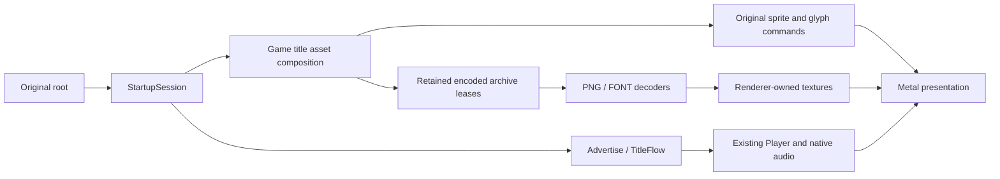

# Native startup host

The previous mixed-stream implementation failed native acceptance. It has been
replaced with independent media execution and a callback-fed native audio
service. The replacement passes silent component probes and the integrated
two-logo run recorded below.

The first visible slice runs the original root script through the reconstructed
company-logo, startup-check, opening-cinematic and title tasks. Shared C++ owns task sequencing and fades; the reusable
[video player](video-player.md) owns media scheduling and completion. The Mac backend owns its window, Metal
presentation, audio device and input sampling. Title presents the original
movie, animated prompt, copyright and font text. Character load and the title
menu remain explicit unsupported boundaries; world rendering is not implemented.

Build and run with the local purchased installation:

```sh
python3 scripts/check.py all
build/host-debug/bw-startup --game "$BW_GAME_DIR"
```

The host targets 60 updates per second using `steady_clock` deadlines. This is
an explicit development cadence, not a recovered fixed simulation timestep.
Game tasks and fades receive measured elapsed time capped at 0.1 seconds,
matching the recovered render-completion publication at `0x40f920`. Movie time
remains separate and unclamped. Missed deadlines skip ahead without issuing a
burst of artificial fixed-step updates. The Mac event pump does not set the game
clock. The original render worker also has configurable pacing and an additional
sleep, so its nominal setting alone does not establish its effective frame rate.

The game launches in native macOS fullscreen and waits for the fullscreen
transition before starting playback. `--windowed` selects a resizable window;
`--window-width N --window-height N` request its size in content points (default
1280×720, clamped to the available display). Both modes aspect-fit the original
1280×720 canvas. Control-Command-F and the green window control toggle fullscreen.

The original root now advances through advertise and title. A natural title
timeout returns to the original attract loop; confirmation reaches the explicit
unimplemented character-load boundary. `--max-seconds N` bounds a development
run (default 300 seconds). `--verify-startup` ignores skipping and exits after
all four movies complete naturally and title publishes outcome 2. It checks
complete PCM consumption, device drain, no unexpected audio underruns and
terminal-frame presentation, and prints per-movie counters. These conditions
do not establish original-game audiovisual parity.
Verification ignores skip actions so typing in another task cannot shorten a
movie; closing the window still aborts. It fails for early close, timeout or
decode/device errors. Ordinary playback retains the documented skip bindings.
This mode belongs to the existing provisioned original-root integration scenario.

## Shared contracts and native implementation

| Responsibility | Source | Implemented boundary |
|---|---|---|
| Root/screen lifecycle | `src/game/startup_services.*` | Original root bytecode and reconstructed task policies |
| Movie transport | `include/bw/video/player.hpp`, `src/video/player.cpp` | Independent session, consumed-media clocks and terminal presentation |
| Game media adapter | `src/game/startup_playback.*` | Game-relative path resolution and recovered fade arithmetic |
| Decoded samples | `include/bw/video/decoder.hpp` | Owned BGRA frames and stereo 48 kHz float PCM; see [decoder](video-decoder.md) |
| Native media output | `include/bw/video/output.hpp` | Presentation plus independently serviced AudioOutput |
| Host window and input | `include/bw/platform/startup_host.hpp` | Main-thread event sampling and output implementation, with no Apple types |
| macOS presentation/input | `src/platform/macos/startup_host.mm` | Cocoa, Metal and GameController |
| macOS media audio | `src/platform/macos/media_audio.mm` | Joined AudioQueue service, callback PCM feed, mapped device clock and drain |
| Movie shader | `src/platform/macos/shaders/movie.metal` | Build-compiled movie texture sampling and black fade composition |
| Mac process entry | `src/platform/macos/main.cpp` | Parse launch options, own native services and select the FFmpeg factory |
| Shared application composition | `src/framework/startup_application.*` | Resource/session ownership and input → media → game → presentation loop |
| Software decoder backend | `src/video/ffmpeg/decoder.*` | Explicit factory and private FFmpeg implementation |

The public headers are shared contracts. A future target supplies its native
backend behind those contracts. There is no Windows/Xbox backend in this slice;
Apple API behavior is not prescribed for those implementations. Target entry
points live beside their native implementations and reuse framework orchestration.
The common host header hides the selected implementation through Pimpl. The
framework borrows host/file services for the duration of the call; its session,
playback and resources retire before the target entry destroys those services.

Build targets preserve these boundaries: `bw_startup_framework` composes game
and engine contracts; `bw_video` provides shared transport; `bw_video_ffmpeg`
provides the selected codec; `bw_media_audio_macos` and `bw_startup_host_macos`
provide native audio and window/presentation. The executable selects them.



## Sample time, ownership and completion

The [shared player](video-player.md) documents independent queue ownership,
clock segments, buffering and EOF. The host composes `MediaAudio`; it does not
implement its own audio buffering. That reusable service owns three 1,024-frame
stereo blocks and a fixed device/media mapping store. Audio feeding and mapping
retirement continue on their native owner while the game/render thread sleeps.
Its callbacks read the decoder's prepared PCM ring, never Lua or game objects.
Buffer availability, played-media time and final drain are separate observations.

The original `marvelousLogo` movie has decoded audio; `xeedLogo` contains silent
audio samples. Both streams use the same transport and output implementation.

Metal retains one BGRA texture; only a newly selected frame uploads its pixels.
Presentation letterboxes to preserve aspect ratio. The first backend waits for
each command buffer to finish before allowing the texture to change. `draw` reports whether a drawable
actually accepted the frame; the shared player retains an unpresented final frame. This is a
conservative ownership choice for startup, not the future engine renderer's
execution policy or a performance claim. Audio stop/dispose is synchronous before
the callback owner or buffers are destroyed. [Metal command completion](https://developer.apple.com/documentation/metal/mtlcommandbuffer/waituntilcompleted()),
[AudioQueue stop](https://developer.apple.com/documentation/audiotoolbox/audioqueuestop(_:_:)).

The shader is compiled to `movie.metallib` during the build, beside `bw-startup`.
The backend locates it relative to the running executable, independent of the
working directory. Shader code is not embedded in Objective-C++ strings and no
source compiler runs during startup.

Fade begin preserves current black-overlay alpha; it uses capped game delta,
while media scheduling uses its audio clock or uncapped wall time. Each update subtracts delta
from remaining duration, adds signed `delta / duration` to alpha, clamps it and
snaps to the requested endpoint when duration expires. This follows recovered
helper `0x485a20`; movie opacity is `1 - overlay alpha`. Initial black is an
explicit host policy while the original startup-wide initialization remains to
be traced. [Recovered startup contracts](../research/engine/subsystems/startup-next-contracts.md).

## Input and current limits

The development host maps Return/Space and connected controller A/Menu to the
observed `0x1010` action group, and Escape/controller B to `0x2020`. These are
explicit host bindings for the observed skip consumers, not a claim that the
original game's physical controller mapping has been reconstructed. Native
keyboard repeat does not emit repeated press edges. Devices are sampled before
game tasks, and focus loss clears held state. General input remapping, repeat
navigation, axes and rumble remain outside this startup slice.

Window-close permission is applied before Cocoa processes close events; the
window delegate vetoes closure while the shared session inhibits it. The native
backend never hides a window and then pretends the close was ignored.

Startup-check lifecycle and result are implemented, but its unresolved sprite
presentation is not replaced with invented artwork. It therefore runs against
the black presentation surface. Character-load/menu behavior, settings/save dialogs, the title confirmation
sound cue, world rendering and visual parity remain outstanding.

Verification distinguishes the in-process playback tests (frame-tail timing,
audio clock/drain, buffering, terminal exposure and interrupted fades), strict compilation/lint, and
provisioned native device execution. Passing the first two alone is not a claim
of visible playback or audible output.

## Earlier logo-only native verification

The October 22, 2026 Mac run used the original root script, the purchased movie
files and `--verify-startup`. Both movies ended naturally, completed their final
presentation intervals, and advanced through the startup check to the explicit
unsupported advertise boundary. The full route took 6.944 seconds.

| Movie | Decoded / uploaded video frames | PCM source / submitted / played frames | Underruns | Media end | Playback wall time |
|---|---|---|---|---|---|
| `marvelousLogo.ssu` | 56 / 55 | 112,046 / 112,046 / 112,046 | 0 | 2.41963 s | 2.56680 s |
| `xeedLogo.ssu` | 60 / 59 | 95,966 / 95,966 / 95,966 | 0 | 1.99929 s | 2.14392 s |

One late video frame was dropped in each movie; neither terminal frame was
skipped. There was no inserted initial silence or buffering silence. Media end
includes preserved source timestamp anchors, so it need not equal PCM duration.
The final XSEED logo was independently visible in a native-window screenshot.
The audio device acknowledged full drain; this is not a claim of a perceptual
listening comparison or original-game color/timing parity.

Full strict build, formatting, fatal clang-tidy, the three registered CTest
entries, repository content checks, UBSan and original-root integration passed
on this implementation. Independent FFmpeg conversion matches all four movie
assets' PCM byte for byte. Separate muted native probes preserve complete audio
through forward/backward media anchors and an induced source stall while the
main thread sleeps. ASan and other target platforms remain unverified.

Generated logs and probes remain ignored under
`research/evidence/reconstruction/native-startup/`: the successful run is
`native-redesign-accepted.log`; its checks use `redesign-accepted-*`. Earlier
failed runs remain alongside them. No game files or reference-engine sources
are included in the tracked result.

## Opening cinematic and title implementation

`src/game/advertise_flow` and `title_flows` preserve recovered state, timing,
fades, input outcomes and cleanup. `startup_title_surface` owns title/font and
selected-loading resource interests, image construction and original draw data.
`bw_images` supplies bounded PNG/FONT decoding; `render::SpriteOutput` supplies
portable texture ownership and ordered quads. Native Metal implements those
commands, including channel-packed font coverage. Encoded resource readiness
and texture readiness are separate.



The opening-cinematic run completed in 130.551 seconds including both logos and
startup check. Advertise consumed all 5,899,200 PCM frames with zero underruns
and presented its terminal frame. The first full title run completed all four
movies in 152.153 seconds, with all PCM consumed and zero underruns; title
published outcome 2. That run exposed an incorrect red/blue FONT channel mapping
in the version text. It is retained as failed visual evidence, despite passing
transport checks. See the corrected acceptance record in
`research/engine/subsystems/startup-title-integration.md`.

The corrected fullscreen run completed in 151.036 seconds with title outcome 2,
all four movies fully consumed and zero audio underruns. Native visual inspection
confirmed readable `Version 1.0.5`, the START prompt and copyright overlay. The
title movie dropped eight late video frames while retaining its terminal frame;
no frame-perfect pacing or original-game parity claim is made. Strict checks,
UBSan and the extended original-root integration pass. Generated evidence lives
under `research/evidence/reconstruction/startup-title/`; the accepted run is
`title-corrected-native.log`, checks are `accepted-checks.log`.
