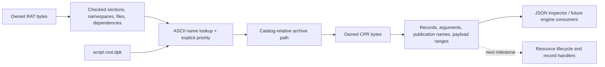

# Resource foundation (SRC-01)

The first reconstructed native module reads RAT catalogs and CPR archives,
resolves logical names across explicitly mounted catalogs, and exposes bounded
record/payload views. It builds on macOS ARM64 with C++20. This is static-derived,
corpus-checked source; it does not yet execute original loading callbacks or run
the game. Original behavior remains documented in the
[resource map](../research/engine/subsystems/resource-dispatch.md).

The [reconstruction design set](architecture/README.md) now places this module
within the proposed whole engine. Its [migration table](../IMPLEMENTATION.md#migrating-src-01)
separates the current combined reader/catalog/filesystem responsibilities as
the next organization step. The paths and commands below describe the code that exists today; no
source move or behavior change has been made by drafting the architecture.

## Build and use

From the repository root:

```sh
cmake -S . -B build/native -DCMAKE_BUILD_TYPE=Debug
cmake --build build/native -j 4
ctest --test-dir build/native --output-on-failure
```

The library has no third-party dependencies. CMake 3.20+ and a C++20 compiler are
required. Python 3 is required when `BUILD_TESTING=ON` so CLI coverage cannot
be silently omitted. A library/tool-only build can use `-DBUILD_TESTING=OFF`.
No game files are needed for either test suite. For the complete engineering
check (format, strict build, tests, analysis and repository policy), run
`python3 scripts/check.py all`; see [tooling setup](../scripts/README.md).

Read the purchased local installation:

```sh
build/native/bw-resource resolve SCRIPT.ROOT.DPK \
  --catalog 30 /Users/andyhunter/Games/BulletWitch-Steam/data/data/stable/stable.rat \
  --catalog 55 /Users/andyhunter/Games/BulletWitch-Steam/data/shader/shader.rat

build/native/bw-resource cpr /Users/andyhunter/Games/BulletWitch-Steam/data/data/stable/script/root.cpr
build/native/bw-resource rat /Users/andyhunter/Games/BulletWitch-Steam/data/data/stable/stable.rat
```

`resolve` returns the winning catalog, resource index, archive path, ordered
direct dependencies, matching publication-record indices and archive record
metadata. `script.root.dpk` resolves to stable resource 12935, record 0 in
`script/root.cpr`: USER `root.dpk`, file offset 192, length 4363. A logical name
is distinct from a record's local name. An empty publication match list means
no matching direct publication was identified; it does not establish availability.

`inventory DIRECTORY` emits one JSON line per RAT/CPR, sorted by path. It continues
past per-file format/read failures and returns a failing exit status if any occur.
All inspector commands are read-only. Save outputs under the ignored research
output tree, for example:

```sh
build/native/bw-resource inventory /Users/andyhunter/Games/BulletWitch-Steam \
  > research/evidence/reconstruction/src-01/native-inventory.jsonl
```

Exit statuses: 0 success, 1 usage, 2 data/unsupported/I/O/host failure,
3 no matching resource/files, 4 ambiguous winning catalog. Errors are JSON on
stderr except usage text; per-file inventory errors are JSON lines on stdout.
Names in this corpus are ASCII. The CLI escapes non-ASCII bytes as `\u00XX`
without claiming an unverified legacy encoding; the library retains string bytes.

## Interfaces and ownership

[Public header](../include/bw/resources.hpp) · [Implementation](../src/resources.cpp)
· [Inspector](../tools/resource_inspector.cpp).

- `CprArchive::parse(Bytes)` and `RatCatalog::parse(Bytes)` own their input bytes.
  `open(path)` reads and delegates to `parse`. Typed metadata owns its strings;
  the byte buffers remain unchanged. Copies own independent data.
- `CprArchive::payload(index)` borrows a checked span. Keep the owning archive
  alive and unchanged while using it. Metadata stores file ranges, never host
  pointers or pointers copied from the original 32-bit engine.
- `RatCatalog::find(name)` performs ASCII lowercase query normalization and exact
  lookup of stored dotted names. The current corpus's full-name lookups all pass.
- `CatalogSet` owns mounted catalogs and explicit integer priorities. Lower key
  wins. Multiple matches at the lowest matching key raise `ambiguous`; original
  equal-key qsort ordering remains unresolved. Catalogs are not auto-mounted
  together, since mission and costume catalogs have different lifetimes.
- Dependencies preserve disk order: local indices first, then named entries.
  A local index supplies a full name for subsequent **global** lookup; it is not
  a promise to bind to the same catalog. This module reports direct dependencies;
  it does not recurse, schedule requests, or set runtime readiness flags.
- `archive_path` normalizes catalog-relative separators and rejects traversal
  outside the catalog directory, including existing symlinks. This is a local
  filesystem boundary, not an emulation of the original virtual path service.
- `Error` distinguishes malformed inputs, unsupported variants, I/O, absence and
  ambiguity. Invalid API indices use standard bounds exceptions.



## Format boundaries

RAT: exact declared size; six bounded, non-overlapping sections; 20-byte resource
and 8-byte file records; namespace nodes with parent/child/membership consistency;
ordered local-index and named dependencies. Traversal is iterative, and rejects
cycles, duplicate nodes/resources/names and overlapping nodes. Nonzero reserved
header words, a nonempty reserved section, named root or empty/dotted components
are unsupported. These restrictions describe the verified disk format, not all
possible related Cavia formats.

CPR: `CPR1`, version 1, little-endian marker, zero fields at +0x28/+0x30,
0x60-byte header, 48-byte records, and checked metadata/first/second sections.
The argument area is interpreted as **floor(size / 12)** triples with trailing
padding retained, matching native 0x41b4a0. Every complete argument triple is
validated, including unused entries. Argument type 2 denotes a pool string only
when the argument name is nonnull; other types remain raw integers.

Record fields preserve all eleven raw words. Publication names, first and second
payload ranges, arguments, and the selected inspection range are exposed.
Selection follows the existing independent archive reader: first nonempty payload,
otherwise second; an inline-reference field overrides its file offset with
`0x28 + raw[2]`. Inline-reference runtime meaning remains provisional. No corpus
record has both payload lengths nonzero; the inspector retains both and applies
first-region precedence if encountered. This is not a runtime relocation claim.

Identified types: USER, DDS, DDSC, DXVB, DXIB, DXVS, DXPS and CALL. These have
readable container views; **all runtime handlers remain unimplemented**. Unknown
FourCCs retain metadata with `known_type: false`. Compression, big-endian archives,
DPK member decoding, texture/model decoding, GPU object creation, CALL phases,
publication/release, async completion and readiness are outside SRC-01.

## Evidence and verification

Original analysis image SHA-256:
`bdaff1746d3092215699b09eab11315c6adf8fb71eaa8f46c280b11b3cd448fd`.
Addresses refer to that unpacked image, based at 0x400000.

| Contract | Native witness |
|---|---|
| RAT section/resource/namespace relocation | 0x41b880, 0x41b920, 0x41b820 |
| Dotted lookup and full-name construction | 0x41ba60, 0x41bb60, 0x41bad0, 0x41b7c0 |
| Case normalization, catalog ordering | 0x4152f0, 0x4154b0, 0x414990 |
| Ordered dependency requests | 0x415230 |
| Physical archive composition | 0x414a10 |
| CPR layout, arguments, record publication-name field | 0x41b4a0 |

Export links are retained in the original resource map. The independent CPR
layout reader predates this implementation and cites the community BMS parser;
its extraction offsets provide a separate corpus comparison, not native runtime
execution evidence.

The [verifier](../research/tools/verify_resource_foundation.py) reruns the native
inventory, checks every input SHA-256 against historical evidence, compares CPR
fields/ranges/prefixes against the prior Python reader, and compares RAT raw
records/file references against the saved inventory. It reconstructs full names
by walking each resource's parent chain, independently of the C++ traversal.
It also checks decoded arguments, ordered dependencies, namespace memberships and
all catalog lookups. Full payload equivalence is established for input bytes by
hash and selection by ranges; the inspector prints only the first 32 payload bytes.

```sh
python3 research/tools/verify_resource_foundation.py \
  build/native/bw-resource /Users/andyhunter/Games/BulletWitch-Steam
```

Corpus: 6,625 CPRs, 29,996 records, 25 RATs, 15,262 catalog resources,
8,235 namespace nodes, 13,562 dependency references and 26,364 record arguments.
All matched. The prior raw inventories are local ignored evidence; reproducing
that comparison in a fresh clone requires generating them with the documented
research tools. Synthetic unit and CLI tests require no local evidence.

Tests cover every truncation of representative containers, malformed sizes and
references, namespace cycles/parents/membership, publication identity, both payload
regions, inline references, padded/unused arguments, unknown types, ownership,
priority/ambiguity, CLI exit behavior, inventory continuation and path containment.

Enable sanitizers with `-DBW_SANITIZE=ON`. The default is `address,undefined`;
`-DBW_SANITIZERS=undefined` selects UBSan alone. On this host, AppleClang 17 and
Homebrew Clang 21 ASan both hang inside sanitizer initialization before `main`.
Saved process samples document that limitation. Native tests and the full corpus
comparison pass under Clang 21 UBSan with `UBSAN_OPTIONS=halt_on_error=1`.
ASan coverage is **not** claimed. Windows/Xbox builds and original-engine runtime
comparisons have not run. See the [work log](../research/logs/2026-10-22-source-reconstruction-01.md).
