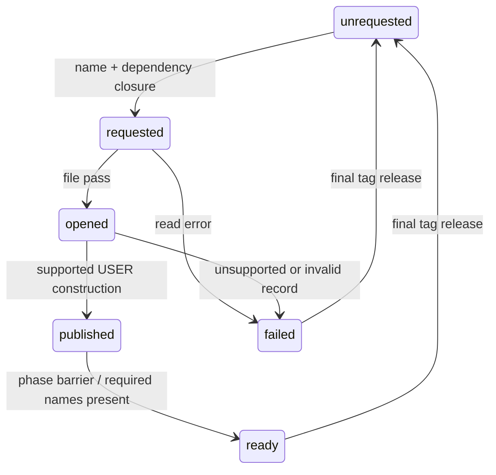

# Startup runtime contracts

The shared resource path is implemented in `resources/service`, with bounded
script-package access in `formats/dpk`. This extends the production resource
foundation; the inspector and future game use these modules.

Resource requests resolve the entire dependency closure through the mounted
catalogs before recording interests. Names are marked before visiting their
dependencies, so cycles terminate. A bounded pump opens files, constructs USER
publications, then completes the phase barrier. Requested, opened, published,
ready and failed remain distinct. A missing requested publication cannot count
as ready. Failures retain diagnostics until release and explicit retry.

This first service supports USER records with ordinary first-section payloads.
Native USER constructor `0x41ac30` relocates section fields and publishes record
`+0x20` through `0x415530`; it releases through `0x4149b0`. The reconstructed
service retains immutable file-relative views instead of relocated addresses.
The separate opened/published pump boundary is a host scheduling choice; it
is not a claim that native USER uses the CALL phase-1 callback. CALL, graphics
handlers, inline runtime references and cancellation races remain unresolved.

A tag records an interest in its dependency files. Multiple tags can retain a
file; release removes the caller's interest and only unpublishes when no tags
remain. Publication identity includes the catalog/file and record. A lease
retains the archive after unpublication. This explicit multi-owner retention is
a host lifetime policy; the original stores one tag per file. No asynchronous
worker or thread-safety guarantee is implied.

DPK v1 decoding checks table, name-pool and payload bounds, rejects duplicate
member names, and returns exact case-sensitive member views. Compressed members
remain inspectable but access fails as unsupported. The package owns its input;
constructing it from a lease currently copies the bounded package once.

Evidence: [native dispatch](../research/engine/subsystems/resource-dispatch.md),
[execution contracts](architecture/execution-contracts.md). The read-only
LLVM disassembly of `0x41ac30–0x41ac80` is recorded under ignored
`research/evidence/reconstruction/steps/user-handler.txt` against the existing
hash-bound unpacked image. DPK corpus checks extend the existing archive-corpus
scenario with the independent Python `layout_probe.dpk` metadata oracle;
synthetic in-memory checks cover malformed members, phases, dependency cycles,
read/handler failure, retry and leases surviving tag release. These establish
format and host-lifecycle behavior, not original-game execution equivalence.
