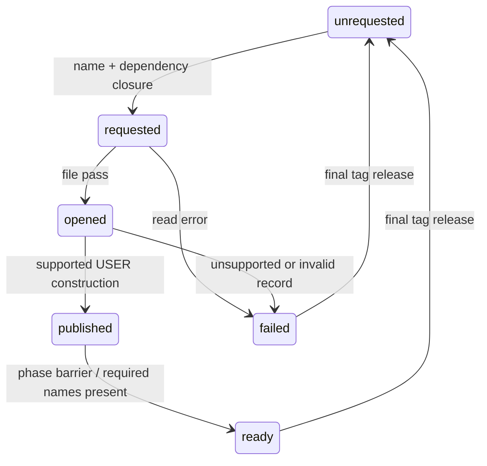
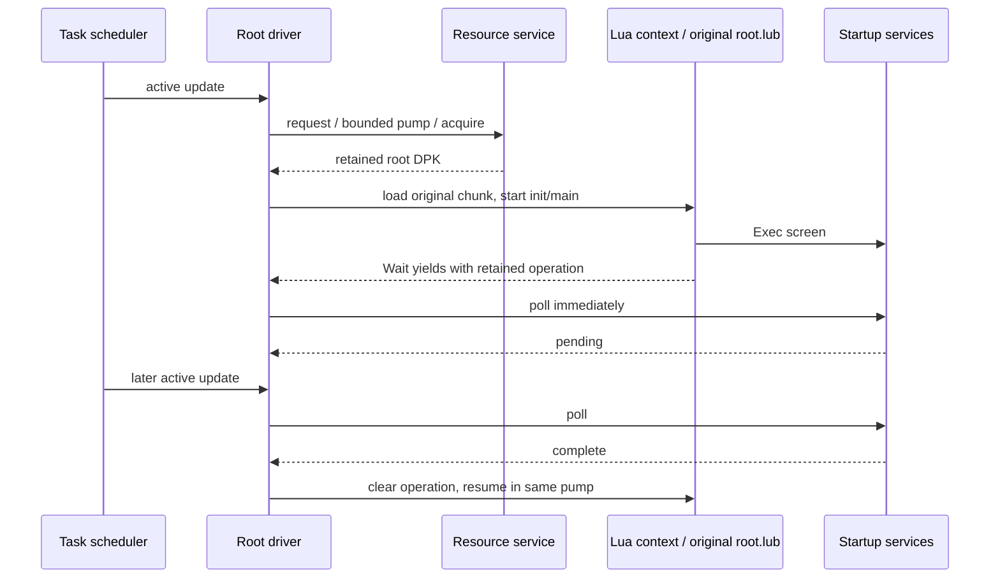

# Startup runtime contracts

The shared resource path is implemented in `resources/service`, with bounded
script-package access in `formats/dpk`. This extends the production resource
foundation; the inspector and future game use these modules.

Resource requests resolve the entire dependency closure through the mounted
catalogs before recording interests. Names are marked before visiting their
dependencies, so cycles terminate. A bounded pump opens files, constructs USER
publications, then completes the phase barrier. Requested, opened, published,
ready and failed remain distinct. A missing requested publication cannot count
as ready. Failures retain diagnostics until release and explicit retry.

This first service supports USER records with ordinary first-section payloads.
Native USER constructor `0x41ac30` relocates section fields and publishes record
`+0x20` through `0x415530`; it releases through `0x4149b0`. The reconstructed
service retains immutable file-relative views instead of relocated addresses.
The separate opened/published pump boundary is a host scheduling choice; it
is not a claim that native USER uses the CALL phase-1 callback. CALL, graphics
handlers, inline runtime references and cancellation races remain unresolved.

A tag records an interest in its dependency files. Multiple tags can retain a
file; release removes the caller's interest and only unpublishes when no tags
remain. Publication identity includes the catalog/file and record. A lease
retains the archive after unpublication. This explicit multi-owner retention is
a host lifetime policy; the original stores one tag per file. No asynchronous
worker or thread-safety guarantee is implied.

DPK v1 decoding checks table, name-pool and payload bounds, rejects duplicate
member names, and returns exact case-sensitive member views. Compressed members
remain inspectable but access fails as unsupported. The package owns its input;
constructing it from a lease currently copies the bounded package once.



Evidence: [native dispatch](../research/engine/subsystems/resource-dispatch.md),
[execution contracts](architecture/execution-contracts.md). The read-only
LLVM disassembly of `0x41ac30–0x41ac80` is recorded under ignored
`research/evidence/reconstruction/steps/user-handler.txt` against the existing
hash-bound unpacked image. DPK corpus checks extend the existing archive-corpus
scenario with the independent Python `layout_probe.dpk` metadata oracle;
synthetic in-memory checks cover malformed members, phases, dependency cycles,
read/handler failure, retry and leases surviving tag release. These establish
format and host-lifecycle behavior, not original-game execution equivalence.

## Task and Lua execution

`bw_resources` contains the existing data/content/resource modules. `bw_runtime`
adds reusable task and script mechanisms; `bw_game` owns the concrete root driver
and its private declaration under `src/game/`. The inspector remains a resource
consumer. There is one engine implementation, shared by verification and future
application composition.

The task scheduler preserves the recovered current/requested state values and
settles lifecycle transitions before separate active and late passes. Both passes
require enabled/current-active; a finish requested during update takes effect
on the next lifecycle pass. The late pass is explicitly gated by its caller.
Priority then insertion ID defines order. Insertions during a tick join the next
snapshot; this is a declared host policy pending closure of dynamic insertion
and all-mode order. Callback failures quarantine that task and propagate.

The Lua adapter owns a pinned [Lua 5.0.2](https://www.lua.org/ftp/) VM and anchors
its coroutine in the registry. Native calls receive typed values; retained
operations own their captures. A wait yields, polls immediately, remains pending
while the callback returns true, clears the operation when false, then resumes
Lua in the same pump. The bridge translates native exceptions to terminal
script failures. The core VM is enabled; standard libraries and additional game
API families are not silently supplied. Unbound calls fail explicitly.

`script/chunk` checks the observed little-endian 32-bit chunk structure and
widens serialized `size_t` and instruction storage to the pinned host ABI.
Opcode words and doubles are preserved; no decompiled text is compiled back
into the game. Upstream Lua's bytecode checks still run. This is compatibility
for the observed chunk layout, not a security boundary for arbitrary bytecode.

CMake fetches the upstream archive by SHA256, with no proprietary assets or
vendored copy committed. `cmake/PatchLua502.cmake` contains three narrow host
fixes: nullable table/upvalue union-member pointer expressions become direct
pointer casts, and pointer hashing explicitly narrows through `uintptr_t`.
UBSan found the null-member expressions during VM creation/cleanup; these fixes
preserve the intended pointer values without disabling sanitizer checks.
Downloaded source retains its upstream license. Project source is strictly
compiled and linted; upstream C is separately built and sanitizer-instrumented.

The context limits a resume to 100,000 instructions, and a pump/root dispatch
to 64 resumptions/iterations. Task transition cycles have a finite guard. These
are explicit host failure/timeslice limits, not original frame timing. Mac ARM64
is verified; Windows/Xbox builds and ASan remain unverified.

## Root composition and evidence

The driver requests `script.root.dpk`, waits for readiness, decodes `root.lub`,
executes its top level and `init`, then repeatedly starts/resumes `main`. It
registers the 17 startup/title/menu bindings: six Exec/Wait pairs, global get/set,
latest-stage lookup, and title/menu status. `_WaitTitle` retains its initial
pending return before polling. Game services own actual screens, save/global
side effects and status interpretation; this layer does not replace them with
an array or claim they have been reconstructed. Mission/result/movie bindings
remain explicit future work.



Provisioned integration runs the original, hash-checked root bytecode through
resource loading, the scheduler and root driver. A deterministic **test fixture**
supplies screen completion/status and the required global read. The observed
route is company logo → memory-card check → advertise → title → character load
→ title menu → title. It verifies continuation/routing and final tag release;
it does not display these screens or establish native timing/behavior equivalence.
The test explicitly rejects unexpected global side effects. Production service
implementations are the next work.

```sh
python3 scripts/check.py all
python3 scripts/check.py corpus --game /path/to/BulletWitch-Steam
python3 research/tools/verify_startup_runtime.py \
  build/host-debug/startup-corpus /path/to/BulletWitch-Steam
cmake --preset host-ubsan
cmake --build --preset host-ubsan --parallel 4
ctest --preset host-ubsan
python3 research/tools/verify_startup_runtime.py \
  build/host-ubsan/startup-corpus /path/to/BulletWitch-Steam \
  --output research/evidence/reconstruction/startup-ubsan
```

The startup verifier records the independently inventoried chunk hash, archive,
binary and source hashes, route, tool description and stdout/stderr under ignored
research evidence. The existing full archive corpus still passes, including
74 DPK packages / 655 members. In-process runtime cases cover nested waiting,
retained arguments, move ownership, immediate completion, native/missing-call
errors, instruction guards, task activation/deactivation/removal and pass order.
