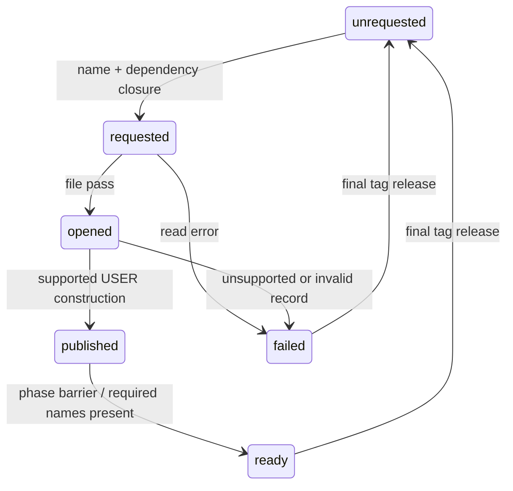
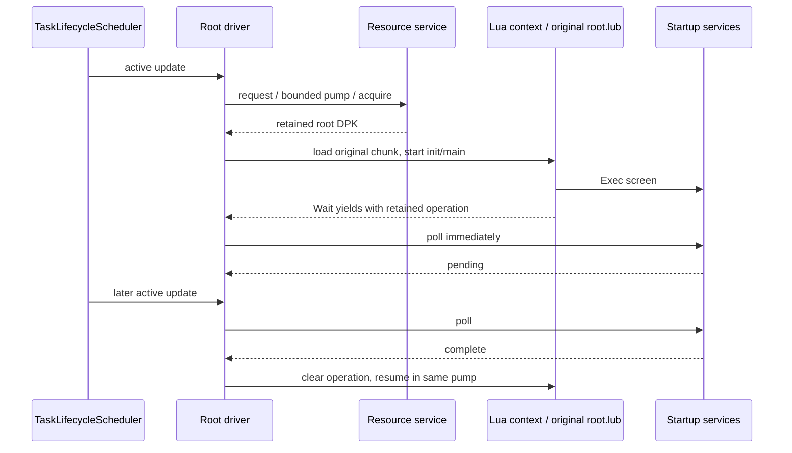
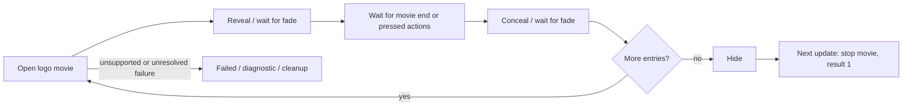
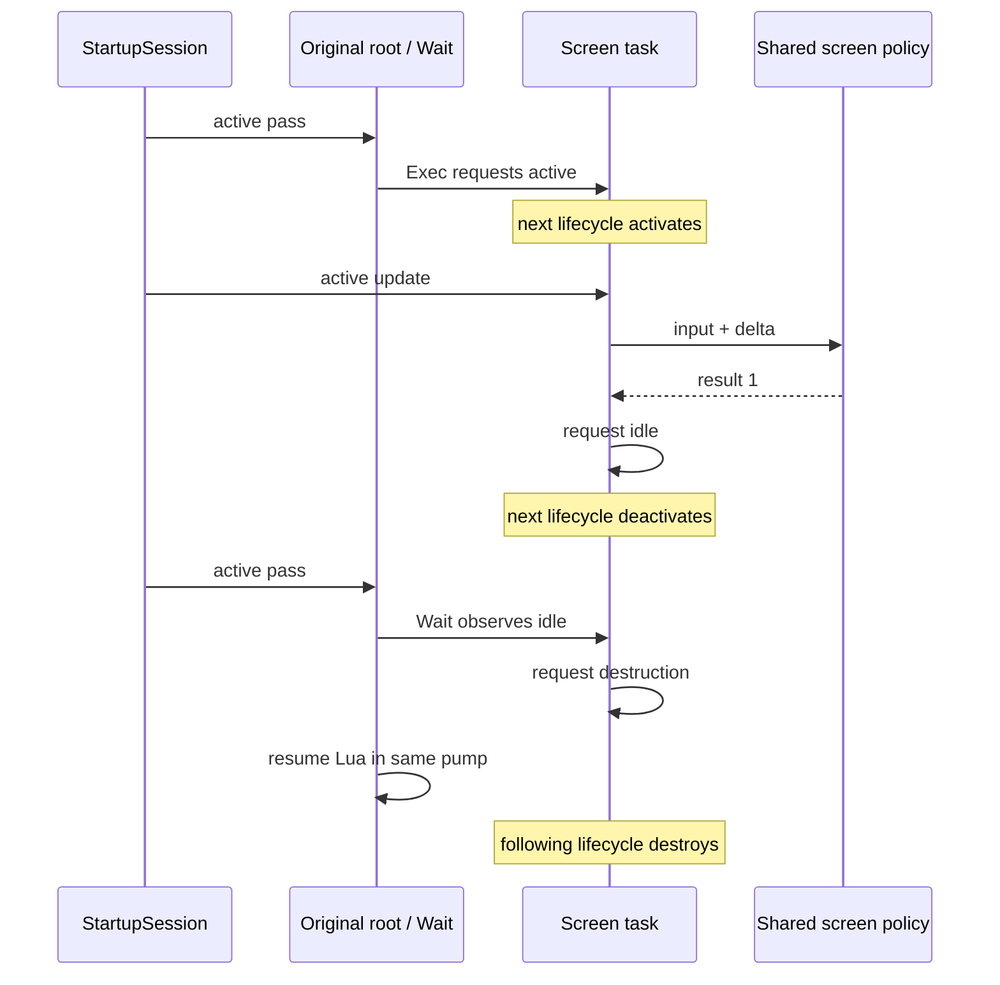

# Startup runtime contracts

The shared resource path is implemented in `resources/service`, with bounded
script-package access in `formats/named_file_package`. This extends the production resource
foundation; the inspector and future game use these modules.

Resource requests resolve the entire dependency closure through the mounted
catalogs before recording interests. Names are marked before visiting their
dependencies, so cycles terminate. A bounded pump opens files, constructs USER
publications, then completes the phase barrier. Requested, opened, published,
ready and failed remain distinct. A missing requested publication cannot count
as ready. Failures retain diagnostics until release and explicit retry.

This first service supports USER records with ordinary first-section payloads.
Native USER constructor `0x41ac30` relocates section fields and publishes record
`+0x20` through `0x415530`; it releases through `0x4149b0`. The reconstructed
service retains immutable file-relative views instead of relocated addresses.
The separate opened/published pump boundary is a host scheduling choice; it
is not a claim that native USER uses the CALL phase-1 callback. Unnamed encoded DDS image siblings are now retained alongside USER publications,
including parser-validated selected payload ranges. A lease exposes its retained
archive for typed asset construction; ready here means encoded bytes available.
PNG/FONT decoding and GPU texture construction have their own readiness gate.
CALL, executable graphics handlers, USER inline runtime references and
cancellation races remain unresolved.

A tag records an interest in its dependency files. Multiple tags can retain a
file; release removes the caller's interest and only unpublishes when no tags
remain. Publication identity includes the catalog/file and record. A lease
retains the archive after unpublication. This explicit multi-owner retention is
a host lifetime policy; the original stores one tag per file. No asynchronous
worker or thread-safety guarantee is implied.

DPK v1 decoding checks table, name-pool and payload bounds, rejects duplicate
member names, and returns exact case-sensitive member views. Compressed members
remain inspectable but access fails as unsupported. The package owns its input;
constructing it from a lease currently copies the bounded package once.



Evidence: [native dispatch](../research/engine/subsystems/resource-dispatch.md),
[execution contracts](architecture/execution-contracts.md). The read-only
LLVM disassembly of `0x41ac30–0x41ac80` is recorded under ignored
`research/evidence/reconstruction/steps/user-handler.txt` against the existing
hash-bound unpacked image. DPK corpus checks extend the existing archive-corpus
scenario with the independent Python `layout_probe.dpk` metadata oracle;
synthetic in-memory checks cover malformed members, phases, dependency cycles,
read/handler failure, retry and leases surviving tag release. These establish
format and host-lifecycle behavior, not original-game execution equivalence.

## Task and Lua execution

`bw_resources` contains the existing data/content/resource modules. `bw_runtime`
adds reusable task and script mechanisms; `bw_game` owns the concrete root driver
and its private declaration under `src/game/`. The inspector remains a resource
consumer. There is one engine implementation, shared by verification and future
application composition.

The `TaskLifecycleScheduler` preserves the recovered current/requested state values and
settles lifecycle transitions before separate active and late passes. Both passes
require enabled/current-active; a finish requested during update takes effect
on the next lifecycle pass. The late pass is explicitly gated by its caller.
All calls require one owning thread; the scheduler creates no threads and is
not thread-safe. Priority then insertion ID defines order. Insertions during a tick join the next
snapshot; this is a declared host policy pending closure of dynamic insertion
and all-mode order. Callback failures quarantine that task and propagate.

The Lua adapter owns a pinned [Lua 5.0.2](https://www.lua.org/ftp/) VM and anchors
its coroutine in the registry. Native calls receive typed values; retained
operations own their captures. A wait yields, polls immediately, remains pending
while the callback returns true, clears the operation when false, then resumes
Lua in the same pump. The bridge translates native exceptions to terminal
script failures. The core VM is enabled; standard libraries and additional game
API families are not silently supplied. Unbound calls fail explicitly.

`script/chunk` checks the observed little-endian 32-bit chunk structure and
widens serialized `size_t` and instruction storage to the pinned host ABI.
Opcode words and doubles are preserved; no decompiled text is compiled back
into the game. Upstream Lua's bytecode checks still run. This is compatibility
for the observed chunk layout, not a security boundary for arbitrary bytecode.

CMake fetches the upstream archive by SHA256, with no proprietary assets or
vendored copy committed. `cmake/PatchLua502.cmake` contains three narrow host
fixes: nullable table/upvalue union-member pointer expressions become direct
pointer casts, and pointer hashing explicitly narrows through `uintptr_t`.
UBSan found the null-member expressions during VM creation/cleanup; these fixes
preserve the intended pointer values without disabling sanitizer checks.
Downloaded source retains its upstream license. Project source is strictly
compiled and linted; upstream C is separately built and sanitizer-instrumented.

The context limits a resume to 100,000 instructions, and a pump/root dispatch
to 64 resumptions/iterations. Task transition cycles have a finite guard. These
are explicit host failure/timeslice limits, not original frame timing. Mac ARM64
is verified; Windows/Xbox builds and ASan remain unverified.

## Root composition and evidence

The driver requests `script.root.dpk`, waits for readiness, decodes `root.lub`,
executes its top level and `init`, then repeatedly starts/resumes `main`. It
registers 19 bindings: six screen Exec/Wait pairs, global get/set, latest-stage
lookup, title/menu status, and `_StartMission`/`_WaitMission`. `_WaitTitle`
retains its initial pending return before polling. Game services own actual
screens, profile/global side effects and status interpretation. Mission start
now captures a validated gameplay request; mission execution and result bindings
remain future work.



Provisioned integration runs the original, hash-checked root bytecode through
resource loading, the scheduler and root driver. The retained deterministic
**test fixture** verifies the full screen route and return-to-title scheduling.
The same integration scenario separately composes the production `StartupSession`,
`FrontEnd`, `Profile` and `StartupMenuSurface` with native POSIX save storage.
It selects costume 5, confirms a new game through the original Lua root, validates
`st01_00` and the selection in the gameplay request, then reloads the saved profile
to check persistence without inventing a checkpoint. Original title/menu/costume
assets are decoded; media observations and rendering are synthetic. Root/resource
cleanup remains checked. This extends the existing scenario, adding no new
integration scenario.

Native manual verification separately observed costume 1 preview/selection and
the resulting gameplay handoff. It is not original-game audiovisual parity or
world rendering. `--verify-startup` still exercises the four-movie natural title
route; it does not automatically navigate the interactive menus.

```sh
python3 scripts/check.py all
python3 scripts/check.py corpus --game /path/to/BulletWitch-Steam
python3 research/tools/verify_startup_runtime.py \
  build/host-debug/startup-corpus /path/to/BulletWitch-Steam
cmake --preset host-ubsan
cmake --build --preset host-ubsan --parallel 4
ctest --preset host-ubsan
python3 research/tools/verify_startup_runtime.py \
  build/host-ubsan/startup-corpus /path/to/BulletWitch-Steam \
  --output research/evidence/reconstruction/startup-ubsan
```

The startup verifier records the independently inventoried chunk hash, archive,
binary and source hashes, route, tool description and stdout/stderr under ignored
research evidence. The existing full archive corpus still passes, including
74 DPK packages / 655 members. In-process runtime cases cover nested waiting,
retained arguments, move ownership, immediate completion, native/missing-call
errors, instruction guards, task activation/deactivation/removal and pass order.

## Reconstructed startup update policies

`src/game/startup_flows` now contains game-owned `CompanyLogoFlow` and
`StartupCheckFlow`. They are compiled into `bw_game`, alongside the root driver,
not separate applications. `StartupSession` now composes these policies with
the task lifecycle and original root. Presentation remains a separate capability;
successful policy checks alone do not establish device or media correctness.

`CompanyLogoFlow` consumes an explicitly supplied ordered movie playlist and an
exclusively borrowed `LogoMedia` capability. Each update executes one native
branch. Successful open requests a reveal fade of **0.25**, then waits for fade
completion before observing movie completion or pressed masks **0x1010 / 0x2020**.
The next branch starts conceal at **0.25**; completion advances the playlist.
The previous movie is released before opening the next. After the final conceal,
hiding and final movie release/result **1** occur on separate updates. Phase
clocks reset on transitions and receive the caller's delta at the end of that
update. The caller supplies the game timestep; the flow invents no frame rate.

The capability contract distinguishes missing/unsupported media (exception →
terminal failed status with diagnostic) from an attempted open that returns
false. The latter is **also unresolved**, rather than treated as successful
skipping: raw `0x49e320` instructions branch from state 500 to visibility clear,
then `0x4745b0` increments the current state to 501. They do not jump to the
normal final state 8001. The present source stops partial media ownership and
reports that unsupported continuation. This is a documented host failure policy,
not a claim of native error-path equivalence. The earlier summary that failed
initialization simply takes final cleanup must not be used to implement success.
The timer-only alternative inside native state 600 is not independently supported;
the implemented successful-open path sets the movie flag, as native code does.

`StartupCheckFlow` maps the external `MemoryCardCheck` task name without asserting
physical card or save operations. Its mapped PC update has no storage operation or
completion wait. The primary states are **0 → 1 → 500 → 8000 → 8001 → 8002 →
8003 → 9000**, one transition per update, including when delta is zero. Visibility
becomes true on the first update, false on the sixth, and result **1** is published
on the seventh. Native `0x474610` sets a secondary UI phase and resets its counters;
its arguments **500 / 1000 / 1300** are phase identifiers, not delay durations.
The source uses descriptive `reveal / hold / close` markers and retains separate
primary and UI clocks. It does not call save services.



Evidence is the existing pass-06w pseudocode **and instructions** for
`0x49e320`, `0x4a0f20`, `0x49e070`, `0x4a0e20`, `0x4745b0`, `0x474610`,
`0x474630`, `0x485930`, `0x485960`, `0x4859c0`, plus pass-06r draw
`0x4a0e80`, under ignored `research/evidence/engine/`. The source-level contracts
cite the C++ MCP rules consulted during design and implementation.

## Startup session and native boundaries

`src/game/startup_services` contains `StartupSession`, the concrete implementation
of the root's `StartupServices` contract. It owns its root driver and one
`TaskLifecycleScheduler`, keeping screen callbacks, Lua continuation and their
state in one lifetime. Resource and media capabilities are borrowed and must
outlive the session. Destruction releases callbacks without ticking them, then
releases the root's resource tag and any owned movie operation. All session calls
remain on one owning thread.

`start_root` registers the original-root driver. `advance` takes the host's delta
and pressed-action snapshot and runs the existing lifecycle/active passes. Root
uses key **0x2001**, set by its creation callback **0x43e900** (owner vtable
**0x82a084 + 4**). Screens retain base key **0x2000** through
`0x49dfb0 → 0x474550 → 0x40b330`, so their active update precedes root polling.
Insertion `0x40b5f0` preserves equal-key order. The scheduler's existing
snapshot policy still makes tasks inserted during an update eligible on the next
tick; complete native dynamic-insertion cadence remains outside this slice.

Completion is not immediate destruction. Native **0x40b690** requests idle **4**.
The next lifecycle pass deactivates the screen; its Wait now observes that it is
not active, then finishes through **0x4745e0 → 0x40b5e0**, requesting state **1**.
The following lifecycle pass destroys/removes it. The reconstructed session
preserves those separate edges. Results survive task removal; failed flows throw
through the root's pending operation and never become successful completion.



The exact logo table is now provisioned in source: `data/movie/marvelousLogo.ssu`
then `data/movie/xeedLogo.ssu`. Read-only PE table recovery found count **2** at
**0x95bd9c**, 12-byte entries at **0x95bd84 / 0x95bd90**, image identifiers
**0x61 / 0x62**, and fallback durations **3.0**. Successful movie opens take the
movie-completion branch, so those fallback durations do not become new timeouts.
Only path separators are normalized for the host. Generated hash-bound evidence
is in `research/evidence/reconstruction/native-startup/logo-playlist.json`.

The activation flag has also been resolved: **0x49e0a8** clears bit **0x8** of
application flags **0xa0b6d8**, enabling the window-close path. The window message
jump table maps **WM_CLOSE (0x10)** to **0x411d4b**; when bit 0x8 is clear, that
branch invokes quit helper **0x411eb0**. `window_close_enabled()` represents this
role without carrying an opaque bitfield into the game API. It is separate from
Lua globals, save data and the startup-check UI.

Global slot **1** maps to the typed title-return request owned by the session:
native getter **0x478e20** reads owner **0x432130 + 0x61470**, initialization
**0x43e8d0** clears it, return handling **0x43fe32** sets it, and setter
**0x47c080** writes it without further side effects. The root consumes it to
choose cold startup or return-to-title. With a front-end capability, typed session
state also backs campaign stage (slot 0), replay/concept modes (slots 2/3), and
replay stage (slot 6). Values are validated by role; there is no generic global
array. Latest-stage lookup returns the confirmed stage-selection value. Title
confirmation now enters profile loading and the interactive menu; natural title
timeout returns to the attract loop.

Shared game policy owns sequencing, fades requested by screens, task waits and
session state. Native adapters own host event/device operations behind common
headers, with media playback scheduling and sample ownership explicit at that
boundary. The startup-check state advances without drawing a fabricated card or
save dialog. Logo open-failure continuation remains unresolved and fails with a
diagnostic. Completing startup and front-end reconstruction does not establish
a world renderer, mission execution or Xbox device behavior.

Three in-process cases in the existing runtime test executable cover PC check
visibility/UI clocks/result ordering, two-logo progression with independent
fade/movie/input gates, and unavailable/open-failure/destructor cleanup. These
use explicit test media observations and establish update-policy behavior only.
Two further in-process session cases cover activation, explicit global ownership,
result versus lifecycle timing, completed-screen re-execution and unsupported
operations. No integration scenario or fake production completion service was added.

## Advertise and title

Advertise reuses the existing movie/fade capability with its recovered 0.25-second
fades, pressed skip masks and three-second open-false fallback. Title opens its
movie before resource readiness, waits for title and selected loading assets,
then applies the recovered reveal, prompt/glow pulse and copyright/version
opacity. Its natural outcome is 2; confirmed input yields 1 after the original
accept/fade phases. Zero-duration fade commands snap on their next update.
The title confirmation sound cue remains unimplemented.

See [screen evidence](../research/engine/subsystems/startup-screen-behavior.md),
[assets](../research/engine/subsystems/title-assets.md) and
[native presentation](native-startup-host.md). The same original-root integration
now decodes real title/font/loading data and checks emitted commands through a
synthetic renderer; native verification separately checks actual Metal/audio.


## Profile, menu and gameplay handoff

The framework owns `Profile`, `StartupMenuSurface`, `FrontEnd` and
`StartupSession` in lifetime order. `FrontEnd` owns `ProfileLoadFlow` and
`MenuFlow`, borrowing profile, save storage, media/fades and `MenuSurface` until
destruction. The session borrows the front end and schedules character-load and
title-menu tasks with the same activation/idle/destruction ordering as the
existing screens. The surface retains resources across the load/menu transition
and releases textures and interests on departure.

`Profile` retains the original 72-byte System and 992-byte Record payloads,
modifying only mapped fields. Missing files use recovered defaults. Exact size
and bounded checkpoint-header validation precede publication; malformed/I/O
failures retain previous state. An existing 307,200-byte checkpoint can be
retained for Continue, but this implementation does not synthesize world saves.
Unknown System/Record bytes survive round trips. The mapped fields distinguish
system difficulty preference from current-game difficulty and costume.

The portable `SaveStorage` contract is separate from read-only game-file access.
Its shared POSIX implementation validates leaf names, performs exact-sized reads,
and writes a complete sibling temporary before file sync/close and atomic rename.
Replacement is per file, not a transaction spanning System and Record; directory
metadata is not synced. The Mac entry selects
`~/Library/Application Support/Plainsight Systems/Bullet Witch` through Foundation
(or `--profile PATH`). The game installation is never selected
as writable storage.

Character loading waits for menu presentation readiness, reveals, loads the
profile and then conceals before publishing completion. Ordinary read/write
errors offer Retry or Continue without saving. The latter retains in-memory
choices and disables subsequent writes until the next profile-load sequence. These desktop dialogs
are an explicit adaptation; complete original localized console/storage dialogs
are not claimed. Menu input is gated by resource and fade completion. Dirty
profile writes must succeed or receive an explicit error choice before a
selection is published.

The current menu supports New Game → difficulty, Continue with a valid existing
checkpoint, campaign stage selection → difficulty, costume selection through
Options, and return/quit. Options expose music/effects volume and costumes;
volume values persist but are not yet connected to output gain. Menu background
music, confirmation/navigation cues and other native option screens remain
unimplemented. Costume previews are the original authored sprite textures,
independent from the future player-model/resource application.

Steam's recovered content refresh enables costumes 1–5 and the 18 extra-mission
IDs 0–5, 16–21 and 32–37. Higher difficulties and the main stage/extra entries
consume separate achievement flags. `MenuUnlocks` supplies those flags, but the
current framework has no Steam achievement provider and passes fresh defaults:
Easy/Normal/Hard available, stage/extra/Chaos/Hell gated. Asset presence does not
silently unlock them. Extra selection policy preserves native result 5, while
the original root handles result 6; that route remains explicitly unresolved.

After a supported confirmed selection, the original Lua root calls
`_StartMission`. `StartupSession` validates the mission identifier, selected stage
and replay mode, then owns a `GameplayRequest` containing mission name, selection,
and a checkpoint copy only for Continue. `_WaitMission` stays pending: no world
consumer exists yet. The native framework prints `gameplay_request_ready` and
exits at this boundary. This is a usable handoff for the next engine work, not a
claim that selecting Start loads or renders a mission.

Evidence and fidelity limits: [profile persistence](../research/engine/subsystems/profile-persistence.md),
[menu policy](../research/engine/subsystems/front-end-menu-policy.md),
[front-end integration](../research/engine/subsystems/frontend-integration.md).
