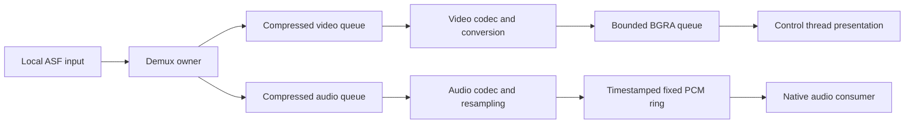

# Movie decoding

[The common decoder header](../include/bw/video/decoder.hpp) exposes an asynchronous
movie session with immutable metadata, independent video polling and prepared
PCM reads. FFmpeg types stay private. The first backend reads purchased ASF
`.ssu` files; native output owns audio-device timing and Metal presentation.
The [reference design study](../research/engine/subsystems/movie-demux-and-decode-design.md)
records the inspected ffplay, Unreal and Godot mechanisms. This implements the
transport/codec boundary; correct device playback is a separate acceptance gate.

The explicit backend factory lives in `src/video/ffmpeg/decoder.hpp` and is
linked through `bw_video_ffmpeg`. Target entry code selects it and passes it
through shared composition to Player. `bw_video` has no default codec selection
or FFmpeg link dependency.

## Ownership and execution

`bw::video::ffmpeg::open_decoder(path)` requires a local regular file, opens/probes it read-only,
and establishes `metadata()` before returning. Metadata declares whether audio
exists even if its first packet occurs late. Open then starts one demux owner
and separate video/audio codec owners; absent audio has no audio worker. Each
context is used by its owner and released after its worker finishes. There is
one input context and no duplicate reader.



`poll_video()` moves one owned, tightly packed, top-down BGRA8 frame with its
presentation timestamp/duration. It never performs decoding. A returned frame
survives decoder destruction; caller-retained and GPU-retained frames need their
own bounds. Pending, sample, end, failed and stopped are distinct outcomes.

Exactly one native consumer may call `read_audio(span<float>)`. It copies
interleaved stereo float PCM at 48 kHz into caller-owned storage, using lock-free
indices and at most two wrap copies. It performs no allocation/free, codec work,
logging, callback notification or mutex acquisition. Reads stop at a timestamp
segment boundary and can return fewer frames than requested. A trailing odd
float is untouched. The source is borrowed until native callbacks are retired.

The codec producer waits on full PCM storage using a two-millisecond predicate
recheck, plus cancellation notification. The callback changes atomic cursors
without a condition-variable mutex; the bounded recheck prevents a missed wake
from stranding the producer. This is an explicit polling cost, not a claim of
hard real-time scheduling guarantees.

`wait_until_ready(target_frames)` is a blocking control-thread operation before
native consumption/clocks start. The target must fit the PCM ring. It waits for
video or true video EOF and the PCM target or true audio EOF. A short stream can
prime below target when it is finished. Metadata, never an empty ring, selects
an audio-backed versus video-only clock.

Demux EOF closes each packet stream after all queued packets. Each codec drains,
and audio also drains the resampler. `audio_ended()` becomes true when no more
PCM can be written, even if buffered PCM remains. `read_audio()` reports end only
after all buffered PCM was consumed; video end similarly follows queued frames.
These events do not establish device drain or final-frame presentation.

`stop()` wakes worker waits and joins all owners; retire native callbacks first.
It is idempotent. Codec and local I/O operations already in progress determine
stop latency; an FFmpeg interrupt callback also observes cancellation. Open
failures throw. Worker failures publish an exception for control-thread reporting
and a callback-safe failed state; no exception escapes the audio read. Failed
sessions do not continue serving queued content as if playback succeeded.

## Timestamps and PCM continuity

The timestamp algorithm follows ffplay n7.1.1 `decoder_decode_frame`: audio uses
`AVFrame::pts` when available, advancing a sample-count fallback only when PTS is
missing; video uses `best_effort_timestamp`. Times are relative to the container
start. Missing video duration uses the declared average frame rate. Invalid
frame durations and negative/nonfinite presentation origins fail explicitly;
negative preroll trimming and seeking are not implemented.

Resampler delay is subtracted from the input timestamp for the first converted
sample. Each converted publication carries that timestamp through the PCM ring.
A later explicit PTS can step the sample timeline while PCM itself remains
consecutive. No silence is inserted, no PCM is removed and no asset-specific
priming bias is fitted. Native output must map each returned segment's timestamp;
it cannot infer all later timestamps from the initial origin and total frames.
Positive initial offsets are intentional timeline silence owned by output.

WMAPro frames have sparse packet-derived timestamps. Independent inspection
confirmed `pts` and `best_effort_timestamp` agree at the actual explicit anchors;
merely changing the field does not remove their approximately 85 ms startup
step. Keeping those anchors matches ffplay's timestamp rule while preserving the
continuous waveform. Original DirectShow absolute audiovisual offset remains
unverified. The previous continuous-origin research recommendation is superseded
by this explicit segmented clock contract.

Diagnostics retain anchor count, the last anchor delta against inferred next
input time (the existing `audio_anchor_bias_seconds` field name), and the largest
absolute delta. These values are observations, never corrections. An absolute
jump greater than ten seconds fails as an unsupported discontinuity, using
ffplay's `AV_NOSYNC_THRESHOLD` as the reference boundary; this backend does not
implement ffplay's clock-reset/seek recovery. Smaller changes are preserved.

## Resource profile and backpressure

`open_with_limits` accepts reduced capacities within the default local streaming
profile. These are subsystem budgets, not constants selected from logo sizes.

| Storage | Default bound | Rationale |
| --- | ---: | --- |
| Live compressed payload and packet bookkeeping | 16 MiB aggregate | Explicit hard admission profile near ffplay's 15 MiB soft watermark |
| Compressed stream share | 12 MiB each | One stream cannot consume the entire aggregate; 4 MiB remains for routing/in-flight work |
| Active packet descriptors | 8,192 aggregate, 6,144 per stream | Independent protection against many tiny packets |
| One staged compressed packet | 4 MiB | Reserved before the demux call; included in aggregate accounting |
| Decoded video | Three reservations, at most 128 MiB | Short frame queue independent of clip duration; conversion reserves before allocation |
| PCM | 48,000 stereo float frames / 384,000 bytes | One second of prepared output, separate from device buffer/prime policy |
| Timestamp segments | 1,024 fixed descriptors | Bounded publication metadata; producer waits when exhausted |
| Audio conversion scratch output | 65,536 stereo frames maximum | One worker-owned conversion result before bounded publication |

Compressed counters include referenced packet-buffer capacity, side data and
packet bookkeeping, and packets temporarily submitted by codec workers. Queue
pointer-slot arrays are preallocated separately at 6,144 slots per stream; they
are not hidden inside the active-payload count. A worst-case 4 MiB staging
reservation can throttle demux before the measured actual packet peak reaches
16 MiB. This deliberate reservation protects admission during a demux call.

No finite bound can support arbitrary container interleaving. Normal pressure
blocks the affected producer. Compressed routing continues while capacity
remains, even if video output is full. If required audio has insufficient
prepared data, its decoder waits for input, video is blocked on full output and
demux cannot admit another packet, waiting cannot repair the held-clock priming
or starved-audio dependency cycle. The reverse missing-video/full-audio cycle
is detected during priming, when the audio consumer is deliberately inactive. Such a session fails with `interleave_budget_exhausted`; it
does not drop reference packets, enlarge queues or label the condition EOF.
The normal-playback policy also rejects that dependency once PCM is empty,
rather than guessing that later presentation might eventually free enough space.

Input validation still permits at most two streams, WMV3/VC1 video and optional
WMAPro audio, dimensions up to 4,096 per axis and 8,847,360 pixels, input audio
up to eight channels/192 kHz, and fixed stream formats. Probing uses 4 MiB/two
seconds of stream analysis. Each codec rejects more than 4,096 packet submissions
without output. These do not imply a hard wall-time bound.

Third-party probe/parser, codec references/scratch and conversion contexts remain
externally managed allocations. The demuxer can allocate a malformed oversized
packet before the post-read check rejects it; no false claim of allocator-level
control is made. The full engine allocator migration remains separate work.
Owned video conversion and audio scratch still allocate on workers. Steady-state
callback storage is fixed; the entire decoder is not allocation-free.

## Reproducible dependency

[cmake/MovieDecoder.cmake](../cmake/MovieDecoder.cmake) downloads the upstream
[FFmpeg 7.1.1 source archive](https://ffmpeg.org/releases/ffmpeg-7.1.1.tar.xz)
with SHA-256:

```
733984395e0dbbe5c046abda2dc49a5544e7e0e1e2366bba849222ae9e3a03b1
```

The source, build, install and logs stay under the selected ignored build
directory's `vendor/ffmpeg/` subtree. The build enables only the ASF demuxer,
local-file protocol, WMV3/VC1/WMAPro decoders, VC1 parser, required codec/util
libraries, pixel conversion and audio resampling. Programs, encoders, network
protocols, autodetected external dependencies, GPL, nonfree and version-3-only
components are disabled. Shared libraries retain their normal FFmpeg names. Imported targets declare
the pinned ABI install names so CMake generates dependent executables' build
RPATH before those libraries exist on a clean build.
The configure output identifies the result as LGPL 2.1 or later. No system or
Homebrew FFmpeg binary is silently selected.

This is a separately licensed dependency; project-authored code remains under
the repository's Apache license. A future binary distribution must preserve
FFmpeg notices, ship the corresponding unmodified source and exact build
configuration, and permit replacement of the shared libraries. The upstream
[license/build guidance](https://ffmpeg.org/legal.html) describes those details.
Source-only publication does not bundle FFmpeg binaries or game media.

The current build recipe has been exercised on the macOS development host.
Xbox codec availability and deployment remain unimplemented target decisions;
the common header does not imply that the Mac library recipe is an Xbox backend.

## Verification boundary

Ignored evidence remains under `research/evidence/reconstruction/native-startup/`.
The asynchronous headless probe checks all four purchased movie assets, exact
frame/sample counts, finite PCM, stable independent EOF, payload hashes and budget
peaks. It deliberately retains the full video output queue while consuming one
second of audio to verify independent progress. Independent FFmpeg conversion is
the PCM oracle. In-process PCM tests cover segment timestamps, wrap, descriptor
and sample pressure, and concurrent producer/consumer handoff. Neither these
checks nor EOF proves visible playback, correct hardware timing or fidelity.
