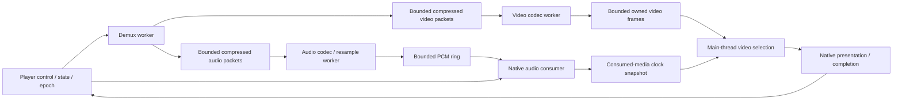
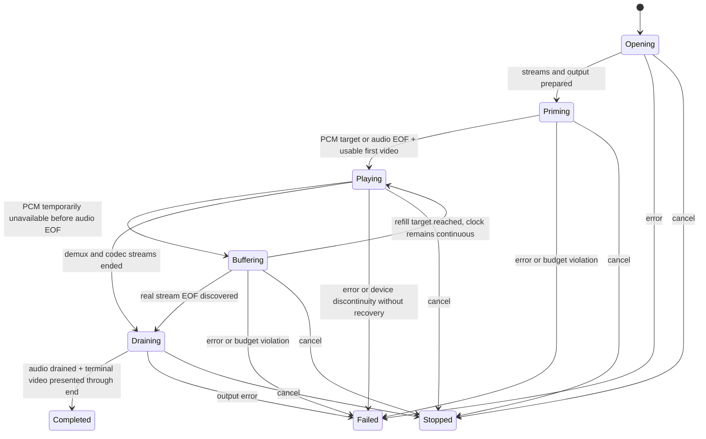

# Movie playback redesign

**Accepted design record.** The replacement is implemented using Unreal's
media responsibilities as the primary architecture guide. Current contracts and
verification limits are recorded in [movie transport](video-player.md). The
failure below describes the superseded implementation; it is retained as the
reason for replacing the pipeline, not presented as accepted native playback.

## Failure and requirements

The instrumented failure reached 53 decoded video frames while only 20,480
stereo audio frames had been submitted (0.427 seconds at 48 kHz). The audio
clock first overtook submitted PCM by 3.25 milliseconds; the old algorithm
then advanced video using wall time until later PCM triggered an exception.
The largest draw took 1.6 milliseconds. These observations implicate the mixed
sample pipeline and its handling of starvation, rather than GPU submission.
Independent packet evidence explains the ordering: Marvelous contains 45 video
packets (145,504 compressed bytes, through 1.835 seconds) before its first audio
packet; XSEED contains 50 video packets through 1.633 seconds. The first 45
Marvelous frames require about 166 MiB as decoded BGRA. The old 64 MiB
prime stopped before discovering audio, and `has_audio == false` incorrectly
started a video-only clock although the file metadata already declares audio.
That prematurely advances video, then the mixed pipeline cannot replenish PCM
independently. Compressed routing and metadata-based readiness address the
causal chain; larger decoded buffers do not.

A single FIFO of decoded video and audio makes future video an obstacle to
needed audio. Separating its two output containers alone is insufficient: a
worker blocked publishing video still cannot decode audio. Increasing its
capacity, delaying a particular clip, or treating starvation as stream end
would preserve the defect.

The replacement must:

- Separate packet routing, each codec's progress, decoded queues, audio
  consumption and presentation. A blocked renderer must not stop audio feeding.
- Bound compressed packets, decoded pixels, PCM and output buffers separately.
  Never solve container interleaving by retaining an entire decoded movie.
- Distinguish absent audio, temporarily empty audio, audio EOF, codec drain,
  device drain, and failed output.
- Derive audio-master time from media actually consumed by the output path,
  with its queued/device latency and clock epoch represented explicitly.
  Decoder timestamps, submitted PCM and reusable native buffers are different
  observations.
- Prime before starting clocks; recover from temporary starvation without
  dropping PCM or counting output silence as advancing movie time.
- Present the terminal video frame and retain it through its presentation
  interval before completion. EOF or an upload counter is insufficient.
- Cancel every wait and retire callbacks, workers and GPU references before
  their owners are destroyed.

## Reference findings

The cross-engine comparison and provenance are recorded in
[media reference design](../research/engine/subsystems/media-reference-design.md).
The compressed-packet and codec proposal is developed in
[movie demux and decode design](../research/engine/subsystems/movie-demux-and-decode-design.md).

The baseline is the established media-player arrangement, adapted to the
engine's common headers and native backends. These are original design
observations; reference implementation code is not included in this repository.

| Reference inspected | Relevant mechanism | Consequence here |
|---|---|---|
| FFmpeg 7.1.1 `fftools/ffplay.c`: `read_thread`, `audio_thread`, `video_thread`, packet/frame queues | Demuxed packets route to separate streams; codec workers and decoded queues progress independently | Compressed interleaving must not force decoded video retention before audio can progress |
| FFmpeg: `sdl_audio_callback` and `audio_decode_frame` | Audio output consumes decoded audio; its clock accounts for remaining software/device buffers | The game/presentation tick cannot own timely PCM feeding or equate enqueue with play |
| FFmpeg: `video_refresh` and clock helpers | Video selection follows a master clock; late frames and presentation timing are explicit | Measure late frames separately from decoding success |
| Unreal Engine commit `f45729c0b6f097038e72b52d366a62baeca3275b`, `Media/Public/IMediaSamples.h` | Independent audio/video fetch and receive-capacity contracts | Public stream readiness must be independent |
| Unreal: `MediaAssets/Private/Assets/MediaSoundComponent.cpp`, `FMediaSoundGenerator::OnGenerateAudio` | Audio generation consumes samples and publishes a timestamp associated with that consumption; insufficient output is explicitly filled | Clock observations belong to the output consumer, not the sample producer |
| Unreal: `MediaUtils/Private/MediaPlayerFacade.cpp`, audio-backed video time-range selection | Uses audio-sink timing and the time at which it was sampled; rejects invalid timing and limits stale extrapolation | Publish coherent clock snapshots with validity and epoch, rather than a bare double |
| Unreal: `MediaUtils/Public/MediaSampleQueue.h` | Queue ownership, flush state and consumer observations are explicit | Cancel/reopen must invalidate previous samples and clock observations together |
| Godot 4.5 `scene/gui/video_stream_player.cpp` | Audio mixing runs through the audio server separately from presentation; bounded resampler writer space and first-update baseline are explicit | Audio feeding and initial timing must not depend on window draw cadence |

Public references: [FFmpeg source](https://github.com/FFmpeg/FFmpeg/blob/n7.1.1/fftools/ffplay.c),
[Godot source](https://github.com/godotengine/godot/blob/4.5-stable/scene/gui/video_stream_player.cpp).
Unreal paths are relative to `Engine/Source/Runtime` in the authorized private
reference checkout. Its source remains ignored and is not copied into authored
code or documentation. These engines differ in detail; the proposal below is
our contract, not a claim that they all use identical buffering policy.

## Proposed ownership and execution

`Player` owns one playback session and generation number. Its control operations
remain on one thread. Workers own their codec/demux contexts exclusively.
The renderer remains native and main-thread owned. Audio consumes from its
own prepared PCM storage on the native output execution path, not from
`Player::advance`.

The backend boundary must expose stream metadata and independent stream
completion. A single `next()` returning either sample is no longer sufficient.
The implemented C++ signatures in `decoder.hpp` and `output.hpp`
express packet/decoder ownership without leaking FFmpeg or Apple types.

The initial implementation should use one demux worker, independent audio and
video codec workers, and independent decoded queues. A selected-stream decoder
behind one worker is an alternative only if it can demonstrate bounded audio
latency during video work; it does not satisfy this requirement merely because
its API accepts a stream enum. Two full demux readers are not the selected
baseline: they add duplicate probing/I/O and avoid rather than model packet
routing.

A mature external playback library is another alternative. It could own this
machinery, but adoption needs a concrete licensing, native output, deployment
and Xbox backend assessment. Embedding a standalone player's process or window
would not satisfy the shared engine/native output split. Reusing the proven
architecture does not require importing another engine's source.

## Storage and flow control

Compressed audio/video queues have independent capacity reservations within a
session's total byte/packet budget. Decoded video has both frame-count and
pixel-byte limits. PCM uses fixed-capacity frame storage at the selected output
format. Native device blocks and presentation resources have separate bounds.
Payload ownership transfers; a wait never holds a codec call, output callback
or unrelated stream's queue lock.

When decoded video is full, the video codec waits. Audio decoding and device
feeding continue. Demux can retain compressed video up to its documented
budget while continuing to discover audio packets. If container interleaving
exceeds that compressed budget, report a specific interleaving/budget failure;
do not block forever behind the very stream whose future packets fill the
budget, discard compressed reference frames, or expand storage without bound.
This is a supported-input limit, not audio EOF.

The current standard-container/default-heap allocations remain an explicit
prototype limitation. The full engine allocation-domain migration follows
the launch-screen/cinematics milestone; this correction still requires explicit
capacity accounting, not a new general allocator subsystem.

Budgets are configuration with measured high-water diagnostics. Readiness is
expressed in playable PCM frames/time and first usable video, not just a count
of mixed samples. The prime target derives from native output periods plus a
documented scheduling margin; it must fit configured PCM capacity. A complete
short stream can prime with less when its own EOF is already known. Values
must be justified from output requirements and stress measurements, never from
company-logo length or filename.

## Audio consumer and clock contract

The audio consumer fills preallocated output blocks from PCM storage. Its hot
path performs bounded copies/zero-fill and publishes bounded observations; it
does not decode, allocate, log, acquire a game lock or call Lua. Callback state
has stable lifetime through synchronous device retirement.

A clock snapshot needs at least the session epoch, media position, monotonic
observation time, validity, playback/buffering state and remaining queued media.
It must be internally coherent. A reader must not combine an old position with
a new epoch or latency. The native adapter defines how its callback position
and hardware/device latency map to actual presentation time. AudioQueue buffer
availability alone cannot supply that answer.

Within one continuous segment, PCM advances by actual output frame count.
The decoder must distinguish a usable decoded-frame timestamp from a packet
anchor, codec priming, or a count-derived fallback. Sparse timestamps must not
invent middle silence, but dropping every later timestamp is also insufficient:
it can hide drift or a real discontinuity. Retain their provenance and compare
new usable anchors with the segment's cumulative-frame position. A recognized
codec delay is normalized at the decoder boundary; an unexplained jump starts
an explicit discontinuity outcome rather than silently shifting samples. The
first implementation may fail an unsupported discontinuity. FFplay's clock
uses decoded timestamp anchors with residual output subtracted; continuous PCM
queuing alone is not its complete synchronization algorithm.
An intentional positive initial offset is timeline silence and advances media;
underflow silence is device maintenance and does not advance media. These two
kinds of silence require different accounting.

The proposed Mac mechanism is **continuous native output with explicit mapped
ranges**, rather than stop/reopen on underflow. The AudioQueue callback refills
preallocated blocks from the PCM ring independently of rendering. Each block
records its real-PCM and maintenance-silence ranges. Use
`AudioQueueEnqueueBufferWithParameters` with no requested start time and retain
its returned actual start timestamp. This maps the buffer to the queue timeline
instead of assuming every enqueue immediately follows consumed media. Query
`AudioQueueGetCurrentTime` with an owned `AudioQueueTimelineRef`; the existing
null timeline cannot report discontinuities. Real-PCM ranges advance media;
maintenance-silence ranges hold it. Retire mapping entries after the queue
playhead has passed their end, not when buffers become reusable.

Mapping storage is preallocated and bounded separately from native buffer
storage: a reusable buffer can still have an outstanding presentation range.
The audio execution path owns mapping updates and publishes coherent snapshots;
the game thread must not be required to drain mapping records for audio to
continue. A snapshot permits extrapolation only inside a known mapped range,
never across a buffering boundary. Invalid actual-start timestamps, exhausted
mapping capacity, or reported timeline discontinuity are explicit backend
failures, not guessed offsets. Real media EOF ends native feeding after the
last PCM block and requires the device's drain acknowledgement.

Apple documents these APIs in [Audio Queue Services](https://developer.apple.com/documentation/audiotoolbox/audio-queue-services)
and SDK `AudioQueue.h`. The subsequent silent native probe established valid
pre-start enqueue sample positions, temporarily invalid initial queue time, and
stale logical enqueue positions after deliberate native starvation. The adopted
implementation therefore maintains native output with mapped maintenance
silence; it does not treat actual-start timestamps as a repair for a real device
gap. The reviewed native service and its fixed capacity/atomic publication
contract are now recorded in [movie transport](video-player.md).

The main thread consumes this snapshot for video selection. It does not invent
media progress from stale audio observations. Wall time is the master only
when metadata says audio is absent, or after the audio stream is explicitly
ended and all its real output is drained. A long video tail is therefore an
ordinary supported state, not a guessed lack of future audio.

## State transitions

Stream metadata is known before clock selection: declared audio remains audio
even when no audio packet has arrived. An empty sample queue cannot switch the
clock to video-only mode.

Opening and priming do not advance the media clock. Prepare output and accept
the first video presentation before enabling playback time. Video-only playback
establishes its wall baseline there; an application's earlier tick must not
charge file-open time to it. Game fade activation should observe readiness
through the adapter, rather than run while media is still opening.

Buffering freezes the audio-backed media timeline at the consumed endpoint.
Presentation retains the last frame. Decoding continues. Resume requires a
refill threshold (or known audio EOF with remaining PCM), maintains the media
origin and reports the interruption. It neither throws merely because data is
late nor silently skips PCM to catch up with wall time. Device loss or an
unreconcilable native timestamp discontinuity remains an explicit error in the
first implementation.

EOF is recorded separately for demux, video codec, audio codec and resampler.
Draining can continue output after all decoding has ended. With an early audio
end, record the final played position and establish a wall-clock video-tail
baseline only after its device drain. With an early video end, hold the terminal
frame while audio finishes. Cancellation is never completion.

## Video presentation and completion

Choose the frame covering the media clock from the video queue. Future frames
stay queued; obsolete frames may be dropped and counted. Retain the selected
frame through GPU completion. Failure to obtain a drawable is pending
presentation, not a successful draw. Video lateness does not stop the independent
audio consumer.

Keep a terminal-frame identity and presentation acknowledgement, not only
uploaded-frame totals. Completion requires both streams' real EOF/drain and
terminal presentation through its interval. If the terminal frame arrives late,
it must still receive a presentation interval before retiring the session;
record the resulting lateness. This prevents successful completion from hiding
a final image that was never visible. Native GPU completion proves resource
retirement; visible-window QA remains necessary to establish appearance.

## Cancellation and teardown

Invalidate the session epoch and prevent new callbacks from observing the old
PCM source. Stop/pause the audio device synchronously before releasing callback
storage. Wake all packet/frame/PCM waits and join demux/codec workers; no worker
may wait for a callback that has already been retired. Release decoder contexts
on their owners and then queued payloads. Retire GPU references before releasing
presentation storage. Reopen starts a new epoch and cannot accept old audio
clock snapshots or stale completion notifications.

Errors publish their owning stage and preserve enough terminal state for the
control thread to report the cause. No exception escapes a native callback.
Partial construction follows the same ownership rules.

## Acceptance before another success claim

In-process cases should exercise public transport state with synthetic samples
and a controlled native-output clock:

- Heavy video-before-audio packet interleaving and a deliberately full decoded
  video queue still permit PCM progress within the compressed budget.
- A suspended presentation consumer does not starve a healthy audio consumer.
- Empty PCM before audio EOF enters buffering; refill preserves every sample,
  holds the media clock during maintenance silence and resumes continuously.
- Native clock origin, queued latency and epoch changes cannot jump video;
  device discontinuity produces a named outcome.
- Audio absent, audio ending early, video ending early, short clips below prime
  target and late terminal video all complete with the required drain/presentation.
- Cancellation during each capacity wait, codec error and output failure join
  all owners and reject stale generation observations.

Retain the existing original-root integration. Native acceptance must then show
both full company logos, continuous Marvelous audio, both natural completions,
no unresolved underflow and measured final-frame presentation. Report PCM
produced/consumed, buffering intervals, late/dropped video, queue high waters,
media/wall duration and output latency observations. Keep before/after evidence;
do not weaken the check to accept the current failure. Broader engine work stays
paused until this playback contract and its native behavior are accepted.
