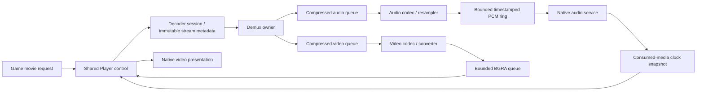

# Movie transport

`bw::video::Player` is reusable engine media control. It knows nothing about logo
playlists, startup phases, fades or Lua. The game adapter requests playback and
observes completion; platform code presents video and consumes audio.

The replacement follows Unreal's separate sample/output responsibilities and
consumer-owned timing, with FFmpeg's independent demux/codec execution as the
backend guide. See the [reference comparison](../research/engine/subsystems/media-reference-design.md)
and [design record](video-player-redesign.md). The previous mixed decoded FIFO
failed native playback. The replacement passes the silent native component
probes and the integrated two-logo run; see the
[recorded native verification](native-startup-host.md#recorded-native-verification).

## Contracts and ownership

[decoder.hpp](../include/bw/video/decoder.hpp) exposes immutable stream metadata,
independent video polling, bounded PCM reads and per-stream completion.
[output.hpp](../include/bw/video/output.hpp) separates presentation from
`AudioOutput`, whose service continues without `Player::advance` or `draw`.
[player.hpp](../include/bw/video/player.hpp) owns the session and selects video.

One control thread calls Player. Its decoder owns joined demux/audio/video
workers and their queues. One native audio consumer reads the PCM ring without
allocation, decoding or game callbacks. Player first retires the native consumer,
then stops/joins the decoder. Reopen creates fresh native timing state; old
snapshots cannot cross session ownership. No callback outlives its source.

Stream metadata determines whether audio exists before any samples arrive.
`open` primes to the requested audio coverage and first video (or true short
stream EOF), selects initial video, and prepares output. Time starts only after
an accepted first presentation. Opening time cannot become a video-only delta;
an empty audio queue cannot change a declared audio stream into video-only mode.

The decoder owns separate compressed/decoded budgets, detailed in
[video decoder](video-decoder.md). Player retains at most one future video frame
beyond those queues and one selected frame during upload. Its default audio
prime/refill target is 4,096 frames (about 85 ms at 48 kHz), a media service policy,
not a movie-specific duration. The native Mac device queues three 1,024-frame
blocks. Prime coverage exceeds these device blocks; a complete shorter stream
can prime below target. The PCM ring holds 48,000 frames by default.

These capacities are explicit prototype resource budgets. Standard containers,
codec internals and native allocations still need the later engine memory-domain
migration; these limits are not a claim of a finished allocator subsystem.

## PCM and clocks

Decoded PCM is continuous in storage and output. Each timestamp segment carries
its actual decoded-frame PTS, with a sample-count fallback only when absent.
A native read may stop at a segment boundary before filling its destination;
that is not underflow. Native output loops over those segments and maps each to
its real device presentation range. Sparse PTS jumps do not insert invented
middle silence or drop PCM. They change the media timestamp when that segment
is consumed. Small signed media-anchor corrections are preserved; they are distinct from a
regression in the native device clock. Player follows the corrected media time
while retaining the current image until the next frame is due. Decoder-defined
large discontinuities remain unsupported. A negative initial audio origin is
also unsupported; no trimming is silently invented.

With audio, the native consumed-media snapshot is the master. Player does not
advance from decoded counts, submitted blocks, buffer reuse or wall time while
that audio timeline is pending/buffering. Video-only playback uses measured wall
time. After explicit audio EOF and real device drain, a new wall baseline can
finish an arbitrarily long video tail. Game timestep caps do not affect media.

The Mac implementation is [media_audio.mm](../src/platform/macos/media_audio.mm),
behind [media_audio.hpp](../include/bw/platform/media_audio.hpp). A joined
CFRunLoop thread owns AudioQueue, its callbacks and mapping retirement. Its
three preallocated blocks and 256 fixed mapping records are independent of the
main thread. Each mapping records device sample range, media start and whether
its frames are PCM, initial timeline silence or maintenance silence.

`AudioQueueEnqueueBufferWithParameters` supplies the buffer's scheduled sample
start. `AudioQueueGetCurrentTime`, with a real timeline object, locates playback
within these ranges and detects timeline discontinuity. Mappings retire after
playback, not callback buffer reuse. The service targets a 5 ms observation period while active; host scheduling
can delay a wakeup. It publishes atomic fields under a sequence counter; readers
retry a bounded number of times and return invalid timing if publication is
busy. Plain fields are never read concurrently through a sequence counter.

The silent API probe established two constraints: queue time is invalid before
playback establishes its clock; and enqueueing after a real device-buffer gap
can still return the old logical sample position. Consequently the service
keeps native buffers supplied even when PCM is temporarily unavailable, and
rejects a scheduled range already behind the observed device clock. It never
pretends the enqueue timestamp repaired a real hardware gap. Mapping-capacity
exhaustion, invalid timestamps and native device errors also fail explicitly.
[Apple Audio Queue Services](https://developer.apple.com/documentation/audiotoolbox/audio-queue-services).

## Buffering, EOF and completion

If the PCM source is pending before its EOF, the native service emits maintenance
silence and records a buffering event. These native frames hold the media clock.
Once the PCM refill target is reached, or the source has ended with a shorter
remaining tail, feeding resumes continuously. No real PCM is skipped. Initial
positive-offset silence is different: it intentionally advances media to the
first audio timestamp. Both are counted separately.

Demux end, each codec's drain, resampler end, empty decoded queues and native
playback drain are distinct. The native service stops refilling only after real
audio end and asks AudioQueue to drain already queued blocks. Its drained
snapshot accounts for all submitted PCM. A temporarily empty source never
requests final drain.

Player chooses the newest due video, retains future video and reports skipped
late frames. A failed drawable acquisition retries presentation. Completion
requires video EOF, its media end, actual audio drain, acceptance of the terminal
frame and that frame's presentation interval. A late terminal frame still gets
its interval; upload or decoder EOF alone cannot hide an invisible final image.
Cancellation clears output and is never successful completion.

## Verification and limits

Five in-process control cases cover initial timing, terminal exposure, declared
audio before valid timing, true drain, buffering snapshots, native failure,
long video tails and recovered game fades. PCM-ring tests separately cover
segment boundaries and producer/consumer behavior. The silent native component
probe used arbitrary PCM and a timestamp jump: healthy output played all 31,200
frames with no underflow; an induced source stall played the same frames after
one buffering event, with maintenance silence excluded from media. The main
thread slept during both runs. This proves component behavior under those
conditions, not perceptual fidelity of the actual game movies.

The existing startup verification requires natural completion, source/submitted/
played PCM agreement, no unexpected normal-run underflow, and terminal-frame
presentation. The integrated Mac run passed those checks, with the final XSEED
logo observed on screen. [Native host](native-startup-host.md) records the metrics
and the limits of that observation.
Seeking, reverse playback, device migration, negative preroll and general engine
allocation domains remain outside this implementation.
