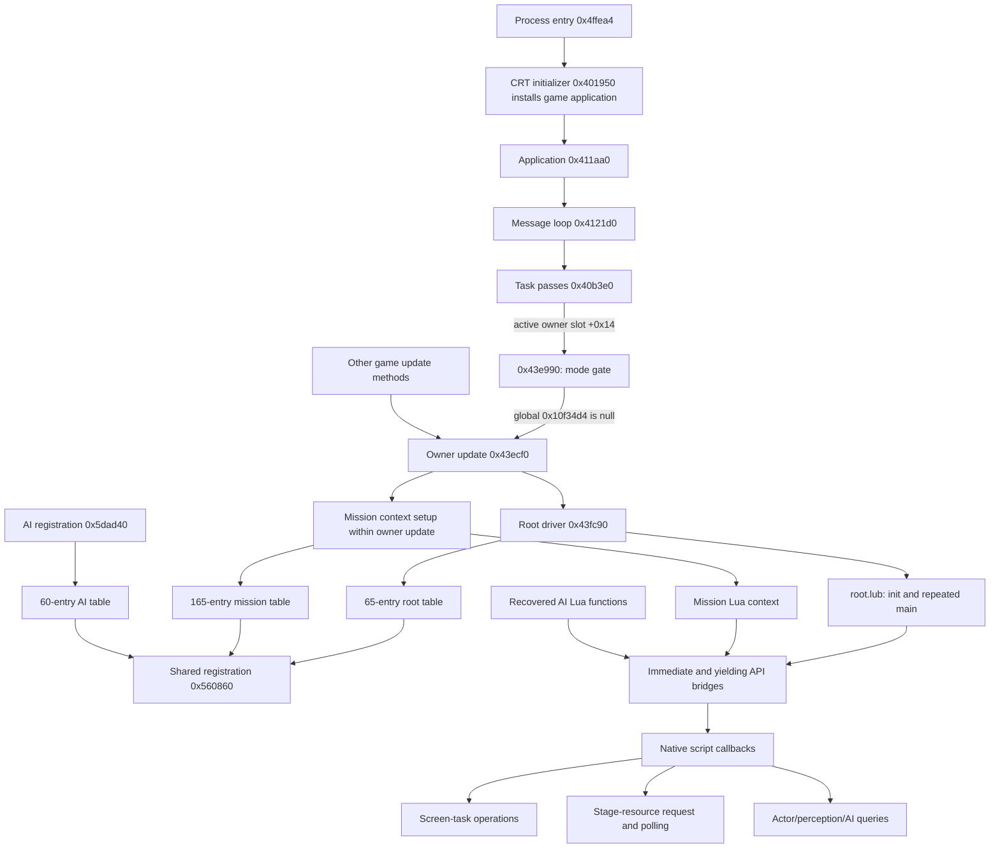
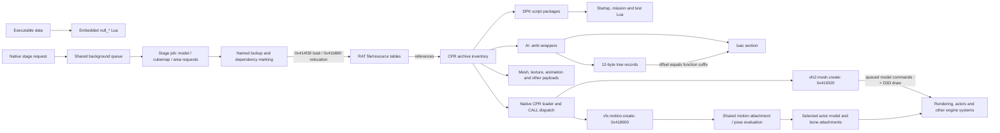
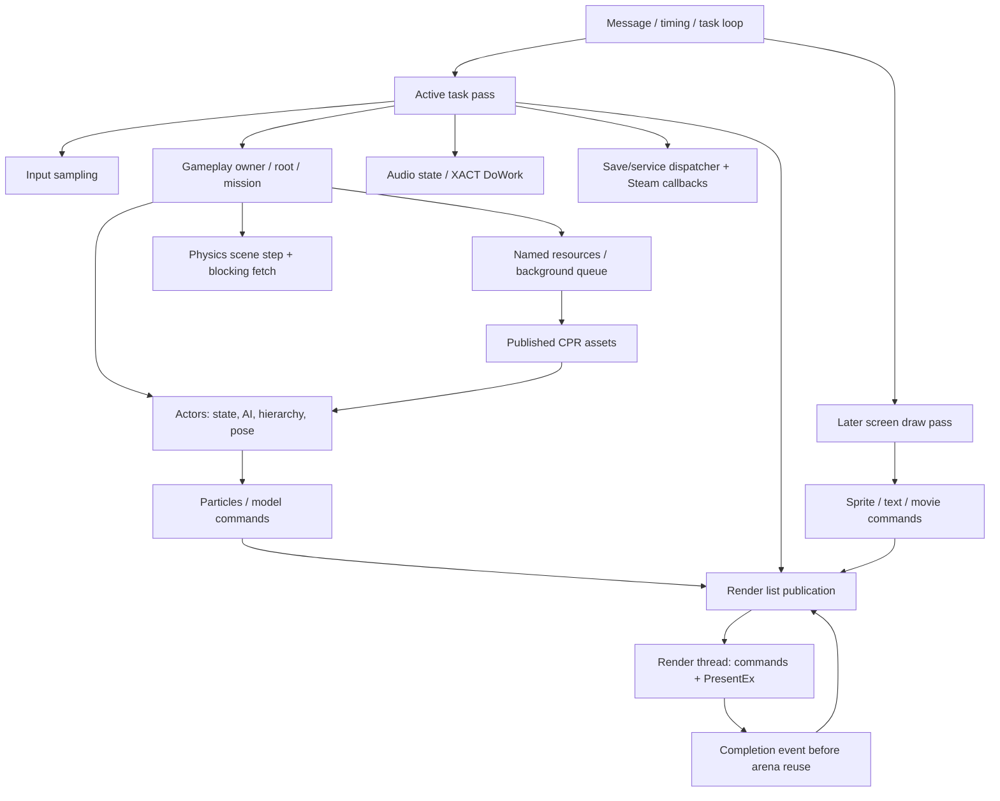

# Bullet Witch engine architecture

**Architectural coverage complete · October 22, 2026 · revision 8**

The main technical entry point for the confirmed [project approach](../../BRIEF.md).
Script recovery is complete. The static architecture now covers every major
Steam PC engine domain with connected producers, consumers and platform boundaries.
Detailed behavior and runtime fidelity questions remain explicit below.
This document describes the recovered engine and tracks its mapping. Proposed
reconstructed components are planned separately in the
[source reconstruction plan](../../IMPLEMENTATION.md). The user selected readable,
buildable source as the foundation for a faithful direct port and later upgrades.

## Navigate

- [Engine provenance](../sources/engine-provenance.md): release history, original
  developer sources and the distinction between engine identity and middleware.
- [Bootstrap and tasks](subsystems/bootstrap-and-tasks.md): application setup,
  message loop, lifecycle passes and virtual update dispatch.
- [Mission lifecycle](subsystems/mission-lifecycle.md): load/start/event callbacks,
  outcomes and restart routes.
- [Background worker](subsystems/background-resource-worker.md): queue, thread
  dispatch, argument ownership and pending semantics.
- [Resource dispatch](subsystems/resource-dispatch.md): named dependencies, CPR
  loading and native mesh/motion handlers.
- [Execution and script runtime](subsystems/execution-and-scripts.md): context layout,
  root/mission orchestration, coroutine scheduling and screen-task interfaces.
- [Mission and stage loading](subsystems/mission-and-stage-loading.md): mission
  selection, yielding stage requests, job submission and pending-state checks.
- [Actors and animation](subsystems/actors-and-animation.md): character resource assembly,
  table-driven spawning, eight concrete factories and actor/model ownership.
- [Actor lifecycle](subsystems/actor-lifecycle.md): hierarchy/frame order, state and
  AI dispatch, pose/attachments, collision messages, deferred spawn and destruction.
- [AI runtime](subsystems/ai-runtime.md): all 155 wrapper schemas, Lua evaluation,
  control transitions, 109 action registrations, 48 constructor families and 112 method targets.
- [Physics and collision](subsystems/physics-and-collision.md): scene ownership,
  frame stepping, collision queues, synchronization and release.
- [Animation data](subsystems/animation-data.md): track layout, finite half-float
  conversion, vector interpolation and SIMD rotation blending.
- [Rendering](subsystems/rendering.md): GPU resource creation, model commands,
  all 766 named shader variants, command worker and PresentEx.
- [Input](subsystems/input.md): task ownership, controller selection and action masks.
- [Audio and movies](subsystems/audio-and-movies.md): XACT/XAudio, DirectShow,
  streaming, double-buffered video textures and completion/release.
- [Saves and progression](subsystems/saves-and-progression.md): file operations,
  checkpoint snapshots, section headers and separate completion/success states.
- [UI and screen tasks](subsystems/ui-and-screen-tasks.md): six startup lifecycles,
  title/menu transitions, font/sprite queues and GPU consumers.
- [Platform services](subsystems/platform-and-services.md): Windows threads/events,
  Steam context/callbacks, configuration and shutdown boundaries.
- [Particles and effects](subsystems/particles-and-effects.md): original class families,
  all four pack tables, stage sequences and native simulation.
- [Particle runtime contracts](subsystems/particle-runtime-contracts.md): emission,
  RNG, children, shared animation, GPU state and lifetime rules.
- [Mapping worklist](WORKLIST.md): all subsystem domains, evidence and next
  actions; unresolved items remain local to their affected paths.
- [Research index](../README.md), [script index](../evidence/script-corpus/INDEX.md),
  [native API index](../evidence/script-corpus/NATIVE-API.md), and
  [native export status](../evidence/native-decompilation/status.tsv).

- [Model data](subsystems/model-data.md): PC declarations, skeleton, material
  references and draw-group metadata, informed by the existing Noesis importer.
- [Community reverse engineering](../sources/community-reverse-engineering.md) and
  [contemporary graphics pipeline](../sources/softimage-bullet-witch.md).

## Evidence convention

| Status | Meaning |
|---|---|
| Verified artifact | Extraction/structure or normalized bytecode checked against source bytes |
| Static confirmed | Relationship directly supported by instructions, tables or data references |
| Inferred | Interpretation of observed behavior; original name/type/semantics not fully recovered |
| Unresolved | A particular relationship or contract still needs investigation |

Solid diagram arrows show established relationships **at the scope stated in the
caption**. Dashed arrows show unresolved connections. Boxes are research role
names unless explicitly identified as original strings. An observed DLL import
confirms a dependency, not its initialization order or every runtime caller.

Preferred VAs refer to the x86 image at base `0x400000`. The analyzed unpacked
image SHA-256 is `bdaff1746d3092215699b09eab11315c6adf8fb71eaa8f46c280b11b3cd448fd`.
Native C files are Ghidra pseudocode with inferred signatures. Instruction
witnesses take precedence where calling conventions or arguments are ambiguous.
No game execution has yet provided a dynamic reference.

## Established foundation

**Cavia developed Bullet Witch's engine in-house from scratch.** The original
Japanese release was July 27, 2006; the PC port followed April 25, 2018. Direct
developer sources and their implications are in [engine history](../sources/cavia-engine-history.md).
The original blog identifies NovodeX physics and an AI scripting engine. Our PC
binary mapping independently identifies Lua 5.0.2 and PhysX dependencies.

| Material | Coverage | Evidence |
|---|---|---|
| Lua source | 232 occurrences / 231 unique chunks; all unique sources round-trip | [Final verification](../evidence/script-corpus/final-verification-summary.json) |
| Script/native boundary | 214 called names; 290 registration entries in three tables | [API summary](../evidence/script-corpus/native-final-summary.json) |
| Native pseudocode baseline | 2,398 functions, including 272 unique registered callbacks | [Export manifest](../evidence/native-decompilation/status.tsv) |
| Asset containers | All 6,625 CPRs; RAT references cover the inventory | [Asset report](../reports/2026-10-21-asset-layout.md) |
| AI structure | 155 wrappers; 27,079 tree-record/Lua-function links | [AI map](../evidence/script-corpus/ai-node-summary.json) |

The corpus pass recorded 461 unresolved indirect callsites in its selected native
graph. That is a baseline inventory, not a count of all engine unknowns. Track
newly understood dispatch sites and newly discovered paths in subsystem notes.

## Recovered execution relationships

This graph combines confirmed registration, script references and selected native
call paths; it is not a complete main-loop or ownership diagram. AI execution policy and concrete startup registration are now connected in their
subsystem notes. Mode-specific task order and runtime cadence remain local questions. Root and
mission registrations are witnessed in [table callsites](../evidence/script-corpus/registration-call-witnesses.txt).
Bridge and task relationships are detailed in [execution and scripts](subsystems/execution-and-scripts.md).

## Resource and behavior representation

Solid edges here represent verified file containment/references or structural
relationships, not a claim about runtime loading order. The native script
loader's logical `script\%s.dpk` / `%s.lub` lookups are mapped; RAT namespace resolution, precedence and publication are now connected to the native loader.

## Subsystem inventory

| Domain | Current map | Remaining bounded contracts |
|---|---|---|
| Bootstrap / shutdown | CRT-installed game application; service setup; startup task; render stop/join and post-loop cleanup | Exceptional exits and secondary destructor order |
| Orchestration / scripting | Root/mission load/start/events, status writers, coroutine pending/resume boundary | All event producers, native argument types and restart gates |
| Task scheduling | Lifecycle and two active passes; concrete input, render, audio and screen methods | Mode-specific list order and exact timing |
| Resources | RAT relocation/precedence; dependencies; CPR handlers; publication; tag unload | Partial-failure script behavior and pending cancellation races |
| Rendering | Buffer/texture creation; mesh command interpreter to indexed drawing; all named shader mappings; worker PresentEx | Full postprocess order, shader semantics, reset/error paths and visual match |
| UI | Six startup task lifecycles; title/menu transitions; text/sprite ring; movie texture to GPU | Other dialogs, layout, exact timing, overflow/reuse and unlock policy |
| Actors / animation | Eight factories; selected full lifecycle; pose/attachment order; vector/half/rotation samplers | Other variants, action/pose specializations and exact SIMD math |
| Particles / effects | Packs, emission/curves/RNG, children, model motion, GPU state and retirement | Local channel/numeric/allocator cases |
| AI | All 155 wrapper schemas / 27,079 nodes; candidate Lua policy; 109 named native factories | Per-action parameter/lifecycle schemas and controller edge cases |
| Physics / collision | Owned SDK/scene; collision queues; frame step and blocking fetch; release | Exact legacy ABI, all shape/filter semantics and separate worker guarantees |
| Audio / movies | XACT 3.7 / XAudio2 2.7 banks/cues; DirectShow graph, texture conversion and events | Cue flags, codec availability and failure behavior |
| Input | Concrete task, XInput/DirectInput acquisition, deadzones, masks, repeats and keyboard/mouse poll | All binding/action consumers and mouse scaling conventions |
| Save / progression | Three local save files; checkpoint snapshot; section header; success versus completion | Nested record fields, malformed-data handling and costume/bonus policy |
| Platform / services | Threads/events/timing/files; concrete Steam context, stats/callback callers; configuration | Actual loaded DLLs, cloud policy and runtime portability behavior |

These are mapping domains, not a recovered class hierarchy. Detailed actions
and current blockers are in the [worklist](WORKLIST.md).

## Connected frame and service boundaries

This combines established service connections, not a single universal chronological
frame sequence. Exact ordering depends on the active task/mode. Input and VSync
both use **+0x14**, not +0x18; byte-checked vtables correct the initial pass-06
working notes. The complete named shader registry and AI tree schema are verified
artifacts. No whole-game runtime fidelity claim follows from static coverage.

The [pass 06 report](../reports/2026-10-22-engine-documentation-pass-06.md) records
commands, corrections, audits and remaining scope. The [worklist](WORKLIST.md)
now tracks contract closure rather than unidentified subsystem entry points.

## Maintain this map

When mapping a function or subsystem:

1. Record addresses, observed calls/data, inferred names/types, field offsets and
   evidence paths in the appropriate subsystem note.
2. Update the relevant relationship, sequence or state diagram. Keep it close
   to the supporting text; label unresolved edges explicitly.
3. Record remaining uncertainty against the precise function, field or edge.
   Continue with other available paths when one is blocked.
4. Update this entry point and the worklist when coverage changes. Keep historical
   reports intact; current notes can supersede their conclusions with evidence.

Tests and runtime observations resolve specific contracts within this work.
The confirmed direction is systematic engine mapping; it is not awaiting a new
feasibility approval.

## Revision record

- **2026-10-22, revision 1:** established this entry point and evidence convention;
  imported the verified script/runtime foundation; added mission selection,
  stage request/polling, submitted callback and queue-inspection anchors. See
  [mission and stage loading](subsystems/mission-and-stage-loading.md) for the new trace.
  Organized the research tree into living maps, sources, reports, logs and evidence;
  added the external provenance catalog and subsystem worklist.

- **2026-10-22, provenance follow-up:** inspected all six user-supplied CEDEC
  slides; recorded page 2's in-house engine wording and translation. Closed the
  presentation-access item; no technical architecture is supplied by these slides.

- **2026-10-22, direct developer confirmation:** located the Play team interview
  and August 4, 2006 official programmer blog. In-house engine origin is established;
  updated provenance and removed the earlier inference-only classification.

- **2026-10-22, revision 2:** incorporated existing Bullet Witch/Zegapain Noesis
  reader research, original NieR tool comparison and contemporary Softimage
  pipeline interview. Added the PC model-data map and diagram; bounded PW0
  comparison identifies nine D3D9 declarations and 125 skeleton records.

- **2026-10-22, revision 3:** continued engine documentation without building a
  renderer. Mapped application/message/task routing, mission load/start/outcomes,
  shared worker dispatch/cleanup, complete stage job and CPR mesh/motion handlers.
  [Pass report](../reports/2026-10-22-engine-documentation-pass-02.md) records scope,
  evidence corrections and remaining work.

- **2026-10-22, revision 4:** added [actors](subsystems/actors-and-animation.md)
  and [particles](subsystems/particles-and-effects.md). Connected character resource
  assembly and group spawning; inventoried all four effect packs and mapped native
  part factories, simulation and stage sequence creation. See the
  [pass 03 report](../reports/2026-10-22-engine-documentation-pass-03.md).

- **2026-10-22, revision 5:** completed the connected particle mapping pass from
  packs and emission to GPU submission and retirement. Added detailed runtime
  contracts and three diagrams. Returned to actors: resolved eight factories
  across nine game-mode vtables and followed actor/model/attachment ownership.
  Shared pose evaluation and sampler consumers now anchor MODEL-03. See the
  [pass 04 report](../reports/2026-10-22-engine-documentation-pass-04.md).

- **2026-10-22, revision 6:** connected the selected actor lifecycle through
  hierarchy/frame ordering, state/component messages, original AiBehavior and
  controller dispatch, model pose/bone attachments, deferred spawning and delayed
  destruction. Added two lifecycle diagrams and hash-bound native checks. See the
  [pass 05 report](../reports/2026-10-22-engine-documentation-pass-05.md).

- **2026-10-22, revision 7:** extended the map across AI, physics, input,
  audio/movies, saves, shared animation, rendering and platform services. Closed
  RAT ingestion/unload, all 766 named shader mappings and concrete CRT-to-startup
  registration. Corrected input/VSync method offsets against raw vtable bytes.
  Completed six startup-screen interfaces and the shared UI GPU path; indexed
  all 48 AI constructor families and their 112 method targets. Added hash-bound
  evidence, native navigation and subsystem diagrams. See
  [pass 06](../reports/2026-10-22-engine-documentation-pass-06.md).

- **2026-10-22, revision 8:** recorded the user's choice of source reconstruction.
  Added the implementation sequence and fidelity criteria in
  [SOURCE-RECONSTRUCTION](../../IMPLEMENTATION.md). Original-engine evidence
  remains distinct from proposed module design; no runtime implementation is
  claimed by this decision.
