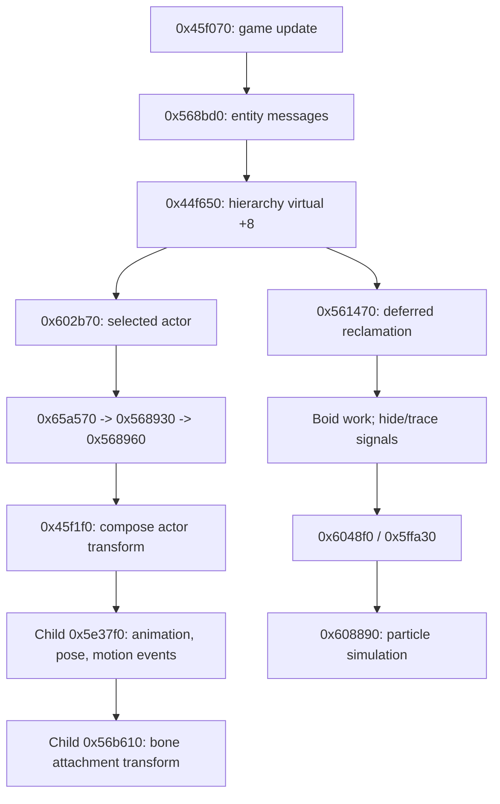
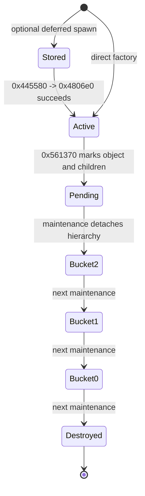

# Actor lifecycle, behavior and frame ordering

Updated October 22, 2026. Parent: [actors and animation](actors-and-animation.md).

This pass follows the actor constructed by **0x5fe070**, with actor vtable
**0x852334** and the ordinary model-component branch **0x850d9c**. It connects
creation, hierarchy update, behavior dispatch, model/pose/attachments, collision
interfaces and delayed destruction. The eight game factories are already mapped;
this trace does not imply that vehicles, player and boss variants share every
method or state gate.

All addresses refer to the hash-bound Steam PC image in the architecture.
[Evidence index](../../evidence/engine/pass-05/FUNCTIONS.md) links named functions
to pseudocode and instructions. [Native witnesses](../../evidence/engine/pass-05/native-witnesses.json)
record verified call edges, vtable prefixes and original RTTI strings. Exact
Ghidra commands and seeds are in the pass-05a through pass-05h evidence directories.
No game execution was used to infer runtime timing.

## Object hierarchy and identity

Base construction **0x473870** places a new object's embedded node +0x10 into the
root list returned by **0x45ce80**. It initializes a child-list sentinel at +0x40,
world transform at +0x50, parent pointer at +0x90 and removal flag at +0x94.
Construction subsequently reparents model components and helpers into their owning
actor's child list. The actor/model back-pointer therefore agrees with the list
used by actual updates and destruction, rather than being only a resource link.

| Object field | Observed role |
|---|---|
| +0x10 | Root/parent-child hierarchy node |
| +0x20 | Additional global object-list node |
| +0x30 | Pending-retirement node |
| +0x40 | Owned child-list sentinel |
| +0x4c | Captured allocator context |
| +0x50 | World transform, passed to children |
| +0x90 / +0x94 | Parent / removal flag |
| +0xa0 | Local transform on this actor base |
| +0xe0 | Additional registered-entity node |
| +0xf0 | Generation-checked handle |
| +0xf8 | Embedded state/component dispatcher |
| +0x11f0 / +0x1200 | Actor-specific list nodes |
| +0x1210 / +0x1218 | Model component / transform helper |

Actor-specific owners **0x446460** and **0x4463c0** are stored at globals
0xd47918 and 0xd4793c. They are not the main hierarchy-update dispatcher. The first
is used by actor queries, deferred spawning and pairwise overlap handling; the
second is traversed by game state-transition processing **0x450c70**. Base
constructor **0x658140** also registers the entity through **0x568890** for the
pre-update message pass.

Handle allocator **0x65a5c0** searches **4000** slots. The low **20 bits** are a
nonzero generation token; the high bits select an 8-byte slot holding generation
and pointer. Consumers check the stored generation before resolving the pointer.
Destructor **0x658350** zeros both slot words. Generation wrap and exhaustion
branches are retained in the export; this is not an assertion that handles can
never become stale or alias after wrap.

## Main update order

For game method **0x45f070**, the connected order is:

| Order | Path | Established behavior |
|---|---|---|
| 1 | game virtual +0xa4 -> 0x450c70 in the mapped base game table | Process game/actor state requests and related service queues |
| 2 | 0x568bd0 -> 0x568c10 | Visit registered entities; enqueue/prepare the pre-update message on entity+0xf8 |
| 3 | 0x43cb10 / 0x48bb70 | Other game passes; detailed role/order dependencies remain local questions |
| 4 | 0x45ce80 -> 0x44f650 | Walk object hierarchy, parent before children, using object virtual +8 |
| 5 | 0x561470 | Reclaim old retirement bucket, detach newly retired objects and advance queues |
| 6 | 0x61b120 | Budget/rotate a separate registered-object list |
| 7 | 0x45cf20, virtual +0x1c with 1 | Service the original “boid manager” synchronously at this callsite |
| 8 | 0x45d1e0 / 0x45d740 -> 0x5adfa0 | Signal “hide manager” and “calcmanager Trace” worker events |
| 9 | 0x6048f0, then 0x5ffa30 | Refresh optional actor/model-derived data, then actor-pair overlap handling |
| 10 | 0x45d830 -> 0x608890, then 0x64fd00 | Effect update and a final timer pass |

The context begins at game **+0x4148**: a parent-transform pointer followed by
timestep at **+4** (game +0x414c). The game sets the first pointer to the identity
matrix. **0x44f650** invokes **0x45069c**, a two-instruction thunk jumping to
object virtual **+8**. It then temporarily sets context[0] to object+0x50, recurses
through object+0x40 children, and restores the previous pointer.

This establishes parent-before-child ordering within this traversal. It does not
establish every game mode's frame schedule. A second recursive walk **0x44f6b0**
uses thunk **0x4506a1** and object virtual **+0xc** through **0x44f710**; keep it
separate from the +8 simulation walk. The shared pose evaluator also has multiple
consumers, so a count of pose evaluations per rendered frame is still unresolved.

The worker constructors preserve original labels. **0x5ad7f0** creates an
auto-reset event; **0x5adbc0** waits between work rounds and dispatches virtual
+0x1c. The two signals in this frame method are not waits for completion. Precise
cross-thread completion and shutdown ordering remain separate contracts.



Arrows between main stages express this method's call order. Hierarchy arrows
express ownership/traversal. They do not impose completion order on worker threads.

## State, component and message dispatch

Actor virtual +8 resolves to **0x602b70**. It applies an optional moving-parent
transform correction (**0x600640**), calls **0x65a570** to preserve the previous
position and run **0x568930**, then handles actor flags/status and attachment
bookkeeping. **0x568930** invokes dispatcher virtual +4 on actor+0xf8, then composes
the world transform through **0x45f1f0**.

The dispatcher vtable is **0x840864**, whose +4 is **0x568960**. Offsets in this
table are relative to the embedded dispatcher, not the actor:

| Dispatcher field | Observed role |
|---|---|
| +4 | Owning actor/entity |
| +8 | Current state (actor +0x100) |
| +0xc | Pending state (actor +0x104) |
| +0x10 | Additional owned state slot |
| +0x14 | Component-list sentinel |
| +0x20 | Message-list sentinel |
| +0x2c | Prepared message boundary/snapshot |

The dispatcher updates current-state virtual +4, sorts the applicable messages
through **0x568450**, and passes component/state/message combinations through
**0x578850**. The dispatch-table index is:

```text
((componentType * 100 + stateType) * 64 + messageType)
```

Type IDs are lazily assigned by separate global counters. The table is a concrete
indirect-call mechanism, not a recovered set of stable enum numbers. When a new
state is pending, the dispatcher sends the old-state transition message, destroys
the old state, installs the pending state, then sends the new-state transition
message. The two message constructors/registrations remain recorded by address;
we use “exit/entry” as behavioral descriptions rather than original class names.

Concrete setup functions allocate priority-ordered components, set their actor
pointer at component+0x20 and insert their node +8 into the component list.
Original RTTI confirms **witch::Runner**, **Shooter**, **Grappler**, **Dodger**,
**AiGrappleCapacity** and **AiBehavior**. For the ordinary factory's setup,
0x5ff170 installs Runner at actor+0x1220 and Shooter at +0x1224, plus further
components. Component method tables and dispatcher registrations, rather than
names alone, are the continuation points for movement and combat behavior.

## Concrete AI connection

When the factory receives the applicable AI input, **0x44dc00** allocates a
**0x7e0-byte witch::AiBehavior**, constructs it through **0x5a5080**, and inserts
it into the actor dispatcher. Its priority field is **999** and its vtable is
**0x847c9c**. The script environment starts at component **+0x30** and the behavior
controller at **+0x2b0**. Setup **0x5a8280 -> 0x5dab40 -> 0x5d21e0** constructs the
logical resource name **ai.%s** and binds it through **0x5045d0**.

Registration **0x5a7c10** populates the actor dispatch table. A specific verified
example is **0x59b020**, which binds AiBehavior / original **StateStart** / the
pre-update message to **0x5888b0 -> 0x5a61d0**. That handler links the actor into
its script environment and initializes behavior data. Other registered state/
message combinations use **0x588800**, which dispatches component virtual +4:
**0x5a7570** for AiBehavior. This closes the connection from actor messages to a
concrete native AI update.

**0x5a7570** skips processing while an actor state transition is pending, refreshes
the environment (**0x5dad90**), dispatches behavior/messages through **0x503210**,
and processes controller/action changes through **0x5ce1c0**, **0x505310** and
related branch helpers. It has explicit per-component cadence and timer fields
(+0x7d0/+0x7d4); preserve the branch gates before assigning a global AI tick rate.
The behavior layer has a second dispatch table and linked behavior records.
These are now concrete consumers of the recovered AI scripts. Full tree-field
semantics and every behavior transition remain AI-01 work.

**Correction preserved:** model functions 0x5f9b10 / 0x6ad170 process motion-linked
channels, not the AI tree. Their ten readers, previous/current motion position and
interval callbacks through 0x6acea0 establish a separate animation-event path.

## Model pose and weapon attachments

Model virtual +8 is **0x5e37f0**, which performs this ordered sequence:

1. **0x56b850** prepares the embedded model transform and advances motion through
   **0x42bb10 / 0x42aec0** using context timestep.
2. Model virtual **+0x28 -> 0x5e5280** prepares motion/controller relationships.
3. Model virtual **+0x2c -> 0x5e5220**, when enabled and a current controller exists,
   calls **0x423d20** for pose evaluation, **0x423b40** for finished-track cleanup,
   then **0x423c70/0x423cb0** and model virtual +0x30.
4. **0x5f9b10** handles two guarded motion-event/channel consumers.

The ordinary weapon attachment's vtable **0x82f3f4** has virtual +8 = **0x56b610**.
It calls **0x56ab10** with its owning component's embedded model **+0x110** and the
bone selector stored at attachment+0xa0, then copies the resulting transform to
attachment+0x50. The child traversal supplies a direct pose-to-weapon connection.
The actor's separate transform helper (vtable **0x8523c0**) instead uses
**0x45f1f0** at virtual +8.

This maps animation consumers and ordering for this hierarchy. Raw/compressed
sampler formats at 0x429fe0/0x4299b0, blend arithmetic, multiple evaluation passes
and all component variants remain MODEL-03 details.

## Movement and collision boundary

Actor motion is not explained by a single physics call. **0x600640** transforms
relative to a stored moving-parent reference and timestep, with a speed clamp,
then sends the correction through the entity's message machinery. State/component
handlers also affect movement. Exact equations remain in the export.

After hierarchy updates, **0x6048f0** visits the first actor list, and for actors
with +0x1248 present calls **0x5fa290** using the component returned by virtual
+0x24. That function derives per-bone transforms and activation masks for associated
records; a single role such as “AI update” is not supported by this code.

**0x5ffa30** examines eligible pairs from the same actor list, gates by bounds,
tests horizontal separation against summed radii, and computes opposite separation
vectors. **0x5fdd80** sends these as actor-addressed messages after generation-checking
handles. The receiver's component/state dispatch determines the response. This
is concrete engine overlap handling. It does not establish which branches use
PhysX or where the scene simulate/fetch boundary falls; those remain PHY-01.

## Deferred spawn and return-to-storage path

**0x4466a0** reserves one of **256** entries beginning at owner+0x120, stride
**0x170**. It sets the active byte, copies **0x114 bytes** of authored actor data
at entry+4 and a 4x4 transform at +0x120, and initializes saved values at
+0x160/+0x164. It returns false when no entry is free. It does not immediately
construct an actor.

Consumer **0x445580** examines eligible actors and entries under game-state,
distance/visibility and population gates. It can copy an eligible distant actor's
record/transform/current and maximum life back into an entry, then call
**0x561370** to retire the live instance. For an eligible stored entry it calls
**0x4806e0**, restores the record and life through actor virtual +0x34/+0x38,
restores transform through +0x1c, and clears the active byte only on success.
It returns after one successful respawn. Its count threshold of 0x31 belongs to
this path; it is not established as a universal actor limit.

The life interpretation is corroborated by the recovered original API
`witch::ScriptEnvironment::getActorLifeMax`, whose virtual +0x2c call resolves to
**0x602aa0** in this actor table. The adjacent +0x28 getter **0x602a30** supplies
current life used by retirement gates.

## Removal and allocator ownership

**0x561370** marks an object once (+0x94), appends its +0x30 node to the pending
list returned by **0x473f10**, invokes virtual +4, and recursively marks its children.
It does not free memory during hierarchy traversal.

**0x561470** then:

1. Deletes objects already in bucket **0x1b59948** through virtual destructor(1).
2. Detaches newly pending objects' +0x10 nodes from root/parent hierarchy.
3. Moves bucket **0x1b59954 -> 0x1b59948**, then **0x1b59960 -> 0x1b59954**.
4. Moves the pending list into **0x1b59960** through list helper **0x40f1e0**.

Thus an object admitted to bucket 2 is reclaimed on the **third later maintenance
call**. Do not equate that with three rendered frames: different game paths also
call maintenance. Full teardown has separate immediate flush helpers.



For the selected actor, deleting destructor **0x5feef0** calls **0x5fede0**:
it removes component callback nodes, destroys optional actor+0x1248 contents,
unlinks actor-specific +0x1200/+0x11f0 nodes, and calls **0x6583e0 -> 0x658350**.
The base destroys dispatcher-owned state/components through **0x568600**,
invalidates the actor handle and unlinks its registered-entity node.

Finally **0x5611d0** recursively calls child destructors, restores allocator context
from object+0x4c, and unlinks hierarchy/additional/retirement nodes. The outer
wrapper frees storage through the allocator's virtual +4 when destructor flag
bit 0 is set. Model destruction separately traverses **0x5e1620 -> 0x5e12f0** and
its base/model resource cleanup. Children removed by their parent's destructor
unlink their retirement nodes, avoiding a later second queued deletion in this path.

## Remaining contracts and next work

- **AI-01:** decode behavior-tree node fields, callback signatures, full dispatch
  registrations and Lua execution policy using the now-connected AiBehavior path.
- **PHY-01:** follow movement/message receivers into collision objects and the
  PhysX scene step/fetch/release order. Pairwise engine overlap handling is mapped.
- **MODEL-03:** decode exact key formats/blends and identify all pose-evaluation
  passes; parent/model/attachment consumption is connected.
- **ACTOR-01/02:** extend this lifecycle to player/vehicle/boss variations, verify
  deferred-spawn gates and exceptional allocation/teardown cases.
- **EXEC-03:** resolve mode-specific invocation of both hierarchy traversals and
  completion guarantees of the hide/trace workers.

The lifecycle route is established statically. These precise remaining contracts
continue the engine map; no new feasibility decision is required.
