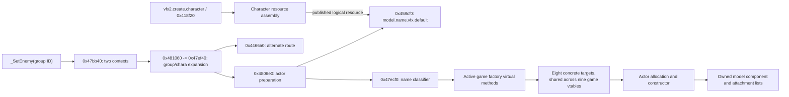
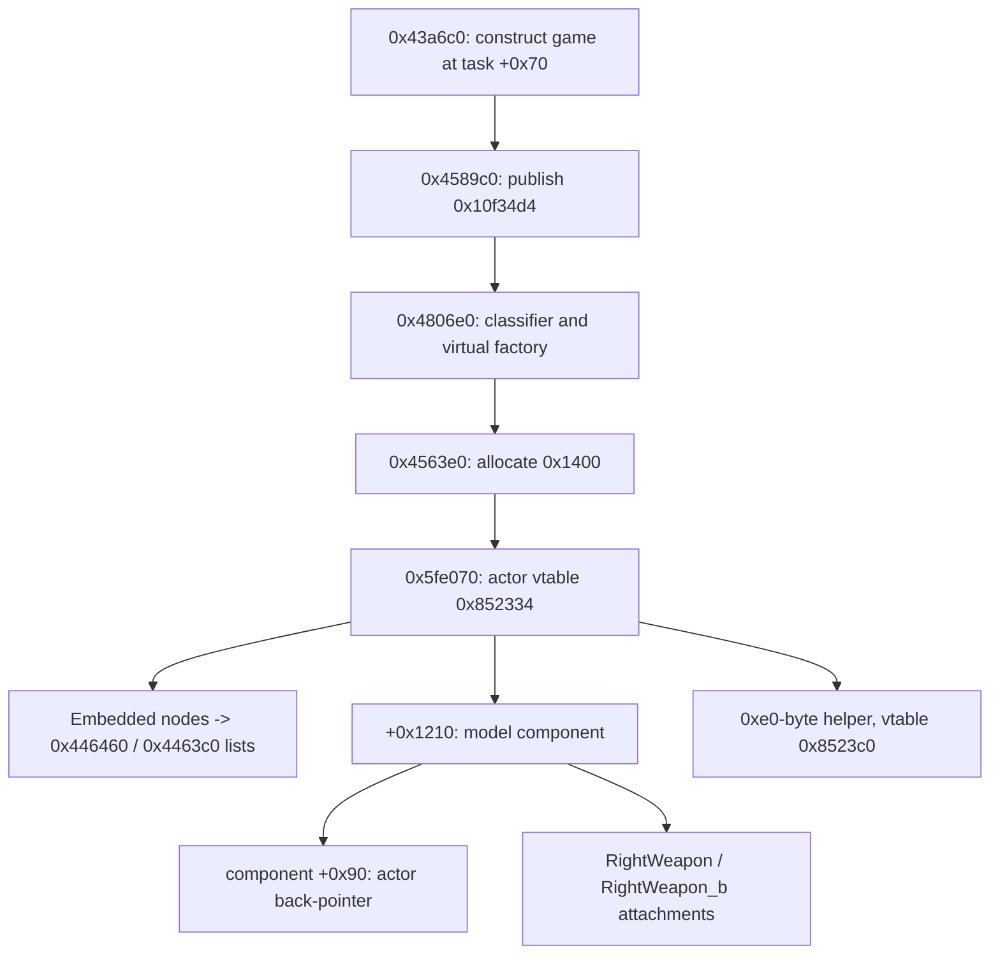

# Actors and animation

Updated October 22, 2026. Return to [architecture](../ARCHITECTURE.md).

The resource-side character assembly and mission-side actor creation paths are now
connected to concrete native functions. Eight concrete actor factories are resolved across nine game-mode vtables.
The selected actor now has a connected [lifecycle map](actor-lifecycle.md): hierarchy
update, state/AI dispatch, pose and attachments, deferred spawning and destruction.
Animation codecs, detailed physics/AI contracts and other actor variants remain open.

## Character resource construction

The resource registry maps `vfx2.create.character` to **0x418f20**. At CALL phase 2
it resolves dependencies labeled `mesh`, `texture`, `controlpoint`, and `instance`.
A missing required dependency returns failure. It allocates a **0x8e0-byte** object,
constructs it via `0x4213d0`, prepares per-category storage, and attaches references:

| Dependency | Allocate category storage | Attach resource |
|---|---|---|
| mesh | 0x424f20 | 0x4253a0 |
| texture | 0x425010 | 0x4254c0 |
| controlpoint | 0x424dd0 | 0x425340 |
| instance | 0x424eb0 | 0x425370 |

The result is stored at CALL record `+0x18`; when requested it is published through
`0x415530`. Phase 3 invokes the result's virtual destructor and unregisters it.
This is resource assembly; live gameplay actor allocation occurs elsewhere.
[Character handler](../../evidence/engine/pass-03a/functions/00418f20.c) and its
[instructions](../../evidence/engine/pass-03a/instructions/00418f20.txt) are retained.
See [resource dispatch](resource-dispatch.md) for the phases and mesh/motion handlers.

## Mission-driven actor creation

`_SetEnemy` adapter `0x4774e0` invokes callback **0x47bb40**. It reads a group ID and
calls **0x481060** for each of two contexts obtained through owner helper
`0x43c610(0)` and `(1)`. `0x481060` forwards to **0x47ef40** with default optional
arguments and a final flag of 1.

`0x47ef40` finds the original `group` and `chara` tables, selects group rows matching
the requested ID, prepares 0x50-byte records, sorts them, expands placement/count
information, and assembles actor parameters from the character rows. A direct
creation branch calls **0x4806e0**. Another branch routes through `0x4466a0`; its
256-entry storage and later activation are now mapped in the
[lifecycle note](actor-lifecycle.md#deferred-spawn-and-return-to-storage-path).
`_SetEnemy` does not unconditionally allocate every actor synchronously.

`0x4806e0` resolves `model.<name>.vfx.default` through **0x458cf0**. For names
beginning `ea`, it adds the stage-specific suffix before lookup. It also prepares
motion-related references, defaults an absent secondary name to `wg1`, classifies
the name with **0x47ecf0**, and invokes a method on the active game object
`DAT_010f34d4`.

| Classifier result | Original name | Factory virtual offset |
|---|---|---|
| 0 | other names | +0x48, after supporting lookups |
| 1 | vh0 | +0x58 |
| 2 | vt0 | +0x5c |
| 3 | ef0 | +0x60 |
| 4 | ec0 | +0x50 |
| 5 | ed0 | +0x54 |
| 6 | eb0 | +0x4c, after supporting lookups |
| 7 | eg0 | +0x64 |

These are observed identifiers, not inferred species or enemy labels. A separate
special branch in `0x4806e0` also exists; the table describes its classifier switch,
not every creation case. The factory addresses below were checked in each of the nine game vtables
selected by the recovered mode-construction path.

Evidence: [group expansion](../../evidence/engine/pass-03a/functions/0047ef40.c),
[actor preparation](../../evidence/engine/pass-03b/functions/004806e0.c),
[name classifier](../../evidence/engine/pass-03c/functions/0047ecf0.c),
[resource lookup](../../evidence/engine/pass-03c/functions/00458cf0.c), and
[original string table reads](../../evidence/engine/pass-03/native-tables.json).
Ghidra loses some register arguments in this path; use adjacent instruction files
before implementing parameter structs or calling conventions.

## Concrete game and actor factories

The task's mode constructor **0x43a6c0** stores the game at task `+0x70`.
Its cases 0/7 use **0x44fde0**, which installs vtable **0x82c6b4**; other cases
install derived tables. Task update **0x43b890** calls **0x4589c0** on that object;
after virtual +0x78 initialization, it publishes the pointer to **0x10f34d4**.
This connects task construction to the active owner used by `0x4806e0`.

| Mode cases | Game vtable |
|---|---|
| 0, 7 | 0x82c6b4 |
| 1, 2 | 0x82d130 |
| 3 | 0x829e18 |
| 4 | 0x82dc80 |
| 5, 6 | 0x828fc0 |
| 8 | 0x82dd78 |
| 9 | 0x82dfb0 |
| 10 | 0x82e068 |
| 11 | 0x82e120 |

All nine have identical targets at +0x48 through +0x64. This is checked directly
against the image, not inferred from C++ inheritance. Mode labels remain numeric
until their callers establish their names.

| Name class | Virtual offset | Factory | Allocation / constructor path |
|---|---|---|---|
| Other | +0x48 | 0x4563e0 | 0x1400 bytes -> 0x5fe070 |
| eb0 | +0x4c | 0x4562b0 | 0x1400 bytes -> 0x5fe070, different setup |
| ec0 | +0x50 | 0x4566b0 | Resource lookup, 0x1400 bytes -> 0x5fe070 |
| ed0 | +0x54 | 0x456930 | Resource lookup, 0x1400 bytes -> 0x5fe070 |
| vh0 | +0x58 | 0x456140 | 0x606960 -> 0x1470 bytes -> 0x605710 |
| vt0 | +0x5c | 0x456820 | 0x606b20 -> 0x1470 bytes -> 0x605710 |
| ef0 | +0x60 | 0x456130 | 0x46df10 -> 0x46e030 |
| eg0 | +0x64 | 0x455fb0 | 0x1410 bytes -> 0x63d2b0 |

The first four share a constructor but have distinct configuration calls; they
are not interchangeable actor types. `vt0` additionally looks up original names
`vt0tow` and `vt0tow2`. `eg0` resolves default material-animation resources.
Allocator selection in the direct factories uses **0x96b7b8** through its virtual
allocation method. Their outer allocation guards are visible; this does not prove
that every nested allocation failure is handled safely.

### One concrete ownership path

Constructor **0x5fe070** calls base **0x658290**, installs actor vtable **0x852334**,
and registers embedded list nodes at actor **+0x11f0/+0x1200** through owner helpers
**0x446460/0x4463c0**. It allocates a model component of **0x7ae0** bytes through
**0x5e0830**, or **0x7f60** through **0x4f45a0**, depending on the mission-owner
field at +0x97788. The component is stored at actor **+0x1210**, linked into
actor +0x40, and receives a back-pointer at component **+0x90**.

The constructor resolves original bone/attachment names `Spine2`, `RightWeapon`
and `RightWeapon_b`. Valid weapon lookups create **0xb0-byte** attachment objects
with vtable **0x82f3f4**, insert their nodes into component +0x40, and set their
owner pointers. A separate **0xe0-byte** helper with vtable **0x8523c0** is linked
under the actor. These ownership/attachment edges also govern the update and recursive destruction
traced in the [lifecycle note](actor-lifecycle.md). Ghidra's late constructor temporaries and inferred argument
list contain aliases; use instructions before converting these fields to structs.

Evidence: [mode constructor](../../evidence/engine/pass-04c/functions/0043a6c0.c),
[base constructor](../../evidence/engine/pass-04c/functions/0044fde0.c),
[publication](../../evidence/engine/pass-04c/instructions/004589c0.txt),
[actor constructor](../../evidence/engine/pass-04c/functions/005fe070.c),
[export status](../../evidence/engine/pass-04c/status.tsv), and
[hash-bound vtable/instruction witnesses](../../evidence/engine/pass-04/native-witnesses.json).
The [function index](../../evidence/engine/pass-04/FUNCTIONS.md) links the individual
factories and the shared particle/animation consumers.

## Update, animation and retirement

The [actor lifecycle map](actor-lifecycle.md) follows game **0x45f070** through
entity message preparation and recursive hierarchy walk **0x44f650**. The selected
actor updates through **0x602b70**, its embedded state/component dispatcher through
**0x568960**, and its model child through **0x5e37f0**. Parent-before-child traversal
connects actor transform, model pose and bone attachments within this pass.

Original **witch::AiBehavior** reaches **0x5a7570**, then behavior/message dispatch
**0x503210** and controller transitions including **0x505310**. Model consumers
**0x5f9b10 / 0x6ad170** instead process motion-event channels. The two paths are
separate. Movement and pairwise overlap messages are connected; the PhysX scene
step/fetch boundary remains to map.

Model update reaches shared pose evaluator **0x423d20** and finished-track cleanup
**0x423b40**; weapon update **0x56b610** reads a resulting bone transform. Shared
particle consumers reach the same pose machinery. Exact sampler formats at
**0x429fe0 / 0x4299b0** and blend arithmetic remain MODEL-03 work.

Retirement **0x561370** marks an actor and its children. Maintenance **0x561470**
detaches hierarchy nodes and advances three buckets; reclamation occurs on the
third later maintenance call after admission. Destructors unlink actor lists,
destroy state/components and owned children, invalidate handles and free storage
through the saved allocator. This timing is expressed in maintenance calls, not
rendered frames.

## Next contracts

- ACTOR-01/02: extend the selected lifecycle to other concrete actor/model variants;
  resolve deferred-spawn gates and exceptional teardown/allocation paths.
- AI-01: decode tree fields, action data, dispatch registrations and Lua execution
  policy from the connected AiBehavior/controller consumers.
- PHY-01: follow movement-message receivers and PhysX scene step/fetch/release.
- MODEL-03: recover sampler codecs and bone/material blend arithmetic; classify
  additional pose passes and mode-specific scheduling.
- Graphics implementation remains deferred while the engine map advances.
