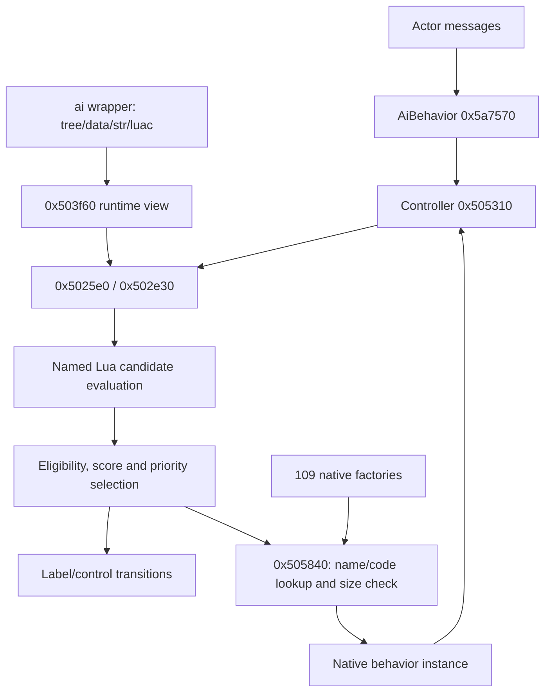

# AI trees, Lua evaluation and native actions

Updated October 22, 2026. Parent: [actor lifecycle](actor-lifecycle.md).

The actor-to-AI connection now extends through the authored tree, Lua evaluation,
native action selection and controller lifetime. This note records static
contracts for the Steam image; it does not claim every action's gameplay semantics.

## Authored resource and runtime view

**0x503300 / 0x503ed0** validate/find the wrapper's `work` region and construct a
runtime view there; **0x503f60** connects `labl`, `tree`, `data`, `str`, `luac` and
`head`. The minimum work allocation checked is **0x44 bytes**. These pointers are
runtime fixups in a loaded resource; the on-disk wrapper contains offsets.

| Runtime view offset | Meaning established by getters |
|---|---|
| +0 | `labl` chunk |
| +4 | First 12-byte tree record after the `call` table |
| +8 | `luac` chunk; payload +0xc, length field +8 |
| +0xc / +0x10 | Call-table entries / count |
| +0x14 / +0x18 | Data / string reference views embedded at +0x24 / +0x34 |
| +0x1c / +0x20 | Wrapper pointer / `head` chunk |

**0x503630** scans nested `refd` and `data` chunks. A reference view holds data
chunk, reference chunk, offset-array pointer and count. The new
[corpus audit](../../tools/ai_runtime_audit.py) applies the native getter formulas
across **155 wrappers / 27,079 nodes / 6,817 entry points**, with no failed
structural checks. [Results](../../evidence/engine/pass-06/ai/summary.json) and
per-wrapper JSON retain offsets, parent/child/sibling links, data fields, parameters
and original names. Existing Lua round-trip results remain the script baseline.

## Tree record semantics

For node byte offset **n** relative to runtime view +4:

| Field | Meaning and consumer |
|---|---|
| +0, `span` | Subtree end is `n + span + 4`; includes this node and descendants |
| +4 | Index into data `refd` table |
| +8 | Backward byte distance to parent; root has 0xffffffff sentinel |

**0x5037e0** returns first child `n+12` when span > 0x10. **0x503810** computes the
next sibling at subtree end and rejects it when outside the parent's subtree.
**0x503950** follows the backward distance, but returns -1 when the resulting
relative offset is zero: the synthetic root is excluded from that helper's parent
result. **0x503e90** tests subtree membership.

**0x503ca0** takes a **one-based entry index** and returns `call[index-1]+4`.
The earlier corpus noted that stored values point to the third word of a tree
record. Their execution targets are the **following record**, after this +4
adjustment. All 6,817 adjusted targets are aligned and inside their tree.

## Node data

Resolve `dataRoot + 8 + references[node.dataIndex]`. Relative to that record:

| Offset | Native interpretation |
|---|---|
| +8 | Signed action/control code; 0x503750 / 0x503720 |
| +0xc | Eligibility/continuation mode, range-checked 0..5; 0x5038a0 |
| +0x10 | Evaluation mode, range-checked 0..5; 0x503c20 |
| +0x14 | Signed 16-bit priority used in evaluator comparison; 0x503910 |
| +0x18 | String-table index used by action name lookup; 0x5036c0 |
| +0x1c / +0x20 | Original `eval` tag / padded name size |
| +0x24 | Lua function name, exactly matching recovered node-offset suffix |
| +0x24 + name size | Parameter byte count; bytes immediately follow |

All Lua name links and tree bounds pass the audit. Observed eligibility modes are
0–4; evaluation modes are 0, 1 and 5. Numbers are retained until individual branch
semantics justify descriptive names. Parameters are preserved as bytes, with
specific action decoders added when their consumers are mapped.

## Evaluation and action selection

**0x5a7570 -> 0x505310 -> 0x5025e0** connects actor behavior to tree selection.
The evaluator initializes its Lua context, loads/calls the wrapper chunk, prepares
native environment arguments and walks through **0x502e30**. That helper filters
candidate children through **0x503cd0**, prepares their named Lua coroutine and
pumps it. A numeric result becomes a floating-point score; other results contribute
zero in this path. Later candidates replace the selected candidate only on a
strictly greater score, preserving the earlier candidate on ties.

There are gates that reuse an existing branch, skip an evaluation, or stop at a
leaf. Preserve them; this is not a claim that every node runs every frame.
Priority checks in 0x5025e0 also constrain action replacement. Exact cadence
remains governed by AiBehavior state/timer fields documented in the lifecycle map.

Control codes **-1, -2 and -3** use label targets resolved by **0x5039c0**. Authored
names include `goto`, `gosub` and `sgoto`; retain numeric distinctions until their
full transition policies are applied. Code -2 uses a distinct shared sentinel in
**0x505840** and controller stack handling in **0x505310**. The controller stores
four pointer slots at +0x60 and parallel values at +0x70, with current index +0x80;
exact overflow policy remains local. Exit/resume calls traverse linked behaviors
before returning storage to the controller pool.

**0x5a58d0** registers **109** 12-byte factory entries from **0x846fb8** using
**0x505940**, and installs fallback **0x5b98e0**. Each entry contains factory,
original name and required storage size. [Action registry](../../evidence/engine/pass-06/ai/action-factories.json)
records all entries. Examples include `changeai`, `wait`, `waitrandom`, `patrol`,
`movetoabsolute` and multiple movement variants.

**0x505840** first handles the -2 sentinel. For other actions, a supplied name is
resolved by **0x5057d0**; only the no-name path directly indexes by numeric code.
The record's required size must fit the available storage. Missing names, invalid
indices or insufficient storage select the fallback factory. This distinction is
material: authored numeric IDs and the PC table do not consistently match. The
per-node audit records both raw code and a matching named PC action where present.
Synthetic/editor node names need not match a registered action.

## Complete action-family index

All **109 registrations** now resolve to **48 unique factories / constructors**
and **112 unique targets across their first nine virtual slots**. Every target
has a native pseudocode and instruction export. The reproducible
[action audit](../../tools/ai_action_audit.py) checks the original registry's
factory/name/storage triples and reads every method pointer from the hash-bound
image. [Action index](../../evidence/engine/pass-06/ai/ACTION-INDEX.md) groups names,
allocation sizes, constructor evidence and original debug parameter formats;
[full table](../../evidence/engine/pass-06/ai/action-vtables.json) retains all slots.

Multiple action names deliberately share a factory. This identifies implementation
families without collapsing their authored parameters or control behavior.
The debug strings expose original names such as `fTimeOut`, `iPosture`, `fSpeed`
and `iCharaId`, but also contain apparent formatting mistakes. They are leads,
not a substitute for checking the parameter-reading instructions.

The controller's linked behavior chain uses instance **+0x1c** as next pointer.
**0x504b50** traverses it through virtual **+8**; **0x504b80** traverses through
**+0xc**. The common **0x503510 (+8)** wrapper updates its state byte +0x2a,
invokes a context hook and dispatches concrete action **+0x18**.
**0x503550 (+0xc)** invokes the matching context hook, dispatches concrete
**+0x1c**, and sets bit 0 at instance +0x2b. Controller retirement in 0x505310
calls +0xc across the chain, releases linked behaviors, invokes **+0x14 with 0**
and returns the root storage to the controller pool. The common +0x14 target
0x5cab30 is a deleting-destructor-shaped wrapper; argument 0 preserves pool storage.
Slot **+0x10** returns the action/control code in the common 0x40e320 target.
Slot **+0x20** formats diagnostic action/parameter text.

These observations distinguish dispatch, exit and storage release. They do not
prove a particular action executes every frame; that remains governed by the
controller and actor's evaluation gates. Slots +0/+4 retain numeric roles where
a concrete implementation alone is insufficient to name the full interface.

## Evidence and remaining work

Slices [06a](../../evidence/engine/pass-06a/status.tsv),
[06b](../../evidence/engine/pass-06b/status.tsv),
[06d](../../evidence/engine/pass-06d/status.tsv) and
[06f](../../evidence/engine/pass-06f/status.tsv) retain pseudocode and adjacent x86
instructions. Exact commands/seeds accompany each slice. Inferred C signatures
lose implicit registers; instruction witnesses take precedence.

Remaining AI work is specific: full parameter decoding and gameplay semantics
within the indexed action families, exact eligibility/evaluation mode names, complete controller-stack edge
cases, message registration semantics and dynamic cadence. The tree resource and
Lua-to-action execution connection are established; no further feasibility gate
is needed.
