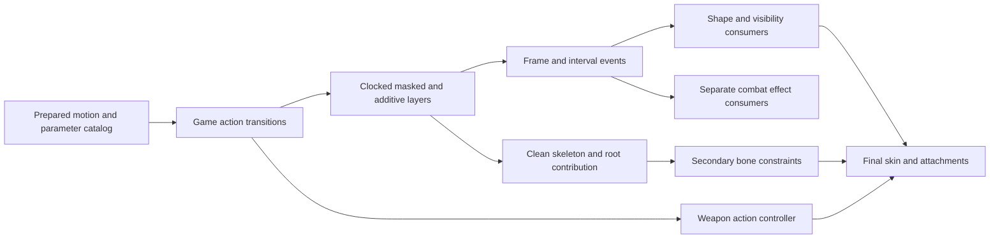

# Alicia animation coverage and implementation order

October 23, 2026. [Actor lifecycle](actor-lifecycle.md) ·
[Bindings](alicia-animation-bindings.md) ·
[Secondary motion](costume-secondary-motion.md).

The expanded animation work should extend the existing animation owner with
shared playback, event and layer mechanisms. It should not add 161 unrelated
states or conflate playing an attack animation with implementing its combat
outcome. This is a coverage plan based on the installed Steam content and
recovered consumers. The current directional-facing review remains open;
secondary motion is integrated across all costumes, with remaining surface intersections documented separately from source solver parity.

## What is actually present

Production resource decoders find **161 PW0 skeletal motions**, **164 motion
parameter publications**, and **six shape animations**. All skeletal motions use
60 frames/second and 125 bone tracks. All six costumes share the PW0 support and
compatible named skeleton layout. This does not mean all six have identical
shape streams: PW0/PW1/PW2/PW4 contain them, PW3/PW5 do not.

The native `0x601250` binding constructor walks 1,108 global slots and applies
76 PW-specific overrides. There are 749 non-null effective labels, 415 direct
PW0 slot matches, covering 158 distinct
PW0 clips. Instruction verification at `0x601567/0x601892–0x601899` establishes one
lookup attempt per slot. A missing `die_va_fr/ba` changes the following parameter
name to `die_fr/ba` but leaves the motion null; the earlier two-motion fallback
inference was incorrect. Three publications are not resolved by this table: `dm_ear`,
`shoot_stand_fire_add`, and `shoot_stand_fire_l`. They may have direct consumers;
absence from this table does not establish unused content. Parameter-only names
are `end04`, `squat_walk_end`, and `walk_cannon`; preserve them as independently
addressable data until their callers resolve the relationship.

**Repetition is a binding operation, not a filename convention.** The raw corpus
has 160 repeat flags set and one clear. Leading `@` in the effective slot label
causes `0x601250` to write zero to the resolved resource header; an ordinary label
writes one. Aliased slots share that resource. `fall_l` occurs at slot 721 with
`@` and slot 953 without it. The static table walk therefore predicts that the
later write leaves this shared resource repeating. This is an explicit inference
from the recovered mutation order, not a live original-process observation.
Keep raw, requested-per-slot and effective shared-resource policy distinguishable
in the prepared catalog; do not silently assign one independent loop bit per
alias. Clip lifetime and controller completion checks still need their callers.

## Family coverage

Families group resource names, not invented universal action states. “Bound”
counts distinct clips resolved by the native slot table. The original traversal
selected 17 body clips; the current catalog covers all 161, while the consumer
and verification boundaries below remain explicit.

| Family | Clips / bound | Current presentation consumer | External or unresolved boundary |
|---|---:|---|---|
| Ordinary stance and movement | 7 / 7 | Live stand/walk/dash, crouch and crouched walk, strict 60-second stay, raised direction and turn selection | Combat accepts aiming/weapon observations; no fabricated firing input |
| Directional evasive action | 12 / 12 | Original four-direction start/middle/end, root/contact and cancellation, corrected parent/model phase | Neutral backward-run visual comparison remains open |
| Generic air and landing | 8 / 8 | Explicit accepted scripted start/flight/landing and default support loss, normal/hard exits, raised families 8–11 | Hardware LT remains evasive action, not scripted jump |
| Shooting poses and overlays | 59 / 57 | Source masked upper/additive requests and independently clocked body/weapon owners; raised target chain | Two labels lack proven slot consumers; projectile/hit/weapon acceptance separate |
| Reload | 28 / 28 | Class/stance request policy, independent weapon clocks and original visibility listener events | Ammo mutation and live weapon admission remain game consumers |
| Weapon/element changes | 5 / 5 | Source accepted change/raise/lower presentation plans and attachment publication; four initial weapon classes | Live resident-weapon replacement and element effect creation separate |
| Discharge poses | 5 / 5 bound clips | Class/stance/nibble admission and source upper/body requests; transient weapon-root attachment repaired separately | Bound/admitted clips do not establish visual firing parity. Support-hand motion remains under review; see [discharge audit](weapon-discharge-attachment.md). No projectile/hit result |
| Magic presentation | 12 / 12 | Common and source-specific retained phases with explicit camera/target/cinematic observations | World effects/costs separate; teleport end769 absent and installed774 consumer unproven |
| Damage response | 14 / 13 | Ordinary Runner direction/class tables and exclusive body lifetime; rare sustained branch remains explicitly unavailable | Health, incoming impact acceptance, low-health recovery and dm_ear consumer separate |
| Death presentation | 8 / 8 | Authored weighted selection, terminal animation and explicit dynamic-body handoff | No invented ragdoll; missing die_va motion lookup is not aliased |
| Stagger/attack-labelled | 3 / 3 | Source close-attack owner, queued follow-up and fresh-owner completion/CAN observations | Hit/effect results and KAK receiver semantics remain separate |

## Current implementation boundary

The catalog prepares all 161 body motions and 164 parameter publications once,
retaining 415 direct native aliases and their shared-resource repeat order.
Actual-content verification admits every clip through the production layered
pose and current-relative-root paths. That census is distinct from the following
family behavior:

- Grounded standing/crouched motion, one-shot crouch input and source 60-second
  special idle now feed the live controller. Explicit scripted family0/1 requests
  traverse start, captured-velocity flight and landing; ordinary support loss
  now enters default family0 flight slot656, while fall_l721 remains the separate
  evasive completion route. Frame1 entry is explicit, not second1. The original
  neutral-run evasive facing comparison remains unresolved.
- Accepted raise/lower, reload, switch and shot presentation requests resolve
  separate upper/additive/weapon clocks. Native reload and raised poses are
  exercised; absent class-specific requests remain unavailable, including WA0's
  missing shoot-after and ordinary class0's empty upper discharge slots.
- Facial event timing, visibility listeners, INT transition durations and
  current-only body/upper events are integrated. Native stand FAC closes and
  reopens the eyes through the production event path. SE/VO now route through
  prepared character policy to mission-owned common, VOICE and GAME_VOICE cue
  banks. Alicia voice admission selects only its reachable streaming waves;
  native dummy-device and production motion-driven CoreAudio runs pass;
  subjective audibility/mix quality remains a user listening check. See [animation audio](animation-audio-presentation.md).
- Close-attack, common magic, damage and death policies have source-based value
  contracts. Their exclusive body-owner integration and exact player consumer
  selection now use the stable action owner: ordinary damage selects the actual
  Runner749..760 tables, suppresses competing locomotion and releases on its
  completion/CAN rules. Native ordinary damage and common magic poses were
  inspected; actual-content checks cover held movement, release and unavailable
  rare sustained918/919 admission without substitution. Scripted jump and common
  magic start offsets use native frames. Dynamic death handoff, low-health
  recovery and spell world effects remain explicit external capabilities.
  Source-specific Thunder, Tornado, Meteor, Sacrifice and common spell phase
  policies now consume explicit camera/target/cinematic observations. Missing
  observations stop the action step rather than fabricate completion. The
  absent teleport end769 and unresolved installed774 consumer remain explicit.

See [raised posture](raised-aim-posture.md),
[model clock phase](actor-model-clock-order.md),
[scripted jump](scripted-jump-policy.md), [spell phases](spell-presentation.md),
and [action policy](alicia-action-policy.md),
[action transitions](alicia-action-transitions.md),
[facial animation](facial-animation.md), and
[event ownership](motion-event-timeline.md). Current integrated review evidence and remaining boundaries are recorded in
[animation acceptance](alicia-animation-acceptance.md).

## Shared mechanisms that unlock the remaining families

**Prepared binding catalog.** Preserve the global slot and PW override relationship,
source publication identity, repeat mutation policy, parameter identity and
optional shapes. Multiple aliases should reference one prepared clip. Resolve
all data once under the actor domain, rather than repeatedly searching strings
or expanding the current `PlayerMotion` enum with every resource suffix.

**Motion events and intervals.** Model update `0x5f9b10` supplies the animation
frame clock to `0x6ad4c0`; `0x6ad170` only constructs temporary readers; `0x6ad4c0` constructs and dispatches them.
Dispatcher `0x6acea0` tracks per-record entry/update/exit state, including a wrap
branch when current frame precedes previous frame. Ordinary entry tests use
`previous < event_frame <= current`; interval end and reset are distinct paths.
Prepared `MotionEvents` and `EventTimeline` now implement source-ordered entry, update, exit, wrap and interruption. Current body and upper owners each dispatch one timeline; outgoing blends and additive poses do not dispatch duplicate events. The game receiver retains cancellation latches and typed visibility/facial commands; unimplemented effects remain explicit.

The PW0 parameter census contains these numeric-tag families:

| Native tag | Publications with section / total records | Proven scope |
|---|---:|---|
| `SE_0` | 112 / 411 | Prepared action/bone commands feed source surface selection and per-bank retained cue lifetime; integrated original-root and native CoreAudio verification passed |
| `VO_0` | 35 / 36 | Prepared weighted Alicia variation, priority/history and memory/stream bank identity feed one shared actor voice owner |
| `FAC0` | 7 / 22 | Decoded packed expressions and source banks drive prepared CPU shape streams; native stand-event blink verified |
| `CAN0` | 145 / 145 | Cancellation entry frame/latch and reset already traced |
| `INT0` | 1 / 1 | First record supplies incoming/exit transition frames; outgoing positive exit wins, preserve-phase bypasses both |
| `KAK0` | 3 / 5 | Unresolved receiver semantics |
| `VIS0` | 21 / 84 | Listener1 is a no-op; listener1000 sets/clears weapon group bits and resets on motion selection. Optional attachment effects remain separate |

**Layers and bone ownership.** `0x5e4760 → 0x5f9290 → 0x5e47a0` connects
requested motions to controller construction/blending, optional parameter
controllers and callbacks. The model evaluates multiple controllers through
`0x423d20`; the current engine now exposes the recovered ordered masked override/additive composition, retained controller rings, release snapshots, local reference modifier and secondary world overrides. Current selected body alone supplies root motion; the source wrap/relative-transform contract is implemented. This mechanism does not by itself admit combat actions.
The ordered mask/composition contract and independent weapon commands are now
traced in [animation layers](alicia-animation-layers.md).

**Weapon synchronization.** WA0–WA3 contain 26 motions in total (6/7/7/6).
Their seven source slots are default, stand, shoot, stand reload, shoot reload,
shoot end and shoot after. WA0/WA3 have no shoot-after publication. All use 60 fps,
but body/weapon duration and even weapon-to-weapon reload duration differ;
stand-reload is 205/215/225/220 frames across WA0–WA3. Do not use one shared time
or infer phase alignment from matching names. Initial activation `0x615900`, selection `0x603900`, table constructor
`0x617210` and bone attachment `0x56b610/0x56ab10` establish the independent
weapon owner. Initial mission admission now accepts an explicit class0..3 and prepares its
own model/support. All26 weapon motions and native class-specific presentation
are verified. Live weapon-class replacement still requires its game admission
owner; absent publications remain explicit rather than substituted.

**Shape and secondary deformation.** Six shape animations (`pw0_1/2/4/5/6/7`)
each contain the same 16 named facial channels; they are not six costume
animations. Prepared shape-name binding, scalar clocks, source bank mixing and retained native dynamic positions are implemented and visually checked on supported costumes. Keep absent costume shape
geometry explicit. The recovered secondary-bone solver uses 111 nodes, forty
output bones and six animated capsules; its clean-pose → constraint → bone-writeback
order belongs before palettes and attachments. Its default ambient behavior is
implemented and native-inspected across all six costumes; remaining garment surface intersections are documented. External force injection remains a later
event/combat consumer.

## Implementation sequence and acceptance

1. Close the current facing/outfit/shadow review. Keep this foundation stable
   while the catalog covers all installed body and weapon publications.
2. Implement the prepared alias-aware catalog and full event timeline. Add
   in-process cases for authored entry/end, wrap, reset, interruption and
   publication lifetimes. Record unresolved tags explicitly.
3. Recover and implement masked/additive pose layers and body/weapon action
   synchronization. First connect stance/crouch/turn and weapon/reload presentation;
   their shared mechanisms then support shooting and reactions.
4. Connect the remaining action families and facial shapes through those same
   mechanisms. Recover per-family source transitions and missing consumers as
   needed; keep combat-result receivers separate. A clip viewer may verify pose
   data, but cannot stand in for action transitions.

For each family, acceptance should record original binding/clock decisions,
transition/event sequence, root/pose ownership, weapon and outfit behavior, all
relevant costume variants, and native visual results. Pause and repeated
publication must not advance clocks or duplicate events. No frame-time resource
lookup, geometry reconstruction or heap allocation should be introduced. Reuse
existing test targets and actual-content probes; add focused contract cases,
not one redundant test per clip.

## Source and reproducibility

The ignored `actor/animation-family-inventory.json` joins the production-decoder
census and executable-table inventory, with input hashes and per-clip parameters,
slots, repeat conflicts, current selection, shapes and weapon metadata. Rebuild
it with `animation-family-inventory.py`; its inputs and commands are beside it
under `research/evidence/reconstruction/actor/`. The executable hash is retained
in the input inventory. No proprietary asset payload is added to tracked source.

Source exports used: pass05d event dispatch, pass05e actor components, pass71
motion/weapon selection and pass75 `0x601250`; current action traces are linked
from [evasive leap](player-evasive-leap.md) and
[jump timing](player-jump-timing.md). Unknown transition/receiver details above
remain explicit research items rather than invented fallback behavior.

Established-source comparison: inspected Unreal revision
`f45729c0b6f097038e72b52d366a62baeca3275b`,
`AnimSequenceBase.cpp::GetAnimNotifies/GetAnimNotifiesFromDeltaPositions` and
`AnimNode_LayeredBoneBlend.cpp::Update_AnyThread/Evaluate_AnyThread`.
The useful boundaries are interval extraction separate from receivers,
loop-aware clock traversal, and per-bone/root ownership separate from pose
sampling. Bullet Witch's event inequalities, controller order and blend equations
remain authoritative. Unreal's loop cap, temporary allocator and weighting rules
are not adopted implicitly. Source snapshots stay in ignored research evidence;
no production implementation was changed for this plan.

Source follow-through: [action transition ownership](alicia-action-transitions.md) records the recovered magic and directional-damage lifetimes, shared NPC-handler exclusions and remaining death/stagger gaps. [Motion event timelines](motion-event-timeline.md) records implemented event preparation and receiver contracts; neither catalog nor decoder coverage is full action acceptance.

Raw catalog review now distinguishes verified ordinary poses, additive deltas
and unknown representations. Alicia currently has 135 ordinary, 17 additive and
9 unknown entries; publication aliases alone grant no representation admission. See
[review pose compatibility](animation-review-geometry.md) for source admission,
the reproduced geometry failure and native full-duration investigation.
