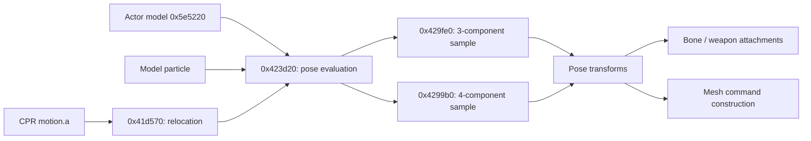

# Animation tracks and pose sampling

October 22, 2026. [Architecture](../ARCHITECTURE.md) ·
[Actor lifecycle](actor-lifecycle.md) · [Model data](model-data.md).

## Connected path

`vfx.motion.create` (0x418900) resolves `motion.a` and relocates it with
0x41d570. Shared pose evaluation at 0x423d20 reaches vector sampler 0x429fe0
and four-component sampler 0x4299b0. The selected actor model's pose method
0x5e5220 reaches this shared path before bone attachments are updated. Model
particles also use these routines; the data codec is shared across consumers.

## Prepared channel contract

Both samplers read the same header offsets:

| Offset | Observed use |
|---|---|
| +0x00 | Encoding discriminator; 0x46000000 selects float32 values |
| +0x08 | Key/search count |
| +0x0c | Byte stride, shifted right by two for word addressing |
| +0x10 / +0x14 | Time bounds used to choose the cached search starting point |
| +0x18 | Float32 key-time array |
| +0x1c | Value array |

They accept a cached key index and an interpolation enable byte. Search starts
from the cache (or adjusts/resets it), then scans an interval satisfying
`t[i] <= time < t[i+1]`, with an exact-key branch. Vector sampling copies an
exact value or linearly interpolates adjacent vectors when enabled:
`a + (b-a) * ((time-t0)/(t1-t0))`. The four-component path delegates blending
to SIMD routine 0x406ed0. Out-of-range behavior must be derived together with
caller clamping and sentinel keys; the pseudocode includes null paths and is
not a safe standalone decoder specification for arbitrary input.

The alternate value path reads 16-bit sign/exponent/mantissa components. Its
conversion helper 0x41df30 matches IEEE binary16 for **all 63,488 finite bit
patterns**, including subnormals and signed zero. This is checked independently
with Python's binary16 decoder in [the scalar audit](../../evidence/engine/pass-06/animation-scalar-audit.json).
The helper does **not** special-case exponent 31: inputs normally interpreted as
infinity/NaN become finite values. Preserve that observed behavior if exact
compatibility requires it. The audit verifies the recovered algorithm, not
execution of the original game or use of special values in actual tracks.

## Rotation blend

The instructions of 0x406ed0 take vectors in XMM0/XMM1 and weights in XMM2.
They compute a dot product, choose a sign for shortest-path interpolation, form
`sqrt(1-dot²)`, and use angle/sine helpers 0x406fc0 and 0x407380. A threshold
of approximately 0.9999899864 selects the near-parallel linear-weight branch.
This is a slerp-style quaternion blend. Ghidra's inferred zero-argument C
signature loses the SIMD interface and returned XMM0, so its C output must not
be compiled as an implementation. Exact polynomial approximations, rounding,
normalization assumptions and channel coordinate conventions remain local
numeric contracts.

## Evidence and remaining scope

[Vector sampler](../../evidence/engine/pass-04b/functions/00429fe0.c) ·
[Rotation sampler](../../evidence/engine/pass-04b/functions/004299b0.c) ·
[Half conversion](../../evidence/engine/pass-06k/functions/0041df30.c) ·
[SIMD blend instructions](../../evidence/engine/pass-06k/instructions/00406ed0.txt).

The file-to-pose codec boundary is mapped. Additional pose passes, morph/material
animation, blend policies across multiple motions and exact skeleton conventions
remain to be recovered through their consumers. No visual pose match is claimed.
