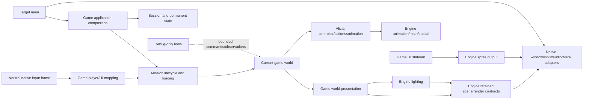

# Proposed physical architecture after the full source trace

**October 26, 2026 · revised architecture implemented, verified and accepted.**

The rejected grouping moved files without resolving several real ownership leaks.
Passing its build and behavior checks did not establish an acceptable architecture.
This proposal replaces that grouping. The user approved this redesign after the
trace and accepted its implementation on October 26, 2026. The rejected work was
adapted directly, without landing it as an intermediate commit.

## Recommended tree

This deliberately revises the earlier peer-root decision. An explicit engine parent
makes mechanisms distinguishable from this game's rules, native adapters and tools.
Only existing implementation is placed here; named split files relocate existing work.

```text
include/bw/                      Singular portable engine contracts
  animation/ audio/ input/ math/ memory/ script/ tasks/ timing/ video/
  content/formats/               Original binary schemas, explicitly legacy
  content/resources/             Catalogs, leases, resolution and residency
  lighting/ spatial/             Lighting evaluation and spatial mechanisms
  render/{scene,materials,shadows,postprocess,output}/
  platform/                     Files, save storage and neutral host boundary
src/
  engine/
    animation/                  Pose, playback, events, shapes, secondary mechanics
    audio/{backends/fact,codecs/ffmpeg}/
    content/{formats,resources}/
    input/                      Neutral input contracts and repeat mechanism
    lighting/                   Fields, lights, receiver evaluation/publication
    memory/ spatial/ script/ tasks/ timing/
    render/{scene,materials,shadows,postprocess}/
    video/codecs/ffmpeg/         Transport beside selected codec implementation
  game/
    application/                Bullet Witch composition and main loop
    session/                    Root Lua, persistent session; audio admission/RNG
    content/original/            Original namespace/owner/stage/palette policy
    mission/                    Mission lifecycle, Lua, pause and effective state
      loading/                  Mission admission and retained asset transactions
    world/                      Current simulation, contact, camera/actor lifetime
      presentation/             Authored stage environment and render-scene assembly
    actors/
      animation/                Original character catalog/event/motion-bank adapter
      alicia/                   Her actor, controller, targeting and live resources
        actions/                Shooter/reactions/jumps/spell admission and state
        animation/              Alicia bindings, face/aim/cloth/support-hand modifiers
        audio/                  Alicia's action/surface/voice policy
    player/{input,camera}/      Human-player bindings, command arbitration and camera
    profile/ settings/         Permanent saves/progression and device/binding settings
    ui/{startup,frontend,loading,power_up,pause,hud,options,common,audio}/
  platform/
    common/files/ posix/files/  Standard file reads versus POSIX atomic saves
    macos/
      main.cpp                  Target executable composition entry
      window/ input/ audio/ files/ memory/
      render/shaders/           Metal renderers, compositor, allocation and shaders
  developer/animation_review/  Existing debug review only; production-excluded
```

Math is header-only; there is no empty `src/engine/math`. Output-compositor contracts
are portable while actual encoding stays native; no empty shared output implementation
is created. No generic entity framework, AI runtime, particle runtime, job system or
asset-pack runtime is fabricated by this tree. Those remain later gameplay work.

The complete current-to-proposed file mapping is
[architecture-layout-file-map.json](architecture-layout-file-map.json). Each source
entry also records the accepted pre-slice path, so this proposal does not require
landing the rejected intermediate structure. The detailed traces are
[engine/native](directory-trace-engine-native.md),
[game map and actual direct consumers](architecture-game-file-map.json), and
[build/tests/tools](directory-trace-build-tools.md).

## Ten concrete repairs behind the tree

The evidence column records the trace-time rejected layout; current implementation
locations and verification are in [the implementation record](architecture-layout-implementation.md)
and the `implemented` fields of the file map.

| Boundary | What the code actually does | Proposed correction |
| --- | --- | --- |
| Application versus engine | `framework/application.cpp::run_application` constructs Bullet Witch Profile, UI, original package mounts, GameSession, GameAudio, mission owners and the process loop. Its header itself takes game policy types. | Put this composition in `game/application`; engine timing retains the timing algorithms. Native `main.cpp` selects backend factories and calls the game application. No generic framework facade is invented. |
| Physical input versus game commands | `StartupHost::pump` captures Cocoa/GameController input **and** maps A/B/start/directions plus menu repeats. `game::map_controller_input` adds saved bindings into the same `platform::StartupInput`, whose fields include fire, evade, aim, reload and sensitivity. | Host publishes neutral device/event observations only. Game/player input maps original UI/game actions and owns their repeat policy using engine ActionRepeat. Split physical input and mapped game input declarations; extract actual native polling under platform input. Preserve focus, edges, short taps and ordering. |
| Game world versus clock | `src/world` contains only WorldClock. Current actor/contact/camera state actually lives in MissionSimulation, composed with StagePresentation by StageInspection. | Clock moves to engine timing. Concrete simulation and the cleaned composition live under `game/world`; mission lifecycle/loading stays separate. Rename the cleaned facade `WorldRuntime` only after its debug coupling is removed. This remains the current partial world, not a complete entity registry. |
| Alicia versus common animation | PlayerController coordinates Alicia action/facing/contact; PlayerActor owns four motion banks, poses, appearances and modifiers. CharacterAnimations also embeds pw0/wa0–wa3 semantic classifications. FacialAnimation is explicitly Alicia's seven expressions. | Give Alicia actor/actions/animation/audio coherent homes. Split Alicia/weapon receiver metadata from the common original publication adapter. Common game animation is an original event/catalog adapter, not a claim that all future NPCs share Alicia's controller. |
| Aim/support-hand ownership | `aim_posture` mixes controller-owned raised lifetime/turning with actor-owned blend/target preparation. `AliciaSupportArm` binds named left-arm bones and weapon control points 100/101 to shared `math::solve_two_bone`. | Split raised weapon state/policy from pose blending/target preparation. Keep the support-hand adapter as a distinct Alicia animation component; a separate file is appropriate here. Generic two-bone geometry remains engine math. Do not merge unrelated code just to remove files or rename the adapter a generic solver. |
| Debug tooling versus shipping runtime | CMake always builds DeveloperReviewFlow and stage_animation_review. StageInspection owns PlayerAnimationReview, MissionInteraction owns DeveloperReviewFlow, and MissionSimulation requires review references for advance/equipment/input/status. A feature flag only gates entry. | Extract debug adapters and their state to a separate, build-selected developer target. Shipping simulation uses its ordinary path without preview owners. Tool commands use bounded existing game operations/observations; production hooks compile to noops and no review implementation/resources link. This is a real dependency repair, not a folder move or a new inspector design. |
| Content mechanism versus game import policy | Stage/CharacterSupport loaders select original namespace aliases, constructor exclusions and stage channels. Catalog/service owns leases/interests/readiness. Camera/stage settings interpret concrete gameplay fields. | Original game loaders/settings readers go to game content/player camera. Engine content retains explicit original binary schemas and generic bounded acquisition/residency. A parser being original-format-specific does not automatically make it game behavior; do not manufacture a universal asset format. Future override packs remain separate design. |
| Lighting/render/spatial | Current scene directory groups light evaluation, region channels, collisions and shadow-caster selection. Native renderer owns the only draw registry; compositor submits world, movie and ordered sprites. | Make engine lighting and spatial visible. Move shadow admission beside render shadows; keep game authored-channel interpretation in world presentation. Native Metal pipeline stays under platform render. Preserve algorithms, accepted output order and synchronous retirement. |
| Audio owner clarity | Engine CueOutput/FACT/FFmpeg implement playback/voices/decoding. GameAudio owns session bank admission; UI owns menu cue/music policy; CharacterAudio is specifically Alicia voice group22 and action/surface tables. | Place each policy with session, UI or Alicia, with no vague second game audio subsystem. Keep one game cue runtime and the existing separate movie PCM endpoint; no duplicated device owner or clock. |
| UI and build boundaries | ProfileLoadFlow performs original UI notice/retry/overwrite/fade behavior; LoadingSurface is mission loading UI; Power Up serves frontend/result routes; spell_selection is ring UI state. `bw_profiles` compiles unrelated UI and mission policy; startup targets include permanent systems; PUBLIC src broadly exposes private headers. | Put screens with their UI responsibilities and keep save authority in Profile. Preserve one shared Options transaction. Correct target membership/names and permitted include edges as part of this redesign, not a later cosmetic follow-up. No library-per-folder requirement. |

## Game owner trace and specific decisions

The game map covers every one of the 185 current game files, including header-only
contracts and the audio compatibility include. Each entry records its current direct
authored include consumers; those are dependency evidence, not an assertion of ownership.
The following constructor/member and call paths establish the ownership decisions:

- Application constructs Profile/DeviceOptions, session audio, screen owners and
  mission owners; destruction retires world/presentation borrowers before assets.
  RootDriver and MissionDriver register different original Lua bindings and retain
  their session/mission context lifetimes. They remain game policy over engine Lua.
- MissionGameplay sequences MissionInteraction, admitted WorldFrame, command/ring
  routing, simulation, resource completion and cockpit observation. MissionControl
  remains the single pause authority. MissionPlayerState is effective mission
  inheritance, not a copy replacing Profile's permanent authority.
- MissionLoading owns retained stage/actor/texture/support inputs and replacement
  candidates. PreparedPropCollision converts authored placed-body data into engine
  static-contact primitives; it belongs with world contact preparation, not visuals.
  ResidentModelView is a borrowed asset/handle association, not a renderer owner.
- MissionSimulation owns PlayerActor, PlayerController, PlayerTargeting, PlayerCamera
  and StaticCollision. PlayerController owns raised lifetime and AliciaActionOwner;
  PlayerActor owns animation banks/poses and Alicia modifiers. This is why an actor
  directory needs subdomains rather than another large flat bucket.
- `CharacterMotionPlayer` adapts one engine PlaybackRing plus one current original
  event receiver. Body/upper/additive/weapon reuse does not make its event semantics
  an engine gameplay system. `PreparedMotionPresentation` decodes original FAC/SND/
  visibility/voice/cancellation commands; those game meanings stay in the game adapter.
- `CharacterAnimations::prepare_pose_semantics` explicitly branches on pw0 and
  wa0–wa3 and knows Alicia receiver slots. Preserve unknown semantics; move those
  policies out of the otherwise common catalog constructor. Do not extrapolate NPC
  pose policy or add inheritance without a proven shared owner.
- `AliciaSupportArm::evaluate` obtains prepared weapon control-point transforms,
  calls the shared two-bone solver, then returns world-pose overrides. This is a
  legitimate character-specific adapter. `AliciaSecondaryMotion` similarly binds
  authored body topology/capsules over the shared secondary-motion solver.
- StagePresentation owns game-authored scene assembly and lighting publications,
  not motion decisions. Environment channel meanings, placed light transforms,
  shadow initialization and NPC material variation are original game adapters.
  `npc_palette` is material preparation; it is not evidence of an AI subsystem.
- UI flows own navigation/transitions; surfaces own art residency and prepared sprite
  output. Help reads mission-aware availability. Options controls Profile/DeviceOptions
  through restricted capabilities. Their shared transactions remain shared, while
  startup/loading/upgrade screens stop hiding under an all-purpose frontend bucket.
- PlayerInputRouting currently owns spell-ring arbitration. Separate ring selection
  UI state under HUD from input consumption/commands under human-player input; accepted
  actions remain in Alicia owners. Nothing about this grouping implements spell effects.

## Dependency direction and output flow



Developer implementations depend on game contracts; shipping game code must not
include concrete developer owners. Native SDK types do not enter engine/game public
contracts. Target main is intentionally allowed to see both game and concrete adapters.
Original-format types are allowed across typed content boundaries; game selection and
state ownership are not pushed into generic parsers or native hosts.

World rendering/postprocess, movie and UI remain sibling producers. Their native
compositor owns final ordering/presentation/completion. An actor changing its pose does
not draw a frame, and a renderer does not choose gameplay state. No new render thread,
frame graph, input backend or fixed timestep is introduced by this proposal.

## Build, tests and repository tooling

Required build work belongs to the same ownership repair: group engine/game/native/
developer compilation owners, remove misleading profile/startup memberships, restrict
private include reach and compile developer sources only in developer builds. Preserve
pinned dependencies and actual backend selection. `movie.metallib`/`bw_movie_shaders`
currently contain **all** native shaders; rename that artifact/target to match the
complete native shader library while updating consumers atomically.

Keep `run`, root purpose/build/license documents, policy hooks, editor configuration,
and public repository content rules. Keep authored inspectors in tools, verification
under tests, and original-source/asset research under research. No game assets, extracted
scripts or raw decompiler output become source files. The build trace inventories every
test file and current target links. Group tests by actual owner without adding/removing
scenarios or presenting fixture coverage as native visual parity. Optional CMake recipe
or research-index housekeeping is not a prerequisite for runtime ownership repair.

## Approved work sequence

1. Approval is recorded for this complete physical/ownership map. Adapt the
   existing uncommitted work directly without committing the rejected grouping.
2. Repair input and developer boundaries within their approved subsystem homes, then
   verify their contracts. Split mixed aiming/catalog policy and relocate concrete
   game asset/application policy with explicit dependencies. Keep behavioral changes
   limited to the already-required production exclusion and ownership restrictions.
3. Apply the agreed exact map, updating CMake, includes, shader names, test registrations,
   tooling/IDE paths and documentation together. Do not leave dependency repairs for
   an unspecified future slice or create a library per folder.
4. Run the required repository/native contract gates and purchased-data traversal,
   then the user walkthrough. Commit only after acceptance. Both reported UI defects
   remain separate backlog, and no new gameplay/rendering/debug UI features enter here.

This trace checks architectural ownership, consumers and placement. It is not another
numerical lighting/animation audit and does not certify every original-game behavior.
Earlier checks establish only that the rejected mechanical grouping preserved behavior.

## Approved data placement refinement

`src/game/content/original` contains loader and interpretation code only. Actual
data stays outside source: optional local `assets/original` and `assets/overrides`
remain covered by `/assets/` ignore rules. The configured purchased installation
continues to be read-only; this slice creates no data copies, mounts, or override
resolver.
