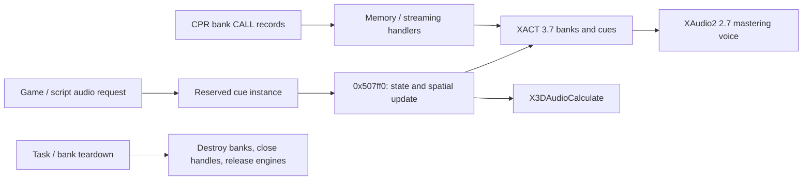

# Audio and movie services

October 22, 2026. [Architecture](../ARCHITECTURE.md). Static PC-engine map.

## Audio ownership and resource boundary

`0x4acb30` registers the audio task (global `0x13977d8`), requests
`audio.xgs.BulletWitch`, initializes the audio core through `0x507570`, and
registers the two named bank handlers below. Task vtable `0x831f68` places
`0x4acce0` in update slot +0x14. Its first invocation sets readiness fields;
subsequent invocations update the game audio layers and call the owned service
at +0x70. Core adapter `0x50a2a0` runs `0x507ff0`, then its child update.

The COM class/interface GUID bytes identify **XACT 3.7 over XAudio2 2.7**:

| Role | GUID | Image address |
|---|---|---|
| XAudio2 class | 5a508685-a254-4fba-9b82-9a24b00306af | 0x6c0bc4 |
| IXAudio2 | 8bcf1f58-9fe7-4583-8ac6-e2adc465c8bb | 0x6c0bd4 |
| XACT 3.7 class | bcc782bc-6492-4c22-8c35-f5d72fe73c6e | 0x6c0b84 |
| IXACT3Engine | b1ee676a-d9cd-4d2a-89a8-fa53eb9e480b | 0x6c0b94 |

The initializer creates the XAudio engine and a six-channel, 44,100 Hz mastering
voice, initializes XACT, and initializes X3DAudio using the SpeedOfSound variable.
These are requested parameters; successful runtime creation has not been observed.
Original Microsoft SDK declarations and download provenance are preserved in
[the DirectX reference](../../sources/directx-2010-reference/provenance.json).

| Resource operation | Native path | Ownership |
|---|---|---|
| `audio.soundbank.create_memory` | 0x4acd60 → 0x44d920 → 0x507c10 / 0x507b50 | XACT in-memory wave bank and sound bank |
| `audio.soundbank.create_stream` | 0x4ace50 → 0x44da50 → 0x508bf0 | File handle plus XACT streaming wave bank; packet size 20 |
| Cue request | 0x44d810 → 0x5079f0 → 0x505fa0 | Reserve/link an instance and initialize its cue/bank/generation fields |
| Frame processing | 0x507ff0 | Walk active instances, update state/spatial work, call XACT DoWork (+0x20) |
| Bank release | 0x44d3a0 → 0x508e10 / 0x508e40 | Destroy sound/wave banks and close streaming handle |
| Service destruction | 0x4aca90 → 0x508670 | Bank cleanup; XACT ShutDown/Release; XAudio Release |

The streaming creation path optionally waits for state bit 4, calling DoWork
while polling. Frame processing handles cue state and invokes X3DAudioCalculate.
A cue request is distinct from the recurring audio update. Full cue state flags,
voice stealing, per-category volume policy and decoded XWB codecs remain local
implementation questions.



## Movie creation, completion and release

`0x562f00` serializes access with the engine lock helpers and passes the D3D
device (`0xa0b6e0`) and path to `0x562780`. That function creates a DirectShow
Filter Graph Manager, constructs the custom 0x180-byte texture renderer, adds it
as `TextureRenderer`, and adds the source filter as `SOURCE`. It seeks an
`Output` pin and renders it; the fallback uses RenderFile. It queries media
control/event interfaces, applies volume, starts the graph and requests state
with a 5,000 ms timeout. This timeout argument does not establish actual latency.

The wrapper is at `0x1b599d0`; completion state is at `0x1b599e4`.
`0x562f60` tests state 2. The event consumer `0x562df0` recognizes event code 1, sets that completion
state and frees event parameters. In the same method it queues the most recently
completed movie texture for screen drawing. `0x562f70`
locks and calls `0x562b00`: Stop, then release media control, event, other queried
interface, graph and custom renderer. Script/mission movie handling and logo/staff
tasks reach these shared wrappers.

```mermaid
sequenceDiagram
    participant Task as Script / screen task
    participant Movie as Movie wrapper
    participant Graph as DirectShow graph
    participant Texture as Custom D3D texture renderer
    Task->>Movie: Open path (0x562f00)
    Movie->>Graph: Add source; connect; Run
    Graph->>Texture: Deliver video samples
    Movie->>Graph: Poll events
    Graph-->>Movie: Completion event 1
    Task->>Movie: Poll state == 2 (0x562f60)
    Task->>Movie: Stop / release (0x562f70)
```

The native graph construction matches Microsoft's
[Filter Graph Manager](https://learn.microsoft.com/en-us/windows/win32/directshow/filter-graph-manager)
and [graph-building interfaces](https://learn.microsoft.com/en-us/windows/win32/directshow/overview-of-graph-building).
The texture callback `0x562cd0` allocates two dynamic X8R8G8B8 textures,
stores width, absolute height and `(3*width+3)&~3` source pitch. Sample callback
`0x5625f0` expands 24-bit pixels into 32-bit pixels with the high byte set to
0xff, reverses row order, then increments the buffer index after unlock.
`0x562df0` reads `(index-1)&1`, while the writer uses `index&1`.
[Sample conversion](../../evidence/engine/pass-06n/functions/005625f0.c) ·
[Texture setup](../../evidence/engine/pass-06n/functions/00562cd0.c) ·
[Draw/event consumer](../../evidence/engine/pass-06l/functions/00562df0.c).
Decoder availability and full behavior on graph failure remain unverified. No codec installation or playback has been performed on this Mac.

## Native evidence

[0x4acb30](../../evidence/engine/pass-06g/functions/004acb30.c) · [0x507570](../../evidence/engine/pass-06d/functions/00507570.c) · [0x507ff0](../../evidence/engine/pass-06j/functions/00507ff0.c) · [0x508bf0](../../evidence/engine/pass-06i/functions/00508bf0.c) · [0x508670](../../evidence/engine/pass-06i/functions/00508670.c) · [0x562780](../../evidence/engine/pass-06g/functions/00562780.c) · [0x562b00](../../evidence/engine/pass-06j/functions/00562b00.c)
