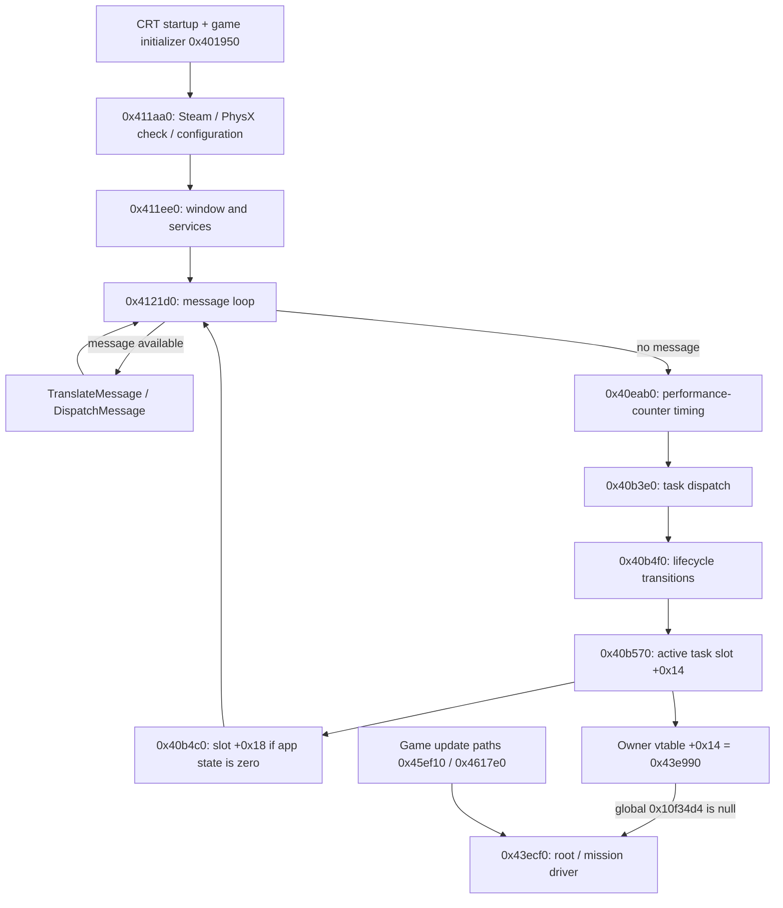

# Bootstrap, message loop and task dispatch

October 22, 2026. [Architecture](../ARCHITECTURE.md). Static map of the unpacked
Steam image; no game execution or frame-rate measurement is implied.

## Entry and initialization

The process entry at `0x4ffea4` enters CRT startup `0x4ffeaf`, which calls
`0x43a500` at `0x4fffcf`. That wrapper calls application entry `0x411aa0`.
[Entry instructions](../../evidence/engine/pass-02/instructions/004ffeaf.txt) ·
[Application entry](../../evidence/engine/pass-02b/functions/00411aa0.c).

Application entry establishes this order:

1. `SteamAPI_Init`; failure returns before the engine setup below.
2. Steam context callback registration, then `NxCreatePhysicsSDK` with literal
   version argument `0x02060400`. The temporary SDK object is released through
   slot `+4`. This is an availability check, not the later simulation scene.
   Failure attempts the bundled legacy PhysX installer and retries; a second
   failure displays an error and returns. Nothing here has been executed by us.
3. Named mutex `BulletWitchAppMutex`, platform setup, then `0x4102d0` configuration.
4. On accepted configuration, accessibility-setting preparation, application
   setup `0x411ee0`, then restoration of those settings after it returns.
5. Shared cleanup, `SteamAPI_Shutdown`, mutex release/close.

`0x4102d0` calls `Direct3DCreate9Ex`, enumerates adapters/modes, reads language and
system settings, and may show the settings dialog. `0x4122c0` registers/creates
`BULLET WITCH`'s window and makes the device-creation call at interface slot `+0x50`.
[Configuration](../../evidence/engine/pass-02b/functions/004102d0.c) ·
[Window/device setup](../../evidence/engine/pass-02c/functions/004122c0.c).

`0x411ee0` performs COM initialization, uses the registered application (or
constructs the base fallback if none exists), runs window/device setup and hook
+0, initializes engine services through `0x411f80`, calls hook +4, enters
`0x4121d0`, then calls hook +8.

**Correction to the earlier pass:** the empty base hooks are not the concrete
normal application hooks. CRT table entry **0x6c0628** points to **0x401950**,
inside the initializer range 0x6c0544–0x6c0878 walked by CRT startup. It calls
0x410160 with static object 0xcb2db8, publishes that object at 0xa0b940, then
installs game vtable **0x829cd0**. Its three hooks are:

| Slot | Target | Observed responsibility |
|---|---|---|
| +0 | 0x43a490 | Game memory settings, configuration helpers |
| +4 | 0x43a290 | RAT catalogs, world/worker setup, startup task, menu textures |
| +8 | 0x43a280 → 0x472ce0 | Release menu textures after the loop |

0x43a290 calls 0x43a3a0 to obtain the startup task (vtable 0x829d68) and
registers it through 0x40b670. That table's +0x14 update is 0x470ca0. This closes
the concrete path from process/CRT initialization through the startup task to
root selection. The base-table observation remains valid only for the fallback.
[CRT initializer](../../evidence/engine/pass-06p/functions/00401950.c) ·
[Concrete startup hook](../../evidence/engine/pass-06m/functions/0043a290.c) ·
[Startup object](../../evidence/engine/pass-06m/functions/0043a3a0.c).

`0x411f80` initializes allocation/resource/task facilities and calls the native
resource-handler registration at `0x417f80`. The ordered registrations include VSync (0x4173a0, task key 0x1000),
InputDevice (0x4171c0, key 0x1001), resource handlers, shader/font handlers,
WorkMeter and DebugChannel (both key 0x4000). VSync's active update slot (+0x14) publishes the render list; InputDevice's
active update slot (+0x14) polls controller/keyboard/mouse. Their +0x18 methods
are empty. The active pass therefore contains multiple service responsibilities.
See [input](input.md) and [rendering](rendering.md).

## Loop and task phases

[Message loop](../../evidence/engine/pass-02b/functions/004121d0.c) calls timing and
task dispatch only when `PeekMessageA` returns no message. It exits when application
`+0x138` becomes 2; WM_QUIT sets state 1 when previously zero and initiates a stop
helper. State/quit handling is documented as observed, not as a complete shutdown
contract.

[Task dispatch](../../evidence/engine/pass-02c/functions/0040b3e0.c) traverses the
list in three passes. `0x40b6a0` invokes a supplied callback on each task and can
remove entries when that callback returns nonzero. Lifecycle transitions precede
slot `+0x14`, followed by slot `+0x18` only while application state is zero.
Both active passes require task `+0x6c` bit 0 and state `+0x64 == 0x10`; they
transiently set state `0x20` while invoking the virtual method.

The lifecycle pass compares current state `+0x64` with requested state `+0x68`:

| Current | Transition method | Resulting state |
|---|---|---|
| 1 | slot `+4`, while temporarily 2 | 4 |
| 4, requested 0x10 | slot `+8`, while temporarily 8 | 0x10 |
| 4, requested otherwise | slot `+0x10`, while temporarily 0x80 | 1; mark removal bit |
| 0x10, requested differs | slot `+0xc`, while temporarily 0x40 | 4 |

[Lifecycle instructions](../../evidence/engine/pass-02d/instructions/0040b4f0.txt) ·
[Update pass](../../evidence/engine/pass-02d/instructions/0040b570.txt) ·
[Later pass](../../evidence/engine/pass-02d/instructions/0040b4c0.txt).
Do not label the entire second pass as rendering until its concrete methods are mapped.

## Startup clock and presentation pacing

The native-startup implementation pass closes the clock consumed by the two
startup screens and fade helper. Raw timer `0x40eab0` measures successive
QueryPerformanceCounter differences in seconds. The message loop contains no
fixed-step accumulator or catch-up loop. Logo `0x49e320`, check `0x4a0f20` and
fade `0x485a20` instead read renderer delta at `0xa0b7b8`.

VSync task `0x417440` calls render-list publication `0x40f920` on renderer
`0xa0b730`. Publication measures elapsed time, waits for the previous worker,
measures again and stores **min(elapsed seconds, 0.1f)** at renderer +0x88,
exactly `0xa0b7b8`. Thus the startup/UI delta includes render backpressure and
is capped at 100 ms. This does not cap the movie/audio clock or prescribe a
fixed 1/60 simulation step.

The command worker `0x40fbe0` paces with QPC/Sleep and PresentEx. The settings
table at `0x6c2660` contains nominal rates 30, 60, 120 and display refresh (0).
The raw initialized preference is 120; another limiter branch uses 30. A separate
worker sleep starts at 16 ms and is changed by other state paths. The limiter's
repeated-subtraction arithmetic and presentation/OS timing mean these constants
are not measurements of actual game FPS. Exact all-mode cadence remains open.

[Detailed derivation](../../evidence/reconstruction/native-startup/timing/README.md),
[raw witnesses](../../evidence/reconstruction/native-startup/timing/raw-witnesses.json)
and [provenance](../../evidence/reconstruction/native-startup/timing/provenance.json)
are bound to unpacked-image SHA-256
`bdaff1746d3092215699b09eab11315c6adf8fb71eaa8f46c280b11b3cd448fd`.
This is static evidence, not an original-game frame-rate observation.

## Connection to scripts

Startup task `0x470ca0`, state 3, selects `root` through `0x43eae0`, inserts the
orchestration object with `0x40b670`, then requests its own finish. The owner vtable
at `0x82a084` places `0x43e990` in update slot `+0x14`. That method calls/tail-jumps
into `0x43ecf0` only when global `0x10f34d4` is null. Other game update methods
`0x45ef10` and `0x4617e0` call the same owner update directly. This explains multiple
routes without assuming that all run each iteration.

[Startup instructions](../../evidence/engine/pass-02/lifecycle-and-queue-witness.txt) ·
[Owner vtable](../../evidence/engine/pass-02/table-witnesses.json) ·
[Game update A](../../evidence/engine/pass-02f/functions/0045ef10.c) ·
[Game update B](../../evidence/engine/pass-02/functions/004617e0.c).

Startup registration is now closed. Common-resource state machine 0x442c60
loads AI and effect resources, requests `audio.xgs.BulletWitch`, waits for the
shared queue, initializes audio via 0x4acb30, then requests the common/voice/
streaming banks and waits again. Its stored state values preserve continuation
across updates. [Resource/service sequence](../../evidence/engine/pass-06p/functions/00442c60.c).

Quit helper 0x411eb0 waits for rendering, clears its run flag, signals work and
joins the worker. Task lifecycle handles individual shutdown methods. Concrete
post-loop and top-level cleanup are recorded in [platform services](platform-and-services.md).
Remaining local questions: mode-specific task order, exceptional startup exits,
all secondary service destructors and dynamic first-frame cadence.
