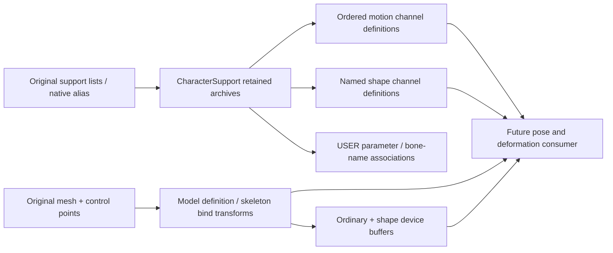

# Character load constructors

October 23, 2026. This boundary reconstructs load-time definitions and linkage;
pose sampling, character drawing and actor construction are separate owners.

The original motion publication handler `0x418900` resolves `motion.a`, then
`0x41d570` rebases its directory and channel offsets. It has a whole-transform
`_BAB` branch and a three-channel branch (the corpus uses `7BA\0`). The latter
resolves optional channels at track offsets 44/48/52, whose time/value pointers
are at 24/28. The whole-transform branch uses pointers 20/24. The bounded decoder
retains those associations without mutating bytes into host pointers.

The mesh handler `0x419320` copies each 104-byte skeleton record, constructs its
relative matrix from the quaternion/translation/scale block at 24, and constructs
then inverts the absolute block at 64. `0x417bb0` composes scale with quaternion
rotation and translation; `0x4091d0` establishes the row-vector quaternion signs
without implicit normalization. `0x4094b0` performs the inverse. The portable
implementation uses the equivalent affine inverse with explicit singular input
rejection; floating-point rounding parity with the original expanded 4×4 inverse
is not asserted.

Before design, inspected Unreal's `FReferenceSkeleton` construction, parallel
bone metadata/pose arrays and `GetComponentSpaceTransform` in
`Engine/Source/Runtime/Engine/Private/Animation/ReferenceSkeleton.cpp`, pinned
[`f45729c0b6f097038e72b52d366a62baeca3275b`](https://github.com/EpicGames/UnrealEngine/blob/f45729c0b6f097038e72b52d366a62baeca3275b/Engine/Source/Runtime/Engine/Private/Animation/ReferenceSkeleton.cpp).
Adopt explicit retained bone topology and pose-definition ownership, separating
loaded definitions from evaluated component poses. Bullet Witch supplies both
relative and absolute bind data, so construction uses those authored blocks;
Unreal's hierarchy evaluation is not substituted for the source format.

Both C++ design and implementation phases consult Core I.11 and performance
MEM.6: returned values own metadata through injected domains, archive spans
remain borrowed, and offset relocation never transfers ownership via pointers.

## Published support ownership

`load_character_support` follows the native alias function: `ea*` uses `ea0`,
`pw*` and `m09` use `pw0`; others keep their names. Compressed list lookup precedes
uncompressed lookup. Archives are acquired once; motion and shape list order is
retained, together with optional bone-name and parameter USER publications.
Native motion/shape list constructors retain pointers in argument order. The
parameter-list handler `0x4435c0` performs no construction at load; it only
unregisters on release. Its referenced USER payloads still need retained owners.

Shape relocation `0x41d680` resolves a fixed-width name directory and one optional
scalar channel per name. Shape values are float samples; motion whole-transform
channels retain ten components, while the separate motion channels preserve
explicit stride and encoding. Decoding does not run an interpolation clock.

The model owner retains shape vertex buffers and shape-offset records separately,
validates both ordinary and shape vertex ranges, and owns constructed skeleton
metadata. The device owner uploads both buffers but marks skeleton/shape draws
as requiring deformation. Static draw submission rejects them until their pose
consumer exists. The character wrapper's optional controlpoint USER association
is retained with the model definition. These load-time owners cannot make a
character actor ready to update, animate or draw.

## Executed evidence

A read-only corpus probe constructs support for all 13 placement base names:
EA0/EA1/EA2 share 177 motions, 7 shape animations and 199 parameter publications;
HM0/HM1/HM2/HW0/HW1 have 8 shapes and absent optional motion lists; HW2 has
8 motions and 8 shapes. WG1/WG2/WG5/WG7 each contain one whole-transform motion.
All 13 actual mesh definitions also decode, including the stage-specific EA
variants, and the probe releases all domain bytes. Ignored evidence and probes
live under `research/evidence/reconstruction/character/`.

Authored in-process cases verify exact borrowed channel extents, absent channels,
whole-transform versus scalar stride, nonuniform-scale affine inverse, malformed
channel bounds, singular bind transforms and cyclic skeleton rejection. They
exercise construction contracts, not pose sampling or original animation parity.
