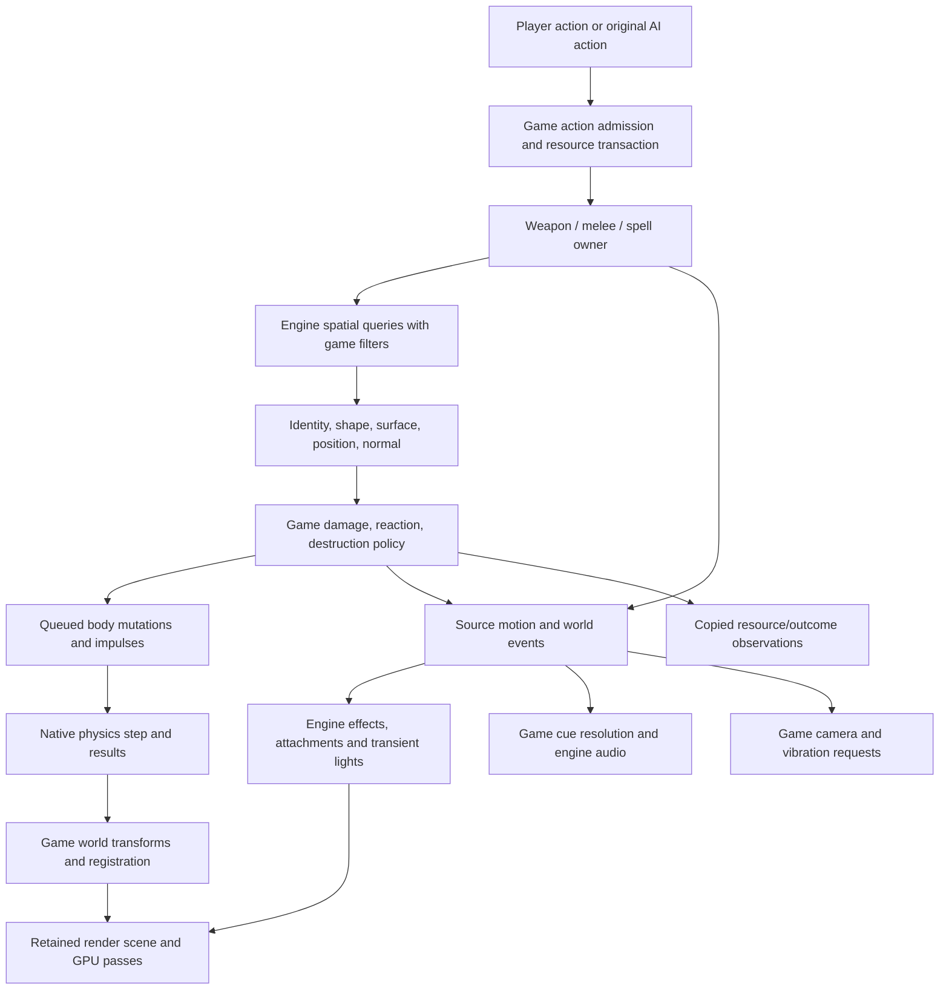

# Combat physics and effects reconstruction

October 26, 2026. Research checkpoint after accepted menu repair `c965e0a`;
mission-start implementation proceeds independently. This is a dependency and
behavior map for the whole combat scope, not implementation approval or a claim
that all original algorithms have been reconstructed.

## Scope and evidence

The inventory includes four player weapons and their enchanted variants, nine
player spells, melee, enemy/vehicle/boss attack families, hit/damage/reaction,
dynamic scenery/destruction, particles, transient lighting, audio, camera and
vibration. A completed action must connect admission to actual world outcome,
animation, visible effects and audible feedback. A presentation clip or an ammo
debit alone is not combat.

Original evidence uses the unpacked Steam image SHA-256
`bdaff1746d3092215699b09eab11315c6adf8fb71eaa8f46c280b11b3cd448fd`.
New read-only exports are `research/evidence/engine/pass-320-combat-physics-effects`,
`pass-321-combat-action-world`, `pass-322-combat-owners`, and
`pass-323-combat-hit-effects`, `pass-324-combat-world-responses` and
`pass-325-combat-final-boundaries` and `pass-326-combat-impact-reactions`. Each has seeds, command, status, inferred C,
instructions and references. Instructions take precedence over incorrect inferred
register/float signatures. Authored summaries below do not copy decompiler output.
An ignored read-only census at
`research/evidence/reconstruction/combat-physics-effects/inventory.py` records
source customization hashes/words, installed AI action use and receiver vtables.
Raw words are not typed fields until a native consumer establishes their meaning.

**Recovered** below means static instructions/data or prior bounded native
witnesses support the stated contract. **Proposed** means an implementation
boundary, not an original Cavia class name. **Unresolved** is a concrete missing
contract; no generic success/no-op is an acceptable substitute.

## Baseline and real prerequisites

Already implemented: original input/actions, Alicia movement and animation,
weapon residency and magazine/cooldown/recharge state, health/magic recovery,
HUD/ring, paused execution, static stage/placed-shape contacts, model/material
rendering and scene lighting, motion timeline, and a working XACT-compatible
audio service with bounded character consumers. Existing spell policies consume
external observations; they do not produce spell targets, damage or scenery work.

The current player presentation sink counts unsupported motion channels rather
than executing their world consequences (`src/game/actors/alicia/player_actor.cpp`,
`src/game/actors/animation/motion_presentation.cpp`). This is an explicit missing
consumer, not a secretly implemented EFF/KAK/HIT backend. Spell policies return
`observation_required` when genuine world/camera completion is unavailable.

Missing at this checkpoint: live NPC decision/action execution, mutable hit
receivers and authoritative damage outcomes, projectiles, dynamic rigid bodies,
destruction, active particles and their GPU batches, world effect/camera owners,
and complete gameplay audio producers. Authored prop shapes currently use their
initial poses. There is no hidden PhysX replacement doing these jobs.

Mission startup must establish real identities, script callbacks, initial and
deferred populations, and teardown. It must not turn every character resource
row into a live actor: `480ec0 -> 600ff0` prepares cache/support data. Group
expansion `47ef40`, creation `4806e0`, deferred storage `4466a0` and activation
`445580` decide actual lifetime. The parallel startup trace supersedes older
wording that described every prepared row as spawned.

## Connected pipeline and ownership

This is a proposed responsibility view of recovered dependencies, not a new
event order. Original `45f070` runs actor messages and parent-before-child
hierarchy, deferred retirement, actor-pair work, then particles; outer
`4617e0` drains queued physics mutation before its later physics step. Preserve
those phases when integrating with the accepted `WorldFrame`. No actor, effect,
audio receiver or rendering adapter acquires authority to advance world time.

## Weapon inventory and shot contracts

The installed base `witch/weapon/*/00_spec` records and `616530` establish five
dispatch codes. All four player guns are not hitscan. Source class versus
dispatch and Elemental Shot mode are different axes.

| Weapon | Dispatch | Range | Speed | Spread field | Rays per accepted shot |
|---|---:|---:|---:|---:|---:|
| Machine gun `wa0` | 0, persistent straight projectile | 72 | 240 | 0.75 | 1 |
| Shotgun `wa1` | 1, immediate multiray | 30 | 1000, not its integration path | 10 | 8 |
| Cannon `wa2` | 0, persistent straight projectile | 100 | 70 | 0.4 | 1 |
| Gatling `wa3` | 0, persistent straight projectile | 72 | 240 | 3 | 1 |
| Cannon alternate `wa2/01_sniper` | 2, immediate ray path | 180 | 120, not its integration path | 0 | 1 |

Units are game world units and source time; the spread word is converted at
the actual callsite. Do not assume it is a direct uniform cone angle until
the RNG/distribution helper is reconstructed. Ranges come from spec+64,
speed+88, spread+78, dispatch+54, ray count+98 (hex offsets).

`616530` selects ordinary/enchant specification, applies owner/muzzle geometry
guards, processes cooldown catch-up and ammunition, dispatches each accepted
shot, and requests the authored muzzle effect. It can emit shots and still
return exhausted status. Preserve emission receipts separately from the final
status. `617a30` retains one negative cooldown remainder, not unlimited idle debt.

Dispatch 0 constructs `61aac0`; update `61bf40` advances through `61ba90`,
subtracting speed × world delta from remaining range and moving along direction.
Dispatch 4 uses the same storage with update `61c280`. Dispatch 3 constructs
`61af10` and updates `61c3a0`: separate velocity, optional gravity, swept old/new
query, remaining traveled distance, impact and explosion-light lifetime.
Dispatch 1/2 call `61c800`: multiple perturbed rays feed `61b1d0`; per-actor
results are coalesced before damage messages. This is not automatically eight
independent shotgun damage messages to the same actor. The fixed native
temporary table has 64 records; validate authored count before a safe port.

`61b1d0` combines scenery (`5f3a40`) with actor segment/radius queries
(`5f5cb0/5f5f80`), source/side filtering, material classification and actor/body
identity. It selects the eligible hit rather than trusting the reticle alone.
Scenery callback flags include 4000 and 8800 (hex); `5e5f40` handles damageable
background bodies. Impact `61bbf0` distinguishes direct damage from a radius
path (`4ae7d0/4afad0`) and invokes physical scenery impulses (`4e8600`).
Generation-checked actor handles survive the query-to-message boundary.

The ray collector keeps the greater per-actor damage result when multiple rays
hit the same actor. `61b1d0` also recovers distance falloff: clamp traveled distance
between spec+68 and +6c, interpolate from one to the level-specific multiplier
at +30, then multiply the level-specific base at +0. This is evidence for the
source formula, not permission to assign the same formula to all radial spells.

`617260` resolves more than the base spec: `10_visual`, muzzle/enchant/bullet/
explosion light definitions and normal/enchant surface-impact tables. Therefore
the shot's complete asset closure includes lights and surface effects, not only
the gun model and sound. `616530` also contains enchanted discharge branches;
the ordinary four specs do not establish elemental parity.

Enemy/vehicle installed base specs cover `eb0`, `ec0`, `ee0`, `eg0`, `vh0`,
`vt0`, `vt0tow`, `vt0tow2`, and `wg0..wg7`. Straight dispatch0 is used by
eb0/ec0/eg0/vh0/vt0 and wg0..3; `ee0` uses 4, wg4/5 use 2, wg6 and both vehicle
missiles use 3, wg7 uses 1 with four rays. Their distinct range, speed, gravity,
blast radius and presentation records must remain data-driven. These opaque
names are compatibility identifiers, not invented enemy species.

Remaining weapon contracts: exact camera-target/muzzle occlusion order and
aim assistance; RNG spread and recoil units; full penetration/material
and friendly-fire matrices; selection of the recovered cannon alternate, elemental
mode parameters and duration/end
events; exact actor hit/body multiplier rules. The above establishes their
owners and concrete continuation points, not numerical completion.

## Spell inventory

`613b40` resolves all nine identities; `613f10` commits current-magic cost and
recoverable-ceiling debit. Cost, selection, real target admission and commit
phase are separate. See [resources](player-combat-resources.md) for verified
cost/recovery and [presentation](spell-presentation.md) for exact clip phases.

| Spell | Recovered world connection | Mandatory gameplay/effect owners and remaining boundary |
|---|---|---|
| Elemental Shot | `613b40`, weapon ordinary/enchant selection, `616530/61bbf0` mode branches | Weapon buff lifetime, all four transformed shots, impact effects/lights, actual status/damage. No substitute generic magic projectile. |
| Ancient Wall | Entry `69cb80 -> 61d510`; placement `65b0c0`; construction `61cfd0` | Real placement query, wall model/body registration, collision while alive, expiry/removal, camera return. Cost follows successful wall admission. |
| Rose Bomb | `69d250`: authored frame12 attachment, frame36 launch subject to later frame50 branch; `64ff10` | Thrown world owner and staged contact/target/child-effect sequence `651c00`; child damage/scenery, attachment/audio and terminal ownership. Do not substitute a conventional grenade. |
| Will Power | `69d690 -> 629d00`, retained target updated by state | Timed directed scenery force `629f20 -> 4e8ef0`, eligibility, body response and release, collision outcome, associated render/audio. Preserve the source directional volume, not a generic lift command. |
| Sacrifice | `69d810`, target lookup `65adb0`, update `69df00` | Ally identity/generation/life, actual frame75/frame145 effect/heal work, invalid-target cancellation and exact debit phase. No invented ally. |
| Raven Panic | `69e1b0 -> 621400 -> 61f120` | Retained raven owner, boid/target work, enemy distraction/state message, camera/effect/audio interruption and expiry. |
| Thunder | `69ea30/69f5c0/69fd10` and terminal owner | Aim target and camera-owned ten-second timeout, five cinematic segments, strike/outcome/scene response; not a fixed clip-duration timer. |
| Tornado | `6a0780 -> 654600` plus `654ba0` | Moving animated tornado, actor/scenery interaction, model/particle attachments, sustained audio, environment transitions, camera/end-state cleanup. |
| Meteor | `6a0c40 -> 6276d0/625b10`; `6a0fe0 -> 625d50` | Preparatory environment owner then meteor world owner, repeated impacts/damage/scenery, lights/particles/audio/cinematic return. |

Tornado and Meteor are multi-owner gameplay systems, not large decorative
emitters. `654600` creates animated model/bone attachments and retained cues;
`656090` moves it, visits actors and calls interaction helpers. Separate
`654ba0/656940` interpolate environment channels and restore previous values.
That environment producer must publish through engine lighting/output contracts,
not embed lighting policy in PlayerController. Meteor likewise transfers
ownership between cinematic and live objects and checks genuine terminal
ownership before release. Each of these paths needs further numeric/operator
trace at implementation; enumeration is not a claim they are already playable.

Installed teleport animation entries are not a tenth verified player spell.
The generic teleport chain requests an absent PW0 ending clip; an additional
installed clip has no proven direct state consumer. Keep that distinction.

## Spell world work and stage environment

The customization census includes 357 records in the relevant weapon, magic,
actor and physics branches. Several spell families have explicit stage tables
for `st01`, `st02`, `st03_a`, `st03_b`, `st03_cd`, `st03_e`, `st04_a`, `st04_b`,
`st04_c`, `st05_a`, `st05_b` and `st06`. Wall effect2, elemental filter, thunder
effect, tornado effect, meteor effect/impact/sky/sky-camera and storm-cloud data
are distinct records. Do not replace them with a global ambient constant or one
hardcoded One Shot Kill profile. Selection and restore must follow the source
stage key and lifetime. `raven_panic` effect data and the original misspelled
`raven_panice` resource-cost path are distinct compatibility keys.

Additional bounded contracts recovered in this pass:

- Wall `61cfd0` creates a collision/service binding and installs update `61e350`.
  Its update uses a source state-function table, age, eight model visibility lanes
  and collision work. A drawn wall without world collision and removal is incomplete.
- Rose Bomb update `651c00` has four states. Its thrown phase advances an analytic
  trajectory and queries scenery/actors; scenery contact changes state, emits
  cue `145` and installs a 0.25-second interval. The next phase collects up to ten
  eligible actor identities within its source radius. A timed phase then creates
  retained children through `650330`, using generation-valid targets or bounded
  fallback placement probes. The terminal phase waits on retained work. Actual
  child damage/effect semantics and special actor contact branch remain to trace.
  This is demonstrably more specific than "a grenade with radial explosion."
- Will Power `629f20` waits for an authored elapsed threshold, then performs
  `4e8ef0` directional scenery selection, effect `5c3`, a transient light and cue
  `143`. `4e8ef0` normalizes direction, applies the authored vertical contribution,
  tests each background bound through `5522d0` and applies `5e8390`. The latter
  selects eligible sub-bodies and records a force vector, body mask and delayed
  request, rather than mutating each body immediately. It does not
  establish generic telekinesis or a PhysX joint held by the player.
- Raven owner `6232c0` has separate timed flock/visual starts (`6248c0/624a50`),
  retained children and a terminal flag. Target and reaction behavior must survive
  beyond the initiating clip; the exact per-bird steering and eligibility remain
  implementation follow-through, not an inferred boids implementation.
- Tornado `656090` uses movement/probe helpers `657420/6571e0`, ground alignment
  `655a40`, actor messages `2723/2724`, and `655350` world interactions. That helper
  iterates background objects and actors separately. Scenery `5e7650` visits
  individual eligible bodies, computes `6556c0` force, can damage/schedule body
  breakage, checks dynamic/protected state and queues force at a point. Actor
  reactions receive messages instead of direct transform writes. Audio and the
  independent environment transition `656940` remain owned until their end paths.
- Meteor preparation update `628dc0` makes world/environment calls and actor
  messages `2729/272a/272b`; live model update `629180` evaluates its animation and
  event receivers. Exact repeated strike damage and scenery events require their
  child receiver trace; a large falling mesh is not the complete spell.
- Thunder end update `69fd10` changes camera categories through its source phases.
  `6a59e0` clears four retained children; it is not a strike producer merely because
  a cinematic branch calls it. Actual target validation, strike producer and
  impact policies must be connected before Thunder acceptance.

## Melee and motion-event hit windows

The original motion receiver owns attack windows as well as visual events.
[Motion timeline](motion-event-timeline.md) reconstructs generic crossings;
these native receivers give the game-specific consequences:

| Receiver | Native path | Required consequence |
|---|---|---|
| KAK0 entry/update/exit | `5f88a0 / 5f9640 / 5f83a0` | Reserve one of four lanes keyed by authored bone, preserve previous bone position and query identity, sweep the moving bone/radius, deliver scenery and actor hits, retire lane. |
| HIT0 update | `5f99f0` | For its supported record kind, read evaluated bone transform/radius, construct radial message through `4ae7d0`, dispatch through `4afad0`. Source entry/exit/reset are no-ops; update is not. |
| EFF0 entry/update/exit | `5f85d0 / 5f9600 / 5f8360` | Honor previous-frame gate and listener ownership; resolve model/bone attachment, create effect, retain and update transform only when source semantics require it; stop/release correctly. |
| SE / VO | Existing [audio presentation](animation-audio-presentation.md) | Resolve surface/class/voice context and original cue rather than treating every event word as an interchangeable sound index. |

KAK0 update reads packed record fields, evaluated model pose and radius, then
runs scenery sweep `4e8770` and actor admission `5f7650`. It remembers the previous
scenery body and has persistent query identity; repeated frame samples must not
become an uncontrolled damage-per-render-frame loop. The exact repeat/side
matrix stays source-owned. A generic animation evaluator publishes crossings
and poses; game combat owns eligibility/damage, and the spatial service owns
queries. Neither animation math nor the renderer mutates actor health.

`4e8770` is more than a wall hit test: it filters type/flags, excludes the prior
body, resolves body mass, applies body reactions/forces (`5e8750/5e5ec0`), invokes
per-body sound `5ef350` and weapon material-impact selection. Melee therefore
shares world hit/result infrastructure with weapons but keeps its authored
bone-window producer and repetition rules.

## Damage, death, enemies and AI

The source already separates Runner, Shooter, Grappler, Damager, MagicUser and
AiBehavior responsibilities. NPC reuse should retain those capabilities and
actor-specific policies; copying Alicia's entire controller is not required.
See [actors](actors-and-animation.md), [lifecycle](actor-lifecycle.md) and
[AI](ai-runtime.md) for the complete factory and component maps.

The installed corpus contains 155 AI wrappers, 27,079 nodes and 6,817 entries;
109 native action names map to 48 constructor families and 112 method targets.
The fresh census finds 54 distinct registered names actually used by named nodes.
The [full action-family index](../../evidence/engine/pass-06/ai/ACTION-INDEX.md)
and [AI map](ai-runtime.md#complete-action-family-index) retain the complete
registry rather than only the representative attack names listed below.
Lua scores/selects behavior and mission scripts gate populations; native actions
execute movement, shooting, grappling and reactions. These counts establish
inventory and structural coverage, not 109 implemented gameplay policies.

Representative attack-related named uses are `oneshoot` (102 nodes in 25
wrappers), `grapple` (57/22), `reaction` (874/98), `reactionSL` (47/32), `dodge`
(78/39), `request_target` (86/23), `granade` (2/1), `towshoot` (1/1),
`lookshootrandom` (2/2), `putenemy_tank` (7/7), `putenemy_chopper` (8/8) and
`tankneck` (2/1). Counts are use sites, not distinct attacks. Registry-only names
and native state transitions can perform attacks without an identically named
AI node. In particular, do not omit vehicle/boss policies because One Shot Kill's
first admitted group uses ordinary enemies.

| Actor construction family | Evidence / consequence |
|---|---|
| Other names, `eb0`, `ec0`, `ed0` | Distinct factories configure shared `5fe070`; actor model, equipment, body and AI records remain distinct. |
| `vh0`, `vt0` | `605710` family; vehicle weapons include `vt0tow/vt0tow2`, ballistic dispatch and vehicle-specific control. |
| `ef0` | `46df10 -> 46e030` separate native family. |
| `eg0` | `63d2b0` family with its own material-animation resources. |
| Additional special construction / bosses | `4806e0` has a special branch outside the classifier table; audit its consumers and attack states before claiming all enemies supported. |

Hit admission and reaction are not a universal `health -= damage` call.
`6867b0` filters the source/receiver relationship, uses hit classification and
body-indexed actor tables to select magnitude/reaction data, then invokes
`6879f0`. That helper gates invulnerability/already-dead state, scales incoming
magnitude by Damager+58, reduces the recoverable ceiling, applies a separate
current-health branch (including a factor of four for one actor-class condition),
resets both recovery countdowns and supports an explicit nonlethal mode. The
precise actor-class meaning must be established before giving this factor a
player/enemy name. This confirms why current health, recoverable health and
maximum health must stay separate.

The receiver then selects survival, knockback/reaction, death and owner
notifications; helper `687ad0`, `687d30` and `688290` participate. Another path,
`684970`, applies line-of-sight and receiver-state gates before damage and
reaction. `66d8e0` alone is a reaction helper, not the complete damage algorithm.
`688290` explicitly gates a branch on original actor-name prefixes `ea`, `hm`,
`hw` and `ee`; `687ad0` selects directional death/reaction identities, and
`687d30` uses hit category, a body-indexed multiplier and an authored magnitude
threshold. These are concrete actor-policy distinctions, not justification for
per-model patches scattered through rendering.

Exact weak-point/armor, elemental resistance, boss-stage transitions, ragdoll
versus authored death and score/drop policies remain bounded follow-through.
Implement a verified shared receipt and let actor policies consume it; do not
pretend the same reaction table fits Alicia, soldiers and vehicles.

Actor handles use source generation checks. Retirement occurs through deferred
maintenance and hierarchy cleanup, not immediate deletion from inside a query
or particle callback. A dead actor can still own a death effect/body; lifetime
and health are different states. The source's three-maintenance retirement delay
must not be renamed three rendered frames.

## Physics service and destructible scenery

The original requests PhysX **2.6.4** (`NxCreatePhysicsSDK(0x02060400)` in `4fb2c0`).
Its scene/service is owned by the world; mutation is queued before simulation,
then a blocking result fetch completes the phase. See [physics](physics-and-collision.md)
and [placed shapes](placed-physics-collision.md). Historical 2.8.1 headers help
interpret related APIs but do not prove exact 2.6.4 vtable ABI names.

`4e9660 -> 4fc050` installs timing using `min(delta, 1/15)` and source arguments `4, 0`,
flushes commands, simulates with the **original delta**, then blocks for fetch.
Instructions resolve the misleading inferred signature. Do not accidentally
clamp away world time or create a second physics-owned wall clock.

The known import paths cook raw triangles (`4f7ac0/4f79f0`) and raw convex data
(`4ee1e0/4f7920`). Therefore a replacement need not consume legacy PhysX cooked
blobs for those routes. Other unknown shape routes do not gain that guarantee.
The already-decoded `body_joints` field maps bodies to skeleton joints; its name
is not evidence of an implemented rigid-body constraint solver.

Current placed contacts cover 137 boxes, 18 convex shapes, three spheres and one
capsule in the inspected 28 selected props, prepared as 2,038 triangles plus four
round primitives. They are static snapshots. Placed triangle-mesh shape kinds
are explicitly unsupported in that importer, separately from the implemented
static stage triangle collision. Existing floor/wall collision does not imply
moving props, contacts or destructibility already work.

| Required provider capability | Recovered consumer | Ownership / remaining contract |
|---|---|---|
| Scene lifetime, mutation drain, step and fetch | `4e9660`, `4f3ff0`, `4fc050` | Mission owns scene; one world phase supplies delta; borrowed query capability cannot advance/mutate scene. |
| Stable body/shape identities and raw geometry cooking | `4e4da0`, `4f7ac0`, `4ee1e0`; placed definitions | IDs retain game owner, sub-body, material and generation; pin provider-specific cooked cache to version. |
| Static, dynamic and kinematic states; pose and velocity commands | Queue cases in `4f3ff0`, handlers `4f4110/41b0/42e0/43f0/44c0/4530` | Copy commands, preserve phase ordering, validate generation on consume; exact unnamed ABI slots stay numeric in evidence. |
| Sweeps/rays/overlaps and mask filtering | Shot, melee, wall, particles, radial/direct spells | Return closest/ordered eligible results as required, with shape/material/normal. Actor-side and invulnerability policy remains game-owned. |
| Mass, force/impulse at a point, angular response, sleep/wake | `5e5f40`, `5e5ec0`, `5e7650`, `4f3b00` | Dynamic provider integrates bodies; game supplies damage and authored force magnitudes. Force/impulse modes must be decoded, not conflated. |
| Contact results and moving-body transforms | Scene fetch and background/model consumers | Publish bounded snapshots after fetch; renderer/animation read results rather than mutate provider objects. Full contact/report flags remain to decode. |
| Multi-body destruction and body activation | `5ec070`, `5ec540`, `5e5f40` | Game owns health and break schedule; provider owns physical bodies. Exact detach/constraint/submesh-change path remains unresolved. |
| Constraints, continuous collision and material coefficients | Descriptor/creation families | Inventory actual authored modes and required contacts before committing a provider. Do not infer absence or universal support from the static subset. |

Alicia's established custom movement/controller remains authoritative for her
movement and sweeps. Dynamic props and explicitly physical actor states belong
to the physics service. Animation-driven attachments and bodies need an explicit
kinematic/physical handoff; the renderer never resolves competing transforms.
Replacing the custom controller with a generic provider character controller
would change the agreed reconstruction approach.

Scenery hit `5e5f40` checks disposed/cooldown flags, body index, surface gates,
invulnerability and breakability before per-body damage `5ec070` and scheduled
break `5ec540`. It separately applies a mass-aware force at a position through
`4f3b00`. Radial `4e8600` selects background bounds and dispatches `5e68c0`, with
optional additional world callbacks; it is not an indiscriminate impulse on every
rendered object. Tornado `5e7650` has per-body damage and dynamic/protected-body
gates. Per-body sounds `5ef350` use authored event slots and transformed positions.
Removing a mesh on impact would bypass all of these behaviors.

**Provider decision remains open.** Required contracts are now concrete enough
to start a bounded provider evaluation after descriptor/filter coverage is filled
in. That evaluation must demonstrate target-platform support, raw-shape cook,
queries, forces/modes, moving contacts, destruction handoff and determinism limits.
A candidate's API checklist is insufficient. No replacement engine is selected
by this report; changing original numerical behavior needs explicit evidence and
an accepted compatibility boundary, not a silent "PhysX-like" shim.

## Effects, lights, rendering and audio

[Particle map](particles-and-effects.md) and [runtime contracts](particle-runtime-contracts.md)
already cover four installed packs (`com/com2/com3/boss1`), 585 entries with 583
unique IDs, 1,640 part records and 833 definitions. They are research decoders and
source maps, not an active production particle subsystem.

| Original part family | Inspected definition count | Consequence |
|---|---:|---|
| Sprite, type 0 | 703 | CPU emission/motion and geometry, GPU textured shader batches. |
| Model, type 3 | 122 | Shared model/material/skeletal render path, not a billboard substitute. |
| Trace, type 2 | 1 | Retained trail geometry/attachment semantics. |
| Trace2, type 5 | 7 | Separate source trace specialization. |
| Cross / two-point, types 1 / 4 | 0 in these definitions | Factories exist; lack of corpus witness is an explicit coverage limit. |

The manager preserves binding overrides (including repeated IDs 7 and 12000),
16 part slots, shared source RNG order, optional 16-instance group limits and a
512-active-instance budget. Eviction skips retained/protected instances. Arena
capacity is 8,192 source units, not unlimited heap growth. The mapped CPU RNG is
the shared LCG with seed 1 and source constants; changing order changes the effect.

Emission, animation, motion, child creation and optional swept particle collision
are **CPU work in the original**. The collision-enabled part routes old/new
positions to the world query and may create an impact child. Billboard geometry
and batch records are produced/uploaded on CPU; seven shader-model-3 variants
and six blend/depth modes execute on GPU. Model particles reuse mesh rendering.
This is the faithful baseline, not a preferred modern CPU/GPU split. Platform
SIMD and storage batching can sit behind stable algorithms; wholesale GPU
simulation is later upgrade work unless a measured blocker justifies it.

Source mode 4 retains depth-writing alpha-test behavior rather than generic
alpha/additive blending. Implement the batch/material state and render-pass
placement deliberately, including depth, fog, exposure and transparency inputs.
Do not compensate for a wrong producer/pass with brightness or opacity tweaks.
The unusual scalar curve terminal index, some stage-EVMT axes/encodings and
specialization math still need native witnesses at implementation. Stage-EVMT
coverage alone does not enumerate all actor/spell-produced effects.

Effect lifetimes distinguish graceful stop (`4dbfe0`), forced stop (`4dc020`),
child retention, destruction (`534960`) and storage return (`535bd0`). Muzzle,
weapon, bone, world and detached-impact effects cannot all borrow an actor pointer
until an arbitrary animation ends. Use stable attachment identity and explicit
retained/released ownership. Persistent scene lights and transient spell/weapon
lights publish through lighting/render-scene boundaries already established by
the lighting redesign. A new spell must not embed another lighting subsystem in
its controller.

Decal/bullet-hole placement and lifetime are **not established** by the sprite
count. Surface impact tables and trace families are recovered, but whether an
individual impact uses a projected decal, world mesh, sprite or authored child
must be followed through its concrete effect ID. Likewise camera shake and
vibration are not proved by a nearby call with a suggestive parameter. The
existing input backend supports rumble; action-to-envelope production still
requires mapping for each family.

Audio infrastructure is real: original XACT banks, FAudio/FACT-compatible service,
CPU codec/mix work and native output, with current bounded character/menu
consumers. Combat is missing producers/closure, not an imaginary speaker device.
The current character work includes SE/VO motion events, source surface/class
resolution and bank dependencies; it does not establish complete enemy, weapon,
spell or environment streaming/priority coverage.

`617260` and shot creation retain muzzle/impact/light data; `61bf40` can request a
near-pass cue. Tornado owns moving sustained cues and transitions; Will Power
emits cue 143 and Rose Bomb constructs cue 144. `5ef350` selects three authored
scenery sound slots by body and position. Resolve their bank/cue identity,
priority, spatial transform and stop policy; do not play a new generic WAV for
every damage message. The existing common/voice bank closure and 14 wave banks
are a starting set, not a declaration that every boss/spell sound is resident.
Mission music is a separate segmented stream path, not XACT bank 3: `44bdf0`
uses filename table `956b68`. Low IDs 2, 5 and 8 map to `bgm_03.xwv`, `bgm_07.xwv`
and `bgm_16.xwv`; the parallel startup agent is wiring original script music
requests. Preserve that ownership distinction when adding combat audio.

## Scripts, residency, time and cleanup

The native binding census demonstrates orchestration rather than a script-only
combat implementation. Across the recovered chunks, `_SetEnemy` appears in 52,
`_SetEnemyCallback` in 36, `_SetEnemyDistCallback` in 29 and `_SetEnemyLifeCallback`
in four; these counts are chunk references, not active callback instances.
`_SetMagicMask`, `_SetMagicLevel`, `_GetMagicLevel` and `_StopMagic` gate gameplay;
`_LoadSettbl_Magic`, `_LoadAddedEffect` and `_SetEffectWorkSize` prepare resources.
`_SetBgObj`, `_RemoveBgObj`, `_StartGimmick`, `_EndGimmick` and `_ResetGimmick`
manage authored scene activity. Native action owners still calculate hits,
damage, force and event work.

Proposed integration contracts, grounded in the above source owners:

1. **Prepare closure before admission.** Stage/character support preparation is
   distinct from live actor spawning. Mission resources own model/motion/body/AI,
   equipment, spell/effect tables, textures/shaders and audio references. Stage
   script loads may extend this closure; a first-spell stall must not be hidden
   with a placeholder effect or synchronous file read in the render callback.
2. **One world frame authority.** Action/cooldown/projectile/effect/AI/physics
   simulation consumes the accepted world interval. Local clip time is an
   evaluation cursor and event-crossing interval, not a replacement world clock.
   Renderer interpolation and device audio sample clocks do not advance gameplay.
3. **Pause is a phase policy.** Freeze source world simulation and its admissions;
   allow pause UI and its audio/input under their existing owners. Preserve
   cinematic/media-specific timing rather than attaching all audio to one new
   stopwatch. Resume cannot replay accumulated damage or burst deferred shots.
4. **One mutation capability per owner.** Query clients get read-only query
   capabilities; damage clients submit validated receipts; physics mutations go
   through bounded commands; renderer and HUD receive copied observations.
   Restrict interface methods, not merely the constness of an outer pointer.
5. **Cancel/retire in source order.** Interruptions close motion hit windows,
   release retained effects/cues/cameras, remove actor/shape queries, drain
   generation-checked pending commands and retire hierarchy members. Scene
   teardown releases actors/bodies before the provider scene/SDK and resources.
   Restart/retry must not retain tornado weather, corpse identities or looping
   audio from the previous mission.
6. **Persist only authoritative game state.** Record progression, mission
   overrides, current resources, checkpoint and world population are different
   owners. Concept entry inherits completed-game capabilities per the accepted
   design, not a mutation of permanent progress. Visual effects and provider
   handles are transient, never serialized as the authoritative save model.

## Established implementation comparison

The concrete Unreal source examined is pinned to
`f45729c0b6f097038e72b52d366a62baeca3275b`, in the local ignored reference checkout.
Four read-only source snapshots and hashes are recorded under ignored
`research/evidence/reconstruction/combat-physics-effects/unreal/provenance.json`.
These are architectural/algorithm references for unresolved boundaries, not code
copied into this repository and not evidence of Bullet Witch's numerical behavior.

| Pinned source and functions inspected | Applicable contract | Limit |
|---|---|---|
| [ProjectileMovementComponent.cpp](https://github.com/EpicGames/UnrealEngine/blob/f45729c0b6f097038e72b52d366a62baeca3275b/Engine/Source/Runtime/Engine/Private/Components/ProjectileMovementComponent.cpp), `TickComponent`, `HandleBlockingHit`, `HandleImpact`, `ShouldUseSubStepping` | One movement authority; do not integrate a body already simulating physics; swept movement; bounded remaining time; revalidate owner after callbacks. | Retain recovered straight/ballistic formulas, range and original world-phase order. Do not import Unreal defaults, bounce or gravity. |
| [GameplayStatics.cpp](https://github.com/EpicGames/UnrealEngine/blob/f45729c0b6f097038e72b52d366a62baeca3275b/Engine/Source/Runtime/Engine/Private/GameplayStatics.cpp), `ComponentIsDamageableFrom`, `ApplyRadialDamageWithFalloff` | Candidate overlap, eligibility/occlusion and per-actor hit grouping before damage delivery; damage is distinct from impulse. | Original spell masks/falloff/LOS remain authoritative. Unreal's synthetic unobstructed hit is not an original hit witness. |
| [BodyInstance.cpp](https://github.com/EpicGames/UnrealEngine/blob/f45729c0b6f097038e72b52d366a62baeca3275b/Engine/Source/Runtime/Engine/Private/PhysicsEngine/BodyInstance.cpp), `SetBodyTransform`, `AddForceAtPosition`, `AddImpulseAtPosition`, radial force/impulse methods | Finite transforms, validated body identity, explicit dynamic/kinematic rules, scoped mutation synchronization, command-owned force arguments. | It does not decide the project's provider, solver settings or original force mode. |
| [RadialForceComponent.cpp](https://github.com/EpicGames/UnrealEngine/blob/f45729c0b6f097038e72b52d366a62baeca3275b/Engine/Source/Runtime/Engine/Private/PhysicsEngine/RadialForceComponent.cpp), `TickComponent`, `FireImpulse` | Filtered overlap, component deduplication, separate movement/destruction consumers; avoid double-applying one force through multiple shapes. | Preserve original per-body versus per-actor distinctions and force field geometry, especially Tornado. |

For the proposed port integration, use these established **ownership and command boundaries** where
original ABI/interface details are incomplete. Do not swap known source damage
or particle algorithms for Unreal merely to simplify implementation. A numerical
fallback requires its own bounded source attempt and recorded difference.

## Production coverage and connected implementation sequence

| Domain | Current production coverage | What is required before gameplay acceptance |
|---|---|---|
| Alicia/input/animation/resources/HUD | Implemented bounded player policies and visuals | Actual hits feed authority; enemy/damage interruptions and all source motion-event sinks. |
| Mission/script/world population | Parallel startup work, separately reviewed | Source initial/deferred actors and callbacks; do not pretend resource cache rows are actors. |
| Static contacts | Stage triangles and supported placed shapes | Dynamic pose updates, actor hit volumes, query filters/materials and relevant unsupported shapes. |
| Weapons | Residency, switching, firing/recharge animation and resource accounting | Five dispatch modes as actually used, real impacts/damage/physics, full effect/audio producers. |
| Spells | Ring/admission/presentation/resource policies with supplied observations | Genuine targets/world owners, all nine world effects/outcomes and interruption cleanup. |
| AI/damage/death | Original data/source mapping | Native action runtime and actor-specific outcome policies; no generic always-success backend. |
| Dynamic physics/destruction | Research boundary only | Real provider, body publication/contact/force/mutation lifecycle, multi-body destruction. |
| Particles/transient effects | Corpus/source map, model renderer available | Active CPU simulation, seven shader variants and blend/depth consumers, attachment/budget/lifetime. |
| Audio | Working service and bounded consumers | Complete shot/spell/enemy/impact cues, world transforms, priorities, streaming and stop policies. |
| Camera/haptics | Existing player/cinematic services | Native attack producers, cancellation and exclusive camera ownership/envelopes. |

The following are proposed connected slices after source mission startup. They
are not authorization to silently omit the other action families.

1. **First complete combat exchange.** Add the required actor hit/damage policies,
   one real AI shooting/reaction/death path, ordinary player gun dispatch and
   concrete surface/actor effects and sounds. This includes a reusable effect
   runtime for the part families used by those exact effects, not standalone
   hardcoded flashes. Observe player firing at an enemy and wall, enemy return
   fire, damage/recovery/death and audio; pause/resume/restart leave no ghost shots,
   orphaned effects or stale targets. If its source reaction needs a dynamic body,
   the provider work is a prerequisite of this slice, not a fake death substitute.
2. **Physical reactions, melee and destruction.** Complete provider boundary and
   required authored descriptors; connect motion-window melee, prop impulses,
   body health/break schedules, moving collision and body-to-render publication.
   Observe a hit prop react/break with sound and effects; Alicia/AI contacts track
   its new position. Melee must hit once per source rule, miss behind blockers and
   cancel correctly. A visual disappearance or stationary collision proxy fails.
3. **All weapon modes and combat actor families.** Connect four player weapons,
   cannon alternate/enchanted modes, all five used dispatch codes and projectile/
   multiray/radius semantics. Extend native AI/vehicle actions using the same hit
   and effect services. Verify range/spread/falloff/ammo, source shotgun coalescing,
   moving-projectile sweeps and source body/reaction distinctions. Stage-specific
   boss attacks remain separately enumerated until their policies are implemented.
4. **Normal spells as complete actions.** Wall, Rose Bomb, Will Power, Sacrifice,
   Raven Panic and Elemental Shot get real eligibility, outcomes, attachments,
   collision/forces, effects and audio. Verify valid and invalid targets, resource
   commit/cancel, removal, hit outcomes and repeat casting; never substitute a
   fixed timer for another owner's completion. Demonstrate each spell explicitly.
5. **Great spells, environmental interactions and remaining mission actors.**
   Thunder, Tornado and Meteor connect targeting/cinematic ownership, weather and
   stage profiles, actor/scenery outcomes, particles/models/lights and sustained
   sound. Verify traversal, obstruction, destruction, interruption and restoration
   after completion/restart. Finish remaining boss/vehicle/ally action and death
   policies and mission callbacks; a successful One Shot Kill encounter does not
   establish campaign parity.

Every slice also verifies actual controller/UI state and source progression,
resource feedback, teardown and representative native frame time. Preserve the
agreed source CPU/GPU split initially; record any measured exception. Sound and
visible feedback belong in the relevant action's acceptance, not a final polish
pass after all combat logic is written.

## Remaining contracts and decision points

The full family inventory and producer/consumer dependency map covers the requested
combat domains; it is not a complete semantic reconstruction of every native
attack or boss state. The following **algorithm/ABI gaps are not complete** and
must be closed when implementing their owning connected slice:

| Boundary | Concrete continuation / decision |
|---|---|
| Aim, spread, recoil and elemental mode details | `616530`, `5df950`, `630400`, installed per-level specs; prove camera/muzzle obstruction and source RNG/recoil rather than tune offsets. |
| Detailed hit filter/body policy | `61b1d0`, `5f7650`, `6867b0`, actor body tables; source/side, armor/resistance, repeated-hit identity and actor-class health branch. |
| Special reactions/death/boss progression | `687ad0/687d30/688290`, dedicated actor factories/actions; distinguish animation, physical body, script result and deferred retirement. |
| Rose Bomb children and individual strike producers | `651c00 -> 650330/650ef0/651b20` child outcome/placement and special contact branch; Thunder/Meteor retained child/event receiver paths. Do not equate allocation or clip completion with impact. |
| Raven steering / Sacrifice eligibility and exact heal | `61f120/6232c0`, `65adb0/69df00/624ee0`; retained target and receiver mutation, not just preview animations. |
| Dynamic body descriptor/filter/material completeness | Creation and queue families; exact 2.6.4 ABI roles, force modes, continuous collision, contact callbacks and constraints. Then provider evaluation is a genuine platform/fidelity choice. |
| Destruction/debris handoff | `5ec070/5ec540` scheduler consumers, body detach, submesh/model visibility, hierarchy/constraints and sounds. |
| Effect specialization and render details | Existing particle unresolved table plus concrete combat effect closures; scalar terminal curve witness, model/trace/cross/two-point, decal classification and GPU states. |
| Audio/camera/haptic closure | All action-specific bank/cue/priority/stream/stop producers, source camera transitions, vibration envelope commands; lack of observation is not evidence of absence. |

No immediate user decision is required for this report. Provider choice becomes
a real fork only after the required descriptor/solver contracts are checked
against actual target-platform candidates. All preceding source mapping and
shared ownership design can proceed without guessing that choice.

## Reproduction and verification

This pass reads existing original artifacts and the pinned Unreal checkout; it
does not run the game, compile production code or modify the installation.
Exports 320–326 report 870 successful function-export rows in total, including
repeat helpers across passes; this is **not** 870 unique algorithms or tests.
The inventory script records the original binary and installed record evidence;
source numeric signatures still require instruction-level interpretation.

Documentation verification covers local authored links and whitespace. No native
combat, visual, audio or physics correctness is claimed by these documentation
checks. The implementation inventory describes the checkpoint above; mission
startup is changing independently and must be checked against its own final
handoff before starting connected combat work.

### Recovery handoff

The October 26 restart recovered this completed family/dependency map and its
saved evidence; no export or whole-system trace needed restarting. The saved
870 export rows all have successful status, the 357-record customization census
is present, all 13 local documentation links resolve, and all four pinned Unreal
snapshot hashes and lengths match their provenance. The recovery audit is saved
under ignored `research/evidence/reconstruction/combat-physics-effects/recovery-audit.json`.
This verifies the saved handoff, not the accuracy of every inferred signature or
runtime behavior.

The research map is ready to guide combat implementation. The explicit remaining
algorithm/ABI contracts above are still open and belong to their connected
implementation slices; the report does not claim every attack is reconstructed.
No provider has been selected and no user direction is currently required.
Mission startup remains a separate implementation and acceptance boundary.
