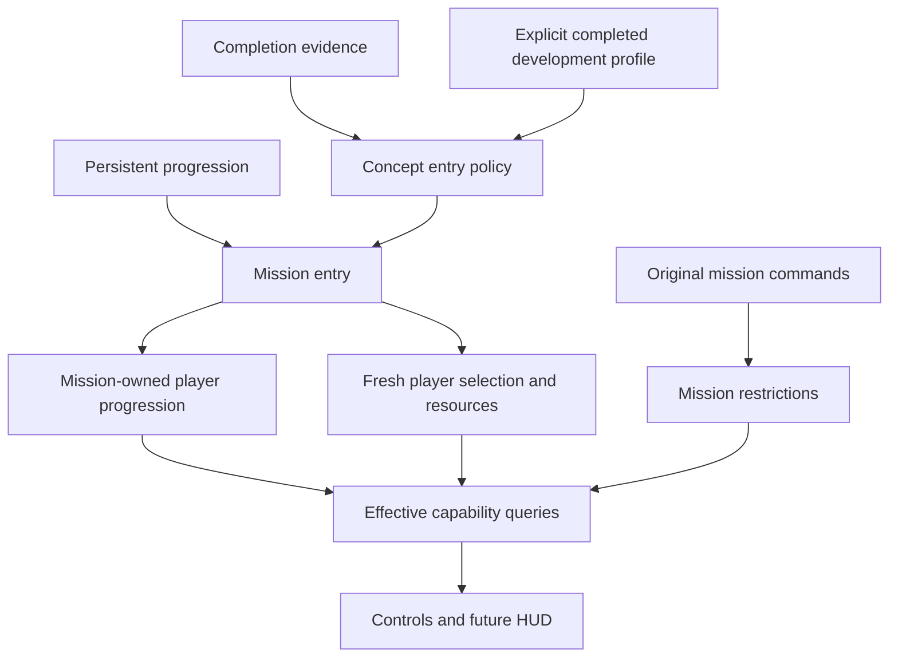

# Concept mission progression entry

October 24, 2026. This bounded source trace separates original entry behavior
from the approved early-access development profile. It complements
[player progression](player-progression-state.md),
[profile persistence](profile-persistence.md) and
[mission admission](mission-start-admission.md). It does not declare full mission
startup, combat or checkpoint restoration implemented.

## Original entry inherits progression

The original menu gates concept missions on completion achievement 13. Selecting
a supplied mission loads its package through `0x4c2cf0`, `0x441720` and
`0x441770`. Resource resolver `0x441a80` maps the root script's `concept` alias
to that selected package. These inspected functions do not grant player levels.

Root `concept_mission()` sets global value 3, starts the concept alias and waits.
Success executes results and returns to the title; it does not run the campaign
power-up/save sequence. The native global setter (`0x47c080`, case 3) writes the
concept flag at mission offset `+0x6147c` and calls `0x4931c0`, which clears the
working checkpoint buffer. Stage Select does the same via global 2 and offset
`+0x61474`. **Starting a concept mission inherits persistent Record progression,
not the campaign's checkpoint health, selected weapon, location or world.**
This clears working restore input, not the on-disk campaign save.

The mission setup state machine (`0x43eea0`) eventually applies player state
through `0x43c1e0`. Without a mission checkpoint section it uses the Record's two
stat, four weapon and nine magic bytes. With a mission section and a live input
owner, it raises each checkpoint progression byte to the corresponding Record
byte when the Record value is greater, then applies the resulting progression.
This is a per-field merge, not wholesale replacement of current mission state.
The initialization occurs before the original `start()` coroutine.

No automatic all-max grant appears in the inspected concept entry. Campaign
completion does not prove every optional purchase was made. A real completed
profile retains its actual upgrades. The One Shot Kill script has no magic-level
grant; its startup adds a restriction instead.

The diagram describes responsibility boundaries. It is not a claim that all
consumers or original startup gates already exist.

## Spell identity and restriction polarity

The nine magic slots are established by the parameter loader `0x613b40`, its
three-level table strides and the typed action consumers. Magic menu tables at
`0x836eb0` (slot identity) and `0x836f00` (script mask) independently establish
that the last three script bits are not in slot order.

| Slot | Ability | Script mask bit | Fresh Record level |
| --- | --- | --- | --- |
| 0 | Elemental Shot | 1 | 0 |
| 1 | Ancient Wall | 2 | 1 |
| 2 | Rose Bomb | 4 | 0 |
| 3 | Will Power | 8 | 0 |
| 4 | Sacrifice | 16 | 1 |
| 5 | Raven Panic | 32 | 0 |
| 6 | Thunder | 128 | 0 |
| 7 | Tornado | 64 | 0 |
| 8 | Meteor | 256 | 0 |

The spell loader's compatibility names include `elemental_shot`, `raven_panice`
and `tornade`; public engine/game identifiers need not preserve their spelling.

`_SetMagicMask` (`0x47c300`) stores the script value at mission `+0x61484`.
The consumer `0x4d0300`, checked against instructions at `0x4d0358..0x4d0376`,
ORs this with the separate runtime mask at `+0x61488`. A matching bit **disables**
the slot. Both masks reset to zero in mission initialization `0x43c670`.
One Shot Kill supplies `0x1c8`: Will Power, Thunder, Tornado and Meteor are
restricted. This does not unlearn those spells or lower their persistent levels.

The original UI separates possession from usability: `0x4d0230` asks the learned
spell predicate (`0x6001a0` → `0x6139d0`) and retains a presence flag; `0x4d0300`
combines that flag with the magic-resource check (`0x6001d0` → `0x6139e0`),
restriction masks and additional target/action conditions. A learned level and
an unset restriction bit therefore do not by themselves establish that a cast
can succeed. Do not implement resource consumption, target acquisition or world
effects merely by marking an animation available.

`_SetMagicLevel` (`0x47c280`) is a narrower mission command than its generic
name suggests. It selects bit 64 first and writes mission slot 7; otherwise bit
128 writes slot 6; otherwise bit 256 writes slot 8. It then reapplies the mission
magic values to the live player. The instruction sequence proves this priority;
a combined selector is not a request to update every set bit. The setter does
not directly modify the persistent Record.

The campaign scripts acquire Thunder in stage 1, Tornado in stage 4 and Meteor
in stage 6. Successful mission processing copies mission progression back to
Record through `0x4946d0`. This establishes story-acquired capabilities separately
from optional upgrade purchases and from the mask that restricts them in a
particular mission.

## Selection and checkpoint contract

Actor initialization `0x602390` sets the selected-weapon nibble to signed -1.
Progression application `0x603cc0` retains an existing available weapon, or cycles
forward through the four resident slots to the next positive-level weapon. From
-1 this begins at class 0. If no resident weapon has a positive level, the source
ensures the first resident weapon has level 1; this repair belongs to live player
application and is not a persistent grant. An implementation must not silently
rewrite Record to perform this repair.

Restore eligibility in `0x43c1e0` is a nonzero mission-section size at checkpoint
header `+0x10`, together with the input owner. A zero low header word clears
mission state first. The selected weapon is restored only when its saved byte is
nonzero, then progression selection repair runs. Saved health/magic setters run
only for positive values. The full serialized world/callback consumers remain
separate required restore work.

| Mission section offset | Field |
| --- | --- |
| `+0` | Script checkpoint byte |
| `+1` | Selected weapon byte |
| `+2..3` | Two stat progression bytes |
| `+4..7` | Four weapon progression bytes |
| `+8..16` | Nine magic progression bytes |
| `+0x324` | Current health, float |
| `+0x328` | Current magic, float |

These offsets are relative to the mission section (`0x1300898` in the original
process), not the base section or the whole file. Header `+0x14` locates it;
`0x4932c0` writes its `0x3a4` bytes. Header `+0x0c` instead locates the base section,
whose stage and difficulty fields are at `+0` and `+2`.

## Completion evidence and the development boundary

The original concept gate uses achievement 13 from the achievement service, not
a test for maximum weapon levels. Root ending increments global 4 and the final
campaign stage sets global 7. The global setter maps these to base saved-data
`+0x104` (completion count, capped at one million) and `+1` (ending flag).
These can describe a loaded save's campaign history, but Record alone cannot
reconstruct the user's achievement history. A fresh concept entry must not
misinterpret the newly cleared working checkpoint as evidence of no completion.

The user approved an explicit completed-game development profile for concept
entry while the normal campaign and save system retain real defaults. Keep its
provenance visible in the entry policy and diagnostic state. A representative
profile with all weapons and spells at level 1 is a deliberate development
choice, not a claim that original completion always grants those optional
purchases. It should not fabricate achievements, award currency, change campaign
progression, persist mission restrictions, or merge fictitious upgrades into an
imported completed profile. The implementation design must specify the chosen
seed and its selection rule rather than scatter availability exceptions through
controls. Preserve the accepted four-weapon traversal path via that explicit
entry policy.

## Evidence and verification

Read-only source/data inspection; no original game execution or save round trip
was performed by this trace. Existing unpacked executable and generated exports
remain ignored. Authored conclusions above are not imported decompiler text.

- Root and selected mission: recovered `root` and `cm01_00` scripts under
  `research/extracted/scripts-recovered/`; original campaign `st01_00`,
  `st04_00` and `st06_00` provide story-grant witnesses.
- Native selected-package path: `research/evidence/engine/pass-concept-launch/`
  and `research/evidence/reconstruction/profile/export3/004c2cf0` (the latter's
  function lives in its `functions` subdirectory).
- Mission/player snapshot and restore: `research/evidence/engine/pass-06k/`.
- Mask consumer and source exports:
  `research/evidence/reconstruction/progression/source/`.
- Full instruction checks: `research/evidence/native-startup/text-disassembly.txt`.
- Menu identity/mask table entries were read directly from the ignored unpacked
  PE image using its section RVA mapping, then matched to the instruction
  consumers and typed spell debit calls at `0x613f10`.

Limits remain full checkpoint object restoration and combat/action admission.
Neither changes the established entry inheritance or mask polarity above.
