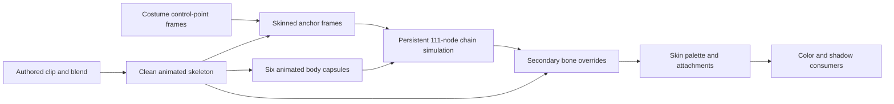

# Alicia costume secondary motion

Updated October 23, 2026. Status: source boundary recovered; CPU component and
actor integration implemented, all-six-costume native motion witnesses recorded.
Physical-controller review confirms outfit movement but still reports clipping.
The [bounded improvement assessment](secondary-collision-improvement.md) retains
the source solver after an iterative candidate failed to improve mesh-contact
proxies consistently. User review accepted the revised body height and action timing, then
reported legs passing through the outfit. The reviewed costume is assumed to be
PW5 from the last known selection; no new screenshot identifies the precise
frame. This report establishes a missing source consumer, not universal visual
parity for every outfit or action.

## Cause and scope

The selected costume is skinned correctly enough to expose a separate missing
pose pass. PW5 contains 125 bones, 34 draws and no shape-position buffers. Its
lower-outfit draws 27–32 use the `zcp_1`–`zcp_4` and `zr_01`–`zr_04` bones.
Standing, walking and forward-evasive-start clips have absent tracks for the
secondary bone region. The current skeletal sampler leaves those bones at their
bind transforms; the original engine subsequently simulates and writes them.
Zero shape buffers alone was not evidence of missing cloth.

The original custom chain simulation includes explicit body contact. It projects
secondary nodes out of six animated capsules, including both thighs and calves.
That missing pass explains the observed class of leg/outfit intersection without
changing the player's world collider or hiding body meshes. It is a CPU skeletal
secondary-motion component, independent of the unresolved PhysX/Jolt dynamic-world
backend choice. It does not constitute arbitrary triangle-mesh cloth simulation.

The existing source player mask disables mesh group 1. PW5 outfit draws are group
0; changing that mask would hide content rather than restore its motion. Actual
packed multiweight sums range from 252 to 255, matching authored quantization;
the original shader does not renormalize them. No weight normalization or bind
pose adjustment is proposed as a visual patch.

## Recovered source path

| Function | Responsibility |
|---|---|
| `0x5fe070` | Select the physics-capable model component when the world's physics service exists |
| `0x4f45a0` / `0x4f4780` | Construct that component; classify `PW` model prefixes and activate secondary motion when bone count exceeds 85 |
| `0x4febc0` | Allocate 111 nodes, initialize authored frames, intermediate nodes, rest lengths and neighbor distances |
| `0x4ff3a0` | Bind the 24-byte node definition records; shift output bones by `find(zcp_0)-85` |
| `0x4f6530` | Evaluate ordinary model animation, then secondary motion and bone writeback |
| `0x4fc760` | Transform each body capsule through its current animated bone |
| `0x4fca10` | Prepare time-varying wind, first-update/reset input, body capsules and root-chain dispatch |
| `0x4fcd80` | Integrate each chain, constrain length/direction, project body contact, update frames and neighboring coupling |
| `0x4fe900` | Closest-point capsule projection, in source collider-mask order |
| `0x4ff490` | Convert simulated world frames back through the current parent and replace the secondary local bone matrices |
| `0x428640` | Construct an animated control-point frame from three weighted authored points and the current skin transforms |

The wrapper calls the custom solver after normal animation. There are no PhysX
calls in the recovered solver/capsule-projection/writeback functions. Physics
service existence is the original component-selection condition, not evidence
that PhysX computes these chains.

The control-point resource helpers `0x424dd0` and `0x425340` allocate a pointer
array and append a resource respectively. They are not a cloth constructor and
destructor. The retained `_CPB` USER is a separate required input: chain anchors
are control-point indices, not inferred bone pins.

The immutable node table at `0x965cd8` contains 53 direct-frame, 34 midpoint and
24 adjacent-midpoint records. The runtime allocates 111 × 208 = 23,088 bytes in
the original layout. Forty records map back to the secondary bones 85–124.
The six 36-byte capsule definitions begin at `0x965c00`:

| Animated bone | Half segment length | Radius |
|---|---:|---:|
| Head (9) | 0.06 | 0.072 |
| Spine3 (7) | 0.10 | 0.12 |
| LeftUpLeg (20) | 0.16 | 0.16 |
| LeftLeg (21) | 0.18 | 0.14 |
| RightUpLeg (23) | 0.16 | 0.16 |
| RightLeg (24) | 0.18 | 0.14 |

Each also has an authored local center/axis. Node collider masks select the
relevant body segments; left/right outfit chains are not tested against an
invented generic body capsule. Projection clamps signed distance along the axis
to the segment and pushes an interior point to the radius. Source returns after
the first selected collider correction; preserve this ordering.

## Implementation contract

Shared `animation/secondary_motion` owns prepared validated chain/capsule
configuration, persistent node state, constrained integration and final world
bone overrides. Configuration is immutable after preparation. State and scratch
storage are allocated from the engine memory domain during actor construction;
updates do not allocate. Inputs explicitly include the clean animated pose,
control-point frames, timestep, elapsed secondary time, source ground bound and
reset state. Output only changes declared secondary bones. The caller serializes
pose evaluation and the solver. No native renderer, world collision backend or
game resource name enters this engine component.

The game-owned Alicia binding selects the recovered PW topology and six body
capsules, validates costume names/bones/control points and supplies the source
reset and update order. The pure control-point decoder validates offsets,
point-count/influence data and copies decoded immutable frames and influences;
it does not retain a borrowed resource-byte dependency. The existing
animation owner publishes secondary corrections after its directional-reference
pose policy and before skin palettes. All vector/matrix computation uses
`bw_math`, retaining float storage and explicit accumulation behavior.

The initial implementation preserves the source chain equations, collision mask
order, rest length, 60-degree angular bound, damping and neighbor coupling.
Exceptional zero-length directions require an explicit deterministic fallback;
they must not create NaNs or silently retune normal source inputs. Unsupported
costume/control-point shapes fail during preparation. Morph animation remains a
distinct consumer; the secondary-bone pass does not claim to implement it.

## Established implementation reference

Inspected Unreal commit `f45729c0b6f097038e72b52d366a62baeca3275b`,
`Engine/Source/Runtime/AnimGraphRuntime/Private/BoneControllers/AnimNode_AnimDynamics.cpp`:
`InitPhysics`, `EvaluateSkeletalControl_AnyThread`, and `UpdateLimits`.
Unreal initializes persistent chain state from a clean animated pose, transforms
bone-driven constraints into simulation space, then publishes bone transforms.
It explicitly handles reset/teleport and separates timestep advancement from
bone evaluation. Adopt these ownership/order boundaries and preparation-time
storage. Bullet Witch's recovered equations and capsule definitions remain the
numerical authority; Unreal's adaptive substeps and generic constraint solver are
not substituted for them. No Unreal source is vendored into production.

Design consultation read both corpora: Core I.1 (`#ri-explicit`) makes pose,
reset/time and output ownership explicit; performance MEM.9
(`guidelines/memory/MEM.9-embedded-allocate-at-init.md`) puts fixed simulation and
scratch storage at construction. Implementation consultation also read Core SL.con.3 (`#rsl-bounds`) for checked
resource/frame spans and re-read performance MEM.9 for fixed update scratch.
The CPU component uses the same explicit ownership and bounded storage.

## Evidence and acceptance

Ignored evidence is organized under `research/evidence/reconstruction/actor/`:
`outfit_probe.cpp`, `outfit-probe-command.json`, `outfit-census.log`,
`pw5-controlpoints.bin`, and hash-bound `secondary-bone-source-tables.json`.
Exports `pass-95-costume-secondary-pose` through `pass-99-costume-body-contact`
retain functions, instructions, caller references and reproducible commands.
The ignored Unreal reference snapshot is `unreal-anim-dynamics-reference.cpp`.

Before declaring this restored: validate all six costume bindings; exercise
rest/reset, ordinary walk/run, all directional evasions and landing with actual
assets; record node/body signed clearance and final mesh observations; verify
finite transforms and zero steady-state domain allocation; run required checks
and original-root integration. A capsule/node metric alone does not establish
that every interpolated outfit triangle stays outside every body triangle.
The in-process resource target passes after adding frame decoding, segment/body
contact, reset, invalid-clock publication and allocation-free update cases. An
actual-asset CPU probe validates all six costume bindings and 17 clips each
(102 costume/clip records): standing, walking, running, shooting stance, crouch
walk, and all 12 directional evasion phases. Each runs 120 updates, publishes
40 overrides from 111 nodes, and retains finite skin matrices. Teardown leaves
zero domain bytes. Its source and commands are `secondary_costume_probe.cpp`
and `secondary-costume-probe-command.json`; results are
`secondary-costume-probe.log`. This probe is a solver/asset check before the final
native pose integration; it does not establish visual clipping clearance.

The initial adapter implements the original default ambient wind path. The
source's transient externally-injected force branch remains a separate missing
combat/event consumer and is not claimed implemented. A pose publication with
zero consumed game time returns existing overrides without integrating or
consuming the first-update flag; the first positive simulation update performs
the source reset branch. This prevents a presentation-only call from using the
original near-zero-time reciprocal to create artificial velocity.

Subsequent actual-asset/native diagnostics and the user's remaining clipping
observation are recorded in [secondary motion verification](secondary-motion-native-verification.md).
That report also links contemporary Xbox 360 and PC review evidence. Restored
secondary movement does not establish equivalent garment intersections or
intersection-free rendering; original-game visual parity remains unverified.
