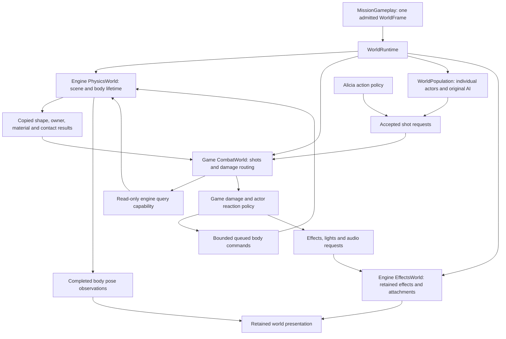

# Initial combat baseline

Implementation builds on accepted mission startup `772f4a4`.

**Accepted for commit as initial combat on October 28, 2026; AI fidelity remains
unresolved.** The user reported serious remaining enemy behavior problems and
explicitly chose to preserve this baseline before a separate, deeper AI
investigation. The October 28 screenshots at 7.01.57, 7.02.18 and 7.03.43 AM
record the live symptoms; they do not establish a particular cause. Earlier
finite source-review conclusions below are historical findings, not proof of
complete AI or source behavioral fidelity. This disposition supersedes the
previous renewed-walkthrough and encounter-closure claims.

The baseline implements ordinary-gun projectiles, actor/scenery collision,
damage/reactions/death, effects/audio, HUD and lifecycle infrastructure, with
source-built Jolt behind private engine physics boundaries. The final full
repository gate and original-content replay pass. Native captures establish
living soldier movement, damage in both directions, active-fire pause/resume,
fresh-stage restart and a visibly supported physical corpse after repairing
shared dead-body contact/model radius. Those finite checks did not establish
correct behavior across the user's walkthrough. Hardware listening and exact
live audiovisual timing are not certified.

The immediate next work is the deeper AI investigation. Full checkpoint
restoration remains explicitly approved but deferred behind that investigation;
current GameOver Yes fresh-restarts. Player melee, spells and other weapons are
not completed here. Alternate archetype101 grenade behavior is not admitted or
certified. Provider contact-group ordering and defined initialization of an
original unwritten byte remain documented adaptations.

## Original intended scope and content

The agreed slice is an ordinary machine-gun exchange with an authored soldier:
fire, hit scenery or an actor, apply damage and the original reactions/death,
take enemy fire, die or kill, and restart. Muzzle/impact presentation, sound,
pause and teardown are part of the exchange. Reachable close-range actions of
the selected enemy remain part of its source behavior closure. Other player
weapons, player melee, spells and
broad scenery destruction follow; their existing animation previews do not
become completed gameplay through this slice.

The first One Shot Kill character row is original identity 100, family `ea0`,
behavior `no_ea_m_000`, weapon `wg1`. This comes from the installed mission
character table, independently captured in the startup raw census. The live
population already selects that row through original triggers. Do not add an
artificial enemy or attach a generic chase/shoot loop to all NPCs.

## Ownership before implementation

These are responsibility names, not recovered Cavia class names. The portable
engine physics interface belongs under `include/bw/physics`, its coordination
under `src/engine/physics`, and the selected provider adapter behind that
interface. Provider types must not leak into game controllers. Game action,
damage, affiliation, weapon specification and soldier policy belong under
`src/game/combat` and the existing actor owners. Shared effects are an engine
service; original pack decoding and game effect selection stay at the content
and game policy boundaries.

Only the world coordinator can drain commands, advance physics and publish its
completed snapshots. Query borrowers cannot register bodies or step the scene;
body command borrowers cannot advance it. Source world time remains authoritative.
Bodies and shapes need typed generation-checked identities. A query returns
copied identity/contact data, never a mutable actor, body or provider pointer.
Damage policy validates the owning actor generation before delivery. Actor
retirement occurs after query/message phases, not from inside provider callbacks.

Alicia keeps her source custom movement policy. It consumes shared scene queries
and publishes her kinematic state; a provider's default character controller is
not a substitute. Animation, kinematic control and dynamic-body states must have
one explicit transform authority at a time. Physical death cannot be replaced
by disappearing geometry or a timed animation if the source requires bodies.

Current `StaticCollision` already owns immutable scenery and placed-shape query
preparation, including the character BVH. Reuse its verified contracts through
the world query boundary while evaluating provider integration. It is not a
dynamic solver. Do not duplicate its intersections in projectiles, actors,
effects or controllers. Static registration currently lives in
`MissionSimulation`; the new world service must own the common registration
lifetime rather than add a parallel controller-private physics scene.

## Verified shot contracts and integration seams

Original `616530` dispatches ordinary `wa0` and `wg1` through persistent straight
projectiles. `61aac0` constructs the projectile and its retained presentation;
`61bf40` updates it through `61ba90` and invokes the shared hit collector
`61b1d0`. This is not hitscan. The installed machine gun has range72 and speed240.
The source decrements remaining range before positional advancement and has an
explicit expiration path; do not replace it with a generic indefinite ray.

The collector combines scenery with actor queries, preserves source/side and
body identity, and selects eligible obstruction/receiver data. Impact `61bbf0`
delivers a distinct damage message through `5c7d30`; the actor receiver then owns
health and reaction decisions. Damage falloff, body multipliers, source-side
filters and nonlethal behavior are not properties of the physics engine.

`PlayerResources::fire` already reports both `shot_count` and terminal status.
The current presentation-only caller ignores the count and emits only an
animation for `accepted`. Combat must consume every accepted emission even when
the same catch-up call returns `empty`; animation/recharge status remains a
separate source contract. Exact per-emission cooldown remainder must be preserved
when constructing projectiles, not inferred later from ammunition deltas.
The resource receipt now records selected weapon, first shot's negated cooldown
and shot interval as copied values. This is the constructor's original backlog
input; it is not a second animation or world clock.

Weapon load closure includes `00_spec`, `10_visual`, original muzzle/bullet
lights and surface impact tables. Ordinary `wa0` and `wg1` both name retained muzzle flash19 and detached
discharge effect 42; their muzzle light records differ. The effect ID is not enough
to implement a flash: resolve the bound pack entry, its parts, textures,
specializations, timing, children and blend/depth states. Missing active effects
are a required subsystem dependency, not an invitation to draw an arbitrary
quad or silently discard the event.

The fresh read-only asset closure resolves the ordinary `wa0`/`wg1` visual and
surface-impact roots to fourteen effect identities and 27 sprite parts. All
have periodic emission; these parts have no nested sequence index and no
definition/collision child effect. This narrows the first required backend to
the actual sprite specializations rather than model/trail effects, but their
curves, GPU states and lifetimes still have to be implemented. The ignored
`first-combat-exchange/source_closure.py` records the root selection, archive and
payload hashes, part bindings and source offsets. It is an asset dependency
check, not a particle simulation test.

The follow-up native binder trace corrects the earlier integer collision flag
interpretation: part `+0x178` is a positive float test. Effect 42's part 33 has
collision strength 0.06, bounce 0.5 and angular perturbation 0.2. It needs the
shared physics segment query even though it has no collision child effect.
The rooted parts use shader variant 0, straight/additive alpha blends and
orientation modes -1/0/1/2/4; a universal camera-facing quad is insufficient.

The implemented wrapper schema now resolves node hierarchy, source action and
mode fields, evaluator names, call/label targets and embedded Lua without
mutating the original resource. The compiled decoder accepts all 155 installed
wrappers and matches the independent native-getter audit's 27,079 nodes and
6,817 call targets. Structural tests reject corrupt parent links and wrapping
extents. This validates prepared metadata, not AI execution or combat behavior.

Shared NPC selection now reconstructs the one-level `502e30/503cd0` traversal:
continued mode-1/3 branches, mode-4 exclusion, completed-current mode-3 exclusion,
single-candidate bypass, numeric Lua scoring and first candidate on ties. The
Lua host explicitly copies initial arguments into its protected coroutine stack
and exposes the first completed numeric result without coercion. A separate
game scoring adapter supplies the actor context identity; original native
observation bindings and action lifecycle remain required before world use.
The pinned Lua 5.0.2 `ldo.c` resume implementation supplies the argument/result
stack contract. Pinned Unreal `UBTComposite_Selector::GetNextChildHandler` was
also inspected: its first-success sequential policy differs from this original
score-based selector and is not substituted for it.

Fresh export `pass-327-first-combat-closure` resolves the impact presentation
consumer: `61b8e0` chooses the original surface table, constructs the transform
from the contact normal/position, requests that effect, then makes the separate
contextual sound request. `615fc0` replaces retained weapon flash and muzzle
light owners and calls the contextual weapon sound action20 through `618410`.
That sound helper deduplicates an active matching **retained** request. The
source cue token, separately from bank loop metadata, decides retention: WG1
fire is retained while WA0 fire creates independent overlapping one-shots.
See [audio contracts](first-combat-audio.md).

The initial soldier tree contains 812 nodes and44 entry points. Its original
Lua reads enemy knowledge, distances, facing/visibility, weapon-ready queries,
leader/path state, received messages, elapsed behavior time and shared random
state. Named native actions include movement variants, patrol, wait/reaction,
voice, dodge and behavior changes. Preserve the evaluator/controller and native
shooter boundary; seeing no `oneshoot` node in that initial wrapper does not
mean the soldier cannot shoot, nor permit replacing the tree with a distance
threshold and fire timer.

## Established implementation comparison

Read the pinned Unreal sources at revision
`f45729c0b6f097038e72b52d366a62baeca3275b`, saved with hashes in the combat research
evidence. `UProjectileMovementComponent::TickComponent` separates movement from
the shared swept collision query, processes the hit after movement, and checks
validity after callbacks. `UGameplayStatics::ApplyPointDamage` passes a point hit,
direction, instigator and damage-causer to the receiver instead of letting the
physics result mutate health. These support the ownership boundaries above.
The reconstruction preserves the traced Cavia projectile update, RNG and
receiver ordering rather than importing Unreal projectile defaults or constants.

Header-design consultation retrieved Core I.1 (`ri-explicit`) and R.20
(`rr-owner`), plus performance MEM.2 (fixed-slot pools) and MEM.6 (injected
allocation). Apply explicit query/command/advance capabilities, RAII provider
lifetime, domain-backed persistent storage and explicit capacity failure.
The implementation phase must separately consult both corpora before bodies.

## Dependency milestones and open decisions

1. Complete the chosen soldier's detection/action/death dependency trace and
   exact body/shape/filter contracts. Evaluate maintained physics providers
   against those contracts and a native integration probe before binding one
   into production. A change in solver behavior is an explicit compatibility
   decision, not implied numerical parity with PhysX2.6.4.
2. Prepare shared physics/query and original effect/weapon asset contracts;
   connect original AI/action requests and persistent projectile lifetimes.
3. Connect hit/damage, source reactions/death, sounds/effects/HUD and defeat/retry.
4. Verify purchased-content paths, native rendering/audio, pause/restart/teardown,
   full repository gate and an independent ownership review before live review.

Provider choice is approved: pinned, source-built Jolt behind the engine physics
boundary. Ordinary soldier death requires the recovered skeletal body/joint
handoff. Open integration work: AI evaluation/actions; camera-to-muzzle
obstruction and spread; damage response; complete effect/audio event routing.
These remain implementation work, not reasons to mark the slice complete.

The death prerequisite is now established: ordinary `StateDie` starts an authored
clip in `6839d0`; `683d40` requests the physical-body handoff when the clip
completes/repeats (subject to its original actor flag) or loses support. The
dynamic provider is therefore required for ordinary kill/death acceptance too.
`pass-328-first-combat-body-handoff` additionally exports the pending force/body
selection helpers for the provider compatibility trace. The separate
[physics boundary evaluation](first-combat-physics-boundary.md) records provider
evidence and remaining schema gaps before a production choice.

## Live hit geometry and world ownership

The current production composition admits the physics owner before population
construction. `WorldRuntime` owns the frozen collision preparation and the only
provider advance operation. `MissionSimulation` observes frozen collision by
const reference. NPC admission receives separate weak resource, query and
command capabilities. Animation publishes kinematic targets before the world
step; physical pose publication follows it. No actor gets a world step method.

Live projectile receivers are **not** the fifteen-body death recipe. Native
`5f9fd0` prepares EHIT parts, and `5fa290` applies the completed inverse-bind skin
matrix to rigid kind1 parts selected by the model's visibility mask. Each face
retains a complete sixteen-bit value: low byte body region, high byte surface.
The resident model view now exposes that existing decoded collision definition.
Shared `ActorHitGeometry` cooks it once; each actor owns only selected query
bodies and copied pose commands. Unsupported deforming kinds reject explicitly.

The purchased EA0 and PW0 EHIT payloads both pass real-provider admission and
retirement: respectively 25 and 19 rigid parts. This is a geometry/schema witness,
not an animation or gameplay parity claim. Reproduction and archive hashes live
under ignored `research/evidence/reconstruction/first-combat-live-hit/`.

Native `5f3a40` backs a scenery contact up by the caller's clearance along the
segment. Ordinary bullets supply 0.01 metres; their subsequent actor query uses
that shortened endpoint. The projectile owner now preserves this ordering.

## Retained weapon sound

Native `615fc0` emits contextual action 20 and refreshes an eighth-second tail.
`618410` keeps a matching active retained request; `6178e0` checks the authored
cue-token retention flag as well as handle validity. WA0 fire token `0x000001b0`
is nonretained and each shot completes independently. WG1 token `0x80000116` is
retained, deduplicates and stops when the tail requests absent action 21.
Recharge cues are `0x139` and `0x13c`. Cue looping remains separate authored bank
behavior. `WeaponAudio` preserves these distinct lifetimes and reports backend
failures. Session world-audio teardown retires outstanding independent sounds.
Native audible verification remains part of final acceptance. Complete impact
surface mappings and evidence are in [first combat audio](first-combat-audio.md).

## Shared health transaction and response ownership

`6879f0` is now reconstructed as a copied health transaction, separate from
source affiliation/body admission and actor reaction selection. Actor `+1214`
is the attached player camera (`619cc0`), so its nonzero branch subtracts four
times the scaled magnitude from current health while reducing the recoverable
ceiling by the ordinary magnitude. Actors without that camera adopt the reduced
ceiling as current health. Invulnerability and already-dead gates leave recovery
delays unchanged; accepted hits reset both delays. Nonlethal mode restores one
current point and the maximum recoverable ceiling.

A fresh original x86 execution witness exercises these distinct branches under
`first-combat-damage/original-health.json`; unit expectations use those observed
outputs. `PlayerDamageResources` grants only an admitted-frame damage transaction;
it cannot change progression, advance a frame or set health directly. Affiliation,
body table scaling, reaction interruption and defeat dispatch still belong to
combat/actor policy and are not implied by this resource seam.

Particle random state is a separate original global stream (`969100`, seed 1,
multiplier `0x41c64e6d`, increment `0x3039`, 15-bit result). The application session
owns it across mission reconstruction, while the world effect runtime borrows
draw authority. It is not the gameplay `SourceRandom` stream and restarting a
mission does not reset it.

## Shared actor preparation and impact dispatch

The existing source common motion registrations are now separate from Alicia's
player-specific overrides. Composing the two tables preserves all 749 prior
player registrations exactly; EA0 uses the common table rather than inheriting
player reload/locomotion substitutions. Mission preparation shares decoded EA0
and WG1 catalogs, while each actor retains its own ordinary/additive playback,
pose, event receipts and palettes. Source damage/death presentation policy is
also shared outside the Alicia controller; extracting it does not change its
accepted player behavior. Full NPC action and event consumption remains an
integration dependency, not a claim established by catalog preparation.

The EA0 behavior closure contains six original wrappers and 1,893 primary nodes.
`MissionBehaviorAssets` resolves catalog `ai.*` publications, follows each
`ai.add` constructor's `amb` argument to the named USER wrapper, and retains one
archive owner for the shared pack. Actors borrow immutable definitions; they do
not reload/decode trees during behavior changes. Native companion actions are
retained separately from selectable child nodes; see the AI report for execution.

`CombatWorld` now owns persistent projectile presentation and dispatches copied
body/surface hit data. Original surface effects and impact cues are selected
before the synchronous actor damage receiver, while physics only returns
geometry/identity. The body byte and surface byte remain distinct. A focused
in-process integration check exercises a real provider hit, paused-frame
suppression, original cue selection and delivery to a recording damage receiver.
It does not prove native visual/audio synchronization or a complete encounter.

The common gun constructor assigns rotating-barrel names only to `wa3` and
`eb0` (`61745d`–`6174e4`); ordinary `wa0` and `wg1` retain an empty receiver.
Their common firing call still consumes the angular-speed RNG sample before
checking cooldown. Source projectile placement also retains the raw row-two
axis from the projectile-origin bone (`600de0` → `617190`, consumed at
`616898`). Authored scale is not normalized out of that placement calculation.

### Original damage threshold admission

Production admission exposed an overly restrictive decoder check: PW0 body
region eight stores a reaction threshold of 21. The recovered ordinary receiver
compares the unit RNG draw directly against the field without normalization or
clamping. The immutable record now names it a threshold and retains that value;
values above one produce unconditional success when the other source gates
permit a reaction. EA0 retains its authored fractional thresholds. This is a
decoder correction established from the purchased customization and the native
consumer, not a tuned reaction rate.

## Encounter composition and defeat ownership

The world now prepares one shared six-tree AI library and native action library,
then retains per-instance controllers for the selected authored EA0/WG1 family.
The world publishes copied encounter observations before actor decisions,
advances actor motion, solves physics once, publishes completed query transforms,
then emits and advances projectiles/effects. Controllers borrow query and emission
capabilities; none can step physics or the world clock. Weapon magazine/cadence
and reload/ready motion policies are shared with Alicia rather than duplicated.
The player weapon receiver is published only after fallible preparation and is
revoked before its owning combat object retires.

Lethal damage switches the player out of ordinary health recovery. The original
cause-1000 callback uses the same descending event ordering as other mission
callbacks. Its Game Over task owns presentation/input only; it publishes a typed
restart/menu result after the original confirmation and fade. The mission
coordinator remains the only transition owner. Original authored sprites and
localized text are prepared before callback execution.

Enemy, resistance and citizen removal are separate family operations. They
retire matching live receivers and discard matching pending requests while
preserving fired-trigger history and unrelated families. Background retirement
is separate: the source manager includes initially placed props, while main
stage geometry survives. Its rendering, local emitters and contact-query
registrations must retire together; background retirement is not a synonym for
clearing the world.

`CancelRealTimeEventAll` targets ten real-time event actor records, not the
mission callback registry. Current gun encounter admission has no such actor
producer, magic effect producer or environmental cue playback owner. Loading
those metadata tables does not establish those runtime systems. The real-time event cancellation and environmental sound zero command now use
an explicit unsupported-producer capability boundary: cancellation is valid
only while no real-time actor producer is admitted, and nonzero environmental
sound activation rejects. No voice handles or event actors are fabricated.
`StopMagic` additionally sends a player cancellation message in the original;
its player action receiver remains required even with no spell effect producer.
None of these operations clears mission callbacks or all combat effects.

Purchased-content integration now exercises source trigger admission, selected
AI, persistent shots, world queries and real actor damage. With a controlled
observer placement and diagnostic aim input, enemy fire lowers Alicia's health,
then Alicia's ordinary gun kills an authored soldier and its original death
animation hands off to Jolt. A separate explicitly wounded-player precondition
lets a real enemy projectile kill Alicia and verifies her physical handoff.
Neither fixture alters production targeting or damage policy.

The original default death callback, GameOver confirmation and a fresh-stage
restart request also pass in a separate controlled death-state scenario. This
does **not** establish faithful checkpoint retry: source GameOver Yes writes
outcome 3, which `43eea0` converts to checkpoint restoration via `494020`.
The current adapter still maps Yes to fresh stage restart. The user explicitly
approved deferring original checkpoint restoration to the next slice. This is
a known current limitation, not faithful retry parity. The recorded outcome 3
and native restoration route remain the source contract for that next slice;
this documentation change does not alter production behavior.

Before the presentation rejection, all 58 authored placement rows and zero
live migrated CPU allocations passed the existing original-content route.
That earlier independent full-diff review completed its identified findings:
source query masks, actor-specific damage state facts, and victim audio requests
were repaired and rechecked. See `first-combat-independent-review.md` for exact
coverage and limits. Every admitted EA0 now owns shared contact/root motion and
audio lifetimes independently of selected AI admission. Additional AI families
remain unimplemented.

A separate actual EA0 melee witness follows original BlastStart841, flight840,
landing839 at frame41 and articulated Jolt handoff at frame46. It uses original
model/motion/collision data and the public actor/provider path. No separate
actual support-loss witness is claimed. A 720-frame offscreen Metal/FACT capture
rendered the earlier controlled encounter and produced
finite nonzero audio with a silent retirement tail. This proves native execution, not
a human judgment of audiovisual synchronization. That revision passed the
repository gate; the subsequent live presentation rejection reopened it. Checkpoint restoration is
explicitly deferred to the next slice. No visible game launch or commit has
been performed for this slice.

Original-content integration also separates target points from actor positions:
completed weighted eye-locator height supplies the target midpoint, with the original
resident model group radius as fallback. Collision capsule dimensions are not
substitutes. Weapon control-point locators retain the source model-frame fallback
when an optional locator is absent. Missing ready/fire/reload animation slots do
not cancel committed weapon state where the corresponding original caller
ignores the optional model-admission result; no substitute clips are selected.

Navigation preserves independent character and placement-group path names,
including missing versus blank original table cells. Primary and secondary
search graphs are checked in source order; a missing graph never silently
becomes archive group zero. Patrol selectors choose the corresponding authored
path and an absent optional archive remains absent.

### Defeat spell teardown boundary

The original `_StopMagic` global command retires actual spell owners, then sends
a typed player notification. Its player receiver `6138f0` explicitly skips a
dead player, in addition to its live state/mode gates. This encounter admits no
world spell producers. Defeat therefore retires an explicitly empty spell set
and takes the verified dead-player notification gate. It does not reset Alicia's
pose or clear unrelated projectile/effect owners. The capability is immutable
and compile-time checked; adding real spell producers requires replacing that
empty teardown with their owner. A living-player `_StopMagic` request remains
an explicit unsupported path pending its source state gates. This narrows the
binding to the demonstrated death callback, not a universal success stub.

The now-implemented family-removal receiver also permits the unchanged goal
callback to execute its original prefix: remove enemies, clear the goal marker,
and pause player input. It then remains suspended at `_ExecMissionClear`;
mission-result production is still unavailable. World simulation remains alive.
The prior initialization test's expectation of an untouched goal marker/input
state applied to the earlier stop at `_RemoveEnemyAll`, not this callback's
source behavior.

## Historical automated verification before presentation rejection

The earlier `python3 scripts/check.py all --jobs 12` passes formatting, architecture
checks, native host build, CTest, fatal clang-tidy over every project compilation
entry and repository content policy. No diagnostic families or test expectations
were weakened. The original-content `startup-corpus --mission-startup-only`
passes after the source/ownership repairs, with zero live migrated CPU allocations
after teardown. Reproduction output is retained under ignored
`research/evidence/reconstruction/first-combat-*`.

The native encounter capture uses production Metal rendering and FACT mixing
with SDL's disk output, not a mock audio result. It runs 720 admitted frames,
checks enemy physical handoff, captures rendered frames, and records finite
nonzero stereo PCM followed by silence after retirement. This is not a
sustained-framerate benchmark or a hardware-audio listening judgment. The
actual Blast witness and independent report retain their separate scope limits.

No commit, push or visible game launch was performed. Acceptance still requires
the user walkthrough. Original checkpoint retry is user-approved next-slice work;
GameOver Yes currently performs a fresh-stage restart.

## Ordinary-start live review regression

The initial native witness exercised the selected encounter from an explicit
trigger-center fixture. It did not walk from the original Lua start through the
cave, so it missed reachable source action branches and delayed population
admission while effects were active. That coverage gap caused a premature
review handoff.

The reported locomotion rejection was reproduced with finite observations and
raw posture `3`. Wait and WaitRandom had bypassed original lookup `5d5a00`;
posture `3` must become packed motion family `0x20` before locomotion adds its
direction bits. The source producer is repaired; the locomotion invariant is
unchanged. The diagnostic build retained the terminal-action repair described
below while restoring only the old Wait conversion, to isolate this cause.

The same real starting route also exposed a valid action-zero terminal in
`no_ea_m_000` (node byte offset 3288). Original selector `5025e0` honors the
terminal flag returned by `502e30` and constructs registered factory zero
(`noname`), whose owner is inert but reconsiderable. Reconstruction rejected
that authored state. Selection and factory admission now implement those source
semantics, including terminal ordering before the completed-branch sibling
rewrite. This is not an unknown-action fallback.

The existing purchased-content startup scenario now drives ordinary movement
from the original Lua-authored spawn through the cave bend. It does not inject
placement or trigger containment on this route. Its later isolated callback
checks still explicitly inject containment; these remain separate from the
walking regression. Evidence and exact failing observations are under ignored
`research/evidence/reconstruction/first-combat-normal-route/`.

The additional lighting failure came from delayed NPC admission after an effect
emitter mutation invalidated the completed view. Scene-owned fixed slots now
stage emitter updates and retirements until explicit view publication; receiver
admission continues to use the last coherent copied light/view result. Invalid
updates reject before replacing pending values, and slot generation reuse
resets depth history. No controller refresh or guard removal was introduced.
See [lighting producer contract](lighting-scene-producer-contract.md).

The repaired route executes 900 ordinary movement frames and then the existing
original callback checks. Independent review covers the action fixes, source
terminal ordering, pending-light lifetimes, and separation of the actual walk
from the later forced callback observations. The native offscreen rerun
completes 720 Metal/FACT frames with enemy damage and an enemy kill; its captured
PCM is finite, nonzero during playback, and silent after retirement. Its
trigger-center fixture remains distinct from the original-start traversal and
from the user's pending controller/audio walkthrough.

The completed purchased-content run reports `mission-startup-only: passed`,
including all 58 authored population rows, original GameOver confirmation and
fresh restart, with migrated CPU live storage zero after teardown. The updated
native capture uses FACT with a disk audio device, not a hardware listening
claim. Manual controller navigation and audiovisual acceptance remain with the
user; checkpoint restoration remains the explicitly approved next slice.

Historical locomotion-crash repair verification: `python3 scripts/check.py all --jobs 12` passed
with fatal lint and all repository checks after the repair files froze. The
log is `first-combat-normal-route/check-all-final.log` under the ignored
evidence root. No commit, push or visible game launch was performed.

## Reopened enemy presentation: consequential source coverage

The previous native evidence did not validate close enemy behavior. The following
reachable source chain is required; unit witnesses alone cannot close these rows.

| Source producer → consumer | Reopened finding / current status |
|---|---|
| Target actions → retained perception | Corrected eye-frame producer is connected. Continuous original-route capture demonstrates detection and front/side/back tracking across three nearby soldiers. |
| `62e960` → `62ebe0`/`62fef0` → anchor and Runner turn | Implemented retained aim anchor, bounded horizontal/pitch rotation, completion and retained original turn-rate receiver. Original executable witnesses confirm positive turn scalar for both horizontal directions; unit comparisons pass. |
| `5a5200` → `62e960` reaction/navigation facing | Replaced immediate actor rotation with the same retained Shooter request used by explicit aim. |
| `664fb0` → `667cc0` → `668360` model-facing/posture | Connected shared original facing policy, completed authored direction reference and separate anchor/model frames. Ordinary grounded movement uses authored horizontal root distance along retained movement direction and contact normal. |
| `666c20`/`667000`/`6678a0` → root consumers | Selection feeds the grounded path above. Generic action root motion consumes translation and relative rotation; it is not substituted for ordinary grounded `664fb0`. |
| `5a5270`/`62ea90`/`62ebe0` ready state | Implemented implicit ready-before-fire, retained duration, positive-state raise/drop edges and duration hold while an upper owner is active. See bounded noncamera bookkeeping below. |
| `630400` upper-owner fire admission | Added active-upper exclusion before ammunition/shot admission. Completed upper owners retire through their existing owner. |
| `5e0830` pose owner capacities | Corrected body 4 / upper 2 / additive 1. Close native capture shows raised firing and repeated shot presentation without the old accumulated-pose defect. |
| `56aa30` → `428640` weapon locator | Replaced raw bone lookup with shared weighted three-point attachment evaluation for both player and NPC. Accumulate model-local skinned points, orthonormalize locally, then compose model and original half-turn. Regression covers scale, nonunit influence sums and missing-slot fallback. |
| `600ae0` → `428640` eye frame → `5aad90` | Prepared immutable body attachments now supply eye origin and forward to perception; actor aim-height observations use the same locator. Previous raw-joint interpretation was wrong. |
| `5f8150` motion sound/contact attachment | Positive slots use weighted locators; zero/negative/missing slots use model-world origin. This is distinct from the actor-eye physical-transform fallback. |
| `615aa0`/`615fc0`/`618410` retained child; `616530`/`617110` detached discharge | Corrected flash/light/audio to barrel locator 0; each emitted projectile now requests separate effect 42 at locator 1. Prior code conflated placements and omitted detached emission. Native barrel/shot frames and copied endpoint telemetry now verify the distinct consumers. |
| `5f9fd0`/`5fa290` → `4225b0` → EHIT query instance | Corrected model-bind-space triangles to completed skin transforms for player/NPC, animation and physical publication. Original executable palette witness confirms inverse bind; native baseline showed displaced torso/head query bounds. API now accepts the completed pose and selects skin internally. Native geometry bounds align with the visible body and ordinary player shots admit real damage/death. |
| `6867b0` → `6879f0` → reaction/pose/physics | Native ordinary shot 885 admits hit 886/body 3, source death clip 730 advances visibly, and physical ownership begins 1107. The moving-player run independently admits hit 1366 and physical handoff 1767. One Shot Kill health1 requires original death, not a fabricated nonlethal stagger. |
| Shooter → Runner → model phase | Prior completed pose can be source-correct for immediate shot; retained flash follows completed pose. No demonstrated phase-order defect. Native copied shot/attachment observations and continuous barrel frames exercise these distinct phases. |
| Instance pose → Metal palette | Separate instance ownership is retained. Three nearby soldiers publish distinct changing facings during the continuous close orbit; inspected frames show independent poses. |

The original ready message also resets Shooter hardware aim-mode bits and a
short timer. For this selected noncamera NPC, the mode starts at zero and its
hardware-input mode-cycling handler is absent. The timer writes separate actor
camera-mode bits; inspected selected AI/perception/action paths consume only
the weapon-selection low nibble, and the camera update is guarded by an absent
camera owner. That bookkeeping is not implemented by the narrowed NPC duration
command. This is a bounded source applicability finding, not coverage of future
camera-bearing actors or the player input receiver.

Independent original-executable checks now cover the shared locator arithmetic
with the purchased EA0 eye54 and WG1/WA0 muzzle/ejection definitions. Ten
identity and rotated/nonuniform-scale cases agree within 1.18e-6; original
record reads, weighted points, frame construction and model composition execute,
with only external square root supplied by the witness. These are synthetic
completed skin poses over actual locator data, not live animation verification.
Separate original Shooter witnesses cover left/right/back and compound yaw/pitch;
the retained anchor policy agrees with the recorded results. Evidence remains
ignored under `first-combat-visual-repair/source-audit/`.

## Repair verification and current review boundary

`python3 scripts/check.py all --jobs 12` passes formatting, architecture,
compilation, CTest, fatal clang-tidy and the repository content guard on the
repaired code. The actual-content `startup-corpus --mission-startup-only` also
passes: ordinary initial-route two-way damage, player kill and physical enemy
death, enemy-caused player death, original startup/modal/checkpoint/music and
GameOver confirmation, population admission and balanced teardown. Migrated CPU
live storage is zero after teardown. Logs are retained under ignored
`first-combat-visual-repair/check-all-repair-complete.log` and
`corpus-repair-route-complete.log`.

The old trigger-center observer was replaced with ordinary forward/right/
approach inputs from the independently verified authored start. Incoming-damage,
player-kill and physical-death assertions remain. The separate Lua callback
fixture remains at its initial position while checking timers and outcomes;
idling under corrected enemy fire would legitimately interrupt that independent
fixture. It binds actor audio like production, while its non-device voice
completion is explicitly controlled. Neither fixture claims native audio timing.
The translated-bind EHIT regression rejects the old raw-bone coordinate
contract; the detached-discharge regression verifies independent placement and
lifetime across retained barrel movement and retirement.

The fresh native evidence follows unchanged original startup Lua, acknowledgments
and normal movement from the initial spawn. The first passive case records real
enemy damage and Alicia's death; survival is not forced. A separate early-return-
fire case records shot 885 → accepted hit 886 → advancing death clip 730 → physical
handoff 1107, with standing, falling and grounded frames inspected. The moving
case shows the closest soldier following Alicia around all sides, nearby soldiers
retaining independent facings, accepted hit 1366 and physical handoff 1767.
A bounded crouch/stand case changes Alicia's weighted eye height from 1.545 to .894
and back, her source target height from .978 to .652 and back, and the enemy's
retained aim vertical component from −.0945 to −.1485 and back to −.0969. Its
native crouched and standing frames were inspected. No target, health, hit shape
or animation state was forced for these visual cases.

Retained flash/light/audio now use the barrel locator; the separate authored
per-projectile effect uses its own locator. Native flash/tracer frames and
copied shot transforms agree with those owners. The earlier diagnostic used an
obsolete SDL2 audio-path variable with SDL3, so its per-run audio attribution
was invalid. Those outputs were preserved, and the corrected final orbit and
vertical runs use SDL3's actual disk-output setting. Their F32LE stereo 44.1 kHz
samples are finite and nonzero, with the final post-retirement second silent.
GPU-readback captures do not establish live audiovisual synchronization or
hardware listening quality; those remain part of the user's walkthrough.

[The independent source/ownership re-review](first-combat-independent-review.md)
finds no additional demonstrated defect in the repaired selected paths. It
covers immutable resident attachments, per-instance poses, synchronous const
pose borrows and copied skin publication, separate anchor/model/physical
frames, ready/upper lifetime and retained/detached presentation ownership.
[The native audit](first-combat-visual-evidence-audit.md) preserves the failed
baselines, source findings, exact captures and their limits. The original can
change hit-group visibility after admission; no such selected EA0 branch was
established here, so future dismemberment/dynamic appearance reuse is not
certified by this encounter.

Review with `./run`, then Concept Mission → One Shot Kill → Normal. Confirm the
original instruction pages, walk through the cave bend to the first open yard,
and use the ordinary machine gun. Left stick moves, right stick looks, RT fires,
right-stick click toggles targeted view, X reloads, left-stick click crouches,
and Menu pauses. Check moving around soldiers, firing at scenery and the visible
body, receiving damage, death, pause/resume and restart. GameOver Yes currently
starts the stage fresh. Other guns, player melee, spells, broader enemies and
mission completion are outside this selected exchange. No commit, push or
visible launch was performed for this repair; user acceptance is still pending.

Checkpoint restoration is the separately approved next slice. It does not excuse
any omitted reachable enemy behavior above. Verification must pair copied
state/clip/attachment/shot/reaction observations with continuous close native
footage following the original startup route.

## Full encounter omission audit after renewed walkthrough

The user requires the entire agreed encounter's source-to-implementation closure,
including producers and reachable branches absent from the current implementation.
This supersedes the earlier scoped review's completion disposition. The independent
source auditor owns authored enemy resources, predicates and action closure; the
integrator owns shared world and combat consumers, with a second independent audit
of those boundaries and copied-source runtime traces. Baseline failures below are retained as provenance. Each disposition distinguishes
source closure, actual-content checks and native observations; none substitutes
for the user’s acceptance of the repaired encounter.

| Original path / evidence | Current implementation and observation | Audit disposition |
| --- | --- | --- |
| CM01 groups 100, 101 and 111 select character 100, `ea0` / `wg1` / `no_ea_m_000` | `WorldCombat::admit` admits these actors independently; identity 101 and other behavior families are excluded by its exact selection filter | Initial nearby actors have controllers. The six-tree archetype100 closure is independently audited. Archetype101 uses a separate grenade behavior tree and remains unadmitted; this is not a claim of complete EA0 or level gameplay. |
| `no_ea_m_000` stationary waits with attached fire, plus Follow/angular/positioning/flock/move-and-shoot branches | Existing native orbit and vertical captures select only idle, ready-idle and turn bindings; three living soldiers retain fixed positions | Baseline failure resolved through the missing sensor, collision-route and movement receivers below. Fresh native ordinary-route capture observes living movement of approximately 3–14 world units across these soldiers. |
| `5bf980` and `5bfeb0` use per-action burst/rest timers and line-of-sight admission | Captured soldiers' firing intervals overlap | Independent burst/rest and source LOS admission are implemented and reviewed. Captured firing overlaps; there is no universal shared attack slot. This does not imply every native pause in firing was individually annotated. |
| `5ce940` → routed `5cfcb0` / direct `5d0430` → `5d08d0`, `5cef00`, `5b0a00`, retained heading and steering target | The rejected baseline replaced this path with whole-segment clearance or A*. The repaired owner retains local sensors, heading, two collision-search jobs, pair state and distinct routed/direct receivers, including with no navigation archive | Implemented and independently source-reviewed through the final MoveTo receiver; actual-content and native living movement now pass. Contact-group ordering remains the explicit provider adaptation described below. |
| Scene query used by current `NpcCombatController::traversable` | Clearance .25 segment descends from actor Y .260004 to grounded destination Y .000004 and hits flat floor normal (0,1,0) at approximately 3.85% of travel | Preserved baseline evidence. Shared source capsule/support queries replace this invalid ground-level route gate; it was not repaired by an unexplained height offset. |
| `5a54a0` constructs StateDie with six-second delay; `683d40` then tests camera owner, camera-facing and distance before `561370` retirement | NPC death currently ends in physical ownership; `MissionPopulation::retire_distant` excludes dead actors and no corpse-expiry receiver removes them | Source delay/camera/distance policy and world-owned permanent population retirement are now implemented, with focused host tests passing. Classification comes from47ef40/445580, not authored row flags. Physical model-to-authoritative position synchronization is implemented; final native retirement verification remains open. |
| Original actor voice dispatch and shared stream/memory slot arbitration | Session GameAudio owns the shared two-stream/eight-memory voice pool and cross-actor history. Actors retain bounded requests; only the admitted world phase advances them. | Implementation and actual-content arbitration regressions pass; final native lifecycle validation remains open. Finite/nonzero PCM alone does not establish arbitration parity. |
| `5b0980` / `5b0f40` / `5b1200` / `5b0a00` → `5cef00` → `6991f0` / `615110` | World-owned `NpcSteeringSensors` retains copied requests/results; `NpcSteeringHeading` owns only route direction and the source ready/fire suppression interval. All route sensors use original group zero. Direct routes no longer require a whole-segment clearance check. | Source-reviewed and checked against executed original heading outputs. Actual-content two-way scenarios now observe 13–18 world units of living actor movement, excluding corpse/physics travel. Fresh native ordinary-route capture confirms living movement; it does not exhaust every terrain configuration. |
| `5cf0c0` approach projection and `5abb40` / `5abb80` retreat clearance/ground projection | Shared query helpers use the source short reflection probe, exclusion masks, alternating approach admission and raised retreat segment. Controllers submit copied steering destinations; shared character collision still owns movement resolution. | Implemented and independently source-reviewed, including segment-direction retreat backoff and shared capsule clearance. Actual-content movement replay passes; native terrain behavior remains under review. |
| `5dc270` symbolic motion lookup → `5bf090` / `5be0d0` → `4aff70` → `6659e0` | Exact uppercase symbol-to-slot compatibility facts replace clip-basename lookup. Ordinary unknown symbols enter the no-motion phase; sequence unknown symbols reject. Reaction flags preserve facing suppression. | Implemented; sequence start/loop both pass source parameter6=1, so their automatic-return flag is false. Actual-content replay now passes the admitted ordinary named reaction slots, with explicit actor-specific pose semantics rather than a blanket fallback. |
| Global `96b2b0`, `5bf280`, pre-actor `5bef40` | `ReactionAdmission` holds ten shared slots, ten-second world-time expiry and source bypass-without-refresh behavior; controllers have only atomic admission. | The final full repository gate and actual-content replay pass. Cross-actor source mapping independently checked; no new parallel clock. |
| `5be990` loop bit, `46e010` completion latch, `4aef20` reaction-state ownership | `NpcActionPose` now publishes three separate facts. Previously the completion predicate was logically impossible. Full-body damage/death supersedes named reaction ownership; additive damage retains it. | Implemented with completion/interruption/loop regressions; actual-content replay now passes with named-reaction completion and interruption semantics. |
| `5d85f0` → `5abf60`, and `5d40c0` | Shooting uses source mask0x3200; `getEnemyMoveAngle` measures enemy bearing in the movement-direction basis, rather than movement bearing in model-facing basis. | Implemented and independently source-reviewed; original-content encounter passes. |
| `5aad90` knowledge transitions → `5886c0` / `5a6800` → entries41/42 and priority arbitration | Both independent perception owners now dispatch recognition events through original entry priorities. The behavior runtime distinguishes event frames from authored calls, re-enters suspended actions and preserves empty-entry no-op behavior. | Implemented; actual-content replay passes. Independent finite encounter source review passes, including primary-before-secondary event ordering; final native attention observation remains open. |
| `5b1790` background registry → model radius and `5ecd30` placement | World encounter publishes copied placed-background root transforms and authored model bounding radii; cover consumers retain the source 1.5 scale and bounded candidate order. | Missing producer implemented and source-reviewed. Native cover-selection behavior remains to be observed. |
| Lethal `6867b0` → `4b0000` / `5a4d90` attacker notification → MagicUser `60aa70` | Authored award comes from chara column27 / placement word61. A copied first-lethal receipt queues the authored amount to a narrow player ceiling receiver on the next admitted actor dispatch. | Actual-content two-way kill verifies the authored award and increased recoverable magic ceiling; repeat corpse hits do not award again. Exact original recipient-drain timing remains a comparison boundary. |
| `6178e0` retained sound wrapper, update `6179c0`, destruction `6157d0` | Retained wrapper identity survives natural backend completion; release clears the owner and permits the next request. | Source-reviewed ownership repair and focused lifecycle tests passed; native audio timing remains open. |

The existing source-coverage table above remains evidence for its individual
repairs, not a declaration that every reachable source branch has been checked.
The expanded matrix will record each concrete source call path, implementation
location, verification, and any omission, inference or unresolved boundary here.

### Corpse retention implementation boundary

`DeathLifetime` owns only the source six-second countdown and copied retirement
predicate. After actor advancement, `WorldPopulation` collects eligible identities
and asks `MissionPopulation::retire_dead` to retire each receiver before removing
its active record. This is permanent death retirement, not distance-based deferred
residency: no pending record is produced, trigger history stays fired, and stale
identities cannot retire a new occupant. Existing controller/audio/render/physics
retirement order is reused. The timer continues when physical pose ownership has
replaced animation, and receives no independent clock.

Source `683d40` requires a negative camera-forward dot and strict distance greater
than 5, or 40 for classification bit0x100; camera-owned actors are exempt. Original
`47ef40`/`445580` copies the family classification to actor+1398, distinct from
chara row6. Focused host build/CTest passes for delay, zero delta, camera exemption,
strict distance gates, permanent removal and stale identity. This does not close
native corpse movement/retirement evidence or the separately discovered physical
model-to-authoritative-position producer, which is now implemented and awaiting the final native lifecycle capture.

### Expanded audit integration status

The earlier native clips do not validate these later omission repairs. The latest
actual-content CPU replay passes both ordinary-gun directions, real player and
NPC death, living NPC movement, authored defeat-magic award, population retirement
and teardown with zero retained engine allocations. Native movement, active-fire
pause/resume, fresh restart and final audio behavior remain required before review.

Additional recovered producers now have explicit owners:

- Original `5abd60` / `5acae0` movement admission uses four support samples,
  collision-owner rejection and shared sphere-penetration results. The world owns
  the twenty-slot scheduling bank; each actor retains only its countdown and
  copied flags. Cover and hidecome use the source capsule query, not a ground-level
  whole-route ray. Behavior and perception scheduling banks rotate once per world
  phase too.
- The two original perception owners remain independent. Ordinary target selector
  `-2` uses the primary; the admitted escape Follow actions using `-12` use the
  secondary. Knowledge setters do not invent recognition events.
- Actor-context audio emits copied original attention events only after a real cue
  resolves. The world drains the original four-slot priority queue before actor
  updates, with the executed source insertion behavior preserved. Sound recipients
  require descriptor bit two, strict radius inclusion and the original thirty-
  recipient bound. There is no added LOS or same-affiliation exclusion. Weapon
  audio with original null actor context does not emit this stimulus.
- Camera-owned StateDie entry broadcasts message eight within eight world units;
  receivers arbitrate entry 43 immediately at the death transition, independently
  of later physical handoff and GameOver. This basic message has no defined sound
  extension. Generic attention state and retained target observations remain
  separate from the copied event position.
- Shared voice arbitration and history are owned by session audio, outside each actor. Its pool
  outlives player and NPC audio borrowers and persists across fresh stage restarts. The world alone advances requests using admitted world time and
  copies listener position. Foreign/repeated frames are rejected before any pool
  mutation; capacity/backend failures are explicit. Live gameplay audio assessment
  remains distinct from numerical capture checks.

The selected original Alicia and soldier talk records have zero subtitle-time,
face and lip properties. Their extra voice presentation consumers are therefore
inapplicable to this encounter; this is a checked content boundary, not a silent
future-work deferral. Full checkpoint restoration remains the user's separately
approved next slice.

The full omission audit also recovered a further required navigation owner:
original routed movement allocates two retained collision-driven search requests
(`5af830` / `5afed0` / `5ae960`), independently of a navigation archive. The earlier
archive A* inference and no-archive direct fallback do not establish this path's
state, force-admission or completion semantics. The worker, pair and outer owner are now implemented and independently
source-reviewed. Focused tests pass, including world-only job processing and
pair readiness surviving worker requeue. Routed follow/angular/cover/patrol and
direct movement retain distinct receiver contracts (`5d1b90` versus `5d1dc0`).
The finite source closure is recorded in the independent review. The final full
repository gate and actual-content replay pass. Native movement, active-fire
pause/resume and fresh-stage restart also pass; the final retained-camera death
continuation and separate audio/resource ownership review also pass, including
the subsequent coupled-radius repair. Contact-group ordering
and defined initialization of the original unwritten pair byte are explicit
provider/safety adaptations in first-combat-ai.md.

### Expanded repair verification

`python3 scripts/check.py all --jobs 12` passes on the repaired tree, including
Google formatting, the native host build, all six registered test executables,
fatal clang-tidy and repository content checks. The original-installation
`startup-corpus --mission-startup-only` run also passes: living soldier movement,
real outgoing kill and incoming player death with physical handoff, authored
magic-ceiling restoration, original GameOver/restart flow and teardown with zero
live engine allocations. Generated logs remain ignored under
`first-combat-visual-repair/check-all-expanded-final.log` and
`corpus-expanded-final.log`.

The player-death corpus case retains a bounded low-health fixture: after the
first actual incoming hit, it wounds Alicia once through the admitted resource
receiver, then requires a subsequent real enemy projectile to cause death and
physical handoff. Previously that one-time precondition occurred at stage start
and regenerated during the longer moving encounter. The change does not force
the terminal hit or alter production health, and this CPU fixture is not a claim
of an untouched native player-death walkthrough.

The current offscreen Metal/FACT two-stage capture uses the original startup and
ordinary movement/look/fire/menu inputs. It shows living soldiers moving, pauses
after accepted enemy fire while movement/fire inputs remain held, verifies frozen
authoritative state, resumes, kills an enemy, selects actual Stage Start and
recreates original startup with the same session audio owner. Enemy fire reduces
Alicia’s health after that restart. The fixture omits UI rendering, so it does not
re-certify pause-menu appearance. Final captured death continuation and audio
measurement details are recorded in the visual evidence audit when complete.

The retained-camera death continuation subsequently failed: after death clip 734,
actual provider bodies fell below valid terrain. The earlier physical flag and
short continuation did not establish settled collision. Source `6030d0` and
`604930` use the same doubled dead-body radius as model publication `602b70`;
only the latter had been implemented. Shared radius policy now connects both
contact and publication, including Alicia, without changing provider shapes or
adding a handoff offset. The final full gate and original-content replay pass after the repair. The
exact failed native route now preserves the corpse above the floor through
physical settling; a normal walk around the container visibly confirms the
supported body. User acceptance remains pending.

Final post-radius verification uses ignored `check-all-death-contact.log`,
`corpus-death-contact.log` and `supported-corpse-native-complete`. Both repository
and actual-installation commands exit successfully. The native repeat preserves
the real hit at frame 1061 and death clip 734, transfers to physics around frame
1199, and observes the pelvis settle near Y +0.095 through frame 1848. The prior
failed capture reached approximately Y -38 by frame 1395. Native frames 1560/1800
after ordinary movement around the container show the intact body resting on
the floor. Actual provider poses and floor-query evidence accompany those frames.
No physical-body translation patch or collision-mask change was introduced.

The separate final independent review found no additional demonstrated defect
in the session voice pool/history, world-only advancement, actor/request
retirement, player weak sound sink, queued defeat-resource capability or shared
dead-radius consumers. The fixture’s one-time wounded precondition and native
audio measurement limits remain explicit. This closes engineering verification
for the finite checks described here. The October 28 acceptance above is for an
initial baseline only; unresolved live AI behavior supersedes any inference of
complete encounter fidelity from these checks.
