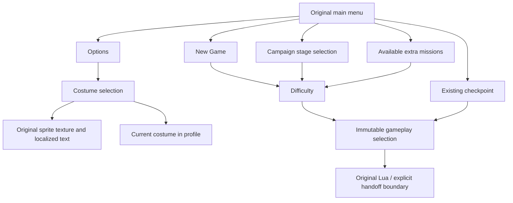

# Front-end menu selection and costume presentation

October 22, 2026. Static native reconstruction and implemented selection policy.
The original executable and assets remain read-only. Ghidra exports are local
ignored evidence, not vendored source. This document separates recovered rules
from the currently implemented subset.

## Recovered decisions

| Owner | Evidence | Decision |
|---|---|---|
| Main menu | `0x49a690`, `0x49b320` | Six rows exist. New Game, Continue, Stage Select, Options, extra missions, Quit. Stage/extra availability uses service achievement ID 13; Continue queries the Steam helper `0x470e50`, which returns true independently of checkpoint presence. |
| Navigation | `0x4c6570` | Wrap vertically and skip disabled rows. Pressed accept/cancel masks are `0x1010`/`0x2020`; repeating up/down are bits 24/25. |
| New Game | `0x49b320` states 2000–2300; `0x4d1910`, `0x4d2110` | Open difficulty directly. Easy, Normal and Hard exist; further entries depend on Steam achievement IDs 9/10. Initial cursor is system difficulty. Confirmation writes current record difficulty at global `0x12f45d8` and publishes main-menu status 1. No costume selector is inserted into this route. |
| Stage Select | `0x4c3de0`, `0x4c5210` | All six campaign stage entries are constructed. A selected stage opens difficulty; success stores stage at `0x95fca4`, child status 1, and parent status 3. |
| Extra missions | `0x4c3de0`, `0x470d70` | Enumerate IDs 0–63 whose availability byte at save task+`0x400` is set. This is Record+`0x3c`, not simple file presence. |
| Costume | `0x4e2970`, `0x470d90` | Original costume 0 always exists. Enumerate 1–11 only when save task+`0x440` availability bytes are set (Record+`0x7c`). Selecting a costume is independent from difficulty selection. |
| Options volume | `0x4d4c10` | Music/effects are bounded 0–256 and adjust by 16. The original also contains vibration, autosave, controls and subsidiary screens. |

Main-menu status 2 is Continue; status 7 returns to title. Quit uses the native
application-exit branch, not a fabricated Lua result.

The extra-mission route has an unresolved original mismatch: the recovered
native parent sets status **5** after its stage child succeeds, while the original
root bytecode recognizes **6** for `concept_mission`. `MenuSelection` preserves
5 and identifies the action explicitly; it does not silently rewrite the value.
The stage child stores the selection and returns, and its examined update does
not call a mission-start routine. Any bridge around this mismatch must be an
explicit compatibility decision, not an assertion that root handled it.

## Steam overrides and achievement availability

The subsequent save-service trace resolves an important distinction. Runtime
IDs 9, 10 and 13 are populated by Steam UserStats achievement callback
`0x4c2950`, not by checking whether DLC archives exist. The corresponding
interface context contains `STEAMUSERSTATS_INTERFACE_VERSION011`. The portable
menu therefore takes an explicit achievement snapshot (`MenuUnlocks`); a local
asset catalog must not silently enable those choices.

`0x4c31b0` unconditionally writes value 2 for costume IDs 1–5, and for extra
mission IDs 0–5, 16–21 and 32–37. Save-service operation 2300, requested by
`0x471aa0`, invokes this updater before the relevant menu children. This is the
Steam content policy the user expected: costume selection is not tied to the
ending bonus unlock. Availability of the extra-mission main entry remains a
separate achievement gate. See the profile persistence research for exact
initialization and serialization handling.

## Costume preview: sprites, independently from applying the costume

The native preview is a textured quad. `0x4e2600` loads `sprite.cos%02d` and
`sprite.text.costxt%02d`, resolves the texture through `0x5680a0`, and retains it
in row+`0x1e0`; text is retained at row+`0x1e4`. `0x4e2cc0` obtains the selected
row, binds that texture through `0x5649e0`, submits the quad through `0x564630`,
and flushes. The base costume uses sprite 445; 446 is the fallback while a
preview is unavailable. `extend/cosspr.cpr` contains the authored costume preview
images, consistent with this exact draw path.

Applying the costume is separate: `0x4e36f0` sends nonzero selections through
`0x471b00`, while the base selection reloads the normal player resource and
writes current costume zero. That resource substitution is not evidence of a
3D menu preview. The current port records the selected costume for gameplay
handoff; it does not claim to instantiate or animate the player model.

## Implemented ownership and limits

`MenuFlow` is native game policy under `src/game/`. It borrows `Profile`, takes
achievement availability, builds bounded presentation values, and emits
an immutable `MenuSelection`. Storage, rendering, audio and Lua remain owned by
their respective services. Up to 64 rows cover the original extra-mission bound.
Profile changes set a persistence notification; callers acknowledge only after
successful saving. Navigation and page changes allocate no heap storage.

Implemented options currently expose music, effects, costume and back. Original
vibration, control configuration, autosave and other subsidiary option screens
are not represented as working controls. The selection policy does not reproduce
the original transition animations or sound cues. Missing Continue data produces
an explicit explanatory page and no gameplay handoff; native file retry/error
messages require their own recovered localization/lifecycle implementation.
The current English labels are presentation defaults; original localized text
and asset labels belong at the presentation adapter.



## Process and reproducibility

Exports use the existing hash-bound unpacked image, established Ghidra project
and `research/tools/engine_slice.py`. Relevant exports:

- `pass-menu-01`: stage, options, costume initialization/update.
- `pass-menu-02`: native option draw, availability accessors and stage metadata.
- `pass-menu-03`: live record initialization and custom-menu ownership.
- `pass-menu-04`: exact costume preview draw/load/release paths.
- `reconstruction/profile/export2` and `export3`: difficulty initialization/update
  and profile field accessors.

For example, reproduce the preview slice with a fresh output name:

```sh
python3 research/tools/engine_slice.py pass-menu-preview-recheck \
  004e2cc0 004e2890 004e24e0 004e25e0 004e2580 004e2600
```

The algorithm follows the original game code, rather than substituting a generic
engine menu framework. Required C++ MCP design consultation retrieved Enum.3
and COPY.7; implementation consultation additionally retrieved SL.con.3.
In-process contract tests verify navigation, missing checkpoint rejection,
profile edits and selection outputs. Those tests do not establish native visual
fidelity or mission execution; native acceptance is recorded by the parent
startup integration slice.
